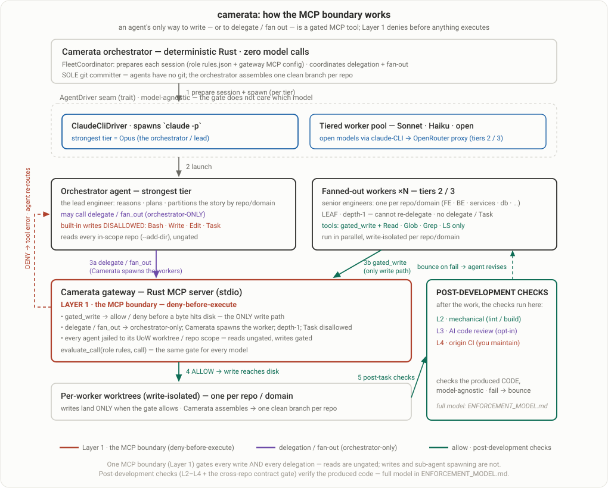

# The Camerata platform in depth

The [README](README.md) is the short summary of Camerata. This page is the long version: how an inspection runs and what it produces, how onboarding turns an inspection into governance, the governed development console, the governance gate, agent grounding, the architecture with the full crate graph and what is still staged. For how to use it screen by screen see [`docs/USER_GUIDE.md`](docs/USER_GUIDE.md); for how it works inside see [`docs/TECHNICAL.md`](docs/TECHNICAL.md).

## Contents

- [Why it exists](#why-it-exists)
- [What is real and what is staged](#what-is-real-and-what-is-staged)
- [The Codebase Inspection in depth](#the-codebase-inspection-in-depth)
- [What has changed recently](#what-has-changed-recently)
- [Onboarding: from inspection to governance](#onboarding-from-inspection-to-governance)
- [The governed development console](#the-governed-development-console)
- [The governance gate](#the-governance-gate-a-proven-seam-narrow-by-design)
- [The enforcement model](#the-enforcement-model-rules-to-layers)
- [Every agent is grounded in the real project](#every-agent-is-grounded-in-the-real-project)
- [Where this leads](#where-this-leads-staged-honestly-not-the-showcase)
- [Status](#status)
- [Try it](#try-it-runnable-demos)
- [Architecture in one breath](#architecture-in-one-breath)
- [The crate dependency graph](#the-crate-dependency-graph)
- [How an AI agent fits behind the gate](#how-an-ai-agent-fits-behind-the-gate)

## Why it exists

I set out to build Camerata because managing multiple AI agents across multiple projects through conversational chat alone became unwieldy, and frankly cognitively tiring. The governance itself worked: my rules held and the agent's code quality stayed high. But routines would fail silently, and I often wouldn't know a run had failed until I went and asked the agent about it. The missing piece was never the governance, it is already baked into my process. What was missing was a structured place for it to live: status and state visible and managed in a real interface, instead of buried in chat. That is what Camerata is: a structured management layer for orchestrating AI agents across any number of projects, while enforcing rules and deterministic gates to maintain code quality.

Camerata is an all-Rust, governed multi-agent engineering platform. The inspection is the most hardened part. Governed development (agents working through a deny-before-execute gate), the consumer app-builder and the architect surface are earlier: built and unit-tested, but not yet run live end to end. This page separates what you can reproduce today from what is staged, and the [Status](#status) section draws that line. The intended reader is the person who will clone the repo and check.

The fastest way to see it: `cargo run -p camerata-ui` (the Enterprise Cockpit, a Dioxus desktop app), then walk **Onboard repos → Governed Development**.

## What is real and what is staged

```text
 CAMERATA: WHAT'S REAL vs STAGED
 ════════════════════════════════════════════════════════════════════════════

 REAL: runs today, you can reproduce it
    ▸ CODEBASE INSPECTION: a deterministic scan plus an AI pass, calibrated and
      de-duplicated, exported as a PDF, a workbook and findings.json. Runs from
      the app or headless with `camerata inspect`. The most hardened part.
    ▸ GOVERNANCE GATE: deny-before-execute blocks a real `claude -p` agent's
      forbidden write before it touches disk. Fail-closed, provider-neutral,
      binary pass/fail (not an LLM grading an LLM).      ← the defensible wedge
      Proven standalone at the CLI (`camerata live-demo`); the deterministic
      gate self-check also runs in-app (Governed Development → Run gate self-check).
    ▸ BROWNFIELD ONBOARDING, end-to-end in the UI: per-repo detect → two-tier
      audit → calibrate/dedup → triage → baseline waivers + GitHub issues → apply.
    ▸ GOVERNED DEVELOPMENT CONSOLE: pull issues, create Units of Work and drive
      the full lifecycle (investigation → decisions → development → update-branch
      → PR → sign-off) with a project-aware chat assistant. Wired end-to-end in
      the UI; live-agent runs across the cycle are the validation milestone below.
    ▸ EVERY AGENT IS GROUNDED: on-demand READ access to the entire set of a
      project's repo clones + the project's rules; writes stay gated to one worktree.
    ▸ PROVIDER-AGNOSTIC RUNTIME: a native in-process ApiAgentDriver owns the
      MCP tool-use loop for any provider; the Claude CLI driver remains for the
      subscription path. Model registry combines Claude static entries with live
      OpenRouter discovery (free / tool-use / caching / vision flags, pricing).
    ▸ DOMAIN-AWARE MODEL TIERING: Strongest / Balanced / Fast fleet bands plus
      an optional Designer (vision) band; suggested profiles (Balanced, Max
      Efficiency, Max Quality, Custom); per-step helper models; L3 AI code review.
    ▸ CONSOLIDATED SETTINGS: one Settings nav item covering cross-project
      credentials (keychain-backed, masked) + Bombe animation controls, and
      per-project model configuration. The Rules page is rules-only.
    ▸ 30-member Rust workspace (29 crates and one maintainer tool) · 10,000+
      tests · governs its OWN source in CI.
    ▸ ADAPTER LADDER: a typed `camerata-client`, a first `camerata-mcp` server (stdio)
      and `camerata` (the CLI) as a real HTTP adapter all drive the same BFF surface
      the cockpit does. `camerata-ui` spawns `camerata-server` as a subprocess instead
      of embedding it. A `governance_events` audit trail (SQLite + `tracing`) makes
      every gate decision and lifecycle event readable after the fact.

 STAGED: built & tested, NOT yet validated live (please don't grade these as proven)
    ▸ The gate inside a full LIVE development cycle: the engine + UI are wired and
      unit-tested; a live model doing real multi-step work with layer-2 bounce-back
      has not been run end-to-end yet. This is the next milestone.
    ▸ Consumer "AI lead engineer" app-builder is a deterministic stub by default
      (real governed fleet opt-in: CAMERATA_LIVE_BUILD=1); Azure deploy = plan.
    ▸ Architect / board adapters tested against fake transports: 0 live calls.

 → Grade the wedge: the GATE is the proven core, and the governed dev console is
   built around it in the app. Everything still staged is labeled honestly below.
```

## The Codebase Inspection in depth

The inspection is the part of Camerata that has had the most hardening. It reads a codebase against the rule library and writes a report a client can act on.

### How an inspection runs

Point Camerata at one or more existing repositories (in the desktop app, or one checkout at a time with `camerata inspect`):

- **Per-repo stack detection** (languages and frameworks) and a **per-repo proposed ruleset** drawn from a corpus of 443 rules across 22 domains covering Rust, Python, Go, JavaScript and TypeScript, Java, C#, Ruby, SQL, Supabase and Firebase, plus the always-on security floor, the process rules and the agentic governance rules. Each repo is scanned against its own selected rules plus an always-on deterministic security floor. The domain-to-stack mapping is declarative data with a computable union, and a build gate (`req_h1_every_corpus_domain_is_emittable_by_some_stack`) fails the build if a corpus folder exists that no stack could ever select from, so a rule cannot sit in the corpus permanently unreachable.
- **A two-tier audit:** a deterministic mechanical scan (hardcoded secrets, raw-SQL concatenation, path escapes, plus clippy, ruff, eslint, semgrep and osv preview) and an AI architectural audit (missing auth on a write path, a service bypassing the repository layer, N+1, cross-boundary imports and the like), with severity and authority calibration, cross-rule dedup and snippet-to-line resolution.
- **Alternative recommendation, built into that same audit:** for every rule that carries more than one adopted alternative, the audit also picks the option it judges best fitting for this codebase (with reasoning you can inspect) and assesses the codebase against that option, not against every option at once. There is one hard exception, and it is load-bearing: if the option the repo actually follows is the one the rule itself names as its own degenerate or absent form (`violates = true` on that option), the rule's directive is **not** rewritten to match, and a finding is emitted instead. Without that guard, a codebase that is consistently incorrect reads as compliant, which is the single worst failure this engine has had. A rule with no default does not block you from proceeding: it is a hint that the audit will pick for you. Disagree with any recommendation and you can override it and rescan just the rules you changed, then accept the final selections into the ruleset.

The honest boundary: what this repository can show you is the engine's behavior on fixture repositories and the test suite that pins it. It does not claim, and the repo holds no published measurement of, how precise or complete the AI pass is on a large real-world codebase, so treat results at that scale as unproven until you have run it on your own code and reviewed the findings yourself.

### What a finding IS: five kinds, not a yes/no

A finding is not a yes/no. Every exported row carries an explicit `kind`, and the five kinds are different statements about the codebase, not five severities:

| Kind | What it says | Ships at |
|---|---|---|
| `defect` | An objective fault at a site. | Its calibrated severity, bounded by the rule's authored floor and ceiling. |
| `deviation` | A consistency violation against the convention this codebase itself predominantly follows: "2 of your 47 assessed endpoints do not use URI versioning." Numerator, denominator and the observed convention are structured fields, never prose to parse. | Capped at `medium` by default, because the cost of inconsistency is forward drift on future features rather than present risk. A rule may author `deviation_ceiling = "high"` where the domain genuinely compounds. |
| `convention_observed` | The codebase consistently follows a convention and there are zero violations. The inspection derives the decision set; governance later enforces it. | `info`, one row per rule. |
| `no_convention` | No convention has been adopted; the codebase is inconsistent with no clear majority. | `info`, exactly one row per rule, never N. |
| `not_assessed` | The rule was armed but could not be evaluated (tool failed, no files matched, the model declined). An honesty row, structurally distinguishable from "assessed and clean". | `info`. |

A row whose producer never assigned a kind exports as the explicit tag `unspecified`. It is deliberately **never** rendered as `defect`: an unmapped emission path has to be visible as a gap rather than silently counted as an accusation. The taxonomy is defined once, in `crates/api-types/src/audit.rs`, and the same discriminator reaches the PDF, the workbook and `findings.json`. Mechanics in [`docs/TECHNICAL.md`](docs/TECHNICAL.md) §6a.

### Run an inspection headless

`camerata inspect` runs the whole inspection pipeline in-process with no server and no UI, and writes the same product-export ZIP the cockpit's export button produces. It costs real model tokens, so the commands below work as a pair: size the repository and check the scan before you pay for anything.

```
cargo run -p camerata -- count <PATH>       # no model, no network: files and lines per language,
                                            # the number the inspection is priced on
cargo run -p camerata -- inspect --repo <PATH> --client "<CLIENT NAME>" --export <OUT.zip>
                                            # prints an estimate first; the ZIP holds the PDF
                                            # summary, findings.xlsx, findings.json and README.txt.
                                            # Also writes <PATH>/.camerata-scan-ledger.json.
                                            # Needs an Anthropic key (saved in the app, or in
                                            # ANTHROPIC_API_KEY). Add --max-cost-usd to cap spend.
cargo run -p camerata -- integrity-gate --ledger <PATH>/.camerata-scan-ledger.json
                                            # exit 0 = every required engine ran, every skip was
                                            # justified, every pipeline stage reconciles
                                            # exit 1 = the scan is degraded; do not grade it
                                            # exit 2 = the GATE could not run (ledger missing or
                                            #          unreadable) - deliberately NOT a pass
./scripts/self-measurement.sh               # the in-repo self-measurement gate: seconds,
                                            # deterministic, no network, no model calls
```

Without `--internal`, every inspection is a client engagement: it runs only on the Anthropic API with Anthropic models and never executes the repository's own code. `--internal` is for the maintainer's own development.

The workbook is partitioned by finding kind rather than being one flat sheet: **Index**, **All Findings** (defects, deviations and any unclassified row), **Deviations** (one row per rule, at the grain the deviation numbers are actually computed), **Conventions** (what this codebase already does well and consistently), the per-area sheets, **Dependencies**, **False Positives** and **Coverage** (what was checked, what could not be and which rules did not run). The PDF is the summary and deliberately does not carry every row; `findings.json` carries the whole non-false-positive row set, every kind included. Each finding carries a rough range of hours to fix, labeled as a rough range. Exit code 2 on the gate is the point of the design: a wrapper that read "the gate could not run" as "the gate passed" would be the same class of bug as a scan that reads "the tool did not run" as "the rule is clean".

## What has changed recently

Each item is short here. The detail is in [`docs/USER_GUIDE.md`](docs/USER_GUIDE.md) §11a and [`docs/TECHNICAL.md`](docs/TECHNICAL.md) §6a and §14.

- **Several repositories as one project.** `camerata inspect` takes `--repo` more than once (each with a `--repo-name`) and the desktop app takes several repos in a project. It is one scan, one report and one cache. Every finding names its repo, so two services that both have a `src/index.ts` stay apart, and each service's own conventions are read separately. A read-only **Patterns across services** section shows where services follow different conventions for the same rule. It is an observation, never a finding.
- **Run to completion.** A client report never contains a part that failed or did not run. A call that fails on network or server trouble (a dropped connection, a timeout, a 429, a 5xx) is retried. A reply that is cut off or malformed is not simply sent again: the part changes the request or fails visibly. Three transport failures in a row (or one login or billing failure) stop the run cleanly, and every part not yet sent is recorded as not run. A client export is written only when every part is complete; otherwise it is refused and the run stays open. A failure report and a failure panel for the operator list each failed part and why. They are never part of the client deliverable.
- **Saved runs and resume.** Every inspection is saved part by part. After an outage, a failed part or an interruption (a crash, a closed laptop), `camerata inspect --resume <RUN-ID|latest>` or the app's **Run what remains** sends only the model calls that were not stored as good. A resume refuses, in plain words, when the repository, the models, the rules or the Camerata version no longer match the saved run.
- **The spend limit.** There is no limit on a real run unless you set one (`--max-cost-usd`, or the app's spend limit field). The inspection prints an estimate first. Once a limit is set the run stops between passes when actual spend reaches it and says which parts did not run. The output cap on each model call is only a guard against a runaway reply: it is sized from the work and does not stop a run.
- **Model choice.** A model comes from the project's settings in the app or from `--model`, `--calibration-model`, `--fix-model` and `--clone-judge-model` on the command line and from nowhere else (no environment variable picks one). The built-in defaults are Claude Sonnet 5.5 for the audit and calibration, Claude Haiku 5.5 for the fix wording and the duplicate-code judge and Claude Opus 5.5 as the strongest tier of the model profiles.
- **Token-efficiency switches.** Every saving the product applies is on by default and can be switched off for one run with `--efficiency NAME=off`, to find out whether it caused a change. A run prints which were on. The names and what each does are in [`docs/TECHNICAL.md`](docs/TECHNICAL.md) (token efficiency, §6a).
- **Runtime end-of-life and vulnerability checks.** Beyond the lockfile audit, the runtime a repository declares (a Docker base image, `.nvmrc`, a manifest field) is checked against endoflife.date and the National Vulnerability Database. A release line past its end of life is a high finding. A version that is a range or a moving tag is never guessed: Coverage lists it as not checked.
- **Accuracy checks on client-facing text.** The model's replies are read as structured data, and a cut-off or malformed reply is never stored as good. The written explanation and the fix for each finding are checked against the evidence: a name the code does not contain is turned down, and the finding keeps its short text or the rule's authored remediation instead.
- **Exit codes.** `camerata inspect` exits 0 when the run is complete, 1 when it could not start or a resume was refused, 3 when the release gate refused the export, 4 when the spend limit stopped it, 5 when the AI service could not be reached and 6 when it is incomplete for another reason.

## Onboarding: from inspection to governance

In the cockpit, the inspection is the first half of onboarding, and the second half turns its results into governance:

- **Three triage tables** (Unresolved / Ignored / Tech debt) with free re-bucketing, then a **Process** step that turns each disposition into a durable artifact: ignores become reasoned baseline waivers, and every tech-debt item is filed as a real **GitHub issue** (the story).
- **Apply:** the chosen governance files (`AGENTS.md`, `CONVENTIONS.md`, a CI workflow for the mechanical rules and `.camerata/baseline.json`) are written to a governance branch and pushed, with the PR opened as a separate, deliberate step.

Onboarding's design principle is that it **emits stories and never does the development work itself**: a "resolve now" finding and up to two CI-wiring tasks (mechanical rules to off-the-shelf linters; architectural rules to custom checkers) each become a GitHub issue the development layer picks up. Walked screen by screen in [`docs/USER_GUIDE.md`](docs/USER_GUIDE.md); mechanics in [`docs/TECHNICAL.md`](docs/TECHNICAL.md).

### Report everything, enforce the delta

The audit shows **every** fault it found, but onboarding does **not** freeze your team on day one: arming snapshots the current violations into a committed `.camerata/baseline.json` as accepted pre-existing debt, and the gate then enforces only on **new or changed** code (the eslint/ruff/sonar baseline model). The match is by rule id plus a content fingerprint, so touching a baselined line un-baselines it: fix it or waive it. Suppression has two homes by intent: a per-line inline `// camerata:allow <RULE> -- reason` (reviewable in the diff, attributed by `git blame`) and the central `.camerata/baseline.json` for bulk, legacy and policy. Three rules always hold: a **reason is mandatory**, **everything is indexed centrally** and **stale waivers are surfaced** for removal.

## The governed development console

Once a project is onboarded, **Governed Development** is where work gets done:

- **Issue management:** pull all open issues across the project's repos, see the real Epic → sub-issue tree (via GitHub's sub-issues) and create a **Unit of Work** from any issue (or author a new story with an AI lead engineer that drafts against the actual codebase).
- **The UoW lifecycle:** each unit moves through **investigation → decisions → development → update-branch → PR → sign-off**, every phase persisted as structured data rather than ephemeral chat, with a model selector and a Stop control per run plus a deterministic **gate self-check** runnable in-app.
- **A project-aware chat assistant** grounded, per turn, in the rules catalog, the project's committed and selected rules, the live development state and the latest scan, with an explicit "what this assistant can see" panel and a hard no-fabrication contract.
- **Human-review escalations with resume:** when an agent's work meets the escalation condition of a rule you selected, the run *pauses* instead of failing: it checkpoints and surfaces in the **NEEDS YOU** queue, where you **Approve / Amend / Reject**. Approve and Amend re-spawn the agent from the checkpoint to continue; Reject reverts and stops. Which rules escalate is driven by the corpus, not hardcoded. See [`docs/ESCALATION_RESUME_DESIGN.md`](docs/ESCALATION_RESUME_DESIGN.md).

This console is wired end-to-end in the UI and unit-tested. The validation milestone (see Status) is a **live** model driving real multi-step development through the gate with layer-2 bounce-back: built, not yet exercised live.

## The governance gate: a proven seam, narrow by design

The technical wedge is **deterministic governance, not an AI verifier**: a real-time, deny-before-execute MCP tool-gateway that blocks a forbidden agent write before a byte hits disk, fail-closed and provider-neutral. Binary pass/fail, not "the model thinks this looks right."

**Proven today:** `cargo run -p camerata -- live-demo` runs a real `claude -p` agent locked to a single gated tool and shows the forbidden write denied before it reaches disk, in-process and fail-closed; a second, non-Claude driver shows the seam is provider-neutral ([`docs/PROVIDER_NEUTRALITY.md`](docs/PROVIDER_NEUTRALITY.md)). The captured proof is in [`docs/LIVE_RUN_VERIFICATION.md`](docs/LIVE_RUN_VERIFICATION.md); the gateway's jail tests (path and secret guards, planted-violation denial, fail-closed-on-unknown-session) run on every `cargo test`.

**The honest boundary:** this is proven as a **standalone denial** and as the in-app deterministic self-check. The gate has **not** yet been exercised inside a full **live** development cycle, where an agent does real multi-step work and the loop iterates to a result. The console for that cycle is built (above); validating it live is the next milestone. The gate currently enforces a high-strictness security tier (a `..`/`.git`/`.ssh` path guard, a secret-file guard and content heuristics for secrets, raw-SQL-concat and secrets-in-URLs; no AST yet). Deepening the enforced rule set behind the seam is incremental, not architectural.

## The enforcement model (rules to layers)

Rules are the single source of truth, but the layers consume them differently: **L3 reads any rule as prose instantly, while L2/L4 only enforce rules you wire into the pipeline** (mechanical rules need wiring; architectural rules need defining *then* wiring). That difference is why the layers can drift. The full model is in [`docs/ENFORCEMENT_MODEL.md`](docs/ENFORCEMENT_MODEL.md).

**The CI layer (L4) is scaffolded and suggested, not auto-enforced.** Apply *generates the files* (the CI workflow `.github/workflows/camerata-gates.yml` and the `.camerata/checks.toml` manifest, where mechanical rules get a runnable command from the rule's conformance hint and architectural rules get a commented TODO placeholder), and onboarding files wiring stories (GitHub issues) for both tiers. But generating the workflow file is not the same as enforcing it: the team reviews and commits the workflow, provisions the linters and writes the bespoke checkers for architectural rules. CI enforcement is opt-in and manually wired, never switched on automatically by apply.


## Every agent is grounded in the real project

A foundational invariant: **every agent that runs inside a project has on-demand READ access to the entire set of that project's repo clones** (a project can hold several distinct repos), plus the project's rules and a cheap always-on digest. It is not a context-less chatbot guessing at your stack: the story-author, the investigation agent and the developer agent can all open any file in any of the project's repos before they reason or write. **Writes stay gated:** the only write path is the gateway's tool, jailed to a single Unit-of-Work worktree, so cross-repo reading never widens what an agent can change. See [`docs/decisions/2026-06-25_all-agents-grounded-in-repo-and-rules.md`](docs/decisions/2026-06-25_all-agents-grounded-in-repo-and-rules.md).

Beyond the repos and rules, each project carries **soft context** that travels with its export: a **product brief** (what the product is, who it's for, the quality bar), **operating principles** (how a good engineer works here) and an accumulating, human-curated **project memory** (decisions, patterns, gotchas) that agents propose and you approve. All three feed the same grounding, so the agents read the *why* before the *what*. See [`docs/PROJECT_CONTEXT_LAYERS.md`](docs/PROJECT_CONTEXT_LAYERS.md).

## Where this leads (staged honestly, not the showcase)

These surfaces are built to varying depth and labeled in [Status](#status). They show where the architecture points; none is claimed proven end to end.

- **Consumer app-builder.** A non-technical owner refines an app with an AI lead engineer through a clarification-first intake (a Product Owner interviewed before any code is written). The data-and-flow spine is built and tested; the default lead engineer is a deterministic stub with the real governed fleet opt-in behind `CAMERATA_LIVE_BUILD=1`. See [`docs/CONSUMER_UX.md`](docs/CONSUMER_UX.md).
- **Architect / board surface.** Governed agents collaborate with a requirements owner through the tracker they already use (Jira, Azure DevOps or GitHub) and write provenance, gate results, PR links and sign-off back to the work item. The most code and most-tested adapter crate, but every adapter test runs against a scripted fake transport: no live board call yet. See [`docs/WORKTRACKER_INTEGRATION.md`](docs/WORKTRACKER_INTEGRATION.md).
- **Standing maintenance agent and a consented design corpus.** Keeping a published app alive (upgrades, security patches, key rotation) through the same governed loop, with prior builds making future ones faster. Designed and partially built.

## Status

A compiling, tested, all-Rust workspace, not a design folder.

**Verified at runtime (you can reproduce it):**

- A **30-member workspace** (29 crates and one maintainer tool, `tools/corpus-verifier`) with **10,000+ automated tests**, `clippy -D warnings` + `unsafe`-forbidden + fmt enforced in CI, governing its OWN source ([`docs/ENFORCEMENT.md`](docs/ENFORCEMENT.md)). A named **self-measurement gate** (`./scripts/self-measurement.sh`) runs ahead of the full suite; see [`docs/TECHNICAL.md`](docs/TECHNICAL.md) §6b.
- **The Codebase Inspection, end to end on fixture repositories:** per-repo detection and rule proposal, the two-tier audit with calibration and dedup, multi-repo projects, saved runs and resume, plus the PDF, workbook and `findings.json` export behind a release gate that refuses a deliverable carrying a secret (and an export that is refused while any part is unfinished).
- **Brownfield onboarding, end to end** on fixture repos: the triage tables, Process emitting baseline waivers and GitHub issues and Apply writing the governance branch.
- **The gate denies a real agent (standalone)** via `camerata live-demo`, with the gateway's verdict and jail tests covered by `cargo test`.
- **The governed development console:** issue pull + Epic/sub-issue tree, UoW creation and the full lifecycle UI, the project-aware chat assistant and the deterministic gate self-check, wired and unit-tested in-app.
- **Universal agent grounding:** full multi-repo read access + rule context, write gate unchanged (proven by the gateway jail tests).

**Built, but the accuracy and efficiency tests are still pending:**

- **The inspection's accuracy.** How precise and how complete the AI pass is on large real-world codebases has not been measured and published. The first accuracy test runs are still to come, and until they have run the AI findings are unproven at that scale.
- **The inspection's token efficiency.** The savings listed under token-efficiency switches are built and each can be switched off, but the effect of each on cost and on findings has not yet been measured across a set of real runs.

**Built and tested, but not yet validated live:**

- **The gate inside a live development cycle:** the engine and console are wired and unit-tested at the argv, jail and state level, but a live model doing real multi-step work with layer-2 bounce-back has not been run end-to-end.
- **The consumer app-builder default flow is deterministic, not model-driven** (real fleet behind `CAMERATA_LIVE_BUILD=1`; Azure deploy is a plan).
- **The architect surface has made zero live board calls:** the `WorkItemProvider` port, the Jira, ADO and GitHub adapters and the sync policy exist with an end-to-end flow test against scripted fakes only.
- **Scheduled routines:** the routine model, the in-app auto-fire scheduler, AI-authored operational prompts, the dashboard, run history and blocked-run review are built and unit-tested. Today a fire exercises the gate against representative calls (to prove deny/allow); live execution of a routine's own prompt is not yet wired. This is the structured, visible home for routines that motivated Camerata (see the opening).

**Still ahead:** the accuracy and efficiency test runs; the live development-cycle validation; live wiring for the worktracker adapters (OAuth, webhooks) and the Azure deploy adapter; the dev-engine ingest of "resolve now" stories; and deepening the gate's rule set (more enforcement arms, AST-level checks).

## Try it (runnable demos)

The first group needs nothing but a Rust toolchain: no network, no credentials and no model call.

```
cargo run -p camerata-ui                    # the Enterprise Cockpit (Onboard repos → Governed Development)
cargo run -p camerata -- acceptance         # the planted-violation scenario against the gate, in-process
cargo run -p camerata -- gate-probe         # the gate-loop GO/NO-GO on a story (both layers, no claude)
cargo run -p camerata -- count <PATH>       # size a repository the way an inspection counts it
cargo run -p camerata -- worktracker-demo   # architect surface (against a fake board transport)
cargo run -p camerata -- maintenance-demo   # the standing ops agent (recommendation, approval gate, rotation)
cargo run -p camerata -- deploy-demo        # the draft→publish gate, a local deploy and the Azure az-CLI plan
```

These start a real `claude -p` agent, so they need the Claude Code CLI installed and signed in, and they use your subscription:

```
cargo run -p camerata -- live-demo          # the gate denies a real claude -p agent's forbidden write
cargo run -p camerata -- po-demo            # a PO form → lead engineer → governed fleet → cargo build/test
```

With a `camerata-server` already running (started automatically by the UI, or standalone via `cargo run -p camerata-server`), the adapter ladder is drivable directly:

```
cargo run -p camerata -- stories            # CLI HTTP adapter: list stories over the BFF
cargo run -p camerata -- run <RUN_ID>       # (also: uows / assign / start-run / events / recent-events)
cargo run -p camerata-mcp                   # MCP server over stdio: the same verbs as MCP tools for any MCP host
```

The inspection commands are under [Run an inspection headless](#run-an-inspection-headless).

## Architecture in one breath

- **Everything load-bearing is Rust** (no TypeScript core; that early design was abandoned on evidence). `camerata-server` is one Tokio process that is the server, the brain and the gate; the Dioxus cockpit (`camerata-ui`) spawns it as a subprocess (health-polled, killed on exit) rather than embedding it in-process.
- **The adapter ladder:** a pure-serde contract leaf (`camerata-api-types`, zero `camerata-*` deps) sits under a typed HTTP client (`camerata-client`), a first MCP adapter (`camerata-mcp`, stdio) and the CLI's HTTP subcommands (`camerata`). Any of them, or the cockpit, drives the exact same BFF surface. See [`docs/ARCHITECTURE.md`](docs/ARCHITECTURE.md).
- **Core:** `camerata-core` holds the domain types and ports (roles, tasks, coordination) and makes zero model calls; `camerata-orchestrator-core` classifies the effect of a decision without asking a model.
- **Governance gateway:** a Rust MCP server. Every agent tool call routes through it; it allows or denies before anything executes (deny-before-execute). Denials and lifecycle events (`gate_deny`, `gate_allow`, `run_started` and the like) are recorded to a `governance_events` audit trail, correlated by run id and readable via API, CLI, MCP and UI.
- **Agent layer:** short-lived agents, one per role, scoped by prompt, allowed tools, path boundaries and rule subset. Each gets read access to all of the project's repos; writes are jailed to its worktree. Two drivers: `ClaudeCliDriver` (subscription path, drives `claude -p`) and `ApiAgentDriver` (in-process, owns the MCP tool-use loop, works with any OpenRouter-listed or Anthropic API provider) over the `LlmPort` seam (`camerata-llm`).
- **Model registry:** Claude static entries merged with live OpenRouter discovery. Each entry is flagged for free tier, tool-use support, prompt caching, vision capability and pricing. Fleet routing is domain-first (visual work to the Designer band) then by difficulty within the Strongest / Balanced / Fast ladder.
- **Persistence:** a versioned store (SQLite now, Postgres later behind the same trait seam) so every user and AI edit is saved with full history, plus the `governance_events` audit trail above.
- **UI:** a Dioxus desktop app whose Bletchley Bombe background is an AI-activity indicator: it powers up (lights up, rotors spin) only while genuine AI or heavy work is in flight (chat turns, authoring, investigation, live runs, scans and audits) and powers down to a dim idle the rest of the time. Trivial fetches never animate it. Tabular surfaces use the [chorale](https://crates.io/crates/chorale-core) table library.

## The crate dependency graph

The real `[dependencies]` graph between the workspace members: 29 crates and one maintainer tool, a strict DAG the compiler enforces (a cycle between crates does not compile). Read it from the bottom up: `camerata-core`, `camerata-api-types` and the other leaf crates depend on nothing in the workspace; checks, agents and the model stack build on them; `camerata-server` is the composition root; `camerata-ui`, `camerata` (the CLI) and `camerata-mcp` are thin binaries on top. The README carries a compact version of this graph.

The diagram is generated from `cargo metadata`, with one arrow per direct normal dependency, and a test (`crates/rules/tests/docs_crate_graph.rs`) fails when it disagrees with the manifests. Dev-dependencies are not drawn.

```mermaid
%% Generated from `cargo metadata --no-deps` (normal [dependencies] edges only, one arrow per direct edge).
%% Dev-dependency edges are not drawn. camerata-test-env appears only as a dev-dependency, so it has no arrows.
graph TD
    agent["camerata-agent<br/>agent drivers"]
    api_types["camerata-api-types<br/>wire contract, no camerata deps"]
    app_core["camerata-app-core<br/>headless app orchestration"]
    camerata_check["camerata-check<br/>architectural checks for a client CI"]
    checks["camerata-checks<br/>layer 2 checks and inspection checkers"]
    cli["camerata<br/>cli: the camerata binary"]
    client["camerata-client<br/>typed HTTP client"]
    core["camerata-core<br/>domain types and ports"]
    corpus_verifier["corpus-verifier<br/>maintainer tool"]
    deploy["camerata-deploy<br/>deploy targets"]
    fleet["camerata-fleet<br/>tiered governed run"]
    gateway["camerata-gateway<br/>layer 1 gate, MCP"]
    intake["camerata-intake<br/>lead engineer intake"]
    linter_registry["camerata-linter-registry<br/>linter rule-id lists"]
    liveness["camerata-liveness<br/>stall detection"]
    llm["camerata-llm<br/>model providers, registry, usage"]
    maintenance["camerata-maintenance<br/>standing ops agent"]
    mcp["camerata-mcp<br/>MCP server over stdio"]
    orchestrator["camerata-orchestrator-core<br/>confidence-dial engine"]
    persistence["camerata-persistence<br/>versioned store, governance events"]
    preview["camerata-preview<br/>live preview adapter"]
    rules["camerata-rules<br/>rule corpus and loader"]
    scaffold["camerata-scaffold<br/>app skeleton scaffolder"]
    secrets["camerata-secrets<br/>secret detector and redactor"]
    server["camerata-server<br/>Axum server, composition root"]
    source_check["camerata-source-check<br/>rule source freshness"]
    test_env["camerata-test-env<br/>test support only"]
    ui["camerata-ui<br/>Dioxus desktop cockpit"]
    ui_core["camerata-ui-core<br/>headless UI logic"]
    worktracker["camerata-worktracker<br/>work item port and adapters"]

    agent --> api_types
    agent --> core
    agent --> liveness
    agent --> worktracker
    app_core --> api_types
    app_core --> checks
    app_core --> core
    app_core --> fleet
    app_core --> liveness
    app_core --> worktracker
    camerata_check --> checks
    camerata_check --> rules
    checks --> core
    checks --> liveness
    checks --> rules
    checks --> secrets
    cli --> agent
    cli --> api_types
    cli --> checks
    cli --> client
    cli --> core
    cli --> deploy
    cli --> fleet
    cli --> gateway
    cli --> intake
    cli --> maintenance
    cli --> rules
    cli --> server
    cli --> source_check
    cli --> ui_core
    cli --> worktracker
    client --> api_types
    corpus_verifier --> core
    corpus_verifier --> rules
    fleet --> agent
    fleet --> checks
    fleet --> core
    fleet --> gateway
    fleet --> intake
    fleet --> rules
    gateway --> agent
    gateway --> core
    gateway --> rules
    gateway --> secrets
    intake --> api_types
    intake --> core
    llm --> api_types
    mcp --> api_types
    mcp --> client
    orchestrator --> gateway
    orchestrator --> secrets
    persistence --> api_types
    persistence --> core
    rules --> core
    server --> agent
    server --> api_types
    server --> app_core
    server --> checks
    server --> core
    server --> fleet
    server --> gateway
    server --> intake
    server --> liveness
    server --> llm
    server --> orchestrator
    server --> persistence
    server --> rules
    server --> scaffold
    server --> secrets
    server --> ui_core
    server --> worktracker
    source_check --> rules
    ui --> api_types
    ui --> ui_core
    ui --> worktracker
    ui_core --> api_types
```



Notes on reading it:

- `camerata-api-types` is the floor of the wire contract: a pure-serde leaf with no workspace dependencies, so `camerata-app-core`, `camerata-ui-core`, `camerata-llm` and `camerata-client` all depend on it directly with no cycle between each other.
- `camerata-client` is the shared typed-HTTP plumbing under both `camerata-mcp` and the CLI's HTTP subcommands. The CLI also links `camerata-server` directly for the in-process `inspect` pipeline.
- `camerata-ui` does not depend on `camerata-server`: it spawns the `camerata-server` binary as a subprocess.
- `camerata-check` is the standalone binary that carries the architectural checkers into a client's own CI, with no server in it.
- `camerata-test-env` is test support only. It is a dev-dependency of the crates that change environment variables in their tests, so it has no arrow here.
- `corpus-verifier` is the maintainer tool that promotes rules from grounded to verified. No app crate depends on it.
- `camerata-linter-registry`, `camerata-preview`, `camerata-deploy` and `camerata-maintenance` have no workspace dependencies. The CLI links `camerata-deploy` and `camerata-maintenance` for the demos.

The crate map and the runtime model are in [`docs/TECHNICAL.md`](docs/TECHNICAL.md) §1.

## How an AI agent fits behind the gate

The orchestrator makes zero model calls; it prepares a session and spawns an agent behind the `AgentDriver` seam. Two drivers implement that seam: `ClaudeCliDriver` (drives `claude -p` subprocesses, used with the Claude subscription path) and `ApiAgentDriver` (in-process, owns the MCP tool-use loop for any provider reachable via the Anthropic API or OpenRouter). Either way, the agent can READ the project's repos but its built-in write tools are disallowed. Its only way to write is the gateway's MCP tool, which denies or allows each write before it executes (layer 1). Allowed writes land in an isolated worktree; layer-2 checks bounce failures back. The gate is provider-neutral and model-agnostic.


