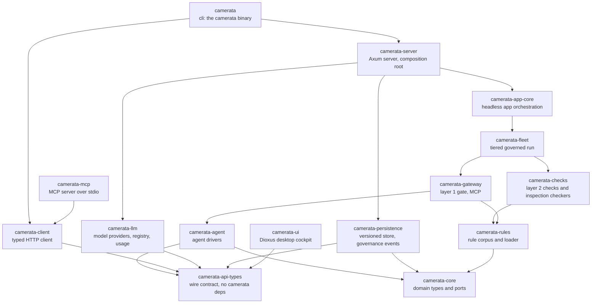

# Camerata Orchestrator

[](https://github.com/zernst3/camerata-orchestrator/actions/workflows/ci.yml)

Camerata is a governed engineering platform for working on code with AI. It is built on one library of written, versioned rules, and two products use it: the **Codebase Inspection**, which reads a codebase against the rules and reports what it finds, and the **governed development console**, where AI agents change code only through a deterministic gate that enforces the same rules.

The rules are plain TOML files in [`crates/rules/principles/`](crates/rules/principles/), so you can read exactly what Camerata checks. The library holds 443 rules across 22 domains, each one versioned and locked by content hash so no rule can change silently. Every finding names the rule it was raised under, and rules point to the standard they rest on (a published style guide, a security reference or a vendor's own documentation). [`docs/RULES_REFERENCE.md`](docs/RULES_REFERENCE.md) documents the format and [`docs/RULE_AUTHORING.md`](docs/RULE_AUTHORING.md) the authoring workflow.

## The Codebase Inspection

Two kinds of check run. A deterministic scan answers the questions that have a provable answer: hardcoded secrets, SQL built by string concatenation, file paths that escape their directory, plus the project's own linters. An AI pass handles the judgment calls, such as a write path with no authorization check or a service that bypasses the repository layer. No AI-raised candidate becomes a finding until it has passed severity calibration and de-duplication, and anything the engine is unsure of is held for a person to decide. What a client gets:

- **Findings in five kinds, not a yes/no:** a defect, a deviation from the convention the codebase itself follows, a convention it follows well, a place where no convention exists and a rule that could not be assessed. Each names its rule and the standard behind it, and carries a rough range of hours to fix.
- **A PDF summary, an Excel workbook and `findings.json`** in one ZIP marked "Confidential, prepared for" the client. A release gate scans every file first and refuses the export if one secret survives.
- **Several repositories as one project.** Every finding names its repo, each service's conventions are read separately and a **Patterns across services** section shows where services differ. It is an observation, never a finding.
- **Run to completion.** A call that fails on network or server trouble is retried, an outage stops the run cleanly and a client export is never written with a part that failed or did not run. Every inspection is saved part by part, so after any interruption **Run what remains** (or `camerata inspect --resume`) sends only the work that is left.
- **Accuracy checks on the client-facing text.** The explanation and the fix written for each finding are checked against the code, and a name the code does not contain is turned down.
- **Runtime end-of-life and vulnerability checks** on the runtime a repository declares, beyond the lockfile audit.
- **Cost you control.** An estimate is printed first, the spend limit is off unless you set one, models come from project settings or command-line flags only (defaults: Sonnet 5.5, Haiku 5.5 and Opus 5.5) and every token-saving measure can be switched off for a run.

**The honest boundary.** What this repository can show you is the engine's behavior on fixture repositories and the test suite that pins it. It does not claim, and the repo holds no published measurement of, how precise or complete the AI pass is on a large real-world codebase, so treat results at that scale as unproven until you have run it on your own code and reviewed the findings yourself. [`DATA_HANDLING.md`](DATA_HANDLING.md) covers what leaves your machine and how to delete what stays.

## The governed development console

- **Agents work behind a deterministic gate.** Every agent tool call goes through a Rust MCP gateway that allows or denies it before anything executes. A forbidden write is blocked before a byte reaches disk. The gate is fail-closed, provider-neutral and binary pass or fail, not an AI grading an AI.
- **Four enforcement layers consume the same rules:** the gate before a write, mechanical checks after a task, an optional AI code review and the CI files Camerata generates for the team to own ([`docs/ENFORCEMENT_MODEL.md`](docs/ENFORCEMENT_MODEL.md)).
- **From work item to pull request.** Issues become Units of Work that move through investigation, decisions, development, update-branch, PR and sign-off. Each phase is saved as data, and a run that meets a rule's escalation condition pauses for a person to approve, amend or reject.
- **Every agent is grounded.** It can read all of a project's repositories and its rules. Writes are jailed to one worktree.
- **Onboarding turns an inspection into governance.** Triaged findings become baseline waivers, GitHub issues and governance files. Camerata reports everything but enforces only on new or changed code.

## How it is built

Everything load-bearing is Rust. `camerata-server` is one Tokio process that is the server, the brain and the gate. The Dioxus desktop cockpit spawns it as a subprocess, and the command-line tool, an MCP server and a typed client drive the same HTTP surface. Agents run behind the gateway through two interchangeable drivers: the Claude CLI and an in-process driver for any Anthropic API or OpenRouter model. The main crates, with an arrow where one depends on the other:



The full graph of all 30 workspace members is in [`PLATFORM.md`](PLATFORM.md#the-crate-dependency-graph).

## By the numbers

I architected Camerata and orchestrated its build: supervised AI agents wrote the code, working under the same deterministic governance rules Camerata itself enforces. Every architectural decision, review gate and scope call is mine. In roughly four and a half months:

| | |
|---|---|
| Rust | over 500,000 lines of Rust across 29 crates and one maintainer tool, including tests |
| Tests | 10,000+ automated tests; roughly half the lines are test code |
| Test quality | mutation testing on the checks crate caught 97.9% of deliberately injected faults in an earlier run ([`docs/MUTATION_TESTING.md`](docs/MUTATION_TESTING.md)) |
| Rule library | 443 rules across 22 domains |
| Commits | 2,400+, and every push to the main branches runs formatting, zero-warning lints and the full test suite in CI |

The discipline matters more than the numbers. A finding a client cannot verify is worse than a missed one, so every deterministic detector ships with a positive test and a "safe twin" that proves it stays quiet on the look-alike case. Wherever a question has a provable answer, code answers it and the AI covers only the judgment calls. Client secrets are redacted before any code reaches a model, and the release gate checks every export.

## Try it

```
cargo run -p camerata-ui                    # the cockpit (a Dioxus desktop app): Onboard repos, then Governed Development
cargo run -p camerata -- acceptance         # the gate denies planted violations, no network and no model
cargo run -p camerata -- count <PATH>       # size a repository the way an inspection counts it, no model
```

A real inspection costs model tokens and needs an Anthropic key (saved in the app, or in `ANTHROPIC_API_KEY`). Use `--max-cost-usd` to cap the spend:

```
cargo run -p camerata -- inspect --repo <PATH> --client "<CLIENT NAME>" --export <OUT.zip>
```

To see a report without spending anything, `cargo test -p camerata-server --test generate_sample_report -- --ignored` builds one from a hand-built fixture (not a scan of real code) into `sample-report/` and needs Typst 0.15 on your `PATH`. More commands are in [`PLATFORM.md`](PLATFORM.md#try-it-runnable-demos).

## Status

The Codebase Inspection and brownfield onboarding are built and run end to end on fixture repositories, and the gate is proven standalone against a real agent. **The V1 accuracy and efficiency tests are still pending:** how precise and complete the AI pass is on large real-world codebases, and what each token-saving measure does to cost and to findings, have not been measured. The governed development console is wired end to end and unit-tested, but a live model doing multi-step work through the gate has not been run yet. The consumer app-builder, the architect surface for Jira, Azure DevOps and GitHub boards and the standing maintenance agent are earlier still. [`PLATFORM.md`](PLATFORM.md#status) separates what is proven from what is staged.

## Where to read next

| Read | For |
|---|---|
| [`PLATFORM.md`](PLATFORM.md) | The platform in depth: the inspection, onboarding, the governance gate, the enforcement model and the full crate graph |
| [`docs/USER_GUIDE.md`](docs/USER_GUIDE.md) | How to use it, screen by screen |
| [`docs/TECHNICAL.md`](docs/TECHNICAL.md) | How it works inside: the gate, the scan pipeline, agent grounding, persistence |
| [`docs/OVERVIEW.md`](docs/OVERVIEW.md) | The high-level map of the whole system in one sitting |
| [`docs/ARCHITECTURE.md`](docs/ARCHITECTURE.md) | The all-Rust stack, top to bottom |
| [`DATA_HANDLING.md`](DATA_HANDLING.md) | What leaves your machine during an inspection and how to delete what stays |
| [`CONTRIBUTING.md`](CONTRIBUTING.md) | How to contribute |
| [`docs/decisions/`](docs/decisions/) | The design-decision records |
| [`docs/VISION.md`](docs/VISION.md) | The north star and where the architecture leads |

## Family

- camerata-ai: the conventions engine the corpus format originates from. The corpus is vendored into this repo at `crates/rules/principles/`, so the workspace is self-contained; override with `CAMERATA_CORPUS_PATH`.
- chorale: the headless, virtualized Dioxus and Leptos table library used for tabular surfaces.
- this repo: the conductor that leads the ensemble.

## License

Source-available under the [PolyForm Noncommercial License 1.0.0](LICENSE). The code is fully readable, and noncommercial use (study, evaluation, personal and research projects) is permitted. Commercial and competing use is reserved by the copyright holder, Zachary Ernst. This is a deliberate choice over a permissive license: a license can be loosened later but never tightened, so it starts reserved.
