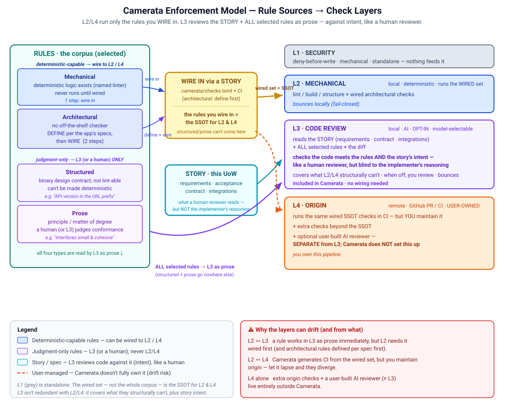

# Camerata: end-to-end user guide

This is the "I have a repo new to Camerata: where do I start and how do I take it all
the way through?" walkthrough, and the canonical source the **in-app assistant** (the chat bubble) answers from. Keep it accurate to what's actually shipped; an
assistant that describes a feature that doesn't exist undercuts the whole point.

> Status (updated 2026-11-18): the Codebase Inspection (the audit of an existing repository, ending
> in a client package) and the governed development flow are both built and live. A new project is a
> **client engagement**: it runs only on the Anthropic API with first-party Anthropic models, and it
> refuses the **CLI** backend and any OpenRouter model before any file is read or any model is called.
> The client's own build tooling (the `cargo clippy` scan preview and the dev loop's layer-2 checks)
> runs only when the operator opts in for that engagement. The operator turns **Client engagement**
> off per project for the operator's own development. Credentials are an **Anthropic API key** and a **GitHub
> token**, both set in Settings (keychain-backed, shown masked); an OpenRouter key is for the
> operator's own development only. An inspection has two finders: the **engine finder** (the
> rule by rule scan, the current default) and the **agent finder** (one model reviews each part of
> the code, section 3b). Both feed the same review stage (a tree, an escalation queue, an Engine
> Check and a group reviewer, section 3a) and the same client package (PDF, Excel workbook,
> `json/inspection.json` and `csv/tickets.csv`). Each feature is described in the section where it applies.
> Sections 19 to 22 and the appendix are reference material: the keyboard shortcuts, a glossary of
> the words on screen, a "how do I" index and troubleshooting.

### Contents

| Section | What it covers |
|---|---|
| 0 | Credentials, the backend (CLI or API), launching the app |
| 1, 2 | Projects, the nav and its pages |
| 2a | The guided inspection (walkthrough) |
| 3 | Onboarding a repo: stack, rules, the scan, triage, apply, CI wiring |
| 3a | The review screen: Tree, Escalations, Engine Check, Flat view, Settings |
| 3b | The finder: agent or engine, and how to run Opus 5.5 as finder and group reviewer |
| 3c | Running a scan: estimate, spend limit, live cost, approve and continue, run to completion |
| 4 to 5a | The Rules view, repo paths, deleting a client's source |
| 6 to 6b | Governed development, L3 code review, Design Canvas |
| 7 to 10 | The rules that govern it, the assistant, updates, single-rule editing |
| 11, 11a | Deep report, the Codebase Inspection package, saved runs and resume |
| 12 to 18 | Feature flags, rule types, CI gates, version pinning, usage meter, Settings, Routines |
| 19 | Keyboard shortcut reference |
| 20 | Glossary of on-screen terms |
| 21 | How do I... (task index) |
| 22 | Troubleshooting: what a message means and what to do |
| Appendix | Screen, control and the section that covers it |

---

## 0. Credentials (the only setup)

Credentials live in **Settings** (the dedicated nav item, not the old gear popup). They are stored
in the system keychain and shown masked in the UI. Two credentials, both optional depending on which
paths the operator uses:

1. **GitHub token**: for push/PR operations and Issues read/write. One token serves every repo it
   can reach. The operator can also set it via environment variable for scripted launches:
   ```bash
   export CAMERATA_GITHUB_TOKEN=github_pat_xxx
   ```
2. **Model provider**: the credentials behind each access path, both optional depending on which
   path a project uses:
   - **Claude CLI (subscription):** the `claude` CLI on the PATH, logged in. Camerata drives it as
     a subprocess (`ClaudeCliDriver`). No key needed. Set `CAMERATA_LIVE_BUILD=1` to activate the
     live fleet.
   - **API path (OpenRouter or Anthropic API):** set an **OpenRouter API key** in Settings, or an
     **Anthropic API key** in Settings (Chat backend, API). The Anthropic key saved in the app is
     the one every model call uses, in the app and in the `camerata` command line, and a key the operator saves or replaces
     takes effect on the next call with no restart. The `ANTHROPIC_API_KEY`
     environment variable is only a fallback (for CI and existing `.env` setups) and is used only
     when no key has been saved in the app. The `ApiAgentDriver` owns the MCP tool-use loop
     in-process and works with any provider the model registry discovers (Claude, and every
     OpenRouter-listed model flagged for tool use).

   Each saved credential row has a **Remove** button. A value saved in the app takes precedence
   over its environment variable, so remove it there to hand the credential back to the
   environment. A GitHub token saved or removed in Settings is used immediately, with no restart.

   **macOS Keychain prompt.** The first time Camerata reads a saved credential after the operator launches
   it, macOS may ask whether the app may use the operator's confidential information. Choose **Always
   Allow** so it does not ask again. The app reads the Keychain once per launch and then keeps
   the values in memory (saving or removing a credential updates both). A build that is not
   code-signed looks like a new app to macOS after every rebuild, so the prompt returns after
   each rebuild; a signed build avoids that.

   These credentials are global (one keychain entry each, shared by every project); which path is
   actually **active** is a separate choice made **per project**, described in the next section.

Launch:
```bash
cargo run -p camerata-ui
```
The desktop app opens with its embedded server; the topbar shows the live connection status.

### Backend: CLI vs API (per project)

Every project-scoped AI call, including the brownfield scan, the alternative-recommendation pass,
the disagreement rescan, and the governed dev loop, is driven by that **project's own Backend
setting**, not a global switch. Set it per project in that project's **Settings**:

| Option | How it works | API key needed? |
|--------|-------------|-----------------|
| **CLI** (development only) | Spawns the `claude` CLI using the operator's logged-in Claude Code subscription | No |
| **API** | Calls the Anthropic Messages API directly | Yes |

A new project starts on **API** as a client engagement, and a client engagement refuses **CLI**.
The operator picks **CLI** only for the operator's own development, after turning off **Client engagement**.
API is the backend for client work because it is metered, single-party and nameable in a contract,
which a subscription running on the operator's own machine is not.

If a project is set to **API** and no Anthropic API key is configured, AI steps on that project
(scan, decomposition, clarification questions, story and design authoring, diagrams, mockups,
escalation chat, code review) do not run and report why; they never fall back to the Claude Code
subscription: the scan/audit page shows an **"AI review did not run"** banner explaining why, and
the deterministic security floor still runs on its own. To unblock it, add an **Anthropic API
Key** in **Settings** (stored in the OS keychain, never in files or the repo; it takes effect on
the next run, no restart needed) or switch that project's backend back to **CLI**.

**Chat backend (a separate, global setting).** One global toggle in **Settings**, labeled **Chat
backend**, controls only the project-less chat assistant (the chatbox that lives outside any
project). It does not affect any project's scan, recommendations, rescans or dev loop: those
always resolve from that project's own Backend setting above, never from the chat setting.

**Local-first:** Camerata stores only configs + pointers (JSON in the operator's OS app-data dir:
`projects.json`, `settings.json`, and one `onboarding-draft-<project>.json` per project); the repo code lives on the operator's own
machine. Each repo a project references must resolve to a local git checkout (see §5).

---

## 1. Projects (the container for everything)

A **project** holds its repos, ruleset and onboarded state. From the **Projects** home the operator can:
- **Create** a project (just a name to start).
- **Open** one (the cockpit's four+1 views only appear inside a project).
- **Export** the open project: a single, **path-free** `camerata-project-<name>.json` containing
  only that project's repos (`owner/repo`), ruleset and which repos are onboarded. It does **not**
  include local paths or the operator's workspace settings.
- **Import** a project config; it **upserts** into the operator's local projects. If the operator already has a
  project with the same name, Camerata **warns before overwriting**. The operator's own workspace settings are
  never touched. After import the repos have no local paths yet; resolve them in the Rules view (§5).

**Project config vs. project data:** the exported JSON contains only the project's transferable
config (repos, ruleset, onboarded state, tier map). Units of Work, the story spine, onboarding
drafts, and local repo paths are **local to each developer** and are never included in an export.
UoWs represent in-progress dev-lifecycle state (branch, stage, run history, decisions, sign-off) and
are machine-local; transferring them would produce overlapping work across developers. When the operator
imports a project on a new machine, the operator starts with no UoWs; they accumulate as the operator works.

---

## 2. The cockpit views

Inside a project the nav shows, left to right: **← Projects** (back to the Projects home), then
**Onboard repos · Governed Development · Rules · Routines · Repository Workspace · Design Canvas ·
Docs · Settings**. On the right of the nav row sit the token usage meter (§16) and the in-app
assistant bubble (§8). Before any project is open, the Projects home has its own small nav:
**Projects · Docs · Settings**.
- **Onboard repos**: bring a repo under governance (§3).
- **Governed Development**: the work control surface: pull work items from a tracker (or author a new
  story from a blank UoW with AI), create a Unit of Work (UoW) from one, then run governed development
  on it with the human↔AI clarify loop, comment back and sign off (§6). There is no settings button
  on this page; all configuration lives in Settings (below).
- **Rules**: manage the project's ruleset after onboarding + the repo-path health check (§4, §5).
  Rule tables are grouped by domain, collapsed by default; clicking a row opens a rule-detail modal.
  This page is rules-only: model configuration has moved to Settings.
- **Routines**: schedule governed runs (templates, an in-app auto-fire scheduler, run history, and
  blocked-run review). Full walkthrough in §18.
- **Repository Workspace**: the local clones: clone status, branch and ship (push + PR) for dev work.
  If no workspace folder is chosen yet but a repo is already linked to a local folder, the page
  suggests that repo's parent folder as the workspace folder, one click to accept. The git panel's
  Sync row has **Pull, Push and Fetch all** (fetch all origin branches with no merge or checkout).
  The branch list scrolls once it gets long, and always shows main (or master) first.
- **Design Canvas**: co-design a work tree with the AI and publish it as a batch of issues (§6b).
- **Settings**: all configuration in one place, split into two clearly-labeled scopes (see §17). The
  Soft-context group also holds the **Work hierarchy** builder (define the operator's work-item types and nesting).
- **Docs**: the in-app documentation viewer. It has two buttons, **User Guide** and **Technical**,
  which show this guide and the technical reference (the same two files the assistant reads).

---

## 2a. Guided inspection (the walkthrough)

A short guided mode for the Inspection, from an empty app to an exported package. A small popup
points at the real control on screen (with an arrow, and the control lightly highlighted), says in a
sentence or two what it does, and shows "Step N of 12" with **Back**, **Next** and **Exit**. It
never clicks, types or decides anything for the operator.

**Turning it on**
- The **Guided inspection** switch on the **Onboard repos** screen, where an inspection starts. On
  means the walkthrough runs alongside the real flow; off hides it. The switch is remembered for
  the operator on this computer (it is an app setting, not part of any project, so a project export never
  carries it).
- On a first launch with no projects, the Projects home offers it once: "Want a guided first
  inspection?" **No thanks** is remembered and the offer is not made again; the switch stays
  available.
- **Start walkthrough** in the **Help** menu, or the same line in the command palette (Ctrl+K or
  Cmd+K), starts it again from step 1 at any time.

**How it behaves**
- Most steps move on by themselves when the operator does the thing (open a project, press the audit button).
  If the operator starts it with the thing already done (from inside an open project, step 1 is already
  satisfied), it skips that step. **Next** skips ahead, and is how the steps that only explain are
  passed. **Back** goes back.
- If the control is not on screen (the operator is on another page, or the inspection has not run yet), the
  popup says how to get there instead of pointing at nothing.
- **Esc** exits, as does **Exit** (and **Done** on the last step); exiting also turns the switch off.
  Esc is left alone while a reason prompt, the code viewer, the stacked view, the palette or a dialog
  is open, or while the operator is typing in a field.
- It gets out of the way: while a reason prompt, the code viewer, the stacked view, the command
  palette or any dialog is open, the popup is hidden and it comes back when they close. Starting
  the walkthrough is refused (with a note saying why) while any of those is open. Only the
  palette's own **Start walkthrough** line can start it with the palette open (it closes the
  palette itself); the Help menu cannot.
- Keyboard and screen readers: starting it moves the keyboard into the popup, each step is
  announced, and closing it puts the keyboard back on the control it was pointing at (on a bar or
  a block, the block itself, never on a button inside it, so a stray Enter cannot decide a
  finding). For the run and export steps it leaves the keyboard on the area around the button, not
  the button, so a stray Enter cannot start a paid run or an export. The popup only listens for clicks and Esc while it is running, so a key pressed
  between walkthroughs does nothing to the next one.

**What it covers (twelve steps).** Create or open a project; add the client repository; the client
name; the model backend and where the key is saved; the stack rules; the spend limit, with the line
count and cost estimate just below it; running the inspection; failed or skipped passes; the review
queue and its four decisions; the speed tools (stacked review, the code viewer, the palette); review
time; exporting the package. This first version covers the Inspection only. Where a step's own
control does not exist, it points at the nearest control that does.

---

## 3. Onboarding a repo (the main flow)

Open **Onboard repos**. The flow: **detect stack → pick rules → scan the repo for violations (audit)
→ triage findings → apply governance → (optional: wire CI) → onboarded.** The **violation scan is a
core part of onboarding**, not an afterthought: it is where Camerata reads the operator's existing code and
surfaces what already violates the rules (existing hardcoded secrets, SQL injection, disabled TLS,
architectural problems, and more), so the operator starts governed development from a known baseline. The operator
*can* skip it and just apply the governance files, but running it is strongly recommended.
Onboarding state **auto-saves** continuously, so the operator can quit and reopen without re-scanning (a
fresh scan starts a new session; a crash mid-scan just re-runs the scan).

1. **Point at the repo(s)**: **browse to each repo's local folder.** Onboarding is **local-first**:
   it reads the code on disk, so a repo must already be cloned locally. Camerata derives the
   `owner/repo` from the folder's git origin (used later only for push / PR) and **records the local
   path**, which makes it a workspace repo immediately, "add a repo to onboard" and "add a repo to
   the workspace" are the same act. **No GitHub connection is needed to onboard**; a token is only
   used later, to push the governance branch and open a PR.

   **Already-onboarded guard:** if the operator points at a repo this project has already onboarded, Camerata
   **refuses with an error** rather than silently re-running. Onboarding is a one-time act per repo;
   to change a repo's rules after the fact, edit them in the **Rules** view (§4), don't re-onboard.
   If the operator genuinely needs to rescan a repo from scratch, use **Reset onboarding** on the project card
   in **Projects** home. It clears the onboarded marker (and the in-progress draft) so the repo can
   go through the scan again; the repos and ruleset are kept as-is.
2. **Scan + propose per-repo rules**: Camerata reads each repo's **local working tree** (it never
   downloads code from GitHub) and detects its stack: languages from extensions, frameworks from
   manifests, **IaC** (Terraform, Terragrunt, Bicep, Pulumi, CloudFormation) and **CI/CD** (GitHub
   Actions, GitLab CI, CircleCI, Azure Pipelines, Travis, Bitbucket, Drone, Jenkins). It proposes a
   starter ruleset **per repo**.

   **The scan is current-branch-only.** It reads whatever is checked out on disk right now; it does
   not check out or select a branch for the operator. Switch branches first if the operator wants a different branch
   scanned.

   **The scan follows the operator's `.gitignore`** (gitignore-aware walking). For git repos, Camerata walks
   the working tree with ripgrep's gitignore engine, which honours `.gitignore` at the root and in
   subdirectories, `.git/info/exclude` and the global gitignore. A file that is gitignored is
   **skipped**: no findings are generated for it. A file that is **committed to the repo** (not
   gitignored) is **still scanned**, even if it has a sensitive name like `.env`. This is deliberate:
   a committed `.env` with real credentials is an actual leak because it is version-controlled and
   visible to anyone with repo access. The scan is enforcing what git sees, not what the filename
   suggests. For directories without `.git`, Camerata falls back to its built-in noise denylist
   (`node_modules`, `target`, build/cache/generated dirs, lockfiles, …).
3. **Pick rules**: each repo has its **own** recommended-rule table; a repo single-select switches
   which repo the operator is editing. Selection is **per repo**: a rule ticked for repo A is bound to A only.
   **Project-level rules** apply to every repo. Click any rule to read its decision question, the
   options, the default and each option's rationale and to choose an alternative. **Option choices
   are also per repo**: adopting an alternative for a rule while viewing one repo does not change
   another repo's choice. A recommended rule that still needs an alternative chosen is **highlighted
   amber**, with a "Needs option" filter to find them and an informational hint naming them, but it
   no longer blocks Audit or Add-rules. The operator can leave it unresolved and proceed: the audit itself
   recommends an alternative for it (see step 4).

   **Opt-in CI security rules are never pre-checked.** The two security-scan rules
   (`CICD-SEMGREP-SECURITY-SCAN-1`, `CICD-CODEQL-SECURITY-SCAN-1`) appear in the list as
   **"Available"** (no recommended badge, no pre-checked checkbox). The operator opts in deliberately. See §3
   step 6 for details.

4. **Scan the repo for violations + triage (recommended core step)**: scan the existing code to
   surface what already violates the rules. This is the heart of brownfield onboarding: the operator can skip
   it and apply governance straight away, but it is where Camerata finds the existing security and
   architectural problems in the repo, so running it is strongly recommended. Each repo
   is scanned only against **its own selected rules** plus the always-on **deterministic security
   floor** (hardcoded secrets, raw-SQL concatenation, secrets in URLs, private-key blocks, vendor
   credential tokens, secret-bearing file paths, TLS verification disabled, ranked Critical, free +
   instant).

   **Scan-type selector, what to run.** At audit-start two checkboxes decide which passes run, both
   **on by default** (today's behavior):
   - **AI architectural review**: the LLM scan of architectural/structured/prose rules (and the deep
     tier). Unticking it skips **every** model call: **no tokens** are spent.
   - **Deterministic scans (floor + linters)**: the always-on security floor **plus** the scan-time
     mechanical preview (below). Local, **no LLM, no tokens**.

   The operator needs at least one ticked; if the operator unticks both, Camerata runs both rather than nothing. **Pick
   deterministic-only** for a fast, free pass (it's also the cleanest way to sanity-check the linter
   findings); **pick AI-only** for just the judgment review. The deep-report toggle is hidden when AI
   review is off (the deep tier is itself an LLM pass). The scan-mode picker below (Parallel /
   Sequential / Background / Batch) is unchanged.

   **Two different axes, and conflating them is the usual confusion.** A finding row carries both,
   and they answer different questions:

   - **WHO produced it, and how much authority does it carry** (enforced / preview / advisory). That
     is the three-way split immediately below, and it is what the triage table's **Authority** column
     filters on.
   - **WHAT the row asserts about the codebase** (defect / deviation / convention observed / no
     convention / not assessed). That is the finding `kind`, added 2026-10-09 and it is what the
     exported artifacts partition on. A row is no longer simply "a violation or not": three of the
     five kinds assert that nothing is wrong. See **"What the five finding kinds mean"** further down
     this section.

   **Three kinds of finding by AUTHORITY, and the difference matters:**
   - **Deterministic floor** (`SEC-NO-HARDCODED-SECRETS-1`, `SEC-NO-RAW-SQL-CONCAT-1`,
     `ARCH-NO-SECRETS-IN-URL-1`, `SEC-NO-PRIVATE-KEY-1`, `SEC-NO-VENDOR-TOKEN-1`,
     `SEC-NO-SECRET-FILE-1`, `SEC-NO-DISABLED-TLS-1`), pure regex/logic, no LLM. **Repeatable**
     (same code → same result, same rule-id, same line) and these are the exact checks the layer-1
     gate enforces on new writes. Treat their rule-ids as **stable/canonical**. In the triage table
     they carry a green **"Rule · enforced"** badge.
   - **Deterministic preview**: findings from the **scan-time preview** (below): the operator's selected
     mechanical rules' own linters, run by Camerata during the scan. **Deterministic** (stable
     tool rule-ids) but **advisory**; they are **not enforced until the CI story wires them**. They
     carry a purple **"Preview · not enforced until wired"** badge.
   - **AI-suggested (architectural)**: model-inferred issues regex can't catch (layering violations,
     N+1, missing auth on writes, god objects, GET-with-side-effects). These are **advisory**, and the
     model **invents the rule-id** per finding, so the id, severity and exact set can **vary run to
     run**. Read them as "the model flagged this pattern," not as a fixed rule. They carry a blue
     **"AI · advisory"** badge. The calibration pass recalibrates severity and flags low-confidence ones
     but never drops any; the operator makes the final call.

   The triage table's **Authority** column shows these three tiers and is **filterable** (enforced /
   preview / advisory); the CSV export carries the `preview` / `preview_tool` columns.

   **Test badge, Needs-review state and Self-referential findings.** Three extra flags appear in the
   finding table:
   - **Test badge** (yellow): the finding is in test code (a test file path, or a line inside a
     `#[cfg(test)]` block). Test-scope violations are down-ranked to low severity. The nuance: a real
     secret in production code in the same file stays Critical even if the file also contains a test
     block; classification is per-finding-by-line, not per-file.
   - **Needs review** (orange): the calibration pass flagged this finding as uncertain; read the
     reason and decide.
   - **Self-referential** (gray badge, status `suppressed-self-reference`): Camerata's own rule
     descriptions contain the very patterns it looks for. When the scanner reads a governed repo's
     `CONVENTIONS.md` or `AGENTS.md` and encounters a rule directive such as "Do not set
     `verify=False` in TLS configuration," it would otherwise flag that line as a TLS-verification
     finding. Findings like this are marked Self-referential and do NOT count toward the active
     violation tally. They are visible in the report so the operator can confirm they are noise, but they do
     not drive the gate, and they do not contribute to the CI gate count.

     **The safety property:** this suppression applies ONLY when BOTH the file is a Camerata-emitted
     governance artifact (`AGENTS.md`/`CONVENTIONS.md` with the Camerata header, a `.camerata/` file
     or a corpus TOML) AND the matched snippet is traceable to a rule's description text. A real
     credential pasted into `CONVENTIONS.md` that is not part of any rule description still flags as
     `active`. Ordinary source files (`app/config.py`, `src/main.rs`, etc.) are never suppressed
     by this mechanism regardless of what text appears in them.

   **Scan coverage section.** Below the violations table, a separate **"Scan coverage"** section
   lists tools that didn't run (missing binary, unrouted rule, etc.) as informational notes. These
   are **not violations**; they tell the operator where coverage has a gap, so the operator knows what the scan did
   and didn't check.

   **Excluded by agreement patterns and the pre-start notice.** A project's Excluded by agreement
   list names files a run never reads and never bills; each one is listed under Coverage as
   "excluded by agreement". Before a run starts, the desktop and `camerata inspect` check the list
   against the files of each repo. A pattern that matches no file anywhere stops the start until
   you remove it or fix it ("Excluded by agreement holds a pattern that matches no file"). A
   pattern that matches only files in a folder Camerata never reads anyway (`node_modules`,
   vendored code, build output) does not stop the start: it is a warning, because the pattern is
   harmless. The desktop says "A start is not held; you can remove it" and still offers
   **Remove pattern**, and `camerata inspect` prints `warning: Excluded by agreement holds
   "<pattern>" (matches no file: <folder> is never read, so this pattern is not needed); the start
   goes ahead` to stderr. `camerata count` prints "warning: <pattern> matches only files never
   read; excluded by agreement; nothing here is read by default". The package still lists the
   pattern in its Coverage section, the PDF and the workbook, marked "excluded by agreement;
   nothing here is read by default". A file over the 1 MB file size limit, or with a line longer
   than 97 KB, never stops a start. Before the start the desktop lists it, with its size, as a
   warning ("1 file will not be read for the inspection (over the 1 MB file size limit)") and
   leaves Start on; `camerata inspect` prints the same warning to stderr. The file is not read for
   the inspection, sent to a model, billed or counted. The secret checks still search its
   contents by pattern, never by the model, so a token or key inside it is found and reported with
   its path and line, masked like any other. With "AI review only" the security floor is off, so
   the warning says the file is not searched for secrets in this run. Add the file to Excluded by agreement if you want it
   left alone completely; it is then never opened. Searching holds for a file up to 20 MB, and for 200 MB of such files in all in one run (the secret search budget): files are searched in path order, and a file that does not fit in what is left of the budget is checked by name only, with its own warning before the start. Coverage
   counts these files in one sentence ("4 files were
   not read for the inspection: ...") and then says how many of them were still searched for
   secrets ("2 of these files were still searched for secrets."). Only the file name is checked
   for a file over 20 MB, a file beyond the 20,000-file limit and a file that is not UTF-8 text,
   and Coverage says so: "2 files were not searched for secrets: 1 over 20 MB, 1 past the 200 MB
   search budget for one run". A file excluded by agreement is never opened, so it is named there too ("3 excluded by
   agreement"). A hand-written file of a type the inspection does not read yet (Razor views,
   project and solution files, schemas, some scripts and templates) is never silent either: it is not read, billed or
   searched for secrets, and `camerata count`, the start warning and Coverage list it as "this file type is not
   inspected yet" ("not billed" in Coverage). `camerata count` tallies them by type ("300 .cshtml, 12 .csproj")
   beside the first 10 paths. A project file or `Gemfile` is still opened for its declared runtime and package
   versions, so it is listed as "this file type is not inspected yet; only its declared runtime and package versions
   are checked", never plainly not read. The report's method text says the same in one sentence. `camerata count
   --json` also carries `unclassified_types`, for the operator only: files of types nothing reads or lists. A pattern that removed nothing is not a file: Coverage counts it in its own
   sentence ("1 pattern is excluded by agreement; nothing here is read by default.").

   **Camerata installs every scan tool itself, before the inspection spends anything.** Camerata is
   self-contained: every scan tool and every runtime a tool needs is downloaded on first use into
   Camerata's own tooling folder, at a pinned version, and checked against a SHA-256 pinned in
   Camerata before it is unpacked. Nothing comes from your `PATH` or a global install (no Homebrew
   `ruff`, no system `python3`, no `node` of your own), and nothing is installed onto them.

   - **The folder:** `~/Library/Application Support/camerata/tooling/` on macOS
     (`~/.local/share/camerata/tooling/` on Linux). Each download lives under `pinned/<tool>-<version>/`;
     the eslint packages live under `eslint/`. Deleting the folder is safe: the next inspection installs
     again.
   - **The pinned versions and where they come from** (each project's official release location only):

     | Tool | Version | Runs on | Downloaded from |
     |---|---|---|---|
     | ruff | 0.17.5 | itself | github.com/astral-sh/ruff releases |
     | eslint (with its plugins) | 9.39.5 | Node.js v24.22.3 | nodejs.org/dist, then the npm registry from Camerata's lockfile |
     | semgrep | 1.185.0 | CPython 3.12.16 (python-build-standalone 20261110) | python-build-standalone releases on GitHub, then PyPI by hash |
     | osv-scanner | v1.9.2 | itself | github.com/google/osv-scanner releases |

     Builds are pinned for macOS arm64 and macOS x86_64 (and Linux). semgrep publishes no build for Intel
     Macs at this version, so on an Intel Mac semgrep reads "cannot be provisioned".
   - **When:** the moment an inspection is started. Camerata works out the tool set from the stacks it
     detects and the rules it selected (a Python repo needs ruff; a JavaScript or TypeScript repo needs
     eslint). It prints the list and installs what is missing; only then does it make its first model
     call. The first inspection on a new machine downloads about 200 MB; later ones reuse the folder.
   - **The list** (`camerata inspect --plan-only` and the pre-flight both show it under `== TOOLS ==`):
     each tool with its version and state: `ready`, `will be installed` or `cannot be provisioned`, plus
     the folder. `--plan-only` only reads the folder; it never downloads or installs.
   - **Refusals:** a client inspection is refused before any model call when a tool it needs cannot be
     provisioned on this machine. Any inspection is refused when a download fails or a checksum does not
     match ("this client inspection did not start: ruff 0.17.5 could not be provisioned: ... Nothing was
     sent to a model."). Fix the network and start again.
   - **During a run:** if a tool has to be installed again mid-run (the folder was deleted) and that
     fails, the inspection stops. It is never reported as a coverage note.
   - `cargo clippy` is the one tool Camerata does not install: it builds the repository with this
     machine's own Rust toolchain, and in a client inspection it only runs with **Run client tooling**.
     The list shows it as "not provisioned".
   - **First run on a clean Mac (for the owner):** `cargo test -p camerata-server --lib
     real_first_run_provision -- --ignored --nocapture` downloads every tool for real into a temporary
     folder, checks every checksum and runs each tool once. It needs the network; nothing else runs it.

   Pick the **model** and the **scan mode** (the select's exact options are in §3c; Camerata
   auto-selects a recommended one by the codebase's size):
   - **Parallel**: runs rule-batches concurrently; fastest. Wall-clock is the slowest
     batch, not the sum of every call.
   - **Sequential (slower, gentlest)**: one chunk at a time, all rules together; slower but gentlest
     on rate limits (a fallback when Parallel hits throttling).
   - **Background job (walk away)**: the Parallel scan, but it runs server-side and detached: the operator gets
     a progress view and can walk away while findings stream in. Best for huge / multi-repo scans
     where a foreground scan would tie up the page. (Parallel and Sequential run in the foreground and
     block until they finish; Background job is the same work, just detached.)
   - **Batch (50% off, async, API key required)**: submits all passes as a single **Anthropic
     Message Batch**, for a flat **50% discount on all scan tokens**. Requires this project's backend
     to be set to **API** with an Anthropic API key configured; results arrive asynchronously
     (seconds to minutes, up to 24h on very large scans). Best when latency is acceptable in
     exchange for cost.

   **Release note: Batch is now the default on the API backend.** When the operator does not pick a mode, a scan
   on the API backend runs as a Message Batch (half price); on the CLI (subscription) backend it still
   runs in real time and says so once. Choose Parallel or Sequential, or pass `--realtime`, to force
   real time. A scan started as a plain foreground request (no background job) always runs in real
   time and says so in its notes, because a batch can run for hours and a foreground request has
   nowhere to record the batch id; start it as a background job to use batches. If the results of an
   accepted batch cannot be retrieved, the affected passes are reported as failed with the batch id,
   and the batch is never submitted a second time. The `batch_default=off` efficiency switch restores
   the previous behavior (real time unless Batch is chosen). **A scan mode Camerata does not
   recognize is now an error** (naming the valid choices) instead of silently running the default
   mode; check any script or saved setting that passes a mode other than `parallel`, `sequential`,
   `batch` or `auto`.

   **What the five finding kinds mean.** Every row carries a `kind`, and it tells the operator what sort of
   statement the row is making. This replaced a binary model in which a row was a violation or it was
   not, and the change matters because three of the five kinds say nothing is wrong:

   | Kind | What it is telling the operator | Where it lands in the Excel workbook |
   |---|---|---|
   | **Defect** | An objective fault at this place. Act on it. | All problems |
   | **Deviation** (the workbook says a departure) | A consistency violation against the convention the codebase itself predominantly follows: "2 of 47 assessed endpoints do not use URI versioning". The numerator, the denominator (when it could be counted honestly) and the convention's own name come as separate fields, not prose to read. | All problems (per place) and Departures (one row per rule) |
   | **Convention observed** | The codebase consistently follows this convention and there are zero violations. This is not filler: it is the decision set the inspection derived from the code, and it is what governance will later enforce. | Your conventions |
   | **No convention** | No convention has been adopted here; the codebase is inconsistent with no clear majority. Exactly one row per rule, never one per place. | Your conventions |
   | **Not assessed** | The rule was armed but could not be evaluated: a tool failed, no files matched or the model declined. An honesty row, deliberately distinguishable from "we checked and it was clean". | Not checked, as a rule that could not be completed |

   A row whose producer never assigned a kind shows as **Unclassified**, and the Start here
   sheet shows that count only when it is non-zero. It is never silently rendered
   as a defect: an unclassified row is a gap in Camerata, and it has to be visible as one.

   A **deviation caps at medium severity by default**, because the cost of inconsistency is paid on
   future features rather than on existing code. Individual rules can author a higher ceiling where
   the inconsistency genuinely compounds (layering boundaries, error-contract shape, auth patterns).

   **Calibration has no "thorough" option any more.** An older version had an opt-in "Thorough
   calibration" checkbox (a multi-vote consensus). It was retired: calibration runs one pass per site
   whatever the request says, and the scan screen has no such checkbox. The only repeat-the-audit
   option left is `--consensus` on the command line (§11a). Calibration never drops findings; it
   only re-ranks and flags, and the per-run **Calibration model** select (a stronger model) is the
   lever for more careful severities.

   **Calibration is not the last word on severity.** A rule can declare, in the corpus, a minimum
   severity (a floor) and a maximum severity (a ceiling); both are applied when the report is
   exported, after the model and after calibration. So a rule whose author wrote "always critical"
   cannot be talked down, and a rule whose author wrote "high, not an automatic critical" cannot be
   inflated past high no matter what any model proposes. The floor only ever applies to a row that is
   accusing the operator of something (a defect or a deviation) and only when the row has a real file and
   line; the ceiling always gets the last word. See `docs/TECHNICAL.md` section 6a for the exact
   resolution order and `docs/RULES_REFERENCE.md` for the fields themselves.
   Findings land in five tables the operator switches between: **Unresolved · Confirmed · Ignored · Tech debt ·
   False positive**; select and **Confirm**, **Ignore (with reason)**, **Save as tech debt** or **Mark false
   positive (with reason)**, and re-bucket freely. A **Needs-review** column shows
   the calibration pass's flag + reason (and the Test badge for test-scope findings). In the Tech-debt
   table mark items **resolve later** or **resolve now**, then **Process**: ignores become baseline
   waivers, and **every tech-debt item is filed as a GitHub issue** (the story). Resolve-now issues
   are titled for pickup by the dev engine (the actual dev work is Pillar 2; onboarding only *writes
   the story*). There is no separate "fix the findings" button; fixing a finding is just its
   resolve-now story flowing into the dev layer. Triage/Process is **not required** to finish
   onboarding. The **Process** button reads **Process ignored + tech-debt buckets** ("Processing..."
   while it works); the screen advises it for when nothing is Unresolved. **Export CSV** (in the
   toolbar) writes the findings as a CSV file with the columns `repo`, `severity`, `status`,
   `rule_id`, `also_matches`, `path`, `line`, `snippet`, `detail`, `preview` and `preview_tool`.

   **The review stage: lanes, the group reviewer and the escalation queue.** The review screen has
   five lanes, switched by their tabs or by the keys `1` to `5`: **Tree**, **Escalations**, **Engine
   Check**, **Flat view** and **Settings**. The Queue described in this section (the three tables,
   the Order select, the progress strip) is the **Flat view**.

   - **The group reviewer (stage 2).** After the per-place review (stage 1, the calibration model),
     the group reviewer reads each rule's problems together. One structured call per rule (more for a rule with over 150 members) writes the
     summary the operator reads at that node, sorts the members into rule groups by shared cause,
     marks the places that do not belong with the rest (outliers, each with one reason from a closed
     list) and picks the places the architect should read in person, each with one reason from a
     closed list. It never removes a place, never overwrites stage 1's answer (a disagreement is
     stored beside it) and never writes a count: the numbers come from the tree. The review screens call a place a "site". Its model is
     Claude Opus 5.5 by default, changed only by `--group-review-model` or the project's review
     settings. In a client engagement it must be an Anthropic API model like every other stage.
   - **Tree.** The operator works through areas (categories), rules and rule groups. A node is either
     an escalation node (it holds a security-class place or a critical or high one, so the operator expects
     to open it) or a bulk node (routine places that can be decided as a batch). Decisions and
     edits are stored under a site key, so on a rerun a decision on an unchanged place is kept, a
     moved place shows its old decision beside it as stale rather than applying it silently, and a
     place that is gone keeps its decision for history.
   - **Escalations.** The escalation queue orders the places that most need a person's eyes. A
     budget decides how many reach the queue: by default 1 place per 1,000 counted lines of code
     with a floor of 20 (`--escalation-rate`, or the **Escalation formula** in the Settings lane).
     A critical place whose reason is a severe kind (unauthenticated reach, a secret exposed, data
     loss, cross-tenant access, authorization bypass or injection) goes past the budget, and so does
     a high place whose reason is a secret exposed, data loss, cross-tenant access, authorization
     bypass or injection. A place with unverified evidence always goes past it, because the release
     gate refuses that row without a decision. Places below the line are listed by **Show below the
     line** and are checked like any other problem. Once a queue row is decided, its **Needed**
     box records whether the reviewer needed to see that place; it is available only for rows above
     the line, and the workbook marks escalated places "Reviewed in person".
   - **Engine Check.** An internal sample of rows for the operator's own quality control: one
     Yes or No question per card, and a No opens the correction in place. It is never in a client
     file. It has three kinds of card (kept rows, rows the engine threw out and a **second look** at
     rows the operator ruled out while the engine had flagged them Possible false positive). §3a.
   - **Settings.** The finder (agent or engine), every stage model (scan, calibration, group review,
     fix, finder model, duplicate check, clone judge), the escalation formula with its live budget,
     the list of reasons that may exceed the budget and the sample size per run. §3a and §3b.

   Every review screen, marker, flag, key and message is described in §3a. The finder is §3b and a
   paid run, step by step, is §3c.

   **Code viewer.** To read the code a finding is about without leaving the app, press **O** while
   the detail pane has focus, or click **Code** or the `path:line` tag in the pane or **Open in
   viewer** at the top of the full-detail modal's code section. The whole file opens over the Queue,
   as it was at the commit that was inspected, scrolled so the finding's line sits in the upper third.
   The table and the pane stay where they were underneath. Closing (Esc, the close button or a click
   outside) puts focus back on the pane, on the finding the operator last viewed.

   - **What the operator sees.** A header with `owner/repo @ commit`, the path, `line L of N` and `finding K of M
     in this file`. Line numbers on the left. The finding's enclosing function or statement has a soft
     band, and its line is highlighted with a left edge in the severity colour. Other findings in the
     same file have a dot in the gutter (and on a thin strip at the right edge, which shows the whole
     file): a solid dot is an open finding, a hollow dot is one the operator has already decided and a number
     shows when several findings cite the same line. Click a solid dot to go to that finding. A line
     over 2,000 characters is cut with `... (N more chars)`. Everything shown has been through the
     secret redactor.
   - **Which version of the code.** If the commit that was inspected is not in this clone, or the
     inspection recorded no commit, the viewer shows the working tree and an amber banner says so. If
     the repo's source was deleted from this machine it shows `Source deleted on <date>, re-fetch to
     view` and no code. A file too large to view (over 4 MB) offers **Show the enclosing block**
     instead, which opens the full-detail modal. A missing or binary file gives its reason. Files
     between 1 MB and 4 MB are loaded 800 lines at a time and the next page loads as the operator scrolls.
   - **Deciding without leaving the code.** `C`, `T`, `I` and `F` do exactly what they do in the pane:
     `C` and `T` apply at once with the five-second Undo (shown at the bottom of the viewer), and `I`
     and `F` ask for a reason first (Enter commits, Esc cancels and a blank reason is refused). After
     a decision the viewer moves to the next undecided finding in the same file, and when the file is
     finished to the next row of the Queue.
   - **One cursor.** The viewer does not keep its own current finding. Moving in the viewer moves the
     Queue's cursor, so the pane underneath always describes the finding the viewer is on. Findings
     that are not rows of the table on screen (already decided, or hidden by a filter) are skipped
     by `]` and `[`, and their dots do nothing when clicked.

   | Key | What it does |
   |---|---|
   | `Esc` | Close the key list, else the viewer (an open prompt closes first) |
   | `C` `T` | Confirm, tech debt (applied at once, 5 second undo) |
   | `I` `F` | Ignore, false positive (asks for a reason) |
   | `Down` `Up` `J` `K` | Next or previous row in the Queue |
   | `]` `[` | Next or previous finding in this file (no wrap; the status line says when the operator reaches the end) |
   | `}` `{` | Next or previous file in this rule group, on its first undecided finding |
   | `.` | Back to the line of this finding |
   | `G` | Go to a line (Enter jumps, Esc cancels) |
   | `/` | Search this file (the field opens; Enter next match, Shift+Enter previous, Esc closes the field) |
   | `S` | Where else is this symbol used (the symbol prompt opens pre-filled; Enter runs the search) |
   | `Y` | Copy a permalink to the line on screen |
   | `Space` | Pin or unpin the finding popover |
   | `H` | Open the Rule Hub for this rule; closing it returns here |
   | `Backspace` `Alt+Left` | Back to where the operator was before the last go-to-line or reference jump |
   | `PgUp` `PgDn` `Home` `End` | Scroll; the cursor stays |
   | `?` | Show or hide this list |

   Keys that hold Ctrl, Alt or Cmd are left alone (except `Alt+Left`), so copying code with Cmd-C
   works. While a reason prompt, the go-to-line field, the search field or the symbol prompt is
   open, every key is text. While the references list has the keyboard, only `Up` `Down` `J` `K`
   (move), `Enter` (open) and `Esc` (back to the code) do anything. While the Rule Hub is open
   above the viewer, `Esc` closes it (also after the operator clicks inside it) and every other key does
   nothing.

   - **The popover.** Rest the pointer on the finding's line, or on any gutter dot, for a quarter of
     a second and a card shows at most eight lines: the rule id (click to open the Rule Hub), the
     kind and authority badges, the headline (the first sentence of the detail for a defect, the
     deviation claim for a deviation), the rule directive cut at 160 characters, severity,
     confidence and effort, the needs-review reason in bold, the current disposition, the other
     findings in this file (click one to go to it), and the other rules violated at the same
     place. It never shows the fix. `Space` pins it so it stays while the operator scrolls.
   - **Search.** `/` opens a find field. Matches are highlighted as the operator types (plain text, ignoring
     case), the current match is stronger and the field shows `3 of 12`. Enter steps to the next
     match and Shift+Enter to the previous one; stepping past either end wraps and the count says
     `(wrapped)`. `Esc` closes the field and leaves the highlights until the operator's next move (a
     navigation key, go-to-line or opening a reference). In a file longer than 1 MB only the
     loaded 800 lines are searched, and the count says which lines.
   - **References.** `S` opens a prompt pre-filled with the symbol the rule captured, else the
     longest identifier on the finding's line. Enter lists every whole-word use of it at the
     inspected commit, at most 200 (the heading says when there are more), skipping vendored and
     generated paths (and any folder in `CAMERATA_SCAN_EXCLUDE_DIRS`, and any file the project's
     Excluded by agreement names, as in the scan), with every
     line redacted; a line of key material is shown as `[redacted]` but keeps its `path:line`.
     `Up` `Down` choose (the list scrolls to keep the choice on screen), `Enter` opens the hit and
     `Esc` goes back to the code. If the search could not run, or took too long or the server was
     busy with other code reads, the heading says `Could not search for <symbol>` and why; it never
     says there are no references when nothing was searched. A hit is a place in the code, not a finding: opening one in another file
     shows that file with a `reference` tag, never moves the Queue's cursor and the decision keys
     do nothing until the operator presses `Backspace` to come back to the finding. Without a recorded commit
     (or when it is not in this clone) the search runs on the working tree and an amber line says so.
   - **Permalink.** `Y` copies `owner/repo@abc1234:path:line` and, when the repo's origin is GitHub, a
     second line with the `https://github.com/.../blob/<commit>/<path>#L<line>` URL. A toast
     confirms. The link names a place; it contains no code. When the code on screen is the working
     tree (the amber banner), there is no commit to link to and `Y` says so instead of copying.

   **Code under the evidence.** In the detail pane, the stored snippet under **Evidence** shows at
   once. When the cursor has rested on a finding for about a sixth of a second, the code around it
   fills in beneath the snippet: the finding's line and three lines either side, with the finding's
   line highlighted and the file's own line numbers. Moving quickly down the list asks for nothing
   until the operator stops. The lines come from the inspected commit and have been through the secret
   redactor. If anything is not as expected (the commit is not in this clone, the source was
   deleted, the file is missing or binary or too large or the line no longer matches the stored
   snippet) the pane shows exactly what it showed before and nothing is added. Context is never
   taken from the working tree. It is kept for the session, and a file the code viewer has already
   opened supplies it without asking again.

   **Stacked group view ("same fix, many places").** When one rule has many findings and the
   question is the same for all of them (is this convention real, is this pattern a bug), read them
   together instead of one at a time. Press **B** while the detail pane has focus on a finding of a
   deviation or defect group, or click **Stack** in the pane or click **Review all N stacked** in
   the rule-level bar above the table. An overlay lists every row of that rule group in the table
   the operator is in, as cards. Each card shows `path:line`, a dot in the severity colour, the finding's
   line with three lines of code either side (the finding's line highlighted), the row's status, and
   a checkbox. Undecided cards start checked; a card that is already decided shows its status and
   starts unchecked. All the code comes from the inspected commit in one request when the stack
   opens and has been through the secret redactor. A card whose code cannot be read at that commit
   (it is not in this clone, the file is gone, the line no longer matches the stored snippet)
   shows the stored line only, and a note under the header says how many cards are like that. If
   the server does not answer the request at all, the note says that instead (it says nothing about
   the code), and the page is asked again when the operator comes back to it or reopens the stack.

   | Key | What it does |
   |---|---|
   | `J` `K` (or `Down` `Up`) | Next or previous card; the list scrolls to keep it on screen |
   | `Space` | Check or uncheck the focused card |
   | `C` | Confirm the checked cards (applied at once) |
   | `T` | Save the checked cards as tech debt (applied at once) |
   | `F` `I` | False positive, ignore: ONE reason prompt for all the checked cards (Enter commits, Esc cancels, a blank reason is refused and the prompt stays open) |
   | `Enter` | Open the focused card in the code viewer; `Esc` there comes back to the stack on the same card |
   | `>` `<` | Next or previous page (see below) |
   | `Esc` | Close the stack and go back to where it was opened from (the detail pane, or the bar's button), with the Queue's cursor on the card the operator was on |

   The buttons above the cards do the same as `C`, `T`, `I` and `F`. A decision acts on exactly
   the cards that are checked, and the Undo that appears at the bottom (five seconds, the same one
   the pane uses) names the count, for example `Confirmed 29 findings.`; one click puts all of them
   back, also in the Queue's table. The same Undo now follows every way of deciding a finding in the Queue:
   the rule-level bar's **Confirm all N**, all the toolbar buttons (**Confirm**, **Save as tech
   debt**, the **Move to ...** buttons and their reason prompts), as well as the pane's keys. A
   blank reason is refused in the same words everywhere, and **Move to Ignored** in the Tech debt
   table now asks for the reason Ignored requires. The cards the operator decided update in place and the stack stays open,
   so the operator can leave a few unchecked, confirm the rest and then deal with the exceptions one by
   one. A card the operator left unchecked stays Unresolved. If nothing is checked, a decision key says so
   instead of doing nothing. Decided rows leave the Queue's table, so **Enter** on a decided card
   cannot open the viewer and says so ("That finding has left the table. Undo its decision to bring
   it back."). Keys that hold Ctrl, Alt or Cmd are left alone. While the reason prompt is open every
   key is text and the buttons that act on cards (the four decisions, the page buttons, each card's
   **Code** button, the checkboxes) do nothing and are greyed out, so a stray click cannot change
   which cards the prompt's count and reason apply to; finish or cancel the prompt first. If the operator
   decides a card somewhere else while the stack is open (in the viewer, for example), it comes back
   decided and unchecked, whatever the operator had clicked on it before.

   A group of more than 200 rows is shown 200 cards at a time. A line under the header says which
   cards are on screen (`Showing cards 1 to 200 of 312`), `>` and `<` (or the **Next page** and
   **Previous page** buttons) turn the page, and the keys act on the cards of the page on screen
   only. Each page makes one request for its code.

   **A reason prompt belongs to its row.** When the operator presses `I` or `F` (or clicks Ignore or False
   positive) in the detail pane, the reason the operator types is for the row the prompt was opened on.
   Clicking another row of the table while the prompt is open does nothing but say so; commit or
   press Esc first, then pick the next row.

   **Previously on this shape (decision memory).** When the operator has already ignored or marked as a
   false positive another finding of the same rule whose offending line is the same code (spacing
   does not matter, an edit to the code does), the detail pane shows a quiet line under the tags,
   for example `Previously on this shape: Ignored, 'test fixture, not shipped' (3 rows)`, and the
   code viewer's hover card shows it on its disposition line. Pressing `I` or `F` (or clicking
   Ignore or False positive) then opens the reason prompt with that reason already typed in. It is
   only a starting point: nothing is decided until the operator has pressed the key **and** pressed Enter,
   the operator can edit the text first (what is stored is what is in the box when the operator presses Enter), and
   Esc throws it away. Nothing is ever applied from memory, and the line never appears for a shape
   the operator only confirmed or saved as tech debt, because those carry no reason to reuse. It only looks
   at decisions made in this review (it is not carried across inspections), and an undo removes the
   memory along with the decision. If the operator's earlier decisions on the shape disagree, the line says
   so instead of choosing quietly: it shows the most common one and adds `, and 2 other rows
   decided differently` (other reasons, a different disposition or Confirmed and Tech debt rows).
   The same words typed with different spacing or capitals count as one decision. A reason is only
   ever offered for the same disposition it was given for: if the operator had only ever ignored the shape,
   `F` starts with an empty box (an "accepted risk" reason is not an answer to "the tool was
   wrong"), though the line still shows the earlier decision. The same code in another repository
   of the same review counts as the same shape. In the stacked view and for the toolbar's Ignore and
   False positive buttons (and "False positive all N"), the prompt starts with a reason only when
   **every** checked or selected finding would be offered the same one; if one has no earlier
   decision, or two have different ones, the box starts empty. If the operator presses Undo while a reason box
   is open, the box closes (the undo moves the operator to the restored finding, and a reason typed for
   another one must not follow the operator there). The reason text is the operator's own words from this
   review and is shown as plain text.

   **Progress strip.** Above the table, one line says where the review stands, for example
   `Undecided 187 of 612 · Confirmed 310 · Ignored 71 · FP 29 · Tech debt 15` (FP is false
   positive). It counts the whole Queue, so it reads the same whichever table (Unresolved,
   Confirmed, Ignored, Tech debt, False positive) is open, and it changes the moment the operator decides
   something or undo it. The strip is plain text; it is not read out automatically after every
   decision, because a run of single-key decisions would have a screen reader repeating the whole
   line each time.

   **Review timer (internal).** Beside the counts, the strip shows `Review timer running` (or why
   it is paused) and a **Pause** / **Resume** button, which Tab reaches and which takes no key of
   its own, so the decision keys keep working (after the operator uses it the detail pane gets the keyboard
   back). The timer starts by itself when the operator opens a group or decides a finding. It pauses by itself
   after 3 minutes with no key or click, and while the Camerata window is not the focused window;
   the idle stretch before the pause is not counted. The next key or click after an idle pause
   resumes it; a pause the operator made themselves with the button stays until the operator presses **Resume**. While
   the code viewer or the stacked view is open it covers the strip, so each of them shows the same
   timer control (state and Pause / Resume) in its own header. Only keys, clicks and scrolling
   inside the Queue table, the detail pane, the viewer and the stacked view count as activity; keys
   and clicks elsewhere (the Conventions panel, say) neither add time nor resume an idle timer. The
   timer records how long the operator spent on each group and,
   for each finding the operator decides, that the local operator reviewed it and when. This is for the operator's own
   planning and pricing: it is saved in the operator's in-progress review, it is never in a report, a
   workbook, `json/inspection.json` or any other file a client receives and the **Review time** button
   beside the strip opens a plain stats view (hours per repo, per group type and per severity)
   with a **Save stats JSON** button. After 20 decisions the strip adds an estimate such as `about 3h 10m left`
   at the reviewer's pace (the median of the last 50 decisions' active time times the findings still undecided);
   before that it shows nothing rather than guess.

   **Order of the Queue.** The **Order** select above the table cuts the Queue four ways.
   **Curated** (the default) is severity, then kind, then the cheapest deviations first, grouped by
   rule then file. **By file** groups by file (in path order) then rule, with the rows in line order,
   so the operator can read one file's findings together. **By rule** groups by rule (in rule id order) then
   file, worst severity first within a rule, so the operator can decide one rule at a time. **Critical first**
   is one flat list with no groups, worst severity first. Picking a cut re-orders the table where it
   stands: the finding the cursor is on stays the finding the cursor is on (also right after the operator
   has decided a finding, when the cursor is on the next one), its group is opened if the new
   grouping had closed it, and the table scrolls to bring its row into view. The keyboard goes back
   to the detail pane, so the decision keys work without a click. The operator's row selection is kept; a column sort the operator had applied is
   dropped, because it would hide the order the operator just chose (**Default order**, beside the sentence
   that names the order on screen, still removes any later column sort). The choice is saved with
   the rest of the operator's in-progress review, so it is still there after a restart. If a newer version of
   the app saved a view setting this version does not know (an order, or which table was open), it
   falls back to the default; the decisions are never lost to it.

   **Command palette.** Press **Ctrl+K** (**Cmd+K** on a Mac) anywhere on the results screen
   (the operator does not have to click into the Queue first), or click **Commands** at the end of the
   toolbar, to open one list of the review actions. Type to filter
   it as the operator goes: every word the operator types must appear in a line, in any order and either case and the
   keys shown at the right (`C`, `Down`) are matched too. **Up** and **Down** move the highlight,
   **Enter** runs the highlighted line (clicking a line runs it too), and **Esc** closes the
   palette and puts the keyboard back where it was (on the detail pane if it was nowhere useful,
   including when the operator opened it with the Commands button), so the decision keys work again without
   a click. Pressing **Ctrl+K** again closes it the same way. **Tab** and **Shift+Tab** stay in the
   palette. A letter typed in the palette's field is text; it is never read as `C` / `I` / `T` /
   `F`.

   The palette adds no action of its own. Each line runs exactly what its button or key runs:
   deciding the focused finding (Confirm, Ignore, Tech debt, False positive), the next and
   previous finding, **Open in the code viewer** (`O`), **Review this group stacked** (`B`, offered
   only on a deviation or defect row), the pane's **Full detail** and Rule Hub buttons, **Undo**
   (offered only while the five-second undo is live), the four **Order** cuts (the cut the operator is in
   is not listed), the strip's **Pause** / **Resume** button and its **Review time** button, and
   **Start walkthrough** (the Help menu's item; see §2a). A
   decision line has the same rules as its key: Confirm and Tech debt apply at once with the
   five-second undo, while Ignore and False positive open the reason prompt and write nothing
   until the operator commits a reason. A line whose control is not on screen is not listed, and a line is checked again at the
   moment the operator runs it: if what it named is gone (the focused finding was decided, the undo window
   closed) or it now says something else (the timer paused itself, so "Pause" is now "Resume"), it
   says what changed and runs nothing. The palette does not open while a reason prompt is open (the
   pane's or the toolbar's), nor over the code viewer, the stacked view or any dialog (full detail,
   the Rule Hub, the review-time view); it says so instead. If a reason prompt opens while the
   palette is up, running a line is refused and the keyboard goes to that prompt. Keys and clicks inside the palette count as
   review activity for the internal review timer.

   **Scan-time deterministic preview.** For each **mechanical** rule the operator selected that maps to a tool
   Camerata can drive (clippy, ruff, eslint, semgrep), the deterministic scan **runs that tool itself**
   with a Camerata-supplied config and folds the results into triage as **preview findings**, even if
   the rule isn't wired into the repo yet. The operator selects it and sees findings. A preview is **indicative,
   not enforcement**: it uses Camerata's tool version (which may differ from what the repo eventually
   pins), and the CI story still has to wire the rule for the gate to block on it. Honest stance: a
   missing tool, an unparseable result or a linter Camerata doesn't drive end-to-end
   (golangci-lint, rubocop, Checkstyle, Roslyn, …) yields a note in the **Scan coverage** section,
   never a false clean. Mechanical rules **stay out of the AI/LLM review**: a deterministic tool
   runs them instead, which saves tokens. **Architectural rules are never attempted in the preview**;
   they need a bespoke checker and are covered by the AI review instead.

   **Excluded from the preview by design:** **CodeQL** and the **paid cloud tiers** (`layer3_only`,
   too heavy a whole-program build to run locally) never preview; they are CI-story-only (step 6).
   The scan header still shows how many rules were excluded from the AI scan for being mechanical.

   **Deterministic-scan progress.** A **"Deterministic scan" progress indicator** renders **above the
   AI agent-activity drawer**, with an overall done/total bar plus a per-tool row (the floor and each
   preview linter: starting → running → done, with a findings count). It's the primary progress view
   in deterministic-only mode, where the AI drawer is empty.

   **Stop button and stall warning during the scan.** A **Stop** button is always visible while the
   scan is running; the operator does not have to wait for a stall to stop it. Clicking Stop ends the scan in a
   **Cancelled** state. Separately, if the scan makes no progress for approximately 2 minutes, an
   amber warning that the scan has made no progress and may be stalled appears above the progress indicator. The warning
   is informational; the scan continues until the operator clicks Stop or it finishes normally.

   **Rule alternatives: the audit recommends, the operator can disagree.** For every rule with more than one
   adopted alternative, the same AI pass that finds violations also decides which alternative best
   fits this codebase and evaluates the codebase against that one option (not against every option at
   once, since an alternative the codebase doesn't follow would otherwise look like violations
   everywhere). This is why a no-default rule no longer blocks the operator in step 3: the audit picks one for
   the operator.

   A **"Rule alternatives" panel** renders directly above the violations table, listing every
   multi-option rule the audit evaluated, including rules with zero violations (so the operator can still
   review and override them). Each row shows the rule id, its title, its finding count, and
   **"Evaluated against: \<option\>"** with a badge: **AI recommended**, **Your choice** (the operator has already
   overrode it), **Override, pending rescan** (staged but not yet rescanned) or **Accepted** (the
   selection is saved to the ruleset).

   - **Why?** opens a modal with the model's reasoning for that recommendation (grounded in what it
     saw in the code). If the model returned an option id that wasn't real for that rule, the modal
     says so and names the fallback option shown instead, rather than hiding the problem.
   - **Change** is a dropdown of that rule's alternatives. Picking a different option does **not**
     rescan immediately: it **stages** an override (the row's badge switches to "Override, pending
     rescan"). Stage as many rules as the operator likes; they accumulate.
   - Once at least one override is staged, a sticky **"Rescan N overridden rule(s)"** bar appears.
     Pressing it fires **one** batched rescan covering exactly those rules, forced to the operator's chosen
     options (the same model, ledger and loading animation as the main audit, just scoped to the
     rules the operator changed). The violations table and the panel update in place with the new findings and
     badges once it completes.
   - **Accept alternatives** persists the current selection for every rule in the panel (the AI's
     recommendation where the operator never overrode it, the operator's choice where the operator did) into the project's
     `chosen_option`, the same field step 3's alternative picker writes to. It's disabled while an
     override is staged but not yet rescanned, so the operator cannot accept a selection whose findings haven't
     caught up with it yet.

5. **Add rules to repo(s)**: writes the governance files onto a `camerata/onboard-governance` branch
   in each repo's **local clone AND pushes that branch to origin; no pull request is opened.** Each
   repo's local clone is resolved from its recorded path (or, as a fallback, a workspace folder). The
   branch is Camerata-managed and regenerated each run (force-pushed), so re-applying is safe. Edit
   the working copy freely, then click **Open governance PR** (a separate, optional button) when ready.
   **Camerata never opens a PR automatically.** **Applying marks the repo onboarded.**

   The files written on apply:

   | File | What it contains |
   |---|---|
   | `AGENTS.md` | Prose rules: the agent's in-context directives. |
   | `CONVENTIONS.md` | Structured, mechanical and architectural rules: conventions + CI conformance notes. |
   | `.camerata/rules.json` | Armed rule ids: the gate config read by Layer 1. |
   | `.camerata/baseline.json` | Accepted pre-existing debt (the full active-finding set at apply time). |
   | **`.camerata/checks.toml`** | **The SSOT check manifest** read by both Layer 2 (dev-loop runner) and Layer 4 (CI). Each applied CI-tier rule becomes one `[[check]]` entry; mechanical rules carry a concrete command, architectural rules carry a TODO placeholder for the team to fill in. This is the single file the operator edits to add, remove or change a custom gate check; one edit covers both the dev loop and CI. |
   | **`.github/workflows/camerata-gates.yml`** | **The generated CI workflow** (a real, runnable workflow file, not a placeholder). It is derived directly from `.camerata/checks.toml`, so it is always consistent with the manifest. Regenerate it any time by clicking **Regenerate CI workflow** in the Rules view. |

   **Apply scaffolds the CI layer; it does not turn CI enforcement on for the operator.** The two files above
   (the workflow and the `checks.toml` manifest) are *generated and committed to the branch*, and
   onboarding files wiring stories (step 6) for what's left. But the CI layer (Layer 4) is **not
   enforced automatically on apply**: mechanical rules still need their linter provisioned and their
   manifest command filled in where missing, and architectural rules carry only a commented TODO
   placeholder until the team writes the bespoke checker. The workflow runs on the CI only once the operator's
   team reviews it, provisions the linters and merges it. The *file* is generated; *enforcement* is
   opt-in and manually wired.

   The apply loop is now closed end-to-end: apply writes `.camerata/checks.toml` → Layer 2 reads it →
   Layer 4 is generated from it, all from the same file. See §14 for the full SSOT picture.

6. **Wire CI rules (two separate stories)**: the final step files **two GitHub-issue stories** per
   repo, one per CI enforcement tier:
   - **Create mechanical-rules CI story**: wire the selected **mechanical** rules into that repo's CI
     as enforced lint gates. Mechanical rules map to an existing off-the-shelf linter, so the
     implementation is straightforward: fill in a manifest entry for each rule and the operator is done.
   - **Create architectural-rules CI story**: wire the selected **architectural** rules into CI.
     Architectural rules need a **custom checker** (no off-the-shelf linter expresses them, e.g.
     "handlers never touch the DB directly") plus team design and scoping before implementing.

   Each story body is **self-sufficient**: it carries a full explanation of the `.camerata/checks.toml`
   single source of truth, the manifest schema with all fields and (for architectural rules) a
   step-by-step how-to with a worked example. A developer picking up either story has everything they
   need with no additional hand-holding. See §14 for the full SSOT picture.

   Both stories are filed separately so the mechanical track (easy, done in a single sprint) is never
   blocked on the architectural design phase.

   **CI-wiring covers both gate layers, not just CI.** Each story instructs wiring the check into
   `.camerata/checks.toml`, which the Layer-2 dev-loop runner AND the Layer-4 CI workflow both read.
   One entry serves both; there is no "wire it twice" step.

   **Optional CI security rules (opt-in, never auto-recommended).** Two CI/CD-domain rules can
   generate their own security-scan CI stories. They are **never pre-checked and never badged as
   recommended** during onboarding; the operator opts in deliberately:
   - **`CICD-SEMGREP-SECURITY-SCAN-1`**: **Community Edition** (free, LGPL-2.1 OSS CLI; runs on any
     repo public or private; single-file, light enough for the scan preview, layer-2 and CI) **vs.**
     **AppSec Platform / Pro** (paid, cross-file taint analysis + the Pro rule set; CI / platform
     tier).
   - **`CICD-CODEQL-SECURITY-SCAN-1`**: **public-repo (free)** **vs.** **GitHub Advanced Security
     (paid, per active committer, for private repos)**. CodeQL's free entitlement is **public/open-
     source repos only**; private code requires the paid GHAS license. Either way its whole-program
     database build is heavy, so CodeQL is **CI / layer-4 ONLY**; it never runs at the scan preview
     or in the dev loop (which is also why CodeQL never appears in the scan-time preview).

   Both rules have **no default option**, so selecting one immediately shows the amber "needs option"
   highlight, though (as above) it is informational only: pick a tier explicitly if the operator wants to
   decide now, or leave it and let the audit recommend one.

**Greenfield (a new repo):** name → pick starter ruleset → scaffold the repo with the rules baked in
from commit zero.

Design rationale: [`decisions/2026-06-15_brownfield_onboarding_flow.md`](decisions/2026-06-15_brownfield_onboarding_flow.md).

---

## 3a. The review screen (the five lanes)

The review screen is where the operator reads what the inspection found and rules on it. Nothing
reaches a client package until the operator has done this. Every word below is the screen's own.

**How to open it.** Run a scan (§3, §3c) or open a saved inspection. Under the **Findings** heading
a row of kind tabs appears (**Queue**, **Conventions**, **No convention**, **Not assessed**, and
**Patterns across services** for a project of several repos). Beside them a **Review** button
(hover text: "The tree of groups: decide a whole group at once, with the exceptions listed.") opens
the review screen. It needs an open project. With no inspection it says "No inspection to review.
Run a scan or open a saved inspection." While it loads it says "Loading the review"; if the load
fails a banner shows the reason and a **Retry** button. An inspection the group reviewer never read
(an old one) shows a muted banner: "This inspection was not reviewed by the group reviewer. The tree
shows the groups the engine made, with no summaries or stage 2 columns."

**The two reviewers.** Stage 1 is the per-place review (the calibration model): for each place it
says whether the problem is real (`yes`, `no` or `unclear`), the severity, the effort and a one-line
reason. Stage 2 is the group reviewer: it reads each rule's problems together and writes the summary,
the groups by shared cause, the outliers and the escalation picks (§3b has what it may and may not
do). The screen shows both, side by side, and never lets one overwrite the other.

**The lane tabs.** Five tabs sit at the top: **Tree** (with "N undecided"), **Escalations** (with a
count), **Engine Check** (with a count; it reads "Engine Check off" when the sample size is 0) and
**Flat view** and **Settings**. Hovering a tab says "Press 3 to switch to Engine Check" and so on.
The keys `1` to `5` switch lanes from the tab row or an armed lane region, but not while the operator is typing in a field (so not inside the Settings fields) and not with Ctrl,
Alt or Cmd held.

**The progress strip.** Under the tabs one line says where the review stands, for example
`Undecided 1,204 of 30,112 · Confirmed 27,900 · Ignored 600 · FP 310 · Tech debt 98 · Held 3`.
`FP` is false positive. `Merged N` appears once a row is merged.
`Held N` is shown in red when any row is held from export.

### The Tree lane

The tree is the main place to work. The left column is the tree and the right column is the detail
of whatever the cursor is on (a node or a place).

- **Nodes.** The tree has three levels: an **area** (a category such as security), a **rule**, and
  a **rule group** (the places of one rule that share one cause, also called a sub-group). A node
  header has an arrow (Open or Close), a green check when every place under it is decided, its label
  and a "N flags" tag when the group reviewer flagged it, then a counts line such as
  `312 sites · 4 esc · 2 outl · 12 new · 298 decided`. The words are: `esc` escalated, `outl`
  outliers, `new` new since a decision, `stale` stale, `held` held, `decided` decided. The review
  screens call a place a "site".
- **Opening a node** loads its sites in pages ("N of M loaded"; **Show next N of M remaining**;
  "Loading sites"; a failed page shows its reason and **Retry**).
- **The site table** has these columns: a checkbox (only on an outlier), **Markers**, **Severity**,
  **Kind**, **File:line**, **Headline**, **Stage 1**, **Stage 2** and **Decision**. At most two
  markers are shown; the rest fold into `+N` with a tooltip that lists them.
- **The node detail** shows the crumb (area > rule > group), the title, the cause, then
  **Summary (model)** or **Summary (edited by you)** with an **Edit** button, then two more texts,
  **Why it matters to the business** and **Why it matters technically**, each with its own **Edit**
  button ("None written for this node." when empty). The client workbook reads these two texts, so an
  edit needs a reason ("Why the text was wrong (required)"). After them come the group's flag chips,
  the four batch buttons, a facts line (`Sites`, `Escalated`, `Outliers`, `New since decision`,
  `Stale`, `Held`, `Decided`) and, when the group was decided, a note such as
  `Confirmed on 11-04: 280 sites covered, 3 left out. "reason"`.
- **A summary edit** needs a reason ("Why the model's summary was wrong (required)"). Saving gives
  "Summary saved. It replaces the model's summary in the review and the exports." When the model's summary changed after the operator's edit, the node shows "Your edit (stale, the
  model's summary changed): <the operator's text>" and the edit does not apply silently.

**Markers (the chips on a row).** Each one has a hover text. In the order the screen draws them:

| Marker | What it means |
|---|---|
| `held` (lock) | The release gate refuses this row until it is decided. The hover text names why (see "Held rows" below). |
| `ESC` or `ESC over` | In the escalation queue. `ESC over` is past the budget, for a reason that may exceed it. The detail shows the reason and the rank, for example `ESC unauthenticated reach #12`. |
| `over` | Past the escalation budget for a reason that may exceed it (shown when there is no ESC chip). |
| `candidate` | The group reviewer wanted it escalated, but it is below the line. |
| `outlier` (with its reason) | The group reviewer says it does not share its group's cause. The reason words are: severity raise held, different object, different construct, only site in file, outlier in group, precondition added, unverified name, fix not grounded, contradiction, evidence unverified, in test code, could be intentional, wording flag. |
| `new since MM-DD` | A member the group decision did not cover. It stays Unresolved. |
| `stale: was X` or `stale edit` | An earlier decision or edit no longer applies, because the code under it changed. It is shown beside the row and nothing was applied. **Reapply** or **Discard** it. |
| `moved, was line N` | The code moved; the row has a new key. |
| `Possible duplicate` | Another cause has a row at the same place. See "Possible duplicate" below. |
| `Possible false positive` | The engine has reasons to doubt the row. See "Possible false positive" below. |
| `carried by RULE at file:line` | Another row at this place carries this rule. It is decided there unless the operator decides this rule alone. |
| `edited` (pencil) | The reviewer changed a field of this row. |
| `added` (pencil) | The reviewer added this finding; the engine did not report it. |

**Batch decisions (the four buttons on a node).** **Confirm all**, **Ignore all**, **False positive
all** and **Tech debt all** decide every place in the group that the batch covers, in one act. They
are disabled when the group has no sites or holds rows the engine threw out (the tooltip says why;
put such a row back from the Engine Check instead). Pressing one first reads the sites ("Reading the
sites to plan the batch: N of M."), then shows the plan ("This writes N site records.", then the clauses that apply) and asks for a
**reason**. A group decision always needs a reason, Confirm included ("A group decision needs a
reason."). Commit with **Commit →** or Enter, cancel with **Cancel** or Esc. What a batch leaves out:

- **Outliers** are left out unless the operator ticks them first (the checkbox on the row, or Space
  on an outlier row). The note reads "N outliers are excluded unless you tick them".
- **Held rows** are always left out ("N held rows are always excluded").
- **Merged rows** are left out.
- **Rows carried by another row** are decided at their carrier.
- A place that already holds this very decision is left as it is ("N already hold this decision and
  are left as they are").

If nothing is left to write, the prompt says "Nothing to write: every site here is held, an outlier
you did not tick, or already recorded." After a batch the Undo bar shows for five seconds.

**Deciding one place.** Press **C** (Confirm), **I** (Ignore), **F** (False positive) or **T** (Tech
debt) while the cursor is on a place. Confirm and Tech debt apply at once with a five-second **Undo**.
Ignore and False positive ask for a reason first ("Reason for “False positive” on 1 site (required)"
with the placeholder "why (the export reads this)"). **A blank reason is refused**
("A reason is required to move 1 site to “False positive”."). **Ruling out a row the engine flagged as a
possible false positive needs a reason just like any other ruling out, one place or a batch**: the
server refuses a blank reason either way.

**The site detail (right column).** Reading from the top:

1. **Head.** The rule id, the kind chip, the marker chips and a position ("3 of 40"), then the **Code**
   button (opens the code viewer, key **O**) and the **Stack** button (the stacked group view, key **B**).
2. **Crumb and review level.** `review level: personally reviewed` (a person decided or edited this
   place, or it is an escalated place that was decided), `reviewed as a pattern` (the place inherited a
   group decision) or `engine verified` (nobody has decided it and the engine's evidence check
   passed).
3. **A red held line**: "Held from export: <why>. Decide it to release."
4. **Fields**, each with a pencil **edit** button: **Headline**, **Detail**, **Fix**, **Fix type**
   (Tailored fix or Standard fix), **Severity**, **Rule**, **Kind**, **Category**, **Sub-group** and
   **Why it matters to the business (this place)**. Editing a field needs a reason ("Why the engine's
   value was wrong (required)", placeholder "why (recorded with the edit)"). The engine's original is
   kept; an `edited` chip shows. A **Kind** edit can only move a row to the kind defect: a deviation
   needs the convention numbers the engine measured, so it cannot be set by hand. A severity must be
   critical, high, medium or low.
5. **The severity line.** After the severity the screen may add two notes. First, when the group
   reviewer disagrees with stage 1 on severity: `stage 1 said high; stage 2 disagrees: medium, "why"`.
   Stage 1's value is never overwritten; the disagreement sits beside it. Second, **the rule's severity
   bounds**: a rule can declare a floor (a lowest severity) and a ceiling (a highest). When a bound
   changed the severity the line says which and from what, for example
   `raised from medium by the rule's floor (at least high)`,
   `capped from critical by the rule's ceiling (at most high)`,
   `capped from high: a consistency deviation is at most medium` (a deviation caps at medium unless
   its rule says otherwise) or `set to info: the row has no file and line`. Steps that both applied
   are joined in order with ", then ". When no bound moved the severity but the rule has bounds, the
   line quietly states them: `rule: at least high, at most critical`. On a row the agent finder
   reported, the model's own rating stands against a rule's minimum, which is guidance only; the one
   raise kept is for unauthenticated access (at least High, and Critical when the wording shows sensitive data, a
   write or a full compromise). The wording caps and a rule's ceiling still apply to agent rows.
6. **Where** (repo, file and line) and the stored code snippet.
7. **Stage 1** (`high · real yes · effort low · "reason"`) and **Stage 2** (`escalated, unauthenticated
   reach, rank 12 · why "..." · outlier: different object "..."`) lines.
8. **Also flagged by**, **Possible duplicate of** (see below), **Also matches at this place**
   (the other rules that fire at the same place; each has a checkbox "Include this rule in the place
   decision", its own severity, kind and hold; a **Decide alone** button opens that rule's
   own row, whose decision wins over the place's), **Carried by** (with **Go to carrier**) and, for a
   row the engine doubts, **Possible false positive** with its reasons.
9. **Wording flags**: the plain-text checks that flagged the row's wording (a "methodology leak",
   for instance).
10. **Decision.** The row's decision in words with its reason; `inherited from its group` when it came
    from a group decision; for a stale decision the buttons **Reapply** and **Discard**.
11. **Client.** For an Ignored row: "Needs client confirmation", or "Accepted risk: <reason>" once
    the client acknowledged it, with a line "Confirmed by <who> on <date>: <note>". **record
    acknowledgement** opens a form ("Who at the client acknowledged this accepted risk (required)",
    "name or email", "Note (optional)") with **Record**. Only an Ignored row can be acknowledged.
12. **Buttons**: the four decisions, **Merge into** (key M), **Add finding** (key A) and, on a row the
    engine threw out, the line "It is in no package. Put it back into review to rule on it, or
    confirm it was rightly thrown out."

**Merge into (key M).** Opens "Merge this site into another (the row stays in the tree)". Search by
`path:line` or rule, pick the target, give a reason ("Why these are one problem (required)").
A site cannot be merged into itself. The merged row stays in the tree; the export shows it as merged.
The merge picker offers only the sites the tree has loaded; if none matches it says "No loaded site
matches. Open its sub-group in the tree first."

**Move to a sub-group (key U).** "Move this site to a sub-group" lets the operator pick another
group of the same rule or **New sub-group** (give its label, which is also its cause, for example
"test fixtures"). A reason is required. Both groups then have new member counts.

**Add finding (key A).** "Add a finding the engine missed". Fields: Repo, File (or **Choose file**),
Line, **Load code** (the code at that line is read-only and the finding quotes it), Rule, Kind,
Severity, Headline, Detail, Fix and a reason ("Why you are adding it (required)"). If the evidence
check does not find the quoted code at that line, the row is added but held: "Finding added, but
the evidence check held it: ... It stays out of every export until you decide it."

**Held rows.** A row is held when the release gate refuses to build a package with it undecided. The
reasons, in the gate's words: evidence unverified (the quoted code was not found near the cited
line); junk text (a placeholder, a refusal or an untranslated fragment); put back after the engine
threw it out, no decision; split out of a ruled-out problem, no decision; merged with no decision
record; Engine Check said No, no correction yet; shown at critical severity or marked unsure, with no
decision. A held row is never covered by a batch decision. Decide it by name to release it.
Changing a row's severity yourself (in Review, or as an Engine Check correction) is a decision:
the row is released whichever way the severity moved. The workbook's Decision so far column reads
"Severity set by the reviewer" for it, and the Reviewer decisions sheet records it. Editing its
wording or location is not a decision. When the gate refuses an export, the export area shows the list
("Export blocked: N rows need a decision before the package can be built.") with one line per row
(the word `held`, the place, the rule, the reason) and an **open** button that jumps to the row. A
group decision that is missing records for some of its sites shows as a `group` line: "the decision
has no record for N sites".

**Rows the engine threw out.** The engine drops some rows (for example a duplicate it folded away).
They are in no package. They appear in the tree under a node labelled "Thrown out by the engine", and the detail says why.
A batch decision does not apply to them. Put one back with **Put it back into review**, or confirm
the throw-out with **Confirm thrown out** (a reason is required), from the row's detail or from the
Engine Check.

**One cause per problem.** The engine writes a problem once at its clearest place and lists the
others as places, and the review shows every place as its own row. The causes are the **Fix**
entries of the client's Fix plan: one Fix is one cause and one change that clears a whole set of
problems. Rows of the same Fix sit in the same rule group. A row that does not share its group's
cause is an outlier. Tool rows (a linter's findings) share one cause per tool rule and join the
agent's row of the same family; every place stays its own row.

**Why it matters, for two readers.** The business reason ("what can go wrong for the product, its
data, its users or the people who work on it, and when it starts to matter") and the technical
reason ("what breaks and under what conditions") are separate texts, shown at the group node and,
for one place, as **Why it matters to the business (this place)**. Both are editable and the client
workbook reads the edited text.

**Possible false positive.** A flag on a row the engine itself has reasons to doubt. It is a review
aid for the operator and nothing else: it never hides, drops, merges or lowers a row, never changes
a severity, a kind, an escalation or a count, never holds an export; a client package carries
none of it. The reasons, in the screen's words (hover the chip or read the detail): **Group reviewer
doubts it**; **Calibration unsure**; **Test code only** (a secret committed in a test is never
flagged for this); **Convention rule at medium or higher** (a style rule, not a security rule, rated
it medium or higher); **Evidence not found**; **Severity from the rule minimum**; **Model only**
(only the model reported it, no deterministic check found the same place and its confidence is low);
**Finder unsure** (the agent finder marked it unsure; the model's own sentence follows). Some reasons
add the row's own sentence after the standard one. A flagged row stays a problem until the operator
rules it out. How often a flagged row turns out to be a real problem is not shown as a rate on the
row. The Engine Check measures it: the second look (below) reports "Real problems among rows ruled out
while flagged".

**Possible duplicate.** A hint that two causes (two Fix ids) each have a row within a few lines of
each other in one file, so the same flaw may have been written twice. The engine only proposes such
pairs; **a model then checks each candidate pair once per run** ("are these the same flaw written
twice?", on the **Duplicate check** model, Claude Sonnet 5.5 by default) and keeps only the pairs it
answered `same`, with its one-line reason. The review view reads the stored answers and makes no model call. With no answers (the check did not run or failed) no hint is
shown. The detail shows **Possible duplicate of** with the other cause's title and a **merge into**
button (key M, you give the reason). Like the false positive flag, it never hides or merges a row by
itself.

### The Escalations lane

The escalation queue holds the places that most need a person's eyes, in rank order. Header:
**Escalations**, the budget line `Budget 300 of 300,000 lines at 1.0 per 1,000 (floor 20)` with a
**Change** button (opens the Settings lane; key **S**), the counts line
`Escalated 347 · 47 over budget (all unauthenticated reach or secret exposure at critical) · 1,212 candidates below the line`
and `Needed me: 120 of 140 decided (86%)` (or "Needed me: nothing decided yet").

- **The line.** A divider row reads `the line: 300 of a budget of 300`. Rows above it are within the
  budget. A band under it, `47 over budget: all ... at critical`, holds the rows that went past the
  budget for a reason that may exceed it. Rows below the line are **candidates**: the group reviewer
  wanted them but the budget did not reach them. They are hidden until **Show below the line**
  ("A look only. It changes nothing and sends nothing."); **Hide the candidates** hides them again;
  **Show N more** pages more.
- **The two looks.** **Possible false positives first (N)** lists, inside each band, the rows the
  engine has reasons to doubt first. **Possible duplicates together (N)** lists rows of causes at the
  same place side by side. Both are "a look only": every row stays and nothing is sent or written.
  Click again for **Back to rank order (N flagged)** or **(N paired)**.
- **The table.** Columns: rank (#), **Reason** (what the group reviewer escalated it for), **Sev**,
  **Node**, **Site**, **Stage 1**, **Stage 2 why**, **Decision**, **Needed**.
- **The detail** shows "Escalated for" and "Why", the **Needed me: I needed to see this row**
  checkbox (disabled until the row is decided: "Decide the row first. Needed me records whether you
  needed to see it."), **Open in the tree** (Enter) and **Go to the node** (G). It has the same four
  decisions as the tree. The **Needed** box is the reviewer's own note on whether the escalation was
  worth reading. It exists only for rows above the line, and only once the row is decided; the
  workbook marks escalated places "Reviewed in person".
- **Empty.** "No escalations. The group reviewer found nothing that needs you, or the run has not
  reached stage 2." followed by "The group reviewer read this run." or "...has not read this run."
- **How the budget is set** is in the Settings lane. Changing it re-marks the line from the stored
  candidates. It calls no model. A toast says, for example, "Budget is now 450. 103 candidates moved
  above the line. No model call was made."

### The Engine Check lane

An **internal** quality control of the engine for the operator: one question per card, Yes or No.
It is **never in a client file**. Header: "Engine Check", a **QC** tag and the line "quality control of
the engine, internal only, never in a client export".

- **What is sampled.** The sample size is a setting (default 50; Settings lane). The sample line
  reads `Sample 50 of this run's 27,900 unread rows (setting: 50)`, and "Allocated by unread share,
  at least 3 per category". When the per-category floor of 3 puts the sample above the setting the
  floor wins and the line says so: `180 cards: at least 3 from each of 60 categories, above your sample size of 50`.
  The allocation line (`Authorization 22 · Secret exposure 3 · ...`) shows which categories drew
  cards, with a hover text and a rate per category (rates under 10 cards say "indicative only").
- **Three kinds of card**, never mixed in one rate:
  1. **A kept row** (an unread row the engine reported): "Did the engine get this right?"
  2. **A thrown-out row** (chip "thrown out by the engine"): "Was the engine right to throw this
     out?" The sample takes 10 percent of the thrown-out rows, at least 5.
  3. **The second look** (chip "ruled out while flagged"): "Was it right to rule this out?" It draws
     from the rows the operator **ruled out while the engine had flagged them Possible false
     positive**, 20 percent of them, at least 3 (or all when fewer). It is built one ruling at a time:
     the draw is the same for the same run and rulings, a later ruling never takes a drawn card away
     and may add one. It stays on even when the sample size is 0. The header says "N of the M rows you
     ruled out while the engine flagged them are in a second look".
- **A card** shows two panels: "As the client would see it" (rule, severity, kind, place, headline,
  detail, fix, snippet) and "What the engine did" (Stage 1, Placed, Escalation, Collapsed from,
  Duplicate link, Outlier and Review flags; a thrown-out row adds "Thrown out" with the reason).
  Buttons: **Prev**, **Next**, **Yes (Y)**, **No (N)**.
- **A No** on a kept row opens "What was wrong?" with the closed list, picked by digit **1** to **8**
  or Up, Down and Enter: Not a real issue; Wrong severity; Duplicate of another row; Should have
  been escalated; Should not have been escalated; Wrong grouping; Wording or fix wrong; Group summary
  does not describe this finding. Each opens its correction in place (mark a false positive, change
  the severity, merge into another row, escalate or take out of the queue, move to another sub-group,
  edit wording or the group summary). **Every correction except escalate and take-out needs a
  reason**. **Commit the correction →** records it; **Leave uncorrected** leaves the card held.
  A No on a **thrown-out** card has one answer ("Thrown out, but a real problem") and offers **Put it
  back into review** (the row returns to review, held until decided) or **Confirm thrown out** (the
  engine was right; the row stays out of the client package; a reason is required). A No on a
  **second-look** card has one answer ("Ruled out, but a real problem"); its correction is **Keep it as
  a problem** (un-rule it, with a reason). A No on a second-look row is answered **only by un-ruling
  the row**: ruling it out again, an edit or a named correction does not answer it. If the engine
  cannot follow a merge chain, the second-look hold is kept.
- **A No holds the row from export** until something corrects it (a decision or edit made after the
  verdict, or the named correction). The card says so: "No: held from export until corrected". A No
  given on an earlier run that nothing has answered stands as "No from an earlier run, still
  uncorrected". When corrected: "No, corrected: the corrected version is what ships".
- **Rates.** One line per kind of card that drew cards: **Error rate among reported findings**,
  **Real problems among thrown-out findings** and **Real problems among rows ruled out while
  flagged**, each as `13% ± 12` with "(N of M checked)". The check cannot see problems the engine
  missed entirely, so these are rates among what was reported. The line **Verdicts N of M** counts
  answered cards. When all are in: "All verdicts are in." with a disabled **Engine Check report
  (operator only)** button (hover: "Operator only, never in a client export. The report has no
  download in this build yet.").
- **Empty and off.** "Engine Check is off: the sample size is 0, so no rows are drawn. Set a sample
  size in Settings to turn it on." with an **Open Settings** button; or "No rows to check in this
  run: the sample drew none."

### The Flat view

The **Flat view** is the Queue (§3): the five triage tables (Unresolved, Confirmed, Ignored, Tech
debt, False positive), the Order select, the progress strip with the review timer, the stacked view,
the code viewer and the command palette. Its detail pane shows the same fields as the tree's and
takes the keys in §19.

### The Settings lane

Everything here changes the project's review settings. While a run is in flight the lane is locked:
"A run is in flight, so these settings are locked until it finishes." A refused save shows a red
banner with the server's reason and the field keeps what was typed.

- **Stage models.** One select per stage. See §3b for what each does and the defaults. A change is
  saved the moment it is picked. The line under them reads "Models come from this project or a CLI
  flag, never the environment. The model per stage is recorded in the ledger and disclosed in the
  methodology section."
- **Finder.** **Agent (one model reviews each part)** or **Engine (rule by rule)**.
- **Escalation formula.** **Rate per 1,000 lines** and **Floor** (two number fields) and the line
  `Counted lines 300,000 → budget 300`. The budget is the larger of the floor and the rate times the
  counted lines per 1,000 (rounded up). An invalid value shows its hint in red ("The rate must be
  between 0 and N escalations per 1,000 lines."; "The floor must be a whole number between 0 and N.").
  **May exceed the budget** is a row of checkboxes, one per reason the engine may escalate past the
  budget. **Evidence unverified** is always ticked and cannot be unticked (a row with unverified
  evidence must always be decided). The note says: "Evidence unverified counts at any severity. Secret
  exposure, data loss, cross-tenant, authorization bypass and injection count at high or critical. The
  rest count only at critical." While the operator types, a sentence previews the effect ("103
  candidates would move above the line. Applying makes no model call."). **Apply** saves
  (hover when disabled shows why). **Enter** applies and **Esc** puts the field back to what is saved.
- **Engine Check, Sample size per run.** A whole number; **0 turns the lane off**; the hint reads "0
  turns the lane off; suggested N for early engagements. Enter saves, Esc reverts." A changed value
  shows "Not saved yet. Press Enter to save."

---

## 3b. The finder: agent or engine, and the stage models

An inspection first has to **find** problems, then **review** them. The finder is the part that
finds. Camerata has two.

| | Engine finder | Agent finder |
|---|---|---|
| Setting word | **Engine (rule by rule)** | **Agent (one model reviews each part)** |
| How it works | The scan passes check the code rule by rule (batches of rules over chunks of code), then the calibration model (stage 1) rates each problem. | The code is cut into **pieces**. One model agent reads each piece in a small **review room** with the selected rules as its **checklist** and writes its problems as files. |
| Which models | The **Scan model** and **Calibration (stage 1)**. | The **Finder model**. The scan passes, the alternatives stage and calibration are replaced by it. |
| Coverage | Recorded in the scan ledger. | From the **tool trace** only (what the agent actually read). |
| Current default | **Yes.** A new project, and a project saved before the setting existed, starts on Engine. | Opt in per project. |

Everything after the finder is the same for both: the possible-duplicate check, the group reviewer
(stage 2), the fix stage, the review screen, the release gate and the package.

### How to choose it

- **In the app:** open **Review** (§3a), then the **Settings** tab (key `5`) and pick **Finder**:
  **Agent (one model reviews each part)** or **Engine (rule by rule)**. The row's note reads "agent:
  one model reviews each part; engine: rule by rule". The choice is saved on the project the moment it
  is picked, and it can be changed only while no run is in flight. The **Review** button appears once a
  scan has produced a result. A deterministic-only scan (untick **AI architectural review**) calls no
  model, so it can be used to get to the Review screen before the first paid scan.
- **On the command line:** `camerata inspect` (the default finder is `agent`; `--finder engine` picks the scan passes instead). `--finder-model
  <ID>` sets its model. The command line refuses `--finder agent` together with `--consensus`, and
  refuses an incremental re-inspection ("--finder agent needs a full inspection ... Pass --full"), so
  add `--full` when an earlier inspection of the same code exists. The app does not show that refusal;
  tick **Full scan** (§3c) when the finder is Agent so every file is reviewed. `--finder-force-pieces K`
  is for internal runs only.
- A saved run keeps the finder it started with: a resume prints "The finder stays on agent, the one
  this run started with." even if the project's setting changed since.

### What the agent finder does

1. **Pieces.** The code is cut by folder, in path order, so the same code gives the same cut every
   time. A piece aims for about 6,000 lines (240,000 bytes of files the model may see). A repository
   at or a little over that size is one piece; a larger one is several. Today the unit is one
   repository (a piece never crosses a repository). A repository up to 1.25 times the target stays one
   piece; a last piece of one or two files is merged into the one before it.
2. **The review room.** Each piece gets a small in-memory file tree: the piece's files plus some
   context files around them (a file tree, a list of neighbours; at most 30 percent of the piece's
   bytes), all read-only, and the checklist. The agent has five tools: **Read**, **Glob**, **Grep**,
   **LS** and **Write**. It writes only under `_camerata/out/`. A path that is not in the room does not
   exist for it. There is no shell and no network.
3. **The rules checklist.** The rules the operator selected for this repository (routed by the rules'
   own "applies to" scopes, the project's chosen option for a multi-option rule) become the agent's
   checklist (`checklist.md`). For every rule the agent must give one of four answers: **problems**
   (with the places), **clean**, **not applicable** or **not a problem here** (one place and one
   sentence: the letter of the rule is not met, but it is harmless there; it makes no row). A rule
   with no usable answer is asked about once more; one that still has none is recorded as not
   completed for that unit and is never shown as clean. A rule that every piece judged not applicable
   or harmless is never recorded as verified clean either.
4. **Problems.** The agent writes each problem as JSON with: path, line, end line, severity, title,
   the code, what is wrong, why it matters technically, why it matters to the client's business, the
   fix, `sure` (yes or **unsure**, with one sentence saying what the code it could see does not settle),
   effort and a short label. When one thing is wrong in several places it writes it once and lists the
   other places, and the review shows each place as its own row. A problem that cites no rule keeps an
   id that starts with `AI-` and its label. A row from the agent keeps the model's own severity (see the severity line in §3a).
5. **Coverage is read from the tool trace only.** For every file of the piece the engine records what
   the agent really did: **read in full**, **read in part** (the line ranges) or **not reviewed**. A
   file the agent did not read in full is **sent again once** (the engine shows it to the model in a
   follow-up and proves from the transport that the whole text was sent). A file still unread after
   that is reported as not reviewed, with the reason, on the **Not checked** sheet. Nothing the model
   says about its own work changes a state: its own `unread.json` list is only compared to the trace.
   A step that did not finish reviewed nothing.
6. **Joints (large code).** A repository cut into two or more pieces gets one more agent call, the
   **joints** call. It is given every piece's card, every lead (a thing an agent noticed but could not
   settle inside its piece) and the list of problems already reported, and it reviews only what shows
   **across** the parts. Code checks that every lead is answered either by an existing problem or by
   a new one. A lead with no answer becomes a problem that needs a decision, so a lead is never
   dropped in silence.
7. **The repair turn.** When a piece's output cannot be used (a malformed file or a field that is not
   allowed), the agent gets **one repair turn** with the reasons. The
   joints call gets one too. A second failure makes that part a failed part (below).
8. **Secrets never reach the model.** Every file is passed through the secret redactor before it goes
   into a room, and every request body is redacted again, so a secret the model echoes in a tool call
   is gone from the next request. **The finder writes a credential line as its variable name only**:
   for a line that holds a credential, the `code` field is only the variable or key name, stopping
   before the `=` or `:` (for example `STRIPE_SECRET_KEY`). With several credential lines it is the first name only
   and the others go in `places`. For a key with no name (a PEM block or a key inline in code), it
   is the part of the line before the value. It still reports the problem. The finder also writes no
   step-by-step exploit instructions, working attack payloads or ready-to-run attack code.
9. **Isolation.** A client's own `.claude/`, `CLAUDE.md` and `.mcp.json` are **reviewed as plain
   files and never loaded**. On the API transport the tool list is closed and every tool reads the
   in-memory room, never the disk. On the command line transport (internal runs only) the room is
   written under the run's state folder, never inside a repository; the session runs with the room as
   its working directory, loads the project's settings only (`--setting-sources project`), and
   `CLAUDE_CODE_DISABLE_CLAUDE_MDS=1` is set so no instruction file is discovered at all. A client
   engagement is refused on the command line transport before a room is written. A tool name the
   model invents is answered with a refusal and does nothing.
10. **Limits.** Pieces run three at a time on the API and one at a time on the command line. Each
    piece has a turn limit, a time limit and its own spend ceiling. A piece that hits one fails
    and is retried by **Run what remains**. Paid turns are always counted: a failure after a request was sent still
    records what that request cost.

The agent finder reviews with the rules as a checklist, so it needs the rules the operator selected,
as the engine finder does.

### The estimate with the agent finder

With the agent finder on, the pre-scan estimate shows, for each repository, a line such as
`acme/api: finder stage about $4.20 (range $2.52 to $7.56), 3 piece(s)`. It is built from the number
of pieces and the lines in them, and it is a **starting guess** with a range, not a quote. The dollar
figure is the finder stage's; the token and pass counts in the headline stay the engine finder's
figures; the group review and the fix stage are extra. The estimate uses fixed per-line and per-piece
figures, so it does not change with the Finder model picked. The finder stage is not
batched: every piece is a live conversation, so `--batch` does not apply to it (the command line
says so).

### The group reviewer (stage 2)

After the finder (and, on the engine finder, calibration), the group reviewer reads each rule's
problems together. It is **one structured call per rule** (a rule with over 150 members is read in
chunks cut along its sub-group hints, plus one short rule-level summary call), run in real time
because the operator waits on it. What it **decides**, and writes into the review:

- **The summary** the operator reads at the rule's node.
- **The causes**: it sorts the members into sub-groups (rule groups) by shared cause. Each has a
  label, a cause, a summary and the two why texts (business and technical).
- **The outliers**: places that do not belong with the rest, each with one reason from a closed list
  (the list on the outlier marker in §3a).
- **The escalation picks**: the places the architect should read in person, each with one reason
  from a closed list (unauthenticated reach, secret exposure, data loss, cross-tenant access,
  authorization bypass, injection, conflicting verdicts, a likely false alarm at high severity, an
  outlier in its group, a rule misfit, unverified evidence, a need for more code) and a rank and a
  sentence. **The escalation line and budget** then decide how many reach the queue: by default 1
  place per 1,000 counted lines with a floor of 20 (**Escalation formula** in the Settings lane, or
  `--escalation-rate` and `--escalation-floor`). The severe reasons go past the budget (see the "May
  exceed the budget" checkboxes), and so does any place with unverified evidence.
- **The reasons**: every disagreement with stage 1 (it can disagree on severity or on whether the
  problem is real) is stored **beside** stage 1's answer, with its reason.

What it **never** does: it never removes a place (every member index is in exactly one sub-group; an
index the reply leaves out lands in the rule's "unplaced" sub-group and is named in the ledger, and an
index the reply invents is counted and ignored); it never overwrites stage 1's answer; and it never
writes a count (the numbers shown come from the tree, and a number the prose states is checked
against it). Its reply schema is closed: a field with no home is refused. A reply the engine turns
down is asked for once more.

**Reply tolerances.** The reviewer's reply is a JSON object, and the engine reads it generously
before it gives up. Added **2026-11-18**: (1) a stray colon after a reason value, as in
`"reason": "needs_more_code": "", "rank": 2`, is repaired, but only when the reply did not parse and
only for the known escalation and outlier reason names; (2) a **lone sub-group** that leaves out
`members` holds every index of its part (every index of the chunk, on a chunked rule); two or more
sub-groups still need members. Already read: JSON inside a code fence or prose; when several objects
appear the last whole one counts (a valid object followed by a malformed correction is refused, never
read as the stale first one); an escalation with no rank keeps the engine's order. A reply that is
still not usable after the re-ask is a failed part, with a reason that says where the JSON broke.

### The stage models (Settings lane)

Every model the engine calls can be set on the project, one row each, in **Review > Settings >
Stage models**. Each row is a select; a change saves at once. The first option of a row that has a
run-time default is **(not set)**, which clears the project's setting so the default applies. The
default is **not** written into the project, so a change in the built-in default is picked up
automatically.

| Row | What it does | Built-in default | (not set) |
|---|---|---|---|
| **Scan model** | The engine finder's scan passes. With the agent finder it is not used for finding. | Claude Sonnet 5.5 | no (always set) |
| **Calibration (stage 1)** | Rates each place: real or not, severity, effort, a reason. Note: "per site, batched". Engine finder only. | Claude Opus 5.5 | no |
| **Group review (stage 2)** | The group reviewer above. Note: "one call per rule group, real time". | Claude Opus 5.5 | no |
| **Fix model** | Writes the fix for each problem after review. | Claude Haiku 5.5 (or the calibration model when the `fix_on_haiku` measure is off) | yes |
| **Finder model** | The agent finder's model. Note: "used when the finder is agent". | Claude Opus 5.5 | yes: "not set: Claude Opus 5.5" |
| **Duplicate check** | The model that checks each candidate pair of problems for the Possible duplicate hint (is it the same flaw written twice?). | Claude Sonnet 5.5 | yes: "not set: Claude Sonnet 5.5" |
| **Clone judge** | The duplicate-code checker, which judges code the clone rules flagged. It runs only when a clone rule is selected. | The project's fast model band (Claude Haiku 5.5 unless changed) | yes: "not set: the project's fast tier model" |

(The **Finder** row sits below the stage rows and the models note. It is the agent or engine choice, not a model.)

**Precedence (where a model comes from).** In this order: (1) a command line flag
(`--model`, `--calibration-model`, `--group-review-model`, `--fix-model`, `--finder-model`,
`--dup-check-model`, `--clone-judge-model`), then (2) the project's setting, then (3) the built-in
default. **Never the environment**: no environment variable and no `.env` file picks a model. In the
app there are no flags, so the project's setting, else the default. A model the operator picks per
run on the scan screen (the **Audit model** and **Calibration model** selects) wins over the project
default for that run only. A resumed run keeps the group review model it started on.

**The client lock.** A client engagement (the default for a project, **Client engagement** in the
project's Settings) runs **only Anthropic models on the Anthropic API**. A model id counts as an
Anthropic API model when it starts with `claude-` and has no `/` or `:`. Before any file is read or
any model is called, the engine lists **every model the run will call** (the scan, calibration,
group review, fix, duplicate check, the finder when it is the agent finder, the deep tier when it is
on and the clone judge always) and refuses the run if the backend is the CLI or any one of them is
not an Anthropic model. The refusal names each one ("group review is set to `...`") and ends
"Nothing was read and no model was called." The lock decides by the id's shape, not by a lookup, so an
OpenRouter id cannot slip through when a model list is empty.

**How to run a project with Opus 5.5 as the finder and the group reviewer.**

1. Project **Settings** (nav): **Backend** is **API**, the Anthropic API key is saved and **Client
   engagement** can stay on (Opus 5.5 is an Anthropic model).
2. **Review** (after any scan result) > **Settings** tab.
3. **Finder**: choose **Agent (one model reviews each part)**.
4. **Finder model**: choose **Claude Opus 5.5**.
5. **Group review (stage 2)**: choose **Claude Opus 5.5**.
6. Leave **Calibration** alone: the agent finder does not call it, but on a client engagement it is
   still checked by the client lock and the price check, so it must still be a Claude model. It also
   becomes the fix model when the `fix_on_haiku` measure is off. Leave the rest on their defaults.
7. Tick **Full scan** on the scan screen. After a scan with a complete AI review, the app keeps a
   baseline, so a later default scan reviews only changed files or skips the AI review as fully
   cached.
8. Optional: set a **Spend limit (USD)** if you want the Cost panel and the pause. With none, the run
   goes to completion with no panel.
9. Run the scan (§3c).

**The same run for an internal session (the operator's own development).** Project **Settings**:
**Backend** CLI and **Client engagement** off. Pieces run one at a time on the CLI, so it is slower.
Claude Code must be new enough for the models a run calls (a model such as `claude-fable-5-2` needs 2.1.290 or newer; see §22). The built-in defaults are Opus 5.5 and Sonnet 5.5.
Then Review > Settings: **Finder** Agent, **Finder model** and **Group review (stage 2)** Claude Opus
5.5, then tick **Full scan** and run.

On the command line the same run is `camerata inspect --repo <PATH> --client "<CLIENT>" --finder agent
--finder-model claude-opus-5-5 --group-review-model claude-opus-5-5 --full --export <OUT.zip>`. With
`--backend cli` it is for internal runs only (add `--internal`).

---

## 3c. Running a scan: the estimate, the spend limit, the live cost, run to completion

This is the order of a paid run, with every control the scan screen shows.

**1. Set up before the scan.**

- **Backend** (project Settings): **API** with an Anthropic key for client work (§0). A client
  engagement refuses the CLI backend and any non-Anthropic model before any file is read (§3b).
- **Client name** (a field above the cost estimate on the scan screen, placeholder "Required before
  export"; saved with the project when the operator leaves the field; "Client name saved." toast).
  The export is refused without it (§11a).
- **Finder** and the stage models: §3b.
- **Rules**: tick the rules to check (§3). The finder reviews only the selected rules.

**2. The scan settings** (under the heading that starts "Step 2" and ends "audit the code against your selected rules (optional)"):

| Control | What it does |
|---|---|
| **Audit model** | The model for the scan passes of this run (hint: "Faster models finish sooner; stronger models catch more."). Wins over the project's Audit model for this run only. |
| **Calibration model** | The model for stage 1 of this run ("Recalibrates severity + flags low-confidence findings. Default = the scan model; pick a stronger one for cheap-scan-plus-smart-verify."). Also wins for this run only. Not used by the agent finder. |
| **What to scan** | Two checkboxes, both on by default: **AI architectural review** and **Deterministic scans (floor + linters)**. Untick AI for a free, token-free pass. At least one must be ticked; unticking both runs both. |
| **Scan mode** | A select: **Default (batch on the API backend, else parallel)**, **Parallel (real time)**, **Sequential (real time, slower, gentlest)**, **Background job (walk away, default mode)** or **Batch (50% off, async, API key required)**. The app picks for the scan's size and marks it "✓ auto-selected for this scan's size": Background job for more than one repo or more than 150 files, otherwise Default. The agent finder is not batched (each piece is a live conversation). |
| **Full scan** | Tick **Re-scan every file (ignore the incremental cache)**. Off by default: a re-scan sends only files changed since the last scan and reuses the rest. The first scan is full regardless. Tick it when the finder is Agent. |
| **Spend limit (USD)** | Optional. Blank is "no limit". See step 4. A value that is not a positive amount is refused with "The spend limit "x" is not a positive dollar amount. Enter a number such as 25, or clear the field for no limit." A leading `$` and thousands commas are accepted. |
| **Deep compliance & security (opt-in)** | Adds about three extra whole-repo passes (SOC-2 gap analysis, deep security audit, threat model). The most expensive option; advisory only (§11). |

The scan starts from **Audit code against selected rules** (the button at the rules table; it
shows "Auditing..." while it runs). With no rule ticked a toast says "Select at least one rule
(tick its checkbox) to audit against."

**3. The pre-flight estimate** (the audit-cost box above the button, before any model call).
"Estimated cost ~$X, ~N tokens, P pass(es), S rule(s)". With several repos there is a line for each
("repo: 360000 characters in 41 file(s), ~$1.23 (4 model calls)"; a repo whose rule choice is not
known yet says "rules chosen: unknown. Open this repo's rule list to include it in the estimate."
and is left out rather than priced on a guess; a repo that could not be read says "could not be read
(...). It is not in this estimate."). **It is an estimate, not a quote, and it can overestimate.** The
note under it says why in the operator's own situation: output tokens (found issues) dominate; on the
API backend prompt caching across batches keeps the input side down, so the real bill can land below
the figure; on the CLI backend each call is a separate process with its own fresh cache, so no
caching discount is to be expected; an **incremental** scan bills only changed files ("Scope:
INCREMENTAL"), a **full** scan bills everything ("Scope: FULL"); the deterministic floor is free; a
repeat run on an unchanged tree reuses findings. With the **Deep** tier on, the note says it is
included and is the most expensive option. With the agent finder, the figure is the finder stage per
repo (§3b); the group review and the fix stage come on top. After the run, the box is replaced by
**Actual cost**: the real billed dollars, tokens, calls and "est. was ~$Y"; if some calls reported
no cost the dollar figure shows "n/a" rather than understating; the API backend also shows the prompt
cache written and read.

**4. The spend limit.** The scan stops between passes once its actual AI spend reaches the limit,
lists every pass it did not run and marks the result incomplete (§11a). Passes already started
finish, so a run can end about one pass over. Every model the run uses needs a known price, or the
run refuses to start and names the model. With **no limit the run goes to completion whatever it
costs**.

**5. The live cost panel.** The **Cost** panel needs a spend limit: with no limit there is no panel. With
the **agent finder** and a limit, it appears once the first piece finishes and updates after each piece.
With the **engine finder** it appears only if the run pauses before a later stage because the
projection would pass the limit. When shown, it reads
`Spent $130.00 of $260.00 approved` with a bar, `Projected $200.00 for the finder stage` (or "with the
group review", or "with the <stage> stage") and `3 pieces done, 4 left`. The **approved amount is the spend
limit**. The projection is the spend so far plus the pieces left at
the average cost of the pieces finished (or the pre-flight figure before any finished) plus the
stages after the finder. **When the projection goes over the approved amount, the run pauses before
it overspends** (it is the spend-limit stop, with a different reason, so the pieces left are parts a
resume retries). The panel then says: "Paused before going over the approved amount. Approved $260.00,
spent $231.40, 4 pieces left. New estimate $318.20 (+$58.20). Approve to continue: resume with a spend
limit of at least $318.20." Two buttons:

- **Approve and continue.** Hover: "Asks you to confirm the new spend limit. Nothing is sent yet." It
  is disabled until the run's job has ended and is saved ("The run can be approved once its job has
  ended and it is saved."). Clicking it asks "Resume this run with a spend limit of $320.70? Work
  already paid for is not paid for again." with **Confirm and resume** (the only click that resumes)
  and **Back**. The advised limit is the new estimate plus a reserve for the pieces in flight, rounded
  up to the cent.
- **Stop here.** "The run stays paused. It can be resumed later." with a **Back** button.

**6. During the run.** "Camerata is auditing your code..." with a **■ Stop scan** button (it ends the
scan as Cancelled). A job shows a progress bar and `done/total passes · N finding(s) so far` (with
`· M NOT RUN (spend limit)` when the limit stopped some). A multi-repo run lists the repos in scope,
scanned one at a time. The **Deterministic scan** box shows per-tool progress. After about two
minutes with no progress an amber warning reads "No progress for 2m ... scan may be stalled" with its
own **■ Stop scan**; it is informational and the scan continues until stopped or finished. An **Agent
activity** drawer shows the AI's live prompt and output. The background animation (the Bombe) runs
while the scan runs (the Bombe toggle is in Settings, §17).

**7. If a part fails: run to completion.** A client deliverable never carries a failed portion.
Every inspection is saved part by part; failed or unrun parts are retried, not skipped. The rules:

- A part that fails after its retries makes the **run incomplete**. A run that hit an outage (three
  failed calls in a row, or a login or billing failure) stops and keeps its parts for later.
- **A client export is refused** while any part failed or did not run. Nothing is written and the run
  stays resumable. With `--internal` an export is still written but is **marked INTERNAL INCOMPLETE**
  (on the cover, in `json/inspection.json` and in the README) and is **not for a client**. The release gate
  refuses any package that carries that marking ("this package records an inspection that did not run
  to completion, so it is not for a client"), so an incomplete package cannot pass as a client one.
- The scan screen shows an **Incomplete: N pass(es) or stage(s) did not run** banner (a compact line
  beside the export button, and an expandable list of each part: repo, pass, class, files and the
  reason, with **Copy as JSON**). "A clean result here does NOT mean the missing parts are clean."
- **Run what remains** (button) shows the plan and estimate first ("Show what would run again and
  what it should cost. Nothing is sent until you confirm."). The plan has a field "Spend limit in
  dollars (change it to raise the limit for this resume)" and **Start: run only these parts**.
  Only what failed or did not run is sent again; work already paid for is not paid for again. The
  spend limit counts the whole run, stored replies included, so raise it by what the operator will
  allow for what remains.
- **`--resume` refuses** (in plain words) when its stored answers would no longer fit: the repository
  is at another commit, a file was edited or added, the models or the rules differ, **or this is
  another version of Camerata**. It refuses while another process works on the same run. A complete
  run says so and does nothing. A run started in the app is resumed in the app; one started with
  `camerata inspect` is resumed with `camerata inspect --resume <ID|latest>`. If the saved run is gone
  the banner says "This scan was not saved, so it cannot be resumed. Run it again."
- If the app closes mid-scan, the next open of the project shows **This inspection was interrupted**
  (or **did not finish**) with **Run what remains**. Details and exit codes are in §11a.

**8. CLI backend or API backend.** The **API** backend calls the Anthropic Messages API directly,
is metered, and can use the **batch discount** (a Message Batch, roughly half price, results
asynchronously). The **CLI** backend drives the operator's own Claude Code subscription; it is for
the operator's own development only (a client engagement refuses it), it has no batch discount, and
each call is its own subprocess. The estimate is priced for the backend in use. On the command line
`--backend api` is the default and `--backend cli` is an explicit choice for internal runs.

---

## 4. The Rules view (manage the ruleset)

The Rules page is **rules-only**: model configuration lives in Settings (§17), not here.

Two tables:
- **Project rules**: the rules the project has selected, in one table, **filterable by repo** (a repo
  single-select), with project-level rules shown too. Click a rule to switch its chosen option; remove
  a rule from a repo. Edits persist to the project's ruleset.
- **All rules**: the full corpus (**455 rules across 22 domains** as of 2026-11-15: Rust,
  Python, Go, JS/TS and its frameworks, Java/Spring, C#/ASP.NET, Ruby/Rails, SQL, fullstack, plus the
  always-on security floor and the agentic governance rules), viewable even when unassigned. Each row
  shows **which repos it's applied to**, with **"Add to repo"** (add a rule to any repo it's not yet
  on, directly here) and a jump to the project-rules table for editing.

**Rule tables are grouped by domain** (derived from the rule's folder in the corpus), collapsed by
default. Clicking a group header expands it; clicking a row opens a **rule-detail modal** showing the
decision question, all options and their rationale, the sources the rule is grounded in and the
enforcement kind. Tables use the dark Bletchley amber theme.

The Rules view also hosts emit, reconcile, suppressions, custom rules, import/export and the
repo-path **health check** (§5).

### Scope decides where a rule lives (and where it's emitted)

Every corpus rule carries a **scope**, set by the rule's author. It is inherent to the rule, not a per-project switch. Scope sorts each rule into one of two levels:

- **Repo-local rules** are emitted straight into each chosen repo's governance files (`AGENTS.md`, `CONVENTIONS.md` and the checks manifest), scoped to exactly the repos the operator picks for them.
- **Project-level rules** (process rules like branch/commit format, and cross-repo API contracts) apply **project-wide** and are **never written into an individual repo's files**. The gates read them from the project itself. They apply everywhere in the project, always. As of 2026-07-05 (GAP-2 fix) the commit and PR gates are **enforced at server chokepoints**: a human-initiated commit or PR whose metadata violates a configured process rule is **hard-blocked** before git is touched. Previously these rules were configurable but had no enforcement path.

**Adopting a rule by picking an option:** click a rule and choose an option. For a **project-level** rule the target is unambiguous (the whole project), so the pick alone selects it and it appears in the **Project rules** table. For a **repo-local** rule the pick does **not** select it on its own (there would be no way to know which repo the operator meant), so the operator chooses repos separately (see §10).

### Some rules are emitted but never scanned, on purpose

A handful of corpus rules govern **how a team or an agent works**, not what the code looks
like: model tiering, budget self-monitoring, commit-message format, "document the decision when
the operator makes it". Nothing in a file tree can confirm or refute those, so scanning for them produces
silence, and silence used to be indistinguishable from "we checked and it was clean", which
meant a client report could open its healthy list with a rule about how *Camerata* runs its
agents, presented as a verified property of *their* codebase.

Those rules now carry a flag (`inspectable = false`) that separates the two roles. **28 of the
455 corpus rules are emit-only.** For the operator, that means:

- They are still proposed, still selectable and still written verbatim into the repo's
  `AGENTS.md` / `CONVENTIONS.md`. As governance directives they are unchanged.
- They are **not** scanned, so they never appear in a finding, never appear in "what's
  healthy", and are not counted in the Start here sheet's "we checked N rules" line. They are
  also not listed under "rules that did not run this scan"; they were never scan rules.
- So the number of rules the operator selected and the number the report says were checked will
  legitimately differ, and the second is the honest one. On a TypeScript repo the checked
  count dropped from 167 to 145 when this landed; nothing stopped working, the report stopped
  over-claiming.
- Two of the 28, the runtime end-of-life rule and the known-vulnerable runtime rule, are the one
  exception to "never appear in a finding". They are not scanned by the AI pass either, but their
  findings come from a dedicated check of the versions a repository declares (see "Runtime and
  framework end of life, and runtime vulnerabilities" below). They still never appear in "what's healthy": a runtime with
  nothing wrong produces no finding and no claim.

The flag is set by the rule's author in the corpus, not per project. It is not a switch in the
Rules view.

### Emit rules locally (with optional escalation to a branch / push / PR)

The **"Emit rules locally"** button in the Rules view regenerates `AGENTS.md`, `CONVENTIONS.md`,
`.camerata/checks.toml`, and `.github/workflows/camerata-gates.yml` from the current ruleset.
Emit is **local-only by default**: it writes the governance files straight into each repo's local
clone with no commit. Three **cascading** toggles escalate from there, each one requiring the
previous to be checked:

1. **Save emits on a new branch**: commit the emitted files onto the managed governance branch.
2. **Push to GitHub**: push that branch to origin.
3. **Open a PR**: open a pull request for it.

Unchecking a level clears the deeper ones, so a request can never push without a branch or PR
without a push. **Push and Open-a-PR require a connected GitHub token**; local-only and branch-only
emits do not. Custom rules are always carried through. (There is no longer a separate
"Emit ruleset to repos (re-emit)" PR button; this single button covers local writes through PRs.)

Click it after editing rules (adding/removing rules, switching options, adding custom rules) to
bring the governance files up to date. It is always safe to re-run (it regenerates from the current
ruleset each time). It requires at least one repo to have a resolved local path; if no local
workspace is configured it reports an error rather than silently doing nothing.

### Reconcile with repos

The **"Reconcile with repos"** button reads what is **actually applied in the repos** and pulls it
back into the project. It reads each repo's emitted gate config (the **local working copy first**,
falling back to the **GitHub governance branch** for repos without a local clone) and matches every
rule id back to its source in the rule-bank, so the operator sees each rule's alternatives and context, not
just the adopted directive. Reconcile then **adopts** the repos' rules into project state: base
selections are mirrored and **custom rules are merged in**, so after reconciling the project
reflects what the repos really enforce (including custom rules). Rules found in the repos that are
not in the corpus are flagged as **"not in rule-bank"** (drift).

**Opt-in rules are not pre-checked.** Rules with the `opt_in_only` flag (currently the two security-
scan rules) appear in rule tables as **"Available"** only: no pre-checked checkbox, no recommended
badge. The operator opts in deliberately by checking them.

**Custom rules.** Beyond the built-in corpus the operator can author their own rules. A custom rule is a
**free-text directive**, not a corpus-shaped rule: it carries a short **name**, a **directive body**
and a **repo multiselect** ("Applies to:") that scopes which of the project's repos it targets.
**Leaving every repo unchecked applies it to all repos** (a project-level custom rule). Adding a name
that already exists edits it.

It has none of the corpus decision/options/enforcement-kind shape, so there is no alternative to
choose and no amber needs-choice gate; it simply emits as a `### CUSTOM-{name}` block alongside the
selected rules in each repo it applies to. The operator can **create, edit and delete** custom rules from the
Rules view; deleting one removes it from any repo it was on.

**In practice a custom rule is always a prose or structured rule**: an advisory directive the agent
follows and a human reviews. It can never be `mechanical` or `architectural`, because Camerata has no
off-the-shelf linter mapping or bespoke checker for a rule the operator just invented. To make a custom rule
deterministically enforced, the operator would open a story / development task to build that enforcement (a
linter mapping or a custom AST checker); until then it is guidance, not a gate. (See §13.)

### Suppressions registry (read-only)

The Rules view hosts a **central suppressions registry**: an informational, **read-only** listing of
every finding the team has waived across the project's repos (inline `// camerata:allow` waivers and
baseline entries). It is **hidden by default**: nothing is fetched until the operator presses **Refresh**,
which **fast-forward-pulls each repo first and then lists** what is waived. The table has a **Repo**
column (alongside Rule, Source, Location, Reason, Accepted by, Status) and an internal scroll so a
long list stays capped. A waiver is flagged **"stale"** when it no longer matches any live finding
(a dead waiver that is safe to remove).

### Export / import the ruleset

The ruleset JSON is the source of truth and can move between projects or machines:

- **Export** shows the full ruleset JSON and a **"Save JSON…"** button to download it to disk.
- **Import** updates the **project only** (the repos are unchanged until the operator emits). Paste a ruleset
  JSON; an **"Apply imported rules to:"** repo multiselect lets the operator re-scope the imported rules
  (leave it empty to keep the scoping baked into the JSON). Custom rules are preserved. Because the
  import does not touch the repos, the operator must **"Emit rules locally"** afterward to apply it (the UI
  warns the operator of exactly that on a successful import).

---

## 5. Repo paths (resolution + health)

Each repo resolves to a **local folder**: repos can live anywhere; the path is machine-local and is
**never exported**. The Rules view runs a continuous **health check**: any repo that doesn't point at
a valid local git checkout (common right after importing a project) is flagged with a warning + a
per-repo **Resolve…** button to browse to its folder. A repo is "broken" when its path is unset,
missing, or not a git checkout whose origin matches `owner/repo`.

**The readiness banner (a paused project).** A project whose repos do not all resolve to a local
clone is **paused**: an amber banner reads "Paused", then a dash on screen, then "link this project's repo before you can
run it." (no repo resolves) or "Paused", a dash, "N repos still need a local clone before this project
can run." (some do not), with a **Link repo** button. Every action that needs a repo (start a run, scan,
apply, publish a design) is disabled until the project is ready, and a disabled action says "This
action is paused until the project's repo is linked. Use "Link repo" above to resolve it." The
button, or opening the project, opens the **Link this project's repo** dialog. For each unresolved
repo it says "This project is coupled with `owner/repo`, but no local match exists. Clone it now, or
select a local clone you already have?" and offers **Clone it now** (pick a destination folder; it
clones there) or **Select existing clone...** (pick the folder; a folder whose origin does not match
is rejected with the reason). **Dismiss (stay paused)** closes the dialog and leaves the project
paused. A repo whose source was deleted (§5a) says so instead: "Source for owner/repo was deleted on
<date>. Re-fetch source from the Workspace tab to rescan."

### 5a. Delete a client's source code, and fetch it back

When an inspection has been delivered, the client's code should not stay on the operator's machine. Each repo
card in the **Workspace** tab has a collapsed **Danger zone** with **Delete source code from this
machine**. Findings, the review screen and every export stay; only the code goes.

**What the card tells the operator.** Next to the repo name the card says where the code stands:

- *Source at `3f2a9c1` (the inspected commit)*: the code on disk is exactly what was inspected.
- *Source at `9b7e21c`, 14 commits newer than the inspection (`3f2a9c1`)*: the operator has moved on. The
  primary button is **Rescan changes**, which inspects only what changed since the inspection and
  keeps the findings for everything else. **Full re-inspection** runs the whole scan again.
- *the inspected commit is not in this clone (history was rewritten)*: only **Full re-inspection**
  is offered, and the finding code views for that inspection are unavailable.
- *Source deleted on 24 Oct 2026*: the code is gone. The card says what was removed ("2,729 files,
  182.9 MB removed") and offers **Re-fetch source** and **View deletion record**.

**Deleting.** Open the Danger zone and press the button. Camerata first checks that the folder really
is a clone of this repo (the same `owner/repo` as GitHub says) and shows the list of everything it will
remove: the checkout, any worktrees, its scan caches, the command-line cache and the Claude Code
session files that hold the code it sent to the model. If the operator has uncommitted changes, or commits
that are not on GitHub, it says so in amber and the button stays off until the operator also ticks **Delete
uncommitted work too**. Type the repo name exactly (`acme/app`) to enable **Delete source code**.
Nothing is removed until then (and not while a scan or a governed run is still working on the repo: wait for it or stop it), and nothing is removed from any folder that is not this repo's clone
(a symlinked path, the operator's home folder, a different repo or Camerata's own folder are all refused with
the reason).

When it finishes the operator gets the **deletion record**: what was removed, from where and when, with the
inspected commit. Use **Copy record** or **Save record as .txt** to hand it to the client. The same
record is under **View deletion record** on the card afterwards.

If the operator linked the repo to a folder themselves (Repo health, "choose the folder"), Delete works on
that folder. It can aim at any clone, anywhere on disk, whose `origin` is the project's repo: that
is by design, so a second clone can be removed through its project. The uncommitted-work and
unpushed-commit checks still apply to that clone, and a folder that is itself a linked worktree of
another clone is refused ("delete that clone instead").

What is kept, on purpose: the findings with the lines of code they quote, because they are the
deliverable. The record says so. It also says what it cannot cover: Claude Code session files
from inspections that ran before Camerata recorded session ids, sessions of the chat assistant and
of governed development that read the repo's code, files left under an old path if the operator moved the
checkout, and other projects' scan caches for the same repo (only when they exist). Clear those by
hand if the client requires it (Claude Code keeps sessions under `~/.claude/projects`).

**While the source is deleted.** The project keeps working. Findings, triage, the PDF, the Excel
workbook and the product package all regenerate from the stored inspection. Anything that needs the
code (scan, rescan, adding rules to a repo, emitting rules locally, opening a pull request, governed
development) is switched off, and says "Source for acme/app was deleted on 24 Oct 2026. Re-fetch source from the Workspace tab
to rescan." In a finding, the code area reads "Source deleted on 24 Oct 2026, re-fetch to view" with
the quoted line still shown above it.

**Re-fetching.** **Re-fetch source** asks GitHub for the repo's default branch and offers two choices:
the latest code, or exactly the commit that was inspected (to reproduce or dispute a finding). The
clone has full history and goes back to the same folder. It needs a GitHub token (Credentials); if
the token is missing, revoked or cannot see the repo, the dialog says which. After it finishes the
card is back to one of the states above. If GitHub now calls the repository something else, the card
says so; the project still records the old name.

---

## 6. Governed Development (work items → Units of Work → governed dev)

The **Governed Development** view is built around two objects:
- A **WorkItem** is the requirement/story pulled from a tracker (the normalized model). Today the
  provider is **GitHub Issues**; the WorkItem model is provider-agnostic, and Jira / Azure DevOps /
  GitHub Projects are **planned per-provider adapters, not yet shipped**.
- A **Unit of Work (UoW)** is the dev lifecycle that references a WorkItem.

### Project settings

All project-level configuration lives in the **Settings** nav item (§17), not on the Governed
Development page. The settings that affect runs are:

- **Loop guard**: the maximum number of revise iterations a governed run may take before it stops.
- **Model configuration**: the full tier-map, suggested profile, helper-agent models, Designer band
  toggle, and L3 AI code review config (see §17).
- **Stall thresholds**: two numeric fields (in seconds) that control how long a run can be idle
  before Camerata considers it stalled:
  - **Watched (interactive)**: default 120 s. Applies to dev runs the operator is actively watching. On
    stall, an amber warning appears in the run panel; the run keeps going and **the operator decides** what to
    do (alert-only, never auto-cancelled).
  - **Routine (autonomous)**: default **1800 s (30 min)**, a deliberately generous grace period.
    Applies to walk-away autonomous runs (scheduled routines). Because no one is watching them,
    autonomous runs **auto-cancel on stall by default**: on stall the run transitions to **Failed**
    with the stall reason recorded (idle time + threshold). A background sweep enforces this; watched
    runs are never swept. Both values must be positive integers greater than zero; saving zero is
    blocked.

These are project defaults, not per-UoW knobs. Per-run model overrides stay on the UoW card; they
default from the project tier-map and override only that one run.

### Issue Management: pull work items

At the top of the view, an **Issue Management** panel shows the GitHub connection status (`● GitHub
connected`, or a no-token notice). Click **Pull work items** to do a **manual** pull (the work-item
table is **never auto-refreshed**) that pulls **all open issues across every repo in the active
project** into a **WorkItem table with a Repo column**. Click any row to read the full work item
(title, body, state, labels and an **Open issue ↗** link to the source). (Separately, once the operator has
Units of Work, a quiet background check watches the board for changes to those specific issues (see
**Assignees, Assign to me and update notifications** below).

### Create a Unit of Work from a work item

From a work item's detail, click **Create Unit of Work from this issue**. This is **deduped by
external reference**: if a UoW already exists for that item the button reads **Open Unit of Work**
and selects the existing one instead of making a duplicate.

### Assignees, Assign to me and update notifications

Once a work item is a Unit of Work, the UoW surface keeps it in step with the board:

- **Assignee display.** The UoW detail header shows **Assigned: `<login(s)>`** (or **Unassigned**),
  and each left-nav UoW card shows a compact assignee chip. Assignees come from the source issue and
  are populated when the UoW is opened or after a **Pull latest** (the underlying issue's assignee
  list is not carried by the lighter bulk pull).
- **Assign to me.** When a GitHub token is configured, the header shows an **Assign to me** button. It
  resolves the GitHub login (once, via `GET /api/me`, cached server side), adds the operator as an assignee on
  the source issue, and updates the displayed assignee on success. The button hides when there is no
  token (no identity to assign) and shows that the issue is already assigned to the operator once the operator is on the issue. A failure
  toasts rather than silently doing nothing.
- **Update notification + Pull latest.** A **quiet background poll (~60s)** checks whether any of this
  project's UoW issues changed on the board (it is a passive check: it never runs an agent and never
  spams toasts; a failed poll is silent and keeps the prior state). When an issue's last-updated time
  is **newer than what the operator last saw**, that UoW is flagged **changed**: a 🔄 change icon appears **both**
  on the UoW's left-nav card and in the UoW detail header. Click **Pull latest** (or the header's
  **🔄 Updated** affordance) to re-fetch the issue, refresh the displayed metadata and clear the flag;
  the "last seen" baseline is reset to what the operator just pulled, so the next change is measured from there.
  The baseline is captured when the operator opens a UoW or pulls it, so opening a UoW never leaves it falsely
  flagged.

### Author a story from a blank UoW with AI

The operator doesn't have to start from an existing issue. The left nav's **New authored story** button creates a
**blank draft UoW** and opens an **authoring panel**:
- A **clarification chat**: describe what the operator wants; the AI drafts an issue title + body and, when the
  requirements are ambiguous, **asks one clarifying question** back (as a structured question with
  options and benefits/drawbacks, see Structured clarifications below). Keep chatting to refine it.
- A **live draft preview** of the title and body as they take shape.
- A **target-repo picker** (the active project's repos) and a **Push to board & link** button.

Clicking **Push to board & link** opens the story as a **GitHub issue** in the chosen repo and **links**
the draft UoW to it; the draft then becomes a normal linked UoW and the standard dev controls take
over. This path is **LLM text generation only**; it drafts an issue, it does **not** write code, so
the governance gate isn't involved here (same class as the chat assistant); the gate stays on the
governed dev run after the UoW is linked. Pushing to the board needs a GitHub token; without a token
(or with Claude unavailable) the chat still saves the operator's turns and tells the operator AI drafting is unavailable
rather than failing.

### Multiple concurrent Units of Work

The operator can run **multiple Units of Work at once**, even on the same repo. Each UoW operates in its own
**isolated git worktree** (a separate working directory off the repo's shared `.git` object store),
keyed by its branch. Worktrees live at `<clone>/.camerata-worktrees/<branch-name>`.

What this means in practice: two UoWs on the same repo can run development, update-branch and ship
operations simultaneously without git checkout conflicts. The gate and all governance rules are
unchanged; worktrees change WHERE the agent works, not WHETHER it's gated. Two UoWs editing the
same lines still produce a normal merge conflict at PR/merge time (expected, resolved at merge).

Worktrees are cleaned up automatically on sign-off. A startup sweep reclaims any that leaked through
crashes. A **disk headroom guard** (default: requires 10 GB free; override with
`CAMERATA_MIN_DISK_HEADROOM_GB`) refuses to create a new worktree if disk space is low; this
protects against the `target/` multiplier when developing a large Rust project with several concurrent
UoWs.

### Structured clarifications (auto-saved, resumable)

Whenever Camerata or the AI needs input from the operator, during story authoring, investigation and other
lifecycle phases; it presents a **structured question**: multiple options each with a short
benefit/drawback description, an "Other" free-text escape and optional multi-select. This mirrors
the `AskUserQuestion` design: the operator picks from concrete options rather than typing free-text into a chat
box.

Everything is **auto-saved**: open questions and the answers survive a restart. The operator can close the
app, come back later and resume exactly where the operator left off. The cross-UoW **NEEDS YOU** queue (in the left rail of
the Governed Development view, with a count) lists every open question across all stories, so the operator never misses a
waiting pause point.

The investigation phase can **pause mid-run** when the agent raises a question, park the run at
"Awaiting clarification," and **resume** (re-spawn the gated agent with the Q+A in context) once the operator
answers. The **development** phase can likewise pause (for a human-review *escalation*) and resume
from a checkpoint (see the next section).

### Human review escalations (a run pauses, the operator decides, it resumes)

Beyond clarifying questions, a governed **development** run can pause for a **review escalation**: a
decision only the operator should make. This happens when the agent's work meets the escalation condition of a
rule the operator selected (for example, modifying an existing test, which `AGENTIC-NO-TEST-TAMPER-1` calls for
review on). Instead of failing, the run **pauses**: it checkpoints its state, leaves the worktree
intact, and parks in an awaiting-review state and shows a **NEEDS YOUR REVIEW** badge

The paused run shows up in the same **NEEDS YOU** queue. Open it and the operator gets a review panel:

- **What happened**: the rule, what specifically met its condition and the agent's reasoning.
- A **chat** with the lead-engineer assistant to discuss it (chatting never decides anything).
- Three decisions:
  - **Approve & resume**: the change is fine; the agent resumes from where it stopped and continues.
  - **Amend & resume**: give a free-text correction; the agent resumes with the operator's directive applied.
  - **Reject & revert**: the change is discarded and the run stops cleanly.

Approve and Amend **re-spawn the agent from the checkpoint** (its partial work is still on disk), so it
continues rather than restarting. A toast notifies the operator when a run pauses while the operator is on another tab.

Which rules escalate, and whether a condition **hard-pauses** (stops for the operator) or **soft-flags** (logs
and continues), is driven entirely by the rule corpus: any rule whose selected option carries an
escalation condition triggers this, not just test-tamper. The agent self-reports when its work meets a
condition; a deterministic backstop catches the test-tamper case mechanically. See
`docs/ESCALATION_RESUME_DESIGN.md` (the as-built design) and `docs/RULE_AUTHORING.md` (how to add an
escalating rule).

### The 3-phase Development cockpit

The Governed Development surface for a selected UoW is a **three-phase cockpit** with free
navigation between phases. The three phases are:

> **Intake → Investigation & Refinement → Development**

Unlike the old strict-sequence lifecycle strip, the operator can navigate between phases freely. Status
within each phase is **informational**; the cockpit does not lock the operator into the current phase.
The underlying `UowStage` server state (Intake / Investigating / DecisionsApproved / Development /
AwaitingQa / SignedOff) still gates the actual AI runs, but the UI surfacing is free-nav.

Each phase has a **Finish / Reopen** control that marks it done (a visible tick) and persists that
flag so it survives a restart. Finishing a phase is informational; it does not advance the stage
automatically, and the operator can always reopen.

#### Phase 1: Intake

The Intake phase renders the whole story inline (no separate modal). The page layout from top to
bottom:

- **Update-branch notice**: any pending upstream branch update is shown at the very top.
- **Repos in scope**: the repos-in-scope selector sits directly under the update-branch notice.
  Set which repos the story touches and which branch each targets. This affects the **per-repo Ship
  panel** in Development (only in-scope repos appear); out-of-scope repos are not listed.
- **Context for the investigation agent**: a large free-text field. Add context the story itself
  doesn't capture; the agent receives it at investigation time. The field is **editable and
  deletable** after it is added (it is not locked once saved).

A **▶ Begin investigation** button (with a model select) starts the investigation run from Intake.
The model defaults to the project's strongest tier. Clicking it transitions the UoW to
**Investigating** and starts a single gated investigation agent.

Without `CAMERATA_LIVE_BUILD=1` the run completes with a placeholder note; with it set and `claude`
connected, a real gated investigation agent runs.

#### Phase 2: Investigation & Refinement

The Investigation phase hosts the investigation agent's output and the prose interface contract.

**Investigation chat and decisions.** The investigation/refinement agent chat is a **live,
project-grounded AI conversation** (not a stub). Each message the operator sends is answered by a real model
call grounded in this story: the investigation note (the agent's written findings) and the approved
decisions. Use it to interrogate the refinement, ask why a decision was made or clarify scope. The
whole transcript persists to the UoW so it survives a reload. If a message fails (the backend or
model is unreachable), an error toast surfaces the reason and the draft is kept so the operator can retry.
Decisions the agent surfaced are listed and can be approved or rejected. When all decision records
are approved, **Approve decisions** advances the UoW to **Decisions Approved**, the gate state the
server requires before development can start.

**Settling the prose contract (cross-repo work).** If the story's work **crosses a contract
boundary** (e.g. two repos need to agree on an API shape), mark **"this work crosses a contract
boundary"** and write the agreed interface contract in the contract text field. This prose contract
is the R3.g artifact, the single authoritative reference that:

- The development agent uses as its primary spec.
- The **integration gate** checks after multi-repo fan-out assembly.

**Contract precondition.** For a story marked as crossing a boundary, the server **blocks
development** until the contract field is non-empty. Attempting to start a dev run without a
contract returns a 400 with an explanatory message. The precondition only applies when
`crosses_boundary = true`; single-repo stories are unaffected.

A **Finish Investigation** button marks the phase done. **Reopen Investigation** is always available.

#### Phase 3: Development

The Development phase is the main run-and-ship surface.

**Run development (governed).** Three per-tier model selects appear: **Strongest**, **Balanced**
and **Fast**, each defaulting from the project tier map and overridable for this run only. Click
**▶ Run development (governed)** to start the build.

**Brownfield vs. greenfield.** When the UoW's repo has a local clone (the normal case), the agent
edits the existing codebase in-place on the UoW's branch in its isolated worktree. When there is no
local clone, the runner scaffolds a new app from the plan in a throwaway temp directory (greenfield).
Camerata picks the path automatically.

**How the tiered run works:** the **Strongest-tier agent is the orchestrator and lead.** It does the
complex, one-way-door work itself. For well-scoped subtasks it can use the governed `delegate` tool
to hand the task to the Balanced or Fast tier. The gate is universal: every child is spawned gated
(`gated_write` only, `Task` disallowed), delegation is only one level deep and escalation is
parent-driven (a child returns `INCOMPLETE:` and the orchestrator re-handles it).

**For multi-repo stories**, the lead can use the `fan_out` tool to dispatch **concurrent per-repo
workers**, each write-isolated to its own repo directory. Workers assemble their outputs and the
**integration gate** checks that the assembled outputs are consistent with the settled contract.
Fan-out is depth-limited (workers cannot fan out or delegate further). The integration gate's live
LLM check path is implemented but the wiring into the dev run orchestration path is **in progress
(#105-followup)**: the contract precondition and the synchronous gate seam are live.

Without `CAMERATA_LIVE_BUILD=1` the run is token-free/scripted and gate enforcement is still real.

**Chat back (development scope).** When a development run pauses for a clarification, a **live,
project-grounded** dev-agent chat is available alongside the clarification questions. Like the
investigation chat, each message is a real model call (grounded in this story and the approved
decisions the run is bound to build under), not a stub. Use it to add context or ask about the
work in flight; the transcript persists to the UoW. Failures surface as an error toast and the operator's
draft is kept for retry. (This is distinct from the **Bug-fix loop** below, which starts a fresh
gated re-run on the same branch.)

**Bootstrap run, which skips the layer-2 checks (the chicken-and-egg escape hatch).** The development-run
control carries a **default-OFF** bootstrap-run toggle (its label says it skips the layer-2 checks). Layer 2 is
fail-closed: a repo with a manifest but no lint/test wired fails as "could-not-run," which is
correct governance but creates a deadlock: the very run that would install the linters fails layer
2 because the tools aren't there yet. Enabling this toggle skips only the post-task layer-2
lint/test bounce for that one tool-installing run. **Layer 1 (deny-before-write) and the decisions
gate still apply.** It is deliberate and visible, never silent or sticky.

**Per-repo Ship panel.** Below the run controls, a Ship panel shows one row per in-scope repo (set
in Intake). Each row has its own push, PR and comment controls. A **"Ship all repos →"** chain
button runs push → open PR → comment across all in-scope repos in sequence. The per-repo breakdown
reflects the repos that will be touched by the story's fan-out work.

**Done / archive.** A **"Mark Done (archive)"** button transitions the UoW to an archived state
(read-only in the cockpit). The UoW is never deleted; reopening Development from the archived
state is always available. Done UoWs remain visible in the left nav (with a done indicator) and in
the history.

**Run liveness: stall warnings and the Stop button.** Camerata watches for lack of progress, not
elapsed time. A legitimately long build that keeps emitting output is never flagged; a process that
goes silent is. A **■ Stop** button is always visible while a run is in progress (the operator does not have
to wait for a stall). If a dev run produces no progress for the project's configured Watched
threshold (default 120 s), an amber banner appears. For autonomous routines, a stall auto-cancels
the run to **Failed** (with the stall reason as the diagnostic); for watched runs, the operator remains in
control. See "Stall thresholds" in Project settings for the configurable values.

**Failed vs. Cancelled.** Failed (with reason) = the run stopped due to an error or stall. Cancelled =
the operator explicitly stopped it. Both are terminal; only Failed carries a diagnostic reason.

**Other controls on every UoW card:**

- **PR lifecycle**: a dedicated panel on each UoW card for the push/PR/feedback loop:
  - **Push & open PR**: pushes the UoW branch and opens a PR with a **user-selected base branch**
    (picker in the console). The resulting PR number + URL are stored on the UoW.
  - **Pull PR info**: fetches current PR state, CI check status (passed/failed/pending), and
    comments. Camerata first checks its stored PR number; if none is stored, it searches by head
    branch, so a PR opened directly in GitHub is found automatically and its number is backfilled.
  - **Resolve with agent (gated)**: feeds open review comments and failing CI check names to a
    gated agent that edits the worktree to address the feedback. Same gate as the dev run; the
    agent cannot commit or push itself.
  - **Comment**: posts a comment on the PR/issue from the console.

- **Open work item**: opens the full work-item modal right from inside the UoW (next to the
  retained **Open issue ↗** link). The modal shows the title, body and a **Comments** section that
  fetches and renders every comment on the source issue (author + timestamp + body). The
  create/open-UoW affordance is hidden here (the operator is already in the UoW).
- **Add comment to issue**: write a comment posted back onto the source issue via the tracker
  adapter. The comment box has **GitHub-style @-mention autocomplete**: type `@` and a dropdown of the
  repo's assignable users appears; click one to insert `@login`. This replaces the old "Ask the team"
  clarify panel, which has been removed. (The mention set is GitHub's repo **assignees**, the
  practical mention set, provider-specific; a per-provider user search is the future generalization.)
- **Update branch (AI-assisted)**: Camerata's equivalent of GitHub's PR "Update branch": pick a source
  branch (grouped **Local** / **Origin**) and merge it **into** this UoW's branch. A clean merge commits
  automatically; on a conflict a **single gated agent** resolves the conflict markers and stages the
  files, and the server completes the merge commit. The agent runs behind the same gate as every
  Camerata agent (gated tools only, no `git`, can't spawn sub-agents); it never commits or pushes
  itself. It's **fail-closed**: with live build off, conflicts abort the merge with an honest "needs the
  AI resolver" message (a clean merge still succeeds); and any path left conflicted aborts the whole
  merge (`git merge --abort`), so a model claiming success without resolving is caught.
- **Pull latest work item**: re-pull just this one item from the tracker (a full refresh, no cache).
- **Sign off this run**: review the run's diff + gate results (rules in force, deny/allow tallies,
  total bounces) and **✓ Sign off this run**; provenance is written back. Sign-off also triggers
  worktree cleanup.

### Gate self-check (GO / NO-GO)

The view hosts a one-click **Run gate self-check** that proves the gate loop is actually wired
*before* the operator trusts it with a work item. It runs the deterministic end-to-end probe (no model call, no
tokens): it plants one violation for **every enforced gate rule** (the security floor), confirms
**Layer 1 denies each one** before it can touch disk, confirms a clean write is **allowed** (the gate
isn't deny-all), and confirms **Layer 2 bounces once on a planted violation and resolves on the
revise pass**. It reports a single **GO / NO-GO** verdict with the floor count (e.g. "6/6 floor rules
enforced"). GO means deny-before-execute + bounce-and-revise are both live. The same probe runs in CI
and as `camerata gate-probe` on the CLI.

> **Note on enforcement transparency:** today the gate blocks and bounces the agent without a
> human-visible audit log of each denial. A visible enforcement record (showing which rule fired, on
> which file, during which run) is planned but not yet built.

---

## 6a. L3 AI code review (opt-in per project)

The **L3 agentic code reviewer** is an optional AI reviewer that runs **in parallel with Layer-2**
after each dev-run iteration. It is the third enforcement stage in the canonical model:
**L1** Security · **L2** Mechanical · **L3 AI code review** · **L4** Origin/CI.

### Enabling it

In **Settings** (§17), the per-project **Model configuration** section includes an **L3 AI code
review** subsection with:
- An **enable/disable toggle**: off by default (opt-in per project; a project without L3 configured
  never runs the reviewer).
- A **model selector** (empty falls back to the project's Balanced tier model.

The setting is per-project, not per-UoW. Enabling it applies to every subsequent dev run in that
project.

### What it does

After the dev agent finishes each iteration and Layer-2 checks run, the L3 reviewer:

1. Runs `git diff HEAD` in the agent's worktree.
2. Sends the **story + selected rules + diff** to the configured model.
3. Returns a ranked list of findings and a PASS or BOUNCE verdict.

The reviewer is adversarial: it looks for the way the change fails. Every finding is ranked HIGH,
MEDIUM or LOW and carries a concrete failure scenario, the rule or acceptance criterion it breaks
and the place in the diff. A HIGH or MEDIUM finding is a BOUNCE. A reply the reviewer did not write
in the agreed format is never read as a PASS: it bounces with one MEDIUM finding.

A BOUNCE feeds the findings back to the dev agent on the next iteration, with the same
bounce-and-revise mechanism as Layer-2. A PASS is recorded as a `layer-3` gate event in the run log.

Every finding is recorded on the unit of work, so none is dropped silently. A finding a later pass no
longer reports is marked fixed. The rest stay open and are listed under **Reviewer findings** in the
Development panel. An open HIGH or MEDIUM finding blocks sign-off until the operator fixes it or chooses
**Accept with reason** and say why it is acceptable as is. The acceptance is also written as a
decision on the unit. LOW findings never block sign-off.

### Reviewer settings

Three more controls sit under the enable toggle. Each defaults to the earlier behaviour:

- **On reviewer error**: advisory (the run continues when the reviewer cannot run) or fail closed (the
  run stops, so no run passes without a review).
- **Fix rounds after a bounce**: 0 (the default), 1 or 2 extra implementer passes beyond the
  project's iteration limit. With the default single pass, a bounce ends the run.
- **Reviewer model tier**: balanced (the default) or strongest, used when no model is pinned above.

Each review is one model call with the whole diff as input, once per pass. Fix rounds add implementer
passes. Strongest costs more per call than balanced.

If the diff is empty (nothing changed), the L3 review is skipped (logged: "Layer-3 skipped: no diff
to review").

### Isolation: blind to other agents

The reviewer sees **only** the story, the rules and the diff; it is deliberately blind to the
investigation notes, orchestrator transcripts and developer reasoning. This isolation prevents
rubber-stamping: the reviewer is spec-grounded and implementer-blind.

### When to use it

- **Cross-cutting rules that are hard to lint**: prose and structured rules that the agent should
  follow but that Layer-2 cannot mechanically verify. The L3 reviewer can catch a rule violation
  that regex/lint cannot.
- **Spec conformance checking**: verifying that the diff actually implements what the story says,
  not just that it compiles.
- **High-stakes stories**: when the cost of a missed rule violation is high enough to justify
  additional AI inference per iteration.

The tradeoff: L3 adds one model call per dev iteration. At the Balanced tier this is modest; at the
Strongest tier it is more expensive. Match the model to the risk.

---

## 6b. Design Canvas (co-design a work tree, publish as a batch)

The **Design Canvas** is where the operator co-designs a hierarchy of work with an AI, then publishes the whole tree into GitHub as a batch of linked issues. Where §6 authors a single story, the Design Canvas authors a **design**: a top node (usually an Epic or Initiative) plus the tree of work it decomposes into. Everything stays a draft until the operator publishes, so the operator can iterate freely with nothing on the board.

### Opening the canvas

Open the Design Canvas from the cockpit. With an active project selected, the empty state lists that project's **saved designs**. Each row shows the design title, a **status badge** (draft is neutral, published is green, archived is muted), a "Type · N nodes" meta line and when it was last updated. Click a row to open its tree. If no project is active the operator gets a hint to pick one first.

### Starting a new design

The **New design** action is front and centre. Under it, **Advanced: load by root ID** opens a design by its root node id (**Load**), and **← Designs** returns to the list. Pick the **root node type** (Epic by default) and create it. A blank root node opens with its own authoring chat.

### Designing the tree with the AI

Talk the design through in the node's chat (the box says "Describe requirements or ask a question..."; **Send (Cmd+Enter)** sends), the same author loop as story authoring. The AI proposes **child nodes at the types the project's hierarchy allows** (it drafts against the saved hierarchy schema, not a fixed Epic to Story shape). Each proposed child shows as a "NodeType: Title" heading with its drafted body rendered below. Accept the proposals with **Materialize N child(ren)** to **materialize** them: each becomes a draft node linked under its parent, and the tree renders immediately in the relationship table with the hierarchy in place. The **+ Add child** button offers only the child types the operator's schema permits for the selected node (a leaf type shows no button).

### Mockups per node

A node can carry a UI **mockup**. Open the mockup panel and describe the UI the operator wants, or **leave the box blank**: a blank prompt still generates a mockup grounded in the node's own story plus its parent's context. The generated HTML previews live in a sandboxed frame and is saved on the node.

### Auto-save, archive and delete

Designs are **saved automatically** on every change; the open design shows a subtle "Saved" indicator. In the header the operator can **Archive / Unarchive** a design (it moves between the `draft` and `archived` badges). Back in the list, a two-step inline delete (trash, then "Confirm?") removes an entire design (root plus every descendant). Design status (draft/published/archived) is separate from a story's development status: publishing a design is not the same as a story finishing a dev run.

### Publishing

When the tree is ready, **Publish all** walks it top-down and creates one GitHub issue per node, wiring parent/child as sub-issues (up to 8 deep) and applying a `type:<name>` label per node. Publishing is fail-soft per node: the operator gets the created issue numbers plus any warnings, and the design is marked **published**. The result lands in the same grouped issues table as the rest of the operator's work. (GitHub is the only publish target today.)

---

## 7. The rules that govern it

Five enforcement points, of which four are fully deterministic (binary pass/fail, no LLM judgement)
and one (L3) is AI-driven:

| Point | Enforces on | Example |
|---|---|---|
| **L1** (MCP tool gate) | one write's file content, before it executes | no hardcoded secret reaches disk |
| **L2** (CheckRunner) | one task's diff, after | the repo's own format/lint/test (e.g. `cargo fmt`/`clippy`/`test`, `ruff`/`pytest`, `npm run lint`/`test`, `gofmt`/`go vet`/`go test`, `bundle exec rubocop`/`rspec`, `./mvnw verify`/`./gradlew check`, `dotnet format`/`build`/`test`) |
| **L3** (AI code reviewer, opt-in) | diff + story + rules, per iteration | rule violation or spec non-conformance the agent missed (see §6a) |
| **Integration gate** | the assembled per-repo outputs vs. the prose contract | API contract between repo A and repo B agrees; live check in progress (#105-followup) |
| **VCS-action gate** | commit/PR/branch metadata | the PR title + commit subject carry the ticket id, **enforced at server chokepoints as of 2026-07-05**: a non-compliant human-initiated commit or PR open is hard-blocked before git is touched; machine-generated commits use an auditable bypass |

> **Layer numbering note (reconciled).** The canonical stages are **L1** Security · **L2** Mechanical ·
> **L3** AI code review · **L4** Origin/CI, and this guide is now reconciled to them: every prose
> reference that means CI reads **L4**, and **L3** is the AI reviewer. The one remaining legacy is
> the `layer3_only` rule-corpus flag in **code**, which means "CI-only (L4)" despite its name; it is
> intentionally NOT renamed to avoid a code migration, so grepping the source for "layer3" finds the
> CI tier. The canonical model in `ENFORCEMENT_MODEL.md` is the reference.

**Layer 2 is cross-language and polyglot: across all seven supported languages.** It is no longer
Rust-only: for each worktree it runs the checks for every **supported** language present: **Rust,
JavaScript/TypeScript, Python, Go, Ruby, Java and C#**, using the **repo's own pinned toolchain**
(the same tool versions the repo's CI uses, taken from the repo's lockfile/wrapper/SDK pin, never
baked into Camerata). It is **fail-closed**: if a toolchain is missing, a check isn't defined or dep
install fails, the task is treated as **not verified** (an error), never a clean pass. So code is
pre-linted at dev time across all seven languages.

> Each language uses its own pinned tooling: Rust via `cargo`, JS/TS via the lockfile-detected
> package manager (`npm`/`pnpm`/`yarn`), Python in an isolated venv from `requirements.txt`/
> `pyproject.toml`, Go via `go.mod`, **Ruby** via `Gemfile.lock` + bundler (`bundle exec rubocop` +
> `rspec`/`rake test`), **Java** via the repo's `./mvnw verify` / `./gradlew check` wrapper, and
> **C#** via `dotnet format`/`build`/`test` (SDK pinned by `global.json`). This matches the seven
> languages the rule corpus ships rules for; the layer-2 language gap is closed.

Rule scopes: **corpus-global**, **repo-local** (from onboarding), **cross-repo** (contracts),
**process** (workflow conventions). The agent has no `git`, so Camerata is the sole committer.

---

## 8. The in-app assistant

The floating chat bubble is a single, context-rich assistant. There are no modes to pick. Every turn it is grounded in all of its sources at once, and the prompt decides which it leans on: ask "how do I onboard a repo" and it draws on the docs; ask "what did my last audit find" and it draws on the live project state; ask "where are we at" and it draws on the development state across every Unit of Work.

**Conversation context is retained** across messages; the operator can ask follow-up questions in the same session and the assistant remembers what was said earlier in the thread. The assistant is also **grounded on the operator's active project** (its repos, ruleset, onboarded state) and on **any issues the operator has pulled in** via the Issue Management panel.

### What the assistant can see

A **"What this assistant can see"** strip at the top of the panel lists its context sources and whether each is currently loaded:

1. **Technical reference** (`docs/TECHNICAL.md`), baked in at compile time: how Camerata works.
2. **User guide** (`docs/USER_GUIDE.md`), baked in at compile time: flows, how-to steps, feature descriptions.
3. **Governance rules catalog** (the live corpus from `GET /api/corpus-rules`, fetched once per session): every rule with its domain, scope and alternatives.
4. **Development state**, fetched from `GET /api/uow` and refreshed each turn: every Unit of Work with its lifecycle stage, gate/bounce status and sign-off state, so a "where are we at" question returns a real cross-project status report.

More rows follow when the data exists: **Pulled issues** (the open issues pulled this session), **Scan results (active project, live)**, **Selected rules** (from the onboarding draft) and **Project ruleset (committed)**. A **see more** toggle expands the strip. A row without its data reads "(none yet)" or "(loading...)" and its dot is off. A **Focused finding** row appears only when the operator clicks **"Ask"** on a specific audit finding; it injects that finding's rule-id, path and line additively so the assistant can zoom into one violation without losing the rest of the context.

**The panel's controls.** A model select at the top of the panel (the same global **Chat assistant model** as in Settings) and a badge naming the backend in use. The input box takes **Enter to send** and **Shift+Enter for a new line**. **Send** sends, **New chat** clears the conversation. A reply shows **+ Add to learnings**, which adds that reply to the active project's memory as an approved decision entry (the line "Added to project memory." confirms it; "No active project, or the add failed." says why not). When the chosen model is an OpenRouter model, a provider sub-selector appears under the header. While the model works the panel shows "thinking...". A failed call shows a line starting with a warning sign and the reason. The chat is global (outside any project's scan settings): its model and backend come from the cross-project settings, not from the project.

The technical reference, user guide and rules catalog form a stable prefix that is cached for cheap reuse; the development snapshot refreshes each turn.

### Honesty guardrail

The assistant answers **only** from those sources. When a question is covered by none of them, it says so verbatim rather than guessing, so it never invents features or facts that do not exist. That is the same honesty line drawn everywhere else in Camerata.

---

## 9. Update detection and rule drift

Camerata surfaces two update signals:

### App updates

When a new version of Camerata is available, a **banner appears at the top of the UI** with the release notes and an "Update" button. This is a one-click reminder, not an auto-update.

### External drift signals (distinct from verification)

Camerata watches for changes that originate OUTSIDE the ruleset. These are separate from the
verification ladder below: they concern a rule's presence and version relative to the corpus and the operator's
local clones, not whether its verification is still trustworthy.

- **Repo path health check** (issue #33): the Rules view shows, per repo, whether its recorded local
  path still resolves to a git checkout, and lets the operator re-resolve a broken one.
- **Update detection**: an app-update banner appears when a newer Camerata release is available, and the
  Rules view can surface when a rule the operator has already APPLIED to a repo has since changed upstream in the
  corpus, so the operator can review and re-apply the new version.

### Verification badges

Every rule carries a provenance badge. These are **read-only in the app**: the `verified` tier is set only
by the maintainer-side verifier tool, never from the product.

There are **five** tiers, not three. The two the older version of this table omitted are the ones
most likely to surprise the operator, so they are called out below the table.

| Badge | Meaning | Pre-checked at onboarding? |
|---|---|---|
| ✓ **Verified** (green) | A human explicitly approved this rule, via the maintainer verifier tool. The gold standard. | Yes |
| **Grounded** (blue) | Rule is cited in a corpus source (linter, doc, framework best practice). The cited source(s) are listed in the rule's **detail panel**: open the rule and read the **Sources** section (a rule may cite several). | Yes |
| **Policy** | A deliberate project or team decision that cites no external authority. Any source it does cite is internal, not a published standard or a real linter rule. | **Yes** |
| **Needs recheck** | Was `verified`, but the cited source or linter has since drifted (a version bump moved a rule id, say). Still backed by a citation and usable. | **No** |
| **Draft** (gray, italic) | AI-generated rule, nobody has reviewed it, no citation found. Advisory only. | No |

**`Policy` is armed, and that is deliberate.** "Grounded" and "pre-checked" are two different
questions. `policy` answers the first one with a no (it cites no external authority) and the second
with a yes (it is still a correct, checkable rule the project decided on). Treating `policy` as
disarming was a defect, fixed 2026-10-09: it had silently switched off 17 shipped rules, including
every `PROC-*` governance rule the product is explicitly about.

**`Needs recheck` is grounded but not pre-checked.** The citation is still there; the human
confirmation behind it is known-stale, so it wants re-confirming before the operator leans on it.

Re-verification is a deliberate maintainer act, done with the repo-side verifier tool (which lands as a
reviewed PR), not from inside the app.

> **Planned (not yet built):** detecting when a rule the operator has *applied* has since changed in the corpus
> (because the operator updated Camerata to a version carrying a newer version of that rule), then offering a per-rule
> "update to current version" diff so the operator decides whether to take it. It is informational and never
> auto-updates an applied rule. Tracked in [#66](https://github.com/zernst3/camerata-orchestrator/issues/66).

### Keeping the corpus's sources current (maintainer runbook)

This is a maintainer routine, not something a client sees. It has two halves: a mechanical monthly
check that costs nothing, and a judgment pass once a quarter. Neither one edits a rule; every change
to the corpus is a human decision.

**Part A, monthly: check the sources.** Run:

```
camerata corpus check-sources                       # text report on stdout
camerata corpus check-sources --json --out report.json
camerata corpus check-sources --no-save             # dry run: records nothing
```

For every `[[sources]]` URL in every rule it records one of five outcomes:

- **ok**: the page answered.
- **redirected**: it answered after a redirect; the report shows where it lives now, so the rule's
  source can be updated.
- **dead**: the server says the page is gone (404 or 410).
- **unreachable**: no usable answer this run (timeout, refused connection, a 5xx, a 401/403/429, a bot
  wall, or a redirect chain that never ends, which is what login and consent pages do). This is never a
  verdict on the page; run again before acting on it.
- **refused**: the tool's network policy would not contact it, and nothing was requested. Only public
  http(s) addresses are allowed: no loopback, private, link-local or unique-local addresses, no
  `.localhost` / `.local` / single-label names, no other schemes. This is checked on the URL, after
  DNS resolution, and on every redirect hop, so a public page cannot bounce the check onto the
  operator's own network.

When a rule cites an anchor (`...#section`), the section's text is normalised, hashed and compared with
the last ACCEPTED text. A changed section is shown as removed and added sentences. A cited anchor the
page no longer contains is listed separately, and the sidecar records since when, so an export treats it
like a dead link (some pages build their content with JavaScript, so check before assuming the section
was removed). A page larger than 5 MiB is cut at that size; its sections are listed as not checked and
nothing is hashed from a partial page. Sources that are repo documents rather than web URLs are counted
but not fetched. The report ends with the rules that have no source at all. The section counts at the
top add up: unchanged, changed, unreviewed from earlier runs and not re-read, new baseline, anchor not
found, and not verified together equal the cited sections.

Known limit: a "soft 404" (a page that answers 200 with a "not found" body, or redirects every missing
page to a home page) looks like a healthy page here. A moved or emptied section still shows up as a
missing anchor or a changed section, but a vanished page behind a soft 404 does not show up as dead.
Part B is where that gets caught.

The hashes live in the sidecar `crates/rules/CORPUS_SOURCE_HASHES.json`, never in a rule file. The first
run only records baselines; changes show from the second run on. Commit the sidecar after a run so the
next one has something to compare against. Requests are polite: one at a time per host, a pause between
them (`--delay-ms`, default 1500), a timeout and a user agent that names the tool.

Safety rails on the sidecar: it is written atomically (a temp file in the same folder, fsynced, then
renamed), so a crash leaves the old file or the new one. A run or an accept that will write takes a lock
file `CORPUS_SOURCE_HASHES.json.lock` beside it; a second one fails with a message instead of overwriting
the first. If a run crashed and left the lock behind, delete that file. If any rule file fails to load,
the run still prints its report but refuses to save the sidecar (and exits with an error), because the
missing rules' URLs would otherwise look "no longer cited" and lose their baselines and unreviewed changes.

**A change does not clear itself.** The first run that sees a section differ records the new text as
pending and keeps the old baseline, so the section is listed as "changed, not yet reviewed" on every
later run, even if nobody read the first report (and even on a run where the page did not answer). It
clears only when the operator accepts it after reading the diff:

```
camerata corpus check-sources --accept "https://example.com/guide#section=sha256:<hash>"  # repeatable
camerata corpus check-sources --accept "https://example.com/guide#section"                # unpinned, warns
camerata corpus check-sources --accept-all                    # after reviewing the whole report
camerata corpus check-sources --accept-all --by "Zach"        # name recorded (default: $USER)
```

The report prints the pending hash for each change and a ready-to-paste `--accept "<url>=<hash>"` line.
Use the pinned form: it is refused if the page changed again after the operator reads the report, so the operator can only
accept the text the operator reviewed. The bare form accepts whatever is pending at that moment and warns about
it. `--accept-all` prints every hash it accepted. An accept is all or nothing.

Accepting makes no requests. The pending text becomes the new baseline, and the sidecar records who
accepted and on what date. Commit the sidecar afterward. If the page goes back to the accepted text on
its own, the flag clears without any action. A client export that reads this data treats an unaccepted
change as lowered confidence with no time limit; the 100-day window starts at the accept date.

**Part B, quarterly: the judgment pass.** A model session with web access, run by hand, with Part A's
latest report as its input. Steps:

1. Run Part A (or take the most recent report) and keep the JSON.
2. Start a session with web access and give it the report plus the list of pattern-level rules
   (architecture, UI and framework conventions) in the domains due for review (see `camerata corpus check`
   for which are due). Use a rotating quarter of the pattern rules each time, so the whole set is
   covered in a year.
3. For each rule the report flags (dead, redirected, changed section, no source) and each rule in that
   quarter's slice, ask: is this still the vendor's or ecosystem's current guidance? If it was
   superseded, since when and by what? Require links.
4. The session's output is a proposed-edits file, one entry per rule: a new source, `superseded_since`
   with `current_recommendation`, or a revised directive. It is a diff file only. Nothing is applied.
5. Review it rule by rule and give the go for each. Apply approved edits as normal rule changes (bump
   the rule's `version`, run `camerata corpus lock`, commit). For each section change the operator has now
   reviewed (whether or not it led to an edit), run `camerata corpus check-sources --accept <url#anchor>`
   so it stops being listed.
6. When a domain is reviewed and the operator is confident it is current, run
   `camerata corpus confirm <domain> <date>` and commit `CORPUS_FRESHNESS.toml`. Running the check never
   advances that watermark; only the operator's confirmation does.

Why only the first half is monthly: most rules do not change in a quarter, so a monthly model pass over
the whole corpus would spend tokens to confirm nothing moved. The mechanical check catches the common
case (a vendor page moved or changed) for free.

---

## 10. Single-rule editing (project and repo scope)

The **Rules view** (§4) allows fine-grained rule editing at three scopes:

### Editing a single rule

Click any rule in the **Project rules** table to open its **detail modal**. The operator can:
- **Switch its chosen option**: if the rule has multiple alternatives (e.g., "no hardcoded secrets" vs. "secrets vaulted"), select a different one. The choice is per-repo.
- **Add custom sub-options**: for rules that support local overrides, the operator can tack on a custom directive (e.g., "allow X in this repo only").
- **View the rule's full definition**: the decision question, all available options + rationale, the sources it's grounded in and the enforcement kind.

### Repo-scoped overrides (choose repos right in the modal)

A repo-local rule applies to **all the repos the operator scopes it to**. The operator chooses those repos **right in the rule detail modal**: open the rule and use the **"Applies to repos"** section, which shows **one checkbox per project repo**.

- **Check a repo** to add the rule there (if the rule wasn't selected yet, checking a repo selects it with its default option).
- **Uncheck a repo** to remove it. Unchecking the **last** repo drops the rule entirely (removing every repo is the same as unselecting the rule).

The older per-row **"Add to repo..."** dropdown in the **All rules** table still works; the in-modal picker is simply a second, more direct path. To carve out a single repo the operator can also add a custom rule that applies only to that repo (a rule the operator authors locally).

### Project-level rules (always apply everywhere)

Some rules are **project-level** by their scope and apply to **every repo** in the project:
- Examples: **process** rules like commit format (`AB#{id}`) and branch naming, and **cross-repo** API contracts.
- They apply project-wide and are **never emitted into an individual repo's governance files**. The gates read them from the project itself. The commit and PR variants are enforced at server chokepoints (see §7).
- In the rule detail modal they show a static **"Applies project-wide (all repos)"** line instead of the per-repo checkboxes.
- The operator edits them only in the **Project rules** table, and the change flows to all repos on the next emit.

### Custom rules

Beyond the corpus the operator can author **two kinds of custom rules**:
- **Repo-scoped**: applies to a single repo; lives in its `.camerata/AGENTS.md`.
- **Project-scoped**: applies to every repo; lives in the project store (cross-repo rules read it).

Both custom types flow through the Rules view editor and the emission system. A custom rule is a free-text directive (name + body + scope) and carries **no enforcement kind**, so it is **prose or structured in practice**, never mechanical or architectural unless the operator opens a development task to build a linter mapping or custom checker for it (see §13). Deleting a custom rule removes it from any repo it was on. Editing one changes only that rule.

---

## 11. Deep-report Markdown export

When the operator runs an **onboarding audit** with the **"Deep report"** checkbox enabled, Camerata runs three advanced analysis lenses over each repo:

1. **SOC-2 gap analysis**: maps detectable practices onto SOC-2 Common-Criteria controls and reports **gaps** (what controls appear to lack implementation). This is a **gap analysis, never a compliance report or certification**; it is advisory and model-inferred. **Note:** the SOC-2 lens is behind the `soc2` feature flag, which ships **OFF** (§12); it runs only if the operator re-enables the flag.
2. **Deep security audit**: a layer deeper than the deterministic floor: authorization on write paths, sensitive-data handling, secret flows, trust boundaries. Findings flow into the same triage + tech-debt workflow as the standard audit.
3. **Threat model**: a structured STRIDE-flavored view: entry points, trust boundaries, data stores, sensitive-data paths and threats + mitigations.

### Cost and timing

The deep tier is the **most expensive audit option** (~3× the standard audit cost, run on the strong model). It is **strictly opt-in** because of the cost; baseline audits (deterministic floor + AI architectural scan) run by default and are much cheaper.

### The deep-report export

After the audit, the **deep report is rendered as structured Markdown**. The operator can **export it** (download as `.md`) from the findings screen. The markdown includes:

- **Advisory notices**: prominent labels stating the output is model-inferred, a static-code analysis (not a pen test) and not externally validated.
- **Scoped-scan table**: deterministic security findings from the changed files (hardcoded secrets, raw SQL, etc.), the same floor that gates are enforced on.
- **SOC-2 gap summary**: controls it appears the codebase leaves gaps in, with severity rankings.
- **Deep security findings**: architectural + authorization issues, trust-boundary violations, sensitive-data handling gaps.
- **Threat model**: entry points, data stores, trust boundaries and the threats that apply to each.
- **SOC-2 control index**: a deduped cross-reference of all Trust Services Criteria controls touched by the scan.

The export is markdown, so the operator can **paste it into a GitHub issue, a team wiki or a compliance readiness doc** for review and discussion.

### Important: the SOC-2 output is advisory

The SOC-2 lens produces a **gap analysis**, a conversation-starter about what controls may be underimplemented, not an audit-grade report. For true SOC-2 compliance work, pair Camerata's gap analysis with a real readiness review and, if aiming for certification, an accredited assessor. Camerata is a **governance tool**, not a compliance tool.

---

## 11a. The Codebase Inspection deliverable (PDF + Excel + JSON)

This is a different artifact from the deep-report Markdown above. The **product export** is the
client-facing deliverable: a ZIP holding a PDF summary, an Excel workbook, `json/inspection.json`,
`json/decisions.json`, CSV and JSON copies of the workbook's tables, the ticket file, `manifest.json` and
a `README.txt`. [`CLIENT_PACKAGE.md`](CLIENT_PACKAGE.md) lists every file, every sheet and every PDF
section, with the glossary. Export it from the cockpit's export button after a scan, or produce the identical ZIP
from the command line with no server and no UI at all:

```
cargo run -p camerata -- inspect --repo <PATH> --export <OUT.zip> --client "<CLIENT NAME>"
```

**Confidentiality marking.** Every PDF page footer and every workbook sheet footer reads
"Confidential, prepared for <client> on <date>" and the first page of the PDF carries a short
handling note (who the report is for, and not to forward it outside that company without consent).
The client name is part of the inspection setup: the **Client name** field above the cost estimate
on the scan screen, saved with the project as the operator leaves the field. An export with no client name is
refused with a message saying where to enter it. On the command line, `--client` is required and is
checked before anything is read or spent. A project export file leaves the client name blank, so a
client's name does not travel in a backup, and a project imported from an export starts with no client
name, so a report is never marked for the wrong client. The name is at most 100 characters, and shorter
when it holds many "&" signs, because the workbook footer has room for 255 characters and writes each
"&" twice; a name that does not fit is refused with a message saying so.

Useful flags: `--backend api|cli` (the same API-vs-CLI compliance setting a project carries; `api`, the
Anthropic API, is the default and uses the Anthropic key the operator saved in the app (Settings), with the
`ANTHROPIC_API_KEY` environment variable only as the fallback when no key is saved there; with no key
anywhere the run fails and tells the operator to add one, it never falls back to the Claude Code subscription; `--backend cli` is an explicit choice for
internal benchmark runs, and the export's `manifest.json` records the backend and provider,
for example `api` / `anthropic`; a client package's `README.txt` carries no model lines), `--batch` (the Anthropic Message Batches path, roughly half the token cost, results
arrive asynchronously, needs `--backend api`), `--realtime` (force real-time calls instead of a
batch; it conflicts with `--batch`), `--model` / `--calibration-model` / `--group-review-model` / `--dup-check-model` / `--fix-model` /
`--clone-judge-model` / `--finder-model` (the only ways to choose a model on the command line; with none given, the built-in defaults run, listed under "Where a model comes from" in the model settings section), `--finder engine|agent` (which finder reviews the
code, §3b), `--escalation-rate` and `--escalation-floor` (the escalation budget, §3a), `--full` to ignore
the incremental-scan cache and rescan every file, `--verbose` to print the per-rule coverage
ledger rather than the concise summary, `--max-cost-usd` to cap the spend and `--efficiency` to
switch a saving off (both below), `--consensus` (run the AI audit three times and keep what at
least two runs report; about three times the AI cost; it cannot be combined with `--finder agent`),
`--internal` (not a client engagement: the operator's own development; without it every inspection
is a client engagement), `--run-client-tooling` (opt in to steps that build or run the client's own
code, today the `cargo clippy` preview), `--finder-force-pieces K` (internal runs only: cut every
unit into at least K pieces so the joints step runs on small code; it needs `--internal` and
`--finder agent`), `--compare-with <STATE-FOLDER>` (after the run, compare its problems with an
earlier agent finder run and write the difference as an operator note beside the ledger; never in
the export) and `--resume` (saved runs, below).

Which `claude` the cli backend runs: every cli call launches the program named by the
`CAMERATA_CLAUDE_PROGRAM` environment variable (give a full path) when it is set, and otherwise the
`claude` found on `PATH`. Set it when the copy on `PATH` is old or when several copies are installed.
Before the first model call on the cli backend, the run reads that program's version
(`<program> --version`) and checks it against the models the run will call. Some models need a
newer Claude Code than others: `claude-fable-5-2`, a model a project can pick, needs 2.1.290 or
newer. If the version found is too old, the run is refused before any model call, and the message
names the version found, the version needed, the model and the fix: update Claude Code, or set
`CAMERATA_CLAUDE_PROGRAM` to a newer binary. If the version cannot be read (the program is missing,
does not answer or prints no version number), the run is refused too, with the reason. A run that
calls no model with a known minimum is not held up by an old version. A value of
`CAMERATA_CLAUDE_PROGRAM` that is not an absolute path is refused, and a non-zero exit from
`--version` counts as an unreadable version.

#### What a scan will cost, and how to cap it

Before the first model call, `camerata inspect` prints a pre-flight ESTIMATE: about how many dollars,
over how many model calls, and the basis it is built on (characters of code, number of rules, the
models, the mode and backend). It is an estimate, not a quote. On the API backend it also prints the
exact input size of one scan pass, counted by the API for free. A repeat run on an unchanged tree
reuses the previous findings and costs less than the estimate.

To put a ceiling on a run, add `--max-cost-usd 25`. The run stops BETWEEN passes once its actual
spend reaches the limit; it never cuts a pass off halfway. The limit is checked before each scan pass,
each calibration or fix batch and each deep-tier call starts, and once the limit has stopped anything no
later stage starts. Calls already started finish, so a run can end about one pass over the limit (a pass
can include one retry of a reply that was cut off). When the limit stops a run:

- the final report says so, and lists the passes that were NOT RUN (also shown under FAILED PASSES);
- a client export is refused and the run stays resumable; `--internal` still writes one, marked
  INTERNAL INCOMPLETE, and its `manifest.json` says `"cost_cap_reached": true`. No dollar figure is
  put in the export;
- the command exits with status 4, so a script cannot mistake it for a complete inspection.

A limit needs every model the run uses to have a known price. If the scan, calibration, fix, deep-tier
or clone-judge model has none (a model outside the built-in price list), the run refuses to start,
before any model call, and names the model, because the cost of its calls could not be counted against
the limit. Without a limit such a model runs as before.

With `--batch` the limit is checked BEFORE the batch is submitted (a submitted batch cannot be
cancelled cheaply); if the estimate would pass the limit, nothing is submitted and every pass is
reported as not run. The desktop app has the same control as "Spend limit (USD)" in the scan settings.
When any pass or stage did not run, for any reason (the limit, or a failure), the app's results screen
shows an "Incomplete" banner listing them, a short reminder beside the export button and the progress
line counts them as NOT RUN rather than done. A rule that was checked on only part of the code is
listed as such and never counted as clean.

Every saving the product applies is on by default and can be switched off for one run, to find out
whether it caused a cost or behavior change: `--efficiency warm_schedule=off` (repeatable), or
`CAMERATA_EFFICIENCY=warm_schedule=off,result_cache=off`. The measures are `warm_schedule`,
`label_after_prefix`, `batch_long_cache`, `result_cache`, `truncation_retry`,
`fix_prefilter`, `fix_on_haiku`, `terse_output`, `batch_default`, `applies_to_routing` and
`candidates_prefilter` (what each does is in TECHNICAL.md). `applies_to_routing` sends a rule that
declares where it applies (for example, only SQL files) just those files; `candidates_prefilter`
sends some SQL rules only the statements they can be about (for example, only function
definitions) instead of whole files. Switch either off if a run seems to have missed something a
rule should have caught. A misspelled name is an error. Every run prints which measures were on. With
`terse_output` on, the scan writes one-sentence explanations and a separate step
writes the full explanation for each finding that survives the merge; a finding whose full
explanation could not be written stays in the report with `[detail incomplete]` after its short
one, and the report lists the step as incomplete.

To size a repo before quoting it, run `cargo run -p camerata -- count <PATH>` (add `--json` for
machine-readable output). It uses no model and no network, reads the repo through the inspection's
own file filter (gitignore, noise denylist, extension allowlist, tracked files) and prints counted
files and non-blank lines per language, the totals and how many files and lines were excluded as
noise. That is the number the inspection is priced on; a plain `cloc` differs because it counts
generated and vendored files.

### The three artifacts have three different jobs

- **The PDF is the summary.** It is a summary of 20 pages at most, written to be read by a person who will not open
  a spreadsheet. It deliberately does not carry every row, and that is not a gap.
- **The Excel workbook is the detail surface.** No sheet shows a problem more than once except All source rows, the raw record. A
  row missing here IS a problem.
- **`json/inspection.json` is the data.** It carries the whole set, every kind included, for anything
  programmatic downstream.

### Tailored fix and Standard fix

Every fix in every file carries one of two labels: **Tailored fix** or **Standard fix**. A Tailored fix
was written for the code and passed Camerata's checks (every name it mentions exists in the operator's
code, and it agrees with the problem). A Standard fix is the rule's own guidance, filled in with the
file and names from the problem. A problem gets a Standard fix when no tailored fix passed the checks,
or when no tailored fix was written for it. Both are real fixes; the label tells the operator which kind the operator
are reading. The label is in the PDF beside the fix, in the workbook's **Fix type** column and in the
`fix_type` field of `json/inspection.json` and of the CSV and JSON files. A problem with no fix text has an
empty label. A problem that ships a Standard fix does not make the inspection incomplete.

### The workbook's sheets

The workbook is ordered by the question a reader asks, in four colour groups and every sheet shows a
problem once except All source rows. The full list, with the glossary, is in
[`CLIENT_PACKAGE.md`](CLIENT_PACKAGE.md).

| Sheet | What is on it |
|---|---|
| **Start here** | The title, a linked list of every sheet with its row count, the scorecard by area and the facts of the inspection. |
| **Glossary** | What every word and column means. |
| **Fix plan** | One row per fix, in the order to do them: First, Next or Later. |
| **All problems** | Every problem once, at the place it was seen, with every rule it breaks and what to do there. An **Unclassified** row lands here too, deliberately, so a gap in Camerata shows up among the accusing rows rather than being filed away in an informational tab. |
| **Needs a decision** | The problems a reviewer must rule on before the client acts, with why each is waiting. |
| **Your conventions** | Conventions the codebase already follows consistently, plus the rules where no convention has been adopted. Nothing is wrong at a place here. This is the derived decision set. |
| **Departures** | One row per RULE, not per place, because the departure numbers are computed per rule. "2 of 47 places depart from URI-versioned endpoints" is adjacent columns (Places departing, Places checked). |
| **Dependencies** | The dependency audit. |
| **Rules checked** | Every rule that ran and what it found, clean rules included. |
| **Patterns across services** | Only for a project of several repos: how each service follows each rule. |
| **Ruled out** | Everything a reviewer or the engine ruled out, kept rather than deleted, with the reason. |
| **Not checked** | What was not checked: rules that could not be completed or did not run, files not read, tools that did not run. |
| **All source rows** | The raw record, where a problem can be listed more than once. |
| **Reviewer decisions** | Every decision a reviewer recorded. |
| **How problems were grouped** | How problems were gathered into areas, rules, rule groups and fixes. |

**Known exploited and exploit probability on dependency advisories.** Each vulnerable dependency is
checked against two public feeds: the CISA Known Exploited Vulnerabilities (KEV) catalog and the
FIRST.org EPSS exploit-probability scores. Matching is by CVE, including a CVE that a GitHub or
RustSec advisory lists as an alias. A dependency on the KEV catalog is labelled "Known exploited" and
raised to critical severity; a dependency with an EPSS score shows its probability of exploitation
in the next 30 days and its percentile. The export's `manifest.json` states how
current each source was ("Vulnerability data (CISA KEV) as of 2026-10-27", likewise for EPSS and
OSV). When a feed cannot be reached, the scan still completes, a cached copy up to 7 days old is
used and named as cached, and with no usable copy the line says plainly that the feed was not
checked, and no finding is labelled from it.

**Runtime and framework end of life, and runtime vulnerabilities.** The dependency audit looks at the
packages in the lockfiles. A second check looks at the runtime and the major frameworks they run on.
It reads the versions the operator's repository declares (a Docker base image, a version file such as `.nvmrc`,
a manifest field, a lockfile entry) and compares them with two public sources: endoflife.date for
end-of-life dates and the National Vulnerability Database for known vulnerabilities in the runtime
itself. A release line past its end of life is a high-severity problem, worded like "Node.js 16 has received
no security fixes since 2023-09-11". One that ends within 90 days is a low advisory. A runtime with a
known vulnerability is rated by its highest CVSS score, and raised to critical when CISA lists the
vulnerability as known exploited. A version that is a range or a moving tag (`>=18`, `node:latest`)
is never guessed: the Not checked sheet lists it, and a runtime declared without a
patch version is checked for end of life but not for vulnerabilities. In a Dockerfile only the image
the final stage is built on counts, because an earlier build stage never ships; a final image that is
itself a build argument (`FROM ${BASE}`) cannot be named, so it is listed as not checked. A framework counts
only when the project file beside the lockfile lists it as a direct, non-dev dependency (in a
workspace project, the `package.json` of a listed workspace package counts); one that
is only pulled in by something else, only used in development or only an optional or peer
dependency is listed as not checked. If either source cannot be
reached, the Not checked sheet says "Runtime end-of-life data unavailable in this scan" or "Runtime vulnerability
data unavailable in this scan", and the report makes no claim about what was not checked. What a
repository declares is not proof of what runs in production.

The Rules checked sheet's Result column reads "Clean" or "Found N places" rather than a bare integer. Two coverage honesty
properties are worth knowing because they were both once wrong: a rule that found something and then
had its row merged into another rule's row **never** renders as clean, and a whole tool tier failing
is disclosed in the artifacts rather than only in Camerata's internal log.

### Check the scan before the operator pays to grade it

A scan costs real model tokens. `camerata inspect` writes a coverage ledger to the operator's state
folder and prints its path, and a second command turns that ledger into a verdict:

```
cargo run -p camerata -- integrity-gate --ledger <LEDGER PATH THE RUN PRINTED>
```

| Exit code | What it means | What to do |
|---|---|---|
| 0 | Every engine that had to run did run, every skip was justified and the row counts reconcile at every pipeline stage. | Proceed. |
| 1 | The scan is degraded. | Do not act on it or pay to grade it; read the gate's output, which names the engine or stage at fault. |
| 2 | The gate itself could not run (the ledger is missing or unreadable). | Fix that first. This is deliberately **not** a pass. |

`--profile graded` (the default) requires every engine that must run for any repo to have actually
run. `--profile smoke` checks structural integrity only and **cannot** catch a whole tier that
silently never ran, so it is the weaker question. An unrecognised `--profile` value is rejected
rather than defaulted, so a typo can never quietly relax the gate.

The gate deliberately does not complain that a Python rule did not run against a Rust repo: a rule
that does not run because it is irrelevant to the stack is correct behaviour. What it will not
tolerate is a skip it cannot classify, which it treats as a defect rather than a pass.

### When a run does not finish: saved runs and resume

Every inspection is saved while it runs, part by part. If the AI service goes down, a part fails, or
the run is interrupted (a crash, a closed laptop), the operator does not start over. The operator runs only what remains.

`camerata inspect` prints a line such as `run: 20261029T101500Z-ab12cd (camerata inspect --resume
20261029T101500Z-ab12cd runs only what remains)`. To finish that run later:

```
camerata inspect --resume 20261029T101500Z-ab12cd
camerata inspect --resume latest          # the newest run that still has work left
```

A resume first prints what remains and what it should cost (only the remaining work, as an upper
estimate), then sends only the model calls that were not stored as good and builds the report and
the export from everything. The operator may give `--export` and `--max-cost-usd` again. The spend limit counts the **whole run, stored
replies included**: the resume prints the stored spend beside the limit before any call ("$X is already
spent, so $Y remain for what is left to do", or, when the stored replies already reach the limit, "no
further call will be sent. Raise the limit by what you are willing to spend on what remains"). Set it
to the stored spend plus what the operator will allow for the rest. Everything else is the saved run's.

A resume refuses, in plain words, when its stored answers would no longer fit: the repository is at
another commit; a file was edited or added; the models or the rules differ; or this is another
version of Camerata. It also refuses while another process works on the same run. A run that is
already complete says so and does nothing.

A client export is written only when every part is complete. While a part has failed or has not
run, the export is refused (nothing is written) and the run stays resumable. `--internal` still
writes an export, marked INTERNAL INCOMPLETE.

In the app, the scan screen shows a failure panel when parts failed. **Run what remains** shows
the same plan and estimate first; **Start: run only these parts** resumes the run, and the
background animation runs until it ends.

**If the app closes in the middle of a scan.** A scan the operator starts in the app is saved as it runs, the
same way. If the app crashes, the operator closes it or the laptop dies before the scan finishes, nothing is
lost: the next time the operator opens the app (or opens the project) the scan screen says **This inspection
was interrupted** (or **This inspection did not finish**, when it ended with a part left) and offers
**Run what remains**. It shows the same plan and estimate first. Only the work that was not stored
is sent again, so the cost is minutes and the findings are the ones an uninterrupted scan gives.
When several saved inspections are unfinished, the newest is offered and the others are listed
below it. An inspection that is running right now is listed as running and is never offered.

A run is resumed in the place that started it. A run started from the app is resumed in the app;
`camerata inspect --resume` refuses it and says so, and `--resume latest` skips it. A run started
with `camerata inspect` is resumed with `camerata inspect --resume`; the app lists it with that
command and has no button for it.

| Exit code | What it means |
|---|---|
| 0 | The run is complete, or the operator resumed a run that was already complete. |
| 1 | The run could not start or a resume was refused; the message says why. |
| 3 | The release gate refused the export. Nothing was written. |
| 4 | The spend limit stopped the run. Raise the limit and resume. |
| 5 | The AI service could not be reached (three failed calls in a row, or a login or billing failure). Resume when it is back. |
| 6 | The run is incomplete for another reason (a part failed after its retries). A client export was refused. A finding whose tailored fix never passed the checks does not cause this: it ships a Standard fix and the run is complete. |

Saved runs live in the Camerata state folder under `runs/`, one folder per run, readable only by
the operator: they hold model answers derived from the code. Camerata keeps the newest five runs of each
project. A run that is not complete is deleted only when a newer complete run exists for the same
commits.

---

### Finishing a saved, incomplete run on a newer build (`--recheck-saved`)

A whole rerun cannot finish a run when the newer build changes anything a model was asked (a stored reply is found by the digest of its exact request). `camerata inspect --recheck-saved <RUN-ID|latest>` does the smaller job: it reads the run's saved sealed report, ledger and stored replies, uses every saved result as saved, and runs only what the newer build changed.

- The final checks run again on the rows as saved: the convention accounting, the pipeline integrity checks, the seal and the release gate. The integrity failures the first build stored are replaced by this build's result of the same checks.
- The delta: each clone check part that failed because the judge's reply could not be read. Its request is rebuilt exactly as the inspection built it from the unchanged repository, its stored reply is read with the current reader, and no model is asked. A confirmed clone gets the rule's standard fix text at export.
- Nothing else runs: no tool preview, dependency audit, finder, fix stage or group review.

If a stored reply still cannot be read, the command refuses and names the part. With `--reask-failed-judge` (or `--reask-failed-judge=<COUNT>`, default 5) it lists each such part, then asks it once on the clone check model the run recorded, within `--max-cost-usd`. It refuses if the run is complete, the saved report or ledger is missing or unreadable, the repository is not the tree the run read, the rules or prompts differ, a part was judged in part, or (client run) the build has uncommitted changes. If the release gate refuses, no export is written. The run, the ledger and "How this was done" name both builds and what ran again.

```
camerata inspect --recheck-saved <RUN-ID> --repo <PATH> --export <ZIP>
camerata inspect --recheck-saved <RUN-ID> --repo <PATH> --export <ZIP> --reask-failed-judge
```

### Rerunning a saved run's deterministic checks (`--rerun-deterministic`)

A resume refuses a different build of Camerata, which is right for model work but means a bug in a deterministic stage (the tool previews and their merges, the convention accounting, the ledger and integrity checks, the collapse, the export) cannot be fixed on a saved run without paying for a whole new inspection. `camerata inspect --rerun-deterministic <RUN-ID|latest>` runs those stages again on the build you are running, from the run's saved inputs, and asks no model.

- Every model reply comes from the run's store. The finder, the group review, the fix text and the clone and duplicate checks keep the results and models of the build that made the run. A reply the run does not hold refuses the whole rerun: the refusal lists every missing reply, nothing is sent and no export is written. A run with a failed or never-answered model part needs a normal `--resume` on its own build first.
- It refuses, naming the cause, when the models, the rules the scan asks about, the questions Camerata asks the model (the prompt schema numbers) or the rule library differ from the saved run. Until runs carry their own rule snapshot (#560) the live rule library digest must equal the one the run recorded.
- A normal `--resume` on another build is still refused. A client inspection needs a build with a commit and no uncommitted changes, because the report names it.
- Both builds are recorded in the run (`reruns` in `run.json`), in the ledger, and in the report's "How this was done". No API key is needed. `--export` may be given again; everything else is the saved run's. A run that is already complete is not rerun.

## 12. Feature flags (opt-out)

Camerata uses **feature flags** to gate features that are optional or under evaluation without code
branching. Every flag defaults **ON** (opt-out model): a flag absent from all sources is enabled. A
flag is turned off only by setting it to `false` explicitly.

### Setting flags

Flags are read from a **`.camerata/features.toml`** file at startup, and can be overridden per-flag by
an environment variable. Only an explicit `false` disables a flag; an absent or any other value leaves
it at its configured default.

```toml
# .camerata/features.toml
soc2 = false
```

```bash
export CAMERATA_FEATURE_SOC2=false   # env override; disables the flag
cargo run -p camerata-ui
```

### Current flags

There is currently **one** runtime flag:

| Flag | Env override | Default | Shipped value | What it controls |
|---|---|---|---|---|
| `soc2` | `CAMERATA_FEATURE_SOC2` | ON (opt-out) | **OFF** (the repo's `.camerata/features.toml` sets `soc2 = false`) | The SOC-2 gap-analysis lens in the deep audit tier (§11). |

So although the flag *defaults* on under the opt-out model, **SOC-2 is shipped OFF**: the checked-in
`.camerata/features.toml` sets `soc2 = false`, so the SOC-2 lens does not run unless the operator re-enables it.
When `soc2` is false, only the SOC-2 lens is skipped; the deep-security and threat-model lenses of the
deep tier still run, and the deep report is valid with an empty SOC-2 section. (Deep-security and
threat-model are part of the deep tier and are not separately flag-gated today.)

### Why flags?

Flags let us:
- **Ship features on day one** without inflating defaults (e.g., SOC-2 analysis is optional until validated).
- **A/B test** features with real users before committing to permanent defaults.
- **Kill or pivot** features fast if they don't land (no messy deprecation dance).
- **Support air-gapped or offline deployments** that opt out of certain AI passes.

---

## 13. Understanding rule types

Every rule in Camerata's corpus carries an `enforcement` field that answers one question: **how objectively can conformance be checked?** That single property decides where the rule is written and how it's enforced.



The diagram above is the canonical **stage** model, L1 Security · L2 Mechanical · L3 AI code review · L4 Origin/CI and how rules feed each layer (full write-up: [`ENFORCEMENT_MODEL.md`](ENFORCEMENT_MODEL.md)). The table just below is a **different, related axis**: the rule *enforcement modalities* (how objectively a rule can be checked), which determine *what kind of wiring* a rule needs.

> **Numbering note (reconciled).** This section and §14 now follow the canonical stage model above:
> any reference that means **CI** reads **L4**, and the AI code reviewer (§6a) is the actual **L3**.
> The one remaining legacy is the `layer3_only` rule flag in **code**, which means "CI-only (L4)"
> despite its name; it is intentionally not renamed to avoid a code migration, so grepping the source
> for "layer3" finds the CI tier. See §7 for the canonical enforcement table.

### The four-layer model

| Rule tier | Blocks the agent's write (gate) | In-loop dev checks | The repo's CI | Scan report |
|---|---|---|---|---|
| **Deterministic floor** (built-in secret/key/SQL/TLS checks) | Yes | No | No dedicated job | Yes |
| **Mechanical** (off-the-shelf linter, e.g. ESLint rule, Clippy lint) | Some | Yes (built-ins + the manifest checks) | Yes (generated) | Yes |
| **Architectural** (the operator builds a custom checker, e.g. API layering via dependency-cruiser) | No | Once the operator registers the checker in `.camerata/checks.toml` | Yes, once the operator builds it | AI review only |
| **Prose / Structured** (advisory) | No | No | No | AI review |

**Security gate rules** are not a corpus category the operator authors into. They are a small, hardwired set of rule-ids built directly into the MCP gate (see §7). They run before any write touches disk, require no build and are always on. The operator does not select them; they cannot be turned off per-repo. The audit surfaces them as "deterministic floor" findings because they are the exact same checks the gate enforces on new writes. There are currently seven gate rules (`SEC-NO-HARDCODED-SECRETS-1`, `SEC-NO-RAW-SQL-CONCAT-1`, `ARCH-NO-SECRETS-IN-URL-1`, `SEC-NO-PRIVATE-KEY-1`, `SEC-NO-VENDOR-TOKEN-1`, `SEC-NO-SECRET-FILE-1`, `SEC-NO-DISABLED-TLS-1`).

The remaining four are the corpus enforcement modalities, from most human-judgment to most automated:

| Bucket | What it means for the operator | Where it's enforced |
|---|---|---|
| **Mechanical** | An existing linter catches it. Every mechanical rule maps to a real, named linter rule in a per-language tool (clippy, ruff, eslint, golangci-lint, etc.). | Local layer-2 check runner (fast, in the dev loop, across all detected languages) **and** CI (authoritative backstop). |
| **Architectural** | Machine-decidable but needs a custom AST check; no off-the-shelf linter expresses it (e.g. "handlers never touch the DB directly"). | Custom CI check (or agent directive as a fallback while the checker is being built). |
| **Structured** | A concrete design contract with a clear conform/violate answer, but not lint-able. Examples: "repositories return domain types," "API version lives in the URL prefix," "cursor not offset pagination." A human can verify it objectively; a linter cannot. | PR review (human, binary yes/no). |
| **Prose** | A principle or idiom where a human must judge conformance: "interfaces are small and cohesive," "optimization by default," "errors are wrapped with context." Reasonable engineers may weigh these differently on the margin. | PR review (human judgment). |

### Opt-in CI security rules (never auto-recommended)

A few `mechanical` rules carry an **`opt_in_only`** flag: they are grounded against a real tool but are
**never pre-checked** during onboarding; the operator opts in deliberately. The two security-scan rules
(`CICD-SEMGREP-SECURITY-SCAN-1`, `CICD-CODEQL-SECURITY-SCAN-1`, §3 step 6) are the current examples;
they exist to generate a security-scan **CI story** for a DevOps engineer, not to constrain the agent's
code, and they have **no default option** so selecting one forces a conscious tier choice. CodeQL also
carries **`layer3_only`**; its whole-program database build is too heavy to run at the scan preview or
in the dev loop, so it is CI-only (L4 in the canonical model) and never appears in the scan-time
preview. Note: the `layer3_only` flag name is a legacy artefact that predates the L3 AI reviewer;
it means "CI / L4 only", not "only at L3". See §7 for the canonical stage numbering.

### The objectivity spectrum

One way to read the four modalities is as a single spectrum: how far can the conformance check shift from human to machine?

| Modality | Conformance test | Written to | Enforced by |
|---|---|---|---|
| prose | human judgment / matter of degree | `AGENTS.md` | PR review |
| structured | human, binary contract | `CONVENTIONS.md` | PR review |
| mechanical | existing linter | `CONVENTIONS.md` + CI | local check runner + CI |
| architectural | bespoke AST check | `CONVENTIONS.md` + CI | custom check |

### Prose vs. structured: the line that matters most

Both prose and structured rules carry the same TOML shape and both live outside CI; they are directives the agent follows and that engineers review. The difference is one of judgment:

- **Prose** rules require a human to *judge* conformance. They live in `AGENTS.md` because they are principles the agent reads and applies by spirit.
- **Structured** rules require a human to *verify* conformance against a clear binary contract. They live in `CONVENTIONS.md` because they are concrete, citable conventions.

"The API version lives in the URL prefix" is structured: the operator can check any endpoint and give a definite yes/no. "Interfaces are small and cohesive" is prose: engineers weigh it and the answer is a matter of degree.

### Where rules are written

`arm.rs` routes rules to files at emit time: `prose` → `AGENTS.md`, everything else (`structured`, `mechanical`, `architectural`) → `CONVENTIONS.md`. That routing is the live source of truth (see `crates/server/src/arm.rs`). The format string at the top of each generated file explains this for anyone reading the repo without Camerata open.

### Custom rules are always prose or structured

The four modalities above describe **corpus** rules. A rule the operator authors (a custom rule, §10) is a
free-text directive with no `enforcement` field, so in practice it is only ever **prose** or
**structured**: an advisory directive the agent follows and a human reviews. A custom rule cannot be
`mechanical` or `architectural` on its own: those require an existing linter mapping or a bespoke
checker, which Camerata can't conjure for a rule it has never seen. To enforce a custom rule
deterministically, open a development task to build that linter mapping or custom check, then it
graduates out of the advisory tier.

### Rule provenance badges

Every rule also carries a `verification` badge (shown in the Rules view):

| Badge | Meaning | Pre-checked at onboarding? |
|---|---|---|
| **Verified** | A human explicitly checked the rule and its cited sources. No agent may set this. | Yes |
| **Grounded** | The onboarding agents found and cited at least one real source (linter rule id, language spec, framework best practice). | Yes |
| **Policy** | A deliberate project or team decision with no external authority to cite. | Yes |
| **Needs recheck** | Was verified; the cited source has since drifted. Still backed by a citation. | No |
| **Draft** | AI-generated, nobody reviewed it, no citation found. Advisory only. | No |

The full five-tier table, and why `policy` is armed while `needs_recheck` is not, is in §9
"Verification badges". The mechanical rules in the current corpus are grounded (each maps to a real,
named linter rule that was validated to exist). None are verified yet; that is a deliberate
human-only step the maintainer keeps. Grounded is the baseline for a shippable rule; verified is the
gold standard the operator can cite to an auditor.

---

## 14. Wiring CI gates: the check manifest (SSOT)

When the operator clicks the onboarding buttons to create CI stories (§3 step 6), the stories teach a single
wiring model: **one entry in `.camerata/checks.toml` enforces a check at BOTH the in-loop dev gate
(Layer 2) and the generated CI workflow (Layer 4).** There is no "wire it twice" step.

### Why a single source of truth matters

Without a shared definition, Layer 2 and Layer 4 can drift: a custom linter the operator adds to CI never
reaches the dev loop, so the agent gets no early feedback and can produce code that passes locally
but fails in CI. The manifest eliminates this structurally; both consumers read the same file.

### The manifest schema

```toml
# .camerata/checks.toml
[[check]]
id       = "ARCH-API-LAYERING-1"         # stable rule id; used as the violation id on nonzero exit
name     = "API layering"                 # short human label shown in bounce-back messages
command  = "scripts/check_layering.sh"   # shell command, runs from the repo root (sh -c)
severity = "high"                         # "high" | "medium" | "low", informational; all severities block
in_loop  = true                           # true = run at Layer 2 AND Layer 4; false = CI-only
```

All five fields are required. A missing field is a parse error, not a silent misconfiguration. A
missing manifest is never fatal; the built-in language runners (cargo/clippy/eslint/ruff/etc.)
are always unaffected.

**`in_loop` decides when the check runs:**

| `in_loop` | Runs at | Use when |
|---|---|---|
| `true` | Layer 2 (dev loop) AND Layer 4 (CI) | Check is fast (under 30s), needs no external secrets or services. The agent gets early feedback. |
| `false` | Layer 4 (CI) only | Check needs secrets, an external service or takes too long to run mid-loop. CI is always the authoritative backstop. |

**The manifest is agent-protected.** The gate rule `SEC-NO-CAMERATA-CONFIG-1` blocks any agent write
to the `.camerata/` directory. Editing the manifest is always a human/operator commit. This prevents
the canonical gate-weakening attack: an agent cannot disable the rules that govern it.

### Mechanical vs. architectural: two different paths

The onboarding flow files **two separate CI stories** (one per enforcement tier) because the
implementation work is fundamentally different:

**Mechanical CI story** ("Wire mechanical rules"): each selected mechanical rule maps to an
off-the-shelf linter. The story shows a per-rule manifest entry template. The implementation is:
fill in the correct command + pinned version, commit the manifest, done. No custom checker design
needed.

**Architectural CI story** ("Wire architectural rules"): there is NO off-the-shelf linter for
architectural rules (e.g. "service layer never touches the DB directly"). The story walks through
a four-step process:
1. Design a deterministic checker (options: a shell script, a custom Semgrep rule, an AST pass,
   a dependency-cruiser config: anything that exits 0 for clean and nonzero for a violation).
2. Add the manifest entry with pinned tool + version + install command.
3. Regenerate the CI workflow.
4. Verify the check at both Layer 2 and Layer 4.

The story includes a worked example for API-layering enforcement via `dependency-cruiser`, as this
is the most common architectural check pattern.

Scope each architectural rule as its own sub-task; do not block the mechanical story on this design
phase.

### What apply writes: the closed loop

When the operator clicks **Add rules to repo(s)** (§3 step 5), the apply step is now the upstream source for
everything Layer 2 and Layer 4 consume. The loop that was previously open is now closed:

```
Apply (Camerata UI)
  └─ writes  .camerata/checks.toml   (the SSOT manifest)
                 |
       +---------+---------+
       |                   |
  Layer 2               Layer 4
  (dev loop)             (CI)
  ManifestCheckRunner    camerata-gates.yml
  reads checks.toml      generated from checks.toml
```

Before this was wired, the apply step wrote a `.camerata/ci-checks.json` file and a placeholder
`camerata-governance.yml` that nothing in the runtime consumed. Those are gone. Now apply emits the
real `.camerata/checks.toml` (the exact format `load_manifest` parses) and the real
`.github/workflows/camerata-gates.yml` (identical to what the Regenerate CI workflow button
produces). There is no "wire it twice" step and no divergence between what the apply step wrote and
what the runtime executes.

**`.camerata/checks.toml` is the single file the operator edits to manage custom gate checks.** One change
there is automatically reflected in both Layer 2 (next dev run) and Layer 4 (next CI run after
commit). The `camerata-gates.yml` workflow is regenerated from it on demand; it is never the
authoritative source, only the derived output.

### Regenerating the CI workflow

After editing `.camerata/checks.toml`, regenerate the CI workflow by clicking the **Regenerate CI
workflow** button in the Rules view (or calling `POST /api/projects/active/generate-ci-workflow`).
The workflow is derived entirely from the manifest, so regenerating it is always safe to repeat.

### `camerata-check` severities and which findings fail the build

`camerata-check` reports each finding at the same severity the operator's Camerata report shows. It runs
the checker's severity through the rule corpus's severity bounds (a rule's minimum severity, its
maximum severity, the deviation ceiling and the rule that a finding with no location is
informational), using the same implementation the inspection and its exports use. For example,
ARCH-DEAD-CODE-1 is capped at `low` by the corpus, so the CI gate reports it at `low`.

Which deterministic findings fail the build:

| Severity after the bounds | Default run | `--strict` |
|---|---|---|
| `critical`, `high`, `medium` | fails the build (exit 1) | fails the build |
| `low`, `info` | advisory: reported, exit 0 | fails the build |

The bar is one constant (`FAIL_AT_SEVERITY = "medium"` in `crates/camerata-check/src/lib.rs`).
The reasoning: a low-severity consistency finding is worth seeing on every pull request, but it
should not block a merge. Needs-review findings never fail a default run, whatever their
severity. The human output tags an advisory finding `deterministic, advisory`; the JSON output
carries `blocking_count`, the number of findings that failed the build.

The corpus is read from the bundled rules, or from the directory in `CAMERATA_CORPUS_PATH`. If
it cannot be loaded, the gate still runs and still applies the bounds that need no rule, but a
finding keeps the checker's own severity, the JSON says `"corpus_bounds_applied": false`, and the
human output says so. When the operator vendors a built binary into a CI image, also copy the corpus
(`crates/rules/principles`) and set `CAMERATA_CORPUS_PATH`.

### `camerata-check --strict` and Firebase rules kept in the console

`camerata-check --strict` fails when a Firebase project's security rules live only in the
Firebase console (the repository holds no rules file the project deploys), because those rules
are reported as not assessed and a strict gate must not pass on something it never checked. That
is intended; commit the deployed rules file, or run without `--strict`.

---

## 15. Tool-version pinning and the drift error

Even with a single manifest definition, a check can still disagree between Layer 2 and Layer 4 if
the two environments run **different versions of the same tool**. For example, a `dependency-cruiser`
rule that was valid under version 5.x may emit different findings under 6.x. The manifest solves
this with three optional pinning fields:

```toml
[[check]]
id       = "DEP-CRUISER-LAYERING-1"
name     = "dependency-cruiser layering"
tool     = "dependency-cruiser"                        # the binary name
version  = "6.3.0"                                     # EXACT version, no ranges or carets
install  = "npm install -g dependency-cruiser@6.3.0"   # the exact install command
command  = "depcruise --config .dependency-cruiser.cjs src"
severity = "high"
in_loop  = true
```

**`version` must be an exact version string, not a range (`^6.3.0` or `>=6`) .** Ranges allow the
two environments to land on different patch releases and disagree. Pinning an exact version is what
makes the SSOT property hold end-to-end.

### What happens at Layer 4 (CI)

The generated CI workflow emits a **dedicated install step immediately before the check step**:

```yaml
- name: "install dependency-cruiser (6.3.0)"
  run: npm install -g dependency-cruiser@6.3.0

- name: "dependency-cruiser layering (DEP-CRUISER-LAYERING-1)"
  run: depcruise --config .dependency-cruiser.cjs src
```

CI always installs the pinned version, so the check runs against the exact tool version the operator declared.

### What happens at Layer 2 (the operator's machine)

Layer 2 does NOT install tools: installing in the dev loop is too heavy. Instead, before running a
pinned check, Camerata verifies that the operator's local tool version matches the pinned version. If it does,
the check runs. If it doesn't, the operator gets a clear error like:

```
local dependency-cruiser is 5.1.0 but manifest pins 6.3.0
install the pinned version: npm install -g dependency-cruiser@6.3.0
```

The check is **skipped** (not silently run on the wrong version) until the operator reconciles. This is a
violation, not a warning: a warning would still let the loop complete "green" on the wrong tool,
which defeats the whole point.

**To fix a drift error:** run the `install` command shown in the error message (it's always the exact
command from the manifest's `install` field), then re-run the operator's dev loop. This protects the operator from the
"passes locally, fails in CI" class of surprises.

**Checks without pinning fields** run normally at both layers with no version check; the operator gets the
system-installed version at each environment. Add pinning when a check's output is sensitive to
the exact tool version.

---

## 16. Token usage meter

A compact, persistent **usage meter** is pinned to the right of the cockpit nav row. It shows the operator's
cumulative token and dollar spend for the current session: `<tokens> tok · $<cost> · <calls> calls`.
Click it to expand a by-model breakdown table.

When the provider is rate-limiting requests, the meter swaps to an amber pulsing badge that says the provider is rate-limiting and the request is retrying instead of the normal readout. This clears automatically when the next request
succeeds.

The meter accumulates spend across ALL model calls: the audit, calibration, research chat, story
authoring, decomposition, clarification and fleet runs, not just the last audit. It is purely
observational: it does not change model selection, retry behavior or the gate.

---

## 17. Settings

Settings is a **single consolidated nav item** inside a project. It is split into two clearly-labeled
scopes.

### Cross-project settings (apply to all projects)

- **OpenRouter API key**: for API-path model access. Stored in the system keychain; shown masked.
- **Anthropic API key**: needed by any project whose own Backend is set to **API** (see below), and
  by the chat assistant when the **Chat backend** is set to API. Stored in the system keychain;
  shown masked. A key saved or replaced here is used by the very next call, in the app and in the
  `camerata` command line, with no restart. The `ANTHROPIC_API_KEY` environment variable is only a
  fallback when no key is saved here.
- **GitHub token**: for push, PR and Issues operations. Stored in the system keychain; shown masked.
- **Chat backend**: a CLI/API toggle for the project-less **chat assistant only**. API makes the
  chat call the Anthropic API with the operator's saved key (with no key it refuses rather than falling back
  to the CLI). It has no effect
  on any project's scan, alternative recommendations, rescans or governed dev loop: those always
  read that project's own Backend setting, described next.
- **Bombe animation**: a global ON/OFF toggle and a Play/Pause preview control. ON by default;
  turning it off stops the background animation entirely. The preview lets the operator watch the Bombe in motion
  (and pause it) without waiting for a real run to start.

#### The credential rows and the other cross-project controls (in screen order)

- **Credential rows** (OpenRouter API Key, GitHub Token, Anthropic API Key). Each shows **Saved:
  <first four characters>...** or **Not set**, a password field ("Paste value here..." or "Enter new
  value to update"), **Save** and, when saved, **Remove** (hover: "Remove the saved value. A value
  saved here takes precedence over the environment variable."). The full value is write-only: only
  the first four characters show after saving. Messages: "Saved: <masked>", "Failed to save: <why>",
  "Removed", "Failed to remove: <why>".
- **OpenRouter Models** and **Anthropic Models**, each with a **Refresh models** button. The lists
  refresh on startup and right after a key is saved; the button pulls the latest on demand. Messages:
  "Add an OpenRouter API key to load its models.", "N OpenRouter models loaded.", "OpenRouter
  returned 0 models.", "Add an Anthropic API key above to load the live model list.", "N live
  Anthropic models loaded.", "Anthropic returned 0 models: double-check the key.", "Refresh failed:
  check the server connection." On any error the Anthropic picker falls back to the built-in Claude
  list, so it is never empty.
- **Chat backend** (CLI or API): §0. With API and no key: "The chat needs an Anthropic API key to run
  on the API backend. Until one is saved below, the chat will not run, it does not fall back to CLI."
- **Data safety** (OpenRouter only): two buttons, **SAFE MODE** and **TESTING MODE**. "Safe mode
  restricts every OpenRouter request to providers that neither train on nor retain your prompts. This
  is the only mode safe for client repositories." Turning safe mode off asks first ("This sends
  prompts to providers that may retain or train on them. Never use with client code.") with **Cancel**
  and **Turn off (testing mode)**. Testing mode resets to safe mode the next time the app starts, and
  while it is on a red banner reads "TESTING MODE", a dash on screen, then "data safety OFF. Prompts may be retained or trained
  on. Do not use with client repositories." A **Provider** picker appears under the chat's model select
  for an OpenRouter model and lists that model's providers with their data policy; unsafe ones are
  disabled in safe mode; "Provider data unavailable: using Auto." when the list cannot be read.
- **Chat assistant model**: the app-level model of the in-app assistant (a select; "Chat assistant
  model saved." / "Could not save the chat assistant model.").
- **Background Animation**: **Animate** ON or OFF and a **Preview** button (**Play Preview** / **Pause
  Preview**, disabled with "Enable animation first" while the animation is off). §16 and §17 above.

### Per-project model configuration

Model configuration is the other half of the Settings page, scoped to the open project.

#### Backend

The first control in this section is **Backend**, the per-project CLI/API choice described in
[§0](#0-credentials-the-only-setup). It governs every AI call this project makes: the scan, the
alternative recommendations, rescans and the governed dev loop. Switching it here takes effect
immediately for this project only; other projects, and the chat assistant, are unaffected.

#### Suggested profiles

A **suggested model level** (a profile) cascades an opinionated set of model choices across every
fleet band and helper step in one click. Four profiles are available:

| Profile | Intent |
|---|---|
| **Balanced** | A sensible default: mid-tier models everywhere, reasonable cost. |
| **Max Efficiency** | Faster and cheaper models throughout; best for high-volume or low-stakes work. |
| **Max Quality** | Strongest models everywhere; best for complex or high-stakes stories. |
| **Custom** | The operator has manually overridden one or more entries; the profile stays at Custom until the operator re-applies a preset. |

Applying a profile sets all entries at once. Any single entry remains overridable afterward.

#### Fleet model bands

The governed development fleet uses a three-band logic ladder:

| Band | Role | Who runs here |
|---|---|---|
| **Strongest** | Lead / orchestrator | Drives the whole run; handles complex, one-way-door decisions; re-handles escalations. |
| **Balanced** | Mid engineer | Subtasks delegated by the orchestrator (`delegate` tool). |
| **Fast** | Quick engineer | Well-scoped, low-risk subtasks. |

Each band has a **primary** model and an optional **fallback chain** (tried in order when the primary
is unavailable or rate-limited).

**Escalation routing:** when a child returns `INCOMPLETE:`, the orchestrator re-handles the work
itself (Strongest tier). There is no separate escalation tier.

#### Designer (vision) band

An optional, project-wide **Designer** band sits orthogonal to the logic ladder. It is a real fleet
agent the lead/orchestrator can hand visual / UI work to (reachable internally as a gated `"vision"`
delegate tier), and it intercepts visual work before the ladder applies:

- Only **vision-capable (multimodal)** models are listed in the Designer selector.
- The designer agent receives the existing in-code layout and styling as context, then produces an
  **HTML/Tailwind mockup** as an intermediate representation (IR).
- A logic-tier agent then translates that IR into Dioxus `rsx!` markup. The vision model never
  writes Rust directly.
- Routing is domain-first: any task classified as visual work goes to the Designer; the Strongest /
  Balanced / Fast ladder handles everything else.

**When the Designer is reachable (the gate).** The band is available to a run ONLY when both hold:
the project's **Designer toggle is ON** in Settings **and** a **vision-capable model is configured**
for it. The toggle controls availability, not just configuration: with the toggle off (or no vision
model set), the orchestrator simply cannot route to the Designer, and any attempt to hand off visual
work is declined the same way an unknown tier would be (no error, no half-configured run). When the
band does run, the Designer agent is governed exactly like every other agent in the fleet: its only
write path is the gate, it is jailed to the single shared worktree and it cannot delegate further.

> The **in-hierarchy designer agent** (above) is distinct from a planned, separate **designer
> module** (an interactive mockup tool for end users). They do not overlap.

#### Helper-agent models

Each one-shot helper step has its own model selector with an info icon explaining what the step
does and where it runs:

| Step | When it runs |
|---|---|
| Audit | The onboarding code audit scan |
| Calibration | The severity-calibration pass during the audit (stage 1 of the review) |
| Fix | Writes one concrete fix for each finding after calibration. Its first option is **Default**: Claude Haiku 5.5, or the calibration model when the `fix_on_haiku` efficiency measure is off |
| Story authoring | Drafting an issue from a blank UoW |
| Decomposition | Breaking a story into sub-tasks |
| Escalation | Translating escalation decisions into prose |
| Clarification | Generating structured clarification questions |

This list has no **Research chat** row: the in-app assistant's model is the app-level **Chat assistant
model** in the cross-project section (above), not a per-project step. The group review, finder,
duplicate check and clone judge models are on the review screen's Settings lane (below).

Every step defaults to Sonnet 5.5 when a project is created, except calibration (Opus 5.5) and the fix
step (not set: Haiku 5.5 by default). A change to one project never touches another project's step models.
Each change saves the moment the operator picks it, and a toast says "<step> model saved." (or "Could
not save <step> model." when the save failed).

For steps where the operator also picks a model per run (the **Audit model** and **Calibration model**
selects on the scan screen), the operator's per-run choice wins over the project default for that run only.

**Where a model comes from.** A model comes from a command line flag (`--model`,
`--calibration-model`, `--group-review-model`, `--dup-check-model`, `--fix-model`, `--clone-judge-model`
or `--finder-model`), else the project's settings in the app, else the built-in default, and from
nowhere else: no environment variable and no `.env` file picks a model, so a stray line in a local
file cannot change which model a run uses or what it costs. In the app there are no flags, so the
project's setting, else the built-in default, applies. The built-in defaults are Claude Sonnet 5.5 for the
scan, Claude Opus 5.5 for calibration (stage 1), Claude Opus 5.5 for the group reviewer (stage 2) and
for the agent finder, Claude Sonnet 5.5 for the possible-duplicate check, Claude Haiku 5.5 for the fix
wording (unless the `fix_on_haiku` measure is off) and, for the duplicate-code judge (the clone judge),
the project's fast model band (Claude Haiku 5.5 unless the project's fast band says otherwise). A project saved before a model setting existed opens with these built-in defaults, except the finder: a project saved before the finder setting existed stays on Engine, and a new project starts on Agent.
The review screen's Settings lane shows every one of these rows (§3a, "The Settings lane").

#### L3 AI code review

An opt-in, per-project agentic reviewer that runs in parallel with Layer-2 after each dev-run
iteration. Toggle it on here; select the model (defaults to the Balanced tier when left blank).
See §6a for the full description of what it does and when to use it.

#### Project controls in screen order

Under **This project**, in this order: **Backend** (CLI or API; "Backend set to X for this project."),
**Client engagement** (a checkbox; on means the Anthropic API and Claude models only, the hint reads
"On. Client work runs only on the Anthropic API with Claude models; the CLI backend and OpenRouter
models are refused before anything is read."; off reads "Not a client engagement: your own
development. Any backend and model may run, and so may the repository's own tooling."; with it on, a
second checkbox **Run client tooling** opts in to steps that build or run the repository's own code),
**Loop guard** (§6), **Suggested model levels**, **Fleet model bands**, **Helper-agent models**,
**L3 AI code review**, **Stall thresholds**, **Commit / PR gate** (next), **Soft context** (product
brief, operating principles, work hierarchy, project memory).

#### Commit / PR gate (the VCS gate)

The **Commit / PR gate** block ("VCS Gate, Process Rule Configuration") tunes four opt-in process
rules that gate commits, pull requests and branch names. Each rule's block appears **only when that
rule is selected on the Rules page** (otherwise: "No VCS-gate process rules are selected for this
project. Select any of PROCESS-COMMIT-DOC-1, PROCESS-CONVENTIONAL-COMMIT-1, PROCESS-BRANCH-NAMING-1,
PROCESS-ADO-LINK-1 on the Rules page to configure their parameters here.").

| Rule | Controls (defaults) |
|---|---|
| `PROCESS-COMMIT-DOC-1`, Substantive commit body | **Enabled** (on); **Minimum body characters** (20); **Require story-id reference** (on) with a **Prefix** (empty is a bare reference such as `#42`; "PROJ" with `-` gives `PROJ-42`) and a **Separator character** (`#`, e.g. AB#123, or `-`, e.g. PROJ-42). |
| `PROCESS-CONVENTIONAL-COMMIT-1`, Conventional commit shape | **Enabled** (on); **Allowed types** (comma-separated: feat, fix, chore, docs, refactor, test, perf, build, ci, style, revert). |
| `PROCESS-BRANCH-NAMING-1`, Branch naming (opt-in) | **Enabled** (off); **Allowed prefixes** (feature/, release/, hotfix/). |
| `PROCESS-ADO-LINK-1`, ADO ticket link (opt-in) | **Enabled** (off); **Ticket prefix** (AB). |

**PR coverage** has two checkboxes: **Apply body rule to PR description (PROCESS-COMMIT-DOC-1)** and
**Apply id rule to PR title (PROCESS-ADO-LINK-1 / story-id)**, both on by default. **Save settings**
saves ("VCS gate settings saved." or "Failed to save VCS gate settings."). **Auditable bypass**: type
a **Test commit subject (to see which rules would fire)** and a **Bypass reason (required and must be
non-empty)**, then **Test bypass**. The answer is "Action already passes the gate: no bypass needed.",
or "Bypass accepted. Record (for evidence trail):" with the record, or the reason it was refused.

### Soft context: product brief, operating principles, project memory

Below model configuration, the **Soft context** group holds the per-project context that helps the
agents exercise good judgment *inside* the rules. The rules are the hard constraints; this is the
softer "why / how / what we have learned" a well-briefed engineer carries. All three are woven into
every agent's grounding and **travel with the project export**, so they transfer to another user on
import.

- **Product brief**: free text describing what the product is, who it is for, the quality bar and
  the non-negotiables. The agents read it *above* the rules, so they grasp the why before the what. A
  scaffold prompts the sections to fill in.
- **Operating principles**: how a good engineer works on this project (conduct, not the code): prefer
  explicit over clever, confirm irreversible changes, report honestly, escalate when blocked and so
  on. New projects are seeded with a default set the operator can toggle off or extend with the operator's own; only the
  *enabled* ones reach the agents.
- **Project memory**: the accumulating, **human-curated** learnings (decisions, patterns, gotchas,
  constraints) that carry across runs, so the next agent does not rediscover what the last one learned.
  **Agents propose, the operator curates:** after a run, the agent's proposed learnings appear here as
  **Proposed** (with a "N to review" badge); the operator uses **Approve**, **Archive** or **Delete** on them, or adds entries of the operator's own.
  Only **Approved** entries (the most recent, capped) feed the agents' grounding.

See `docs/PROJECT_CONTEXT_LAYERS.md` for the design.

### Work hierarchy (define the operator's work-item types)

Also in the Soft-context group is the **Work hierarchy** builder: define, per project, the work-item
types the team uses and which types may nest under which. It is Camerata's own, portable, per-project
answer to a fixed type system: freetext types (so custom ones slot in), and it encodes the parent-child
RELATIONSHIP rules that a flat label cannot.

- A **palette** of built-in types (Initiative, Epic, Feature, Story, Defect, Task, Bug), each with a
  hover explaining the term, plus an input to add **custom** types of the operator's own.
- **Drag a type onto another type's "children" zone** to allow that nesting. A parent may allow several
  child types (a Feature can parent a Story and a Defect), and a child type may sit under several
  parents. Cycles are prevented, so the graph stays a sane tree.
- Mark which types may be a **design root** (the top of a work tree), then **Save** to persist the whole
  graph. It travels with the project export.

New projects start seeded with the common ladder (Initiative, then Epic, then Feature, then Story or
Defect; Story then Task or Bug); edit it freely. This is the first shipped piece of a larger Design
page: the schema itself is live today; the AI-assisted decomposition of an epic into drafted child
stories, and publishing that tree to the tracker, are planned.

---

## 18. Routines (scheduled governed runs)

A **routine** is a governed run on a schedule: give it a name, a schedule, an operational prompt and a
permission scope, and Camerata fires it for the operator. Routines live under the **Routines** nav item. The
scheduler runs *inside the app*, so routines fire while Camerata is open (not as a background OS
service).

### Creating a routine

Open **Routines** and either start from a **template** or fill the form fresh.

- **Templates**: two presets to start from: **Bug Triage Dashboard** (daily 09:00, read-only) and
  **Security Scan and Patch** (daily 04:00, write-gated). "Use this template" prefills the form; the operator
  still write the intent and press Save.
- **Name**: what the operator will recognize it by.
- **Permissions (scope)**: the cap on what an unattended run may do:
  - **Read-only**: analyze and report; write nothing.
  - **Write (gated)**: edit on a working branch, every write through the governance gate, no push.
  - **Write and open PR**: the above, plus push and open a PR. Nothing auto-merges.
- **Project**: assign it to a project (for grouping, and so it travels with that project's export) or
  leave it **Global**. Either way the scheduler fires it; the assignment is about organization, not
  execution.
- **Model**: the model the routine uses, from the model catalog.
- **Schedule**: a structured picker: **One-off** (a single date and time), **Daily**, **Weekly** (pick
  the weekdays), or **Monthly** (pick the day of month), each with a time. A live preview shows the
  resulting schedule. Anything left unscheduled is **manual**: it never auto-fires, and the operator runs it by
  hand.
- **Intent**: describe, in plain words, WHAT the operator wants the routine to do. This is never run verbatim.
- **Draft operational prompt**: press it and the lead-engineer AI authors a concrete **operational
  prompt** from the operator's intent plus scope (falling back to a deterministic scaffold if the model is
  unavailable). The prompt is editable; it is what a run would actually execute.

Press **Add routine** to save. A locally-created routine is **provisioned** and ready.

### The dashboard

The Routines view shows a status strip the operator can click to filter: **Total, Enabled, Running, Blocked,
Due (under 24h)**. Rows are grouped by project (Global last), each showing its schedule, next fire, and
last run. Per routine:

- **Start / Stop**: arm or disarm auto-firing (the `enabled` state). Provisioning never auto-starts a
  routine; the operator presses Start.
- **Run now**: fire it immediately (a manual run).
- **Set up**: appears on an **imported** routine, which arrives un-provisioned (so a Start cannot
  silently do nothing on a machine where the routine does not really exist). Press it to provision,
  then Start.
- **Run history**: the recent runs (capped at 20), each with its gate summary.

### Blocked runs and review

When a run's governance gate denies something, the routine lands in **Blocked (needs review)** and
raises a human-review escalation (at most one open per routine). Its row expands into a review panel
where the operator can **chat with the lead engineer** about what was denied (chatting never unblocks) and then
**Authorize and unblock**. This is the same review flow as the interactive escalations in section 6.

### What a fire does today (current behavior)

Be aware of the current execution model so nothing surprises the operator: a scheduled or manual fire exercises
the **governance gate against a fixed set of representative calls** to demonstrate deny and allow
enforcement, rather than running the operator's operational prompt as a live multi-agent build. The gate verdicts
are real and the blocked-run review flow is real, but the routine's authored prompt, scope and model
are not yet driving a live build at fire time (so a fire currently returns the same representative
summary). Live prompt execution is planned; the scheduling, prompt authoring, dashboard, run history
and review surfaces are what is shipped today.

### Portability

Routines assigned to a project travel with that project's **export**. On import they arrive
**un-provisioned and stopped**, so nothing fires on the new machine until the operator presses **Set up** and then
**Start**.

---

## 19. Keyboard shortcut reference

Rules that hold everywhere:

- **Keys fire only while the region they belong to has the keyboard** (the tree, the queue, the detail
  pane, a card). Each region shows an indicator: "Keys: ..." when armed, "Keys are off. Click the tree
  (or Tab into it) to arm them." when not, and "Keys are off while you type. Enter commits, Esc
  cancels." while a reason field is open.
- **While any text field has the keyboard, every key is text.** A letter typed in a reason box is
  never read as a decision.
- **Keys that hold Ctrl, Alt or Cmd are left alone** (so Cmd-C copies), except the ones listed with
  those modifiers below.
- Decisions made with a key apply at once with a **five-second Undo** (Confirm and Tech debt), or ask
  for a reason first (Ignore and False positive).

| Where | Key | What it does |
|---|---|---|
| Review screen | `1` `2` `3` `4` `5` | Switch to Tree, Escalations, Engine Check, Flat view, Settings (not while typing) |
| Results screen | `Ctrl+K` / `Cmd+K` | Open (or close) the command palette |
| Command palette | `Up` `Down`, `Enter`, `Esc` | Move, run the highlighted line, close and give the keyboard back |
| Command palette | `Tab` `Shift+Tab` | Stay inside the palette |
| Flat view detail pane | `C` `I` `T` `F` | Confirm, Ignore (reason), Tech debt, False positive (reason) |
| Flat view detail pane | `Up` `Down` | Previous or next row |
| Flat view detail pane | `O` | Open the code viewer |
| Flat view detail pane | `B` | Open the stacked view of the rule group (deviation or defect rows) |
| Code viewer | see the table in §3 | `C T I F`, `]` `[`, `}` `{`, `.`, `G`, `/`, `S`, `Y`, `Space`, `H`, `Backspace` / `Alt+Left`, `PgUp` `PgDn` `Home` `End`, `?`, `Esc` |
| Stacked view | see the table in §3 | `J` `K`, `Space`, `C` `T` `F` `I`, `Enter`, `>` `<`, `Esc` |
| Tree | `Down` `Up` | Move the cursor |
| Tree | `Right` / `Left` | Open or step into a node / close or go up one level |
| Tree | `Shift+Left` | Close everything |
| Tree | `Enter` | On a node: open it and step into its sites |
| Tree, node | `C` `I` `F` `T` | Batch decision: always asks for a reason |
| Tree, node | `E` | Edit the node's summary (reason required) |
| Tree, outlier row | `Space` | Tick or untick the outlier for the next batch |
| Tree, place | `C` `T` / `I` `F` | Apply at once with Undo / ask for a reason |
| Tree, place | `O` / `B` | Code viewer / stacked view (`B` also opens the stack on a node) |
| Tree, place | `E` then a letter | Edit a field: `H` headline, `D` detail, `X` fix, `T` fix type, `S` severity, `R` rule, `K` kind, `G` category, `U` sub-group, `B` why it matters to the business (this place). `Esc` cancels ("Edit which field? ... Esc cancels") |
| Tree, place | `M` | Merge into another site |
| Tree, place | `A` | Add a finding the engine missed |
| Tree, place | `U` | Move to a sub-group |
| Escalations | `Up` `Down` | Move |
| Escalations | `Enter` | Open the row in the tree |
| Escalations | `C` `I` `F` `T` | Decide the row |
| Escalations | `N` | Tick or untick Needed me (after the row is decided; rows above the line only) |
| Escalations | `G` | Go to the row's node in the tree |
| Escalations | `S` | Open the Settings lane |
| Escalations | `Shift+Down` | Show more rows |
| Engine Check card | `Y` / `N` | Yes (the engine got it right) / No |
| Engine Check card | `Up` `Down` | Previous or next card |
| Engine Check card | `M` | Merge |
| Engine Check card | `G` | Go to the row's node |
| Engine Check, "What was wrong?" | `1` to `8` | Pick what was wrong |
| Engine Check, "What was wrong?" | `Up` `Down` then `Enter` | Pick by cursor |
| Engine Check, correction form | `Enter` / `Esc` | Commit the correction / leave it uncorrected |
| Settings lane, a number field | `Enter` / `Esc` | Apply or save / put the field back to what is saved |
| Any reason prompt | `Enter` / `Esc` | Commit / cancel (a blank reason is refused) |
| In-app assistant | `Enter` / `Shift+Enter` | Send / new line |
| Guided inspection | `Esc` | Exit the walkthrough (not while typing or while a dialog is open) |
| Any text field (macOS) | `Cmd+C` `Cmd+X` `Cmd+V` `Cmd+A` `Cmd+Z` | Copy, cut, paste, select all, undo (the Edit menu; paste goes through a clipboard bridge) |

The **Help** menu has one item, **Start walkthrough** (also in the command palette). The app menu
has the standard About, Hide, Quit, Window and Edit entries.

---

## 20. Glossary of on-screen terms

The words below are the ones the screens use. The client package uses the same words; its own
glossary (`docs/CLIENT_PACKAGE.md`) defines the package columns.

**The things the inspection finds**

- **Problem**: what was found at a place. A problem lists every rule it breaks.
- **Place** (the review screens say **site**): one file and line, or one whole file, where a problem
  was seen. Every place is its own row.
- **Rule**: one thing the inspection looks for, with an id such as `SEC-NO-RAW-SQL-CONCAT-1`.
- **Area** (also **category**): the part of the system a rule belongs to, such as security or testing.
  The top level of the tree.
- **Cause**: why the places of one group belong together.
- **Fix**: one cause and one change that clears a whole set of problems, wherever they appear. A Fix is
  made of one or more rule groups.
- **Rule group** (also **sub-group**, **group**): the places of one rule that share one cause. The
  group reviewer creates them; the operator can move a place to another group (key `U`).
- **Kind**: what a row says. **Defect** (an objective fault), **Deviation** (a place that departs from
  a convention the codebase mostly follows; it caps at medium by default), **Convention observed** (the
  codebase follows it everywhere; zero violations), **No convention** (the codebase is split with no
  clear majority; one row per rule), **Not assessed** (the rule was armed but could not be evaluated;
  an honesty row), and **Unspecified** (a row that reached the screen with no kind: a gap in Camerata,
  shown in the Queue with an alarm chip).
- **Severity**: Critical, High, Medium or Low (Info for an observation that is not a defect).
- **Severity bounds**: the floor and ceiling a rule declares. The severity line says which one moved a
  row (§3a).
- **Confidence** (a column of the Queue): **High**, **Needs review** (calibration was unsure), **Test**
  (the finding is in test code) or **Unrated**.
- **Authority**: who produced a row and how much it counts. **Rule · enforced** (deterministic floor),
  **Preview · not enforced until wired** (a linter run at scan time), **AI · advisory** (model-found).
- **Enforcement**: **Enforced**, **Preview**, **Baseline debt**, **Waived**, **Self-referential**.
- **Self-referential**: a row on Camerata's own rule text in a governance file; suppressed and not
  counted.

**Review and decisions**

- **Unresolved**, **Confirmed**, **Ignored**, **Tech debt** and **False positive**: the five triage
  tables. **Confirmed**: it is real and it ships in the report. **Ignored**: accepted, with a reason
  (an Ignored row shows "Needs client confirmation" until the client acknowledges it, then "Accepted
  risk"). **Tech debt**: filed as a GitHub issue, resolve later or resolve now. **False positive**: the
  tool was wrong; left out of the problem lists, kept with the reason on the Ruled out sheet, never baselined, reason required. **Merged**: folded into
  another row (it stays in the tree). **Put back**: a row the engine threw out that the operator put
  back into review.
- **Ruled out** (the workbook's word): looked at and not a problem. The Ruled out sheet holds what a
  reviewer marked False positive and what the engine threw out, each with its reason.
- **Needs a decision** (also **Needs review**): a reviewer must rule on the row before the client acts.
- **Held**: the release gate refuses the row until it is decided (§3a lists the six reasons).
- **Thrown out** (**Thrown out by the engine**): the engine dropped the row; it is in no package.
- **Stage 1** (calibration): the per-place review. **Stage 2** (group review): the group reviewer.
- **Disagreement**: stage 2 disagreeing with stage 1; stored beside stage 1's answer.
- **Escalation** (**escalated**, **ESC**): a place the group reviewer picked for a person to read.
- **Escalation queue**, **the line**, **budget**: the queue holds the escalated places in rank order;
  the line is where the budget ends; the budget is the larger of the floor and the rate times the
  counted lines per 1,000.
- **Over budget** (**over**): escalated past the budget for a reason that may exceed it.
- **Candidate** (**below the line**): wanted by the group reviewer but not reached by the budget.
- **Needed me**: the reviewer's note on whether an escalated row needed a person.
- **Outlier**: a place that does not share its group's cause (reason from a closed list).
- **New since decision**: a member the group decision did not cover.
- **Stale**: a decision or edit that no longer applies because the code under it changed.
- **Carried by** / **Also matches**: a rule that fires at a place where another row already stands;
  the other row carries it.
- **Possible false positive** and **Possible duplicate**: the two review-aid flags (§3a).
- **Engine Check**: the internal quality control sample. **Second look**: its check on rows the
  operator ruled out while they were flagged. **Verdict**: one Yes or No.
- **Review level**: personally reviewed, reviewed as a pattern or engine verified.
- **Review timer**: the internal clock on the Flat view's strip (§3).
- **Order**: how the Queue is cut (Curated, By file, By rule, Critical first).
- **Stack** (the stacked view): every row of a rule group as cards with code, to decide together.
- **Code viewer**: the file as it was at the inspected commit.
- **Rule Hub**: everything a scan knows about one rule (opened from a rule id).
- **Conventions** panel: conventions the audit derived from the code. **Adopt** writes one into that
  repository's `AGENTS.md`. **Recommend** does the same for a rule where the codebase is split.

**The run**

- **Finder** (**agent** or **engine**), **piece**, **review room**, **checklist**, **joints**, **lead**,
  **coverage**, **tool trace**, **repair turn**: §3b.
- **Pre-flight estimate**: the cost estimate before a run. **Spend limit**: the cap on a run.
  **Approved amount**: the spend limit, as the cost panel names it. **Projected**: the cost panel's
  forecast. **Approve and continue**: resume a paused run at the advised limit.
- **Part** (also **pass**, **piece**): one unit of work the run saves. A **failed part** failed after
  its retries; a part that **did not run** was never tried.
- **Incomplete**: some part failed or did not run. **INTERNAL INCOMPLETE**: the marking on an export
  of an incomplete run; it is not for a client.
- **Run what remains**: resume a saved run, sending only what is not stored.
- **Client engagement**: a project mode that allows only the Anthropic API and Anthropic models and
  never runs the client's own code unless the operator opts in.
- **Package**: the client export (PDF, Excel workbook, `json/inspection.json`, CSV, tickets, manifest, README).
- **Release gate**: the check that refuses a package with a held row, a secret, a mismatch or an
  incomplete run.
- **Tailored fix** and **Standard fix**: the two labels on every fix (§11a).

---

## 21. How do I... (task index)

| I want to... | Do this |
|---|---|
| Add credentials | Settings, cross-project section: Anthropic API key, GitHub token (§0). |
| Create a project | Projects home, "Create a project", name, **Create & open** (§1). |
| Move a project to another machine | **Export** on its card, **Import project (JSON)...** on the other (§1). |
| Start over on a repo | **Reset onboarding** on the project card; it asks **Confirm reset** (§3). |
| Run a first guided inspection | The **Guided inspection** switch on Onboard repos, or Help > **Start walkthrough** (§2a). |
| Onboard a repo | Onboard repos > browse to the folder > pick rules > audit (§3). |
| Choose the agent finder | Review > Settings > **Finder** (§3b). |
| Run Opus 5.5 as finder and group reviewer | §3b, "How to run a project with Opus 5.5". |
| Change a stage's model | Review > Settings > **Stage models** (§3b), or Settings > **Helper-agent models** (§17). |
| Stop a scan | **■ Stop scan** (§3c). |
| Limit what a scan can spend | **Spend limit (USD)** on the scan screen, or `--max-cost-usd` (§3c). |
| Keep going after a cost pause | **Approve and continue**, then **Confirm and resume** (§3c). |
| Finish a scan that failed or was interrupted | **Run what remains** (§3c, §11a). |
| Do a free pass first | Untick **AI architectural review** (§3c). |
| Open the review screen | **Review** next to the kind tabs (§3a). |
| Decide a whole group at once | Tree > the node > **Confirm all** / **Ignore all** / **False positive all** / **Tech debt all** (§3a). |
| Decide one row from the keyboard | `C`, `I`, `T`, `F` on the row (§19). |
| Undo a decision | **Undo** in the bar (five seconds). After that, decide the row again, or move it back to Unresolved in the Flat view (§3, §3a). |
| Rule out a row the engine flagged | **False positive** or **Ignore**, with a reason (§3a). |
| Edit a row's wording, severity or group | `E` then a letter, or the pencil buttons (§3a). |
| Merge duplicate rows | **merge into** or `M` (§3a). |
| Add a finding the engine missed | **Add finding** or `A` (§3a). |
| Edit the group summary or the two "why" texts | **Edit** at the node (§3a). |
| See why a severity changed | The severity line in the detail pane (§3a). |
| Read the code of a finding | **Code** or `O` (§3). |
| Review many rows of one rule together | **Stack** or `B` (§3). |
| Change the escalation budget | Review > Settings > Escalation formula, or **Change** in the Escalations lane (§3a). |
| Turn the Engine Check off or on | Review > Settings > **Sample size per run** (0 is off) (§3a). |
| Answer an Engine Check card | **Yes (Y)** or **No (N)**, then pick what was wrong (§3a). |
| Release a held row | Open it (the export panel's **open**) and decide it (§3a). |
| Export the package | Set the **Client name**, resolve held rows, fill **Project title** and **Prepared by** (the name on the package; the app has no signing step), then **Export product (ZIP: PDF + Excel + JSON)** (§11a). |
| Export a package from a terminal | `camerata inspect --export` (§11a). |
| Check a package | `camerata release-gate <zip>` (§11a). |
| Resolve a repo path | Rules view, repo paths (§5). |
| Delete a client's source code and get it back | §5a. |
| Run governed development on a story | Governed Development (§6). |
| Schedule a routine | Routines (§18). |
| Ask the assistant a question | The chat bubble (§8). |
| Read these docs in the app | Docs > **User Guide** or **Technical**. |

---

## 22. Troubleshooting: what a message means and what to do

Each entry is a message or symptom the app can show, with its meaning and the next step.

### Starting a scan

| Message or symptom | What it means | What to do |
|---|---|---|
| "Scan not run" or "Scan blocked", with "Add an Anthropic API key in Settings, or enable "Allow Claude CLI (personal subscription)" for this project, to run this scan." | The scan could not start; the usual cause is an API backend with no key saved. | Add the Anthropic API key in Settings. The "Allow Claude CLI" checkbox the message names no longer exists: the choice is now the project's **Backend** (CLI or API) in Settings, and CLI is for the operator's own development with **Client engagement** off. Camerata never falls back to the CLI silently. |
| "AI review did not run" (with a reason) | The AI part was blocked (no key, or the project is API only). The deterministic floor still ran. | Fix the reason (usually add the key), re-run the audit. |
| "AI review failed" | The AI pass hit a hard failure (a bad model id, an API or login error). | Check the model id and the key or CLI setup, then re-run. |
| "Scan failed: The background scan stopped before it could finish..." | The background job died. | Check the backend setup, then retry the scan. |
| "This is a client engagement, so it runs only on the Anthropic API under Anthropic's commercial terms. The `cli` backend ... is refused for client work. Nothing was read and no model was called." | A client engagement with the CLI backend. | Set the project's Backend to API with a key, or (own development only) turn **Client engagement** off. |
| "This is a client engagement, so every model must be an Anthropic API model (an id starting with `claude-`)... group review is set to `x`..." | One of the models the run would call is not an Anthropic model. The message names each one. | Pick a Claude model for the stage named (§3b). |
| "The spend limit cannot be enforced: `x` has no price in the model registry... Nothing was run." | A spend limit is set and a model has no known price. | Choose a priced model or remove the limit. |
| "The spend limit "x" is not a positive dollar amount. Enter a number such as 25, or clear the field for no limit." | The Spend limit field holds a typo. | Fix or clear it. A typo never means "no limit". |
| Refused before the first model call on the CLI backend, naming a version and "update Claude Code, or set `CAMERATA_CLAUDE_PROGRAM`" | The `claude` program is too old for a model the run calls (`claude-fable-5-2` needs 2.1.290 or newer), or its version could not be read. | Update Claude Code, or point `CAMERATA_CLAUDE_PROGRAM` at a newer binary (an absolute path). |
| "--finder agent cannot be combined with --consensus" | The two options contradict (command line). | Drop `--consensus`. |
| "--finder agent needs a full inspection ... Pass --full" | An earlier inspection of the same code exists (command line). | Add `--full`. |
| "--finder-force-pieces is for internal runs only" or "...needs --finder agent" | Misused internal flag. | Add `--internal` and `--finder agent`, or drop it. |
| "Select at least one rule (tick its checkbox) to audit against." | No rule is ticked. | Tick a rule. |
| "Source for <repo> was deleted. Re-fetch source from the Workspace tab to rescan." | The client's source was deleted from this machine (§5a). | Re-fetch it, then rescan. |
| "Paused" (a dash on screen) "link this project's repo before you can run it." or "...N repos still need a local clone before this project can run." | A repo has no local folder. | Use **Link repo** or clone it (§5). |
| "Can't reach the engine" | The local server is not answering on its port. | Restart the app. |
| An amber pulsing "rate-limiting" badge on the usage meter | The provider is throttling; the request retries. | Wait; it clears when a request succeeds. |

### During and after a run

| Message or symptom | What it means | What to do |
|---|---|---|
| "No progress for 2m ... scan may be stalled" | No progress for about two minutes. Informational. | Wait, or press **■ Stop scan**. |
| "Paused before going over the approved amount..." | The cost projection passed the spend limit (§3c). | **Approve and continue** then **Confirm and resume**; or **Stop here**. |
| "Incomplete: N pass(es) or stage(s) did not run" | A part failed or the spend limit stopped it. | Read the list, then **Run what remains**. Do not give a client the result. |
| "Cannot resume now: <why>" | The saved run no longer fits (the repo moved; a file changed; the models or rules differ; **another version of Camerata** made it; another process works on it). | Read the reason. For a different version, start a new run. |
| "This scan was not saved, so it cannot be resumed. Run it again." | The run was never saved. | Run it again. |
| "This inspection was interrupted" / "did not finish" | The app closed or the run ended with parts left. | **Run what remains**. |
| Exit code 4 / 5 / 6 / 3 (command line) | Spend limit / AI service unreachable / incomplete for another reason / release gate refused (§11a). | See the table in §11a. |
| "Pipeline bug: N rule(s) reached more than one kind surface in this scan" | A rule emitted two kinds, which it must never do. The counts are not trustworthy for it. | Report it; it is an upstream bug, not something to triage. |
| "N unspecified" chip on the Queue tab | Rows reached the screen with no kind. | Report it (a gap in Camerata); the rows are in the Queue, never silently a defect. |

### On the review screen

| Message or symptom | What it means | What to do |
|---|---|---|
| "No inspection to review. Run a scan or open a saved inspection." | There is nothing to review yet. | Run a scan. |
| "This project has no completed inspection to review. Run an audit first." | The server refused the review read: the project has no completed inspection. | Run an audit first. |
| "Loading the review" that does not end, or a red banner with **Retry** | The read failed or is slow. | Press **Retry**. |
| "This inspection was not reviewed by the group reviewer..." | An old inspection with no stage 2. | Re-run the scan to get the summaries. |
| "Decisions not loaded: the decision store could not be reached... You are seeing your decisions as of the last time it could be..." | The server cannot be reached; changes are saved here and stored when it is reachable. **An export waits until they are.** | Wait for the server; the export button works again afterwards. |
| "Decisions not loaded: ... so what you have decided on these findings is unknown. It is not shown as Unresolved." | Nothing earlier to show. | Retry once the server is reachable. |
| "Export blocked: N rows need a decision before the package can be built." | The release gate refuses held rows or group decisions with missing records. | Press **open** on each line and decide the row (§3a). |
| "A reason is required to move 1 site to “X”." (the Escalations lane says "this place" or "1 site") / "A group decision needs a reason." / "A reason is required to ..." | Ignore, False positive, every batch decision and every correction need a reason. | Type one and commit. |
| "Nothing to write: every site here is held, an outlier you did not tick, or already recorded." | The batch has nothing it may write. | Tick outliers or decide held rows by name. |
| "These rows were thrown out by the engine. Put one back from the Engine Check; a batch decision does not apply." | A batch on a thrown-out node. | Use the Engine Check. |
| "An edit needs a reason. Say what was wrong." / "That is the value it already has." / "Severity must be critical, high, medium or low." / "The fix type must be Tailored fix or Standard fix." | An edit was refused. | Fix the field. |
| "A row can be moved to the kind defect. A deviation needs the convention numbers the engine measured, so it cannot be set by hand." | Kind edits only go to defect. | Choose defect or leave the kind. |
| "A sub-group needs a name." / "The site is already in that sub-group." / "A new sub-group needs a label." | A move was refused. | Fix the name or pick another group. |
| "A merge needs a reason. Say why these are one problem." / "A site cannot be merged into itself." / "Pick the site to merge into." / "No loaded site matches. Open its sub-group in the tree first." | A merge was refused. | Open the target's group, pick it, give a reason. |
| "A finding needs a repo and a file path" / "a line number" / "a headline and an explanation" / "Load the code at that line first: the finding quotes it." / "That line is blank or past the end of the file." / "A finding the engine missed needs a reason." | An added finding is incomplete. | Fill the field; press **Load code**. |
| "Finding added, but the evidence check held it..." | The quoted code was not found at that line. | Decide the row; it stays out of every export until then. |
| "Only an Ignored row can be acknowledged by the client." / "Say who at the client acknowledged it." | An acknowledgement was refused. | Ignore the row first, name who acknowledged. |
| "A stale merge cannot be carried over: its target belongs to the earlier run. Discard it and merge again." | A stale merge cannot be reapplied. | **Discard**, then merge again. |
| "Engine Check is off: the sample size is 0..." | The lane is off. | **Open Settings**, set a sample size. |
| "A run is in flight, so these settings are locked until it finishes." | The Settings lane is locked. | Wait for the run. |
| "The rate must be between 0 and N escalations per 1,000 lines." / "The floor must be a whole number between 0 and N." / "The sample size must be a whole number between 0 and N." | A settings value is out of range. | Fix it; **Esc** puts the field back. |
| "That row is not in the tree any more." | The row left the tree (a rerun or a merge). | Pick another row. |
| "That undo expired (the window is five seconds). Move the finding back from its triage table." | The Undo window closed. | Move the row back by hand. |
| "Finish or cancel the reason first, then open the command palette." / "Close the code viewer or the stacked view first..." / "Close the open dialog first..." | The palette cannot open now. | Do what it says. |
| "Click Confirm to reset onboarding..." / "Click Confirm to permanently delete ... This can't be undone." | Two-click guards on project cards. | Click **Confirm reset** or **Confirm delete** if sure. |

### Export, files and settings

| Message or symptom | What it means | What to do |
|---|---|---|
| "Enter the client name in the inspection setup before exporting..." | The Client name is empty. | Fill the **Client name** field. |
| "The client name is longer than N characters" / "contains a line break..." / "too long for the workbook footer" | The name does not fit the footer. | Shorten it. |
| "This package records an inspection that did not run to completion, so it is not for a client" | The release gate refused an incomplete package. | Finish the run, then export again. |
| "Product export failed." / "Export failed." / "Could not export the project JSON." | The export did not complete. | Read the cause in the message; fix and retry. |
| "Import failed." (project) / "Import failed" (a dash on screen) "check the JSON shape." (ruleset) / "Overwrite project?" | A bad file, or a project of the same name exists. | Check the file; confirm **Overwrite** only if intended. |
| "Could not save <setting>." toasts | A settings save failed (the server is unreachable or refused it). | Retry; check the server. |
| "Each tier requires at least one model id." | A fleet band was saved empty. | Give each band a model. |
| "Choose an alternative first for: <rules>" | A rule needs an option before arming. | Pick the option (§3). |
| "Apply failed" (a dash on screen) "set a workspace folder + connect GitHub (Contents write)." | Apply needs a workspace folder and a token. | Set both (§0, §3). |
| "Open PR failed" (a dash on screen) "needs PR write on the connected token." | The token cannot open PRs. | Use a token with PR write. |
| "TESTING MODE" (a dash on screen) "data safety OFF. Prompts may be retained or trained on. Do not use with client repositories." | Provider safety testing mode is on. | Turn it off before any client work. |
| "Corpus freshness: ..." banner | A rule pack is overdue for its sweep (§9). | See §9. |
| "Camerata X is available (you are running Y)." | An app update exists. | **View release**. |

---

## The whole loop, in one line

**Create/open a project → configure credentials in Settings (Anthropic API key + GitHub token; an OpenRouter key only for own development,
keychain-backed) + set model configuration (profile, fleet bands, Designer band, helper steps, L3
review) → onboard each repo (browse to its local folder → scan the local code, choosing AI review
and/or deterministic scans → pick per-repo rules (opt-in rules are never pre-checked) → Add rules
to repo(s): local branch+push → optionally audit + triage (check Test badge + Scan coverage
section) + wire CI via two separate stories (mechanical and architectural)) → manage the ruleset
in the Rules view (rules-only; Re-emit rules to bring local clones up to date; rules grouped by
domain, collapsed by default, click to expand) → in Governed Development, pull work items (or
author a new story from a blank UoW with AI), create a Unit of Work from one → 3-phase cockpit
(Intake: inline story view, set repos-in-scope at top, add/edit/delete context for the
investigation agent → Investigation: run investigation agent, approve decisions, settle prose
contract for cross-boundary work → Development: run three-tier orchestrator-led build with optional
Designer band for visual work, use per-repo Ship panel, mark Done/archive) → use PR lifecycle
buttons to push, open PR, pull CI status and resolve feedback with a gated agent → sign off.**

Onboarding is local-first (no GitHub needed); connect GitHub and a model provider for the push/PR
and the AI audit + governed dev. Export/import a project (config only; UoWs stay local) to move it
between machines; resolve local repo paths on the receiving side. Multiple UoWs can run
concurrently, each in its own isolated git worktree. Wire custom checks via `.camerata/checks.toml`
(the SSOT for both the dev loop and CI); pin exact tool versions to prevent drift. Watch the token
usage meter in the nav for cumulative spend. Use the chat bubble to ask data-driven questions about
the operator's active project; it retains context across messages.

---

## Appendix: where each control is covered

Each row gives the screen, the control and the section of this guide that covers it. Section numbers are the headings
above. A control not listed has its own heading in the section named for its screen.

| Screen | Control | Section |
|---|---|---|
| App menu | About, Hide, Quit, Window, Edit (Cmd+C, X, V, A, Z) | 19 |
| App menu | Help > **Start walkthrough** | 2a |
| Projects home | **Create & open**, project name field | 1 |
| Projects home | **Open**, **Export**, **Reset onboarding** (**Confirm reset**), **Delete** (**Confirm delete**) | 1, 3 |
| Projects home | **Import project (JSON)...**, **Overwrite project?** dialog | 1 |
| Projects home | "Onboarding in progress": **Continue where you left off**, **Start over** | 3 |
| Projects home | "Want a guided first inspection?" **Guide me**, **No thanks** | 2a |
| Nav | **← Projects**, Onboard repos, Governed Development, Rules, Routines, Repository Workspace, Design Canvas, Docs, Settings | 2 |
| Nav row | Usage meter (click to expand), rate-limit badge | 16 |
| Nav row | Chat bubble | 8 |
| Banners | App update ("View release"), corpus freshness | 9 |
| Banners | "Can't reach the engine", toasts | 22 |
| Settings (cross-project) | Credential rows: **Save**, **Remove** | 0, 17 |
| Settings (cross-project) | **Refresh models** (OpenRouter, Anthropic) | 17 |
| Settings (cross-project) | Chat backend CLI or API, Chat assistant model | 0, 17 |
| Settings (cross-project) | Data safety **SAFE MODE** or **TESTING MODE** | 17 |
| Settings (cross-project) | Background Animation: Animate, Preview | 17 |
| Settings (project) | **Backend** CLI or API | 0, 17 |
| Settings (project) | **Client engagement**, **Run client tooling** | 0, 3b, 17 |
| Settings (project) | **Loop guard**, **Stall thresholds** | 6 |
| Settings (project) | **Suggested model levels**, **Fleet model bands**, Designer band | 17 |
| Settings (project) | **Helper-agent models** (Audit, Calibration, Fix, Story authoring, Decomposition, Escalation, Clarification) | 17 |
| Settings (project) | **L3 AI code review** | 6a, 17 |
| Settings (project) | **Commit / PR gate** (four rules, PR coverage, Test bypass) | 17 |
| Settings (project) | **Soft context**: product brief, operating principles, work hierarchy, project memory | 17 |
| Onboard repos | Brownfield or Greenfield, folder picker, repo chips, **Scan repos** | 3 |
| Onboard repos | **Guided inspection** switch | 2a |
| Onboard repos | Per-repo rule table, repo select, "Needs option" filter | 3 |
| Onboard repos | **Audit code against selected rules** | 3, 3c |
| Scan screen | **Client name** | 3c, 11a |
| Scan screen | **Audit model**, **Calibration model**, **What to scan**, **Scan mode**, **Full scan**, **Spend limit (USD)**, **Deep compliance & security** | 3c |
| Scan screen | Estimated cost, **Actual cost** | 3c |
| Scan screen | **■ Stop scan**, stall warning, progress bar | 3c |
| Scan screen | **Cost** panel, **Approve and continue**, **Confirm and resume**, **Stop here**, **Back** | 3c |
| Scan screen | **Incomplete** banner, **Copy as JSON**, **Run what remains**, **Start: run only these parts** | 3c, 11a |
| Scan screen | "This inspection was interrupted" | 3c, 11a |
| Scan screen | Deterministic scan progress, Scan coverage | 3 |
| Scan screen | "AI review did not run", "AI review failed", "Scan failed" | 22 |
| Scan screen | Rule alternatives panel: **Why?**, **Change**, **Rescan N overridden rule(s)**, **Accept alternatives** | 3 |
| Scan screen | Kind tabs: Queue, Conventions, No convention, Not assessed, Patterns across services | 3, 3a |
| Scan screen | Conventions panel: **Open**, **Adopt** or **Skip**, **Write N into <repo>...** dialog | 3, 20 |
| Scan screen | **Review** button | 3a |
| Queue (Flat view) | Five triage tables, **Order** select, **Default order** | 3 |
| Queue (Flat view) | Toolbar: **Confirm**, **Ignore with reason**, **Save as tech debt**, **Mark false positive**, **Move to ...**, **Export CSV**, **Commands** | 3 |
| Queue (Flat view) | Rule-level bar: **Review all N stacked**, **Confirm all N**, **False positive all N** | 3 |
| Queue (Flat view) | Progress strip, **Pause** or **Resume**, **Review time**, **Save stats JSON** | 3 |
| Queue (Flat view) | Detail pane: **Code**, **Stack**, **Full detail**, rule id (Rule Hub) | 3 |
| Queue (Flat view) | **Process ignored + tech-debt buckets** | 3 |
| Code viewer | all keys, popover, search, references, permalink | 3, 19 |
| Stacked view | cards, keys, pages | 3, 19 |
| Command palette | Ctrl+K or Cmd+K, **Commands** | 3, 19 |
| Review screen | Lane tabs and `1` to `5`, progress strip | 3a |
| Tree lane | Node arrows, counts, flags, Summary **Edit**, two "why" **Edit** buttons | 3a |
| Tree lane | **Confirm all**, **Ignore all**, **False positive all**, **Tech debt all**, outlier checkboxes | 3a |
| Tree lane | Site table, markers, **Undo**, **Retry** | 3a |
| Site detail | Fields' **edit** buttons, **Merge into**, **Add finding**, move to sub-group | 3a |
| Site detail | **Possible duplicate of**, **merge into**, **Also matches**, **Decide alone**, **Carried by**, **Go to carrier** | 3a |
| Site detail | **Possible false positive** | 3a, 20 |
| Site detail | **Reapply**, **Discard**, **record acknowledgement** | 3a |
| Escalations lane | **Change**, two looks, **Show below the line**, **Hide the candidates**, **Show N more** | 3a |
| Escalations lane | **Needed me**, **Open in the tree**, **Go to the node** | 3a |
| Engine Check lane | **Prev**, **Next**, **Yes (Y)**, **No (N)**, "What was wrong?", **Commit the correction**, **Leave uncorrected** | 3a |
| Engine Check lane | **Put it back into review**, **Confirm thrown out**, **Keep it as a problem** | 3a |
| Engine Check lane | **Open Settings**, **Engine Check report (operator only)** | 3a |
| Settings lane | Stage model selects (Scan, Calibration, Group review, Fix, Finder model, Duplicate check, Clone judge) | 3b |
| Settings lane | **Finder** select | 3b |
| Settings lane | Rate per 1,000 lines, Floor, May exceed the budget, **Apply** | 3a |
| Settings lane | **Sample size per run** | 3a |
| Export | **Client name**, Project title, Prepared by, Executive summary override, **Triage log** | 11a |
| Export | **Export product (ZIP: PDF + Excel + JSON)** | 11a |
| Export | "Export blocked" panel, **open** | 3a, 22 |
| Export | **Export deep report (Markdown)**, **Save to file** | 11 |
| Rules | Rule tables, rule modal, **+ Custom rule (this repo)**, **+ Global custom rule**, **Export CSV**, Project or Repo override | 4, 10 |
| Repository Workspace | Folder, clone status, **Link repo**, Pull, Push, **Fetch all**, branch list | 2, 5 |
| Governed Development | Work items, UoW, phases | 6 |
| Governed Development | **Approve & resume**, **Amend & resume**, **Reject & revert**, **■ Stop** | 6 |
| Governed Development | **Gate self-check**, reviewer findings **Accept with reason** | 6, 6a |
| Design Canvas | **← Designs**, **Materialize N child(ren)**, **Clear** | 6b |
| Routines | Templates, form, **Add routine**, Start or Stop, Run now, Set up | 18 |
| Docs | **User Guide**, **Technical** | 2 |
| Chat panel | Model select, **Send**, **New chat**, **+ Add to learnings**, context strip, see more | 8 |
