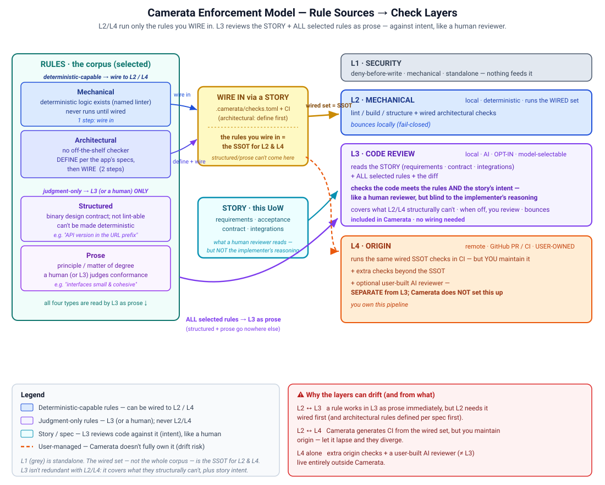

# Camerata — end-to-end user guide

This is the "I have a repo new to Camerata — where do I start, and how do I take it all
the way through?" walkthrough, and the canonical source the **in-app assistant** (the chat bubble) answers from. Keep it accurate to what's actually shipped — an
assistant that describes a feature that doesn't exist undercuts the whole point.

> Status (updated 2026-06-27): the brownfield **onboarding flow is built and live** — per-repo
> stack detection + rule selection, **custom rules** (per-repo + project-global), an optional code
> audit you can scope with a **scan-type selector** (AI review and/or deterministic scans), four scan
> modes, an opt-in **thorough-calibration** consensus pass, a **scan-time deterministic preview** that
> runs your selected mechanical linters during the scan, a three-table finding triage, and an **Apply**
> step that writes governance onto a local branch and pushes it (no PR until you ask). Two opt-in
> **CI/CD security rules** (Semgrep, CodeQL) are available but **never auto-recommended or pre-checked**.
> Re-onboarding an already-onboarded repo is **blocked**. Projects are **exportable/importable**, repos
> resolve to **local folders** with a health check, and onboarding state **auto-saves**. Governed
> Development is now a **3-phase cockpit** (Intake · Investigation & Refinement · Development) with
> free navigation between phases, **Finish/Reopen** controls per phase, **per-story repo/branch
> scoping** (Intake, with the repos-in-scope selector at the top of the page), **prose contract settling**
> and a **contract precondition** (no development for cross-boundary work without a contract), and a
> **per-repo Ship panel** with a "Ship all repos" chain button. UoWs reach a **Done/archive** terminal
> state. Settings is a **single consolidated nav item** (no settings button on the Governed Development
> page): cross-project credentials (OpenRouter key + GitHub token, keychain-backed, masked) and Bombe
> animation controls on one side; per-project **model configuration** on the other. Model tiering is
> **domain-aware**: Strongest / Balanced / Fast fleet bands, an optional project-wide **Designer
> (vision) band** for visual work, **suggested profiles** (Balanced / Max Efficiency / Max Quality /
> Custom), and individually selectable **helper-agent models** (audit, calibration, research chat,
> story authoring, decomposition, escalation, clarification). L3 AI code review has its own model
> selector (defaults to Balanced). The **Rules page** is rules-only (model config moved to Settings).
> The **Rules view** has an **"Emit rules locally"** button that regenerates governance files directly
> into local repo clones. Emit is **local-only by default**, with three **cascading** toggles (each
> requires the previous): **Save emits on a new branch → Push to GitHub → Open a PR**. The UI theme
> is **Bletchley industrial amber** with a background **Bombe machine** that is an **AI-activity
> indicator**: it powers up (lights up, rotors spin) only while genuine AI / heavy work runs (chat
> turns, authoring, investigation, live runs, scans, audits) and powers down to a dim idle otherwise;
> the rotor knobs freeze in place between runs and resume from there. Trivial fetches never animate
> it. Settings exposes a global ON/OFF and a Play/Pause preview. The **Intake page** renders the whole
> story inline (no separate modal) with a large **"Context for the investigation agent"** field that
> is editable and deletable after it is added. The **Rules page** groups rule tables by domain,
> collapsed by default; clicking a row opens a rule-detail modal. **Blank UoWs you author with AI**,
> an **AI-assisted Update-branch** control, a work-item modal with comments + @-mention autocomplete,
> a one-time **layer-2 bootstrap bypass** for installing tooling, a one-click **Gate self-check**
> (go/no-go), **multiple concurrent UoWs** (each runs in its own isolated git worktree), **PR
> lifecycle buttons** per UoW (push, open PR, pull PR info, resolve with agent), and **structured
> clarifications** that auto-save at pause points. Dev runs and onboarding scans show **run liveness**:
> an amber **stall warning** appears when a run makes no progress for the watched threshold, and a
> **Stop button** is always available to cancel any running dev run or scan at any time (the run ends
> in a **Cancelled** state). Scan findings now include a **Test badge** for test-scope violations, a
> separate **Scan coverage** section (tools that didn't run), and scan tools (Semgrep/ESLint)
> **auto-install on first use**. The in-app assistant retains **conversation context** across messages
> and is grounded on your active project and pulled issues. A persistent **token usage meter** tracks
> 5-hour and session-wide spend. The **check manifest** (`.camerata/checks.toml`) is the single
> source of truth for custom deterministic gates: one entry wires a check into BOTH the in-loop dev
> gate and the generated CI workflow. The runtime is **provider-agnostic**: a native in-process
> `ApiAgentDriver` owns the MCP tool-use loop for any provider; the `ClaudeCliDriver` remains for
> the Claude subscription path. Credentials are an **OpenRouter API key** (for API-path models) and
> a **GitHub token** (for repo operations).

---

## 0. Credentials (the only setup)

Credentials live in **Settings** (the dedicated nav item, not the old gear popup). They are stored
in the system keychain and shown masked in the UI. Two credentials, both optional depending on which
paths you use:

1. **GitHub token**: for push/PR operations and Issues read/write. One token serves every repo it
   can reach. You can also set it via environment variable for scripted launches:
   ```bash
   export CAMERATA_GITHUB_TOKEN=github_pat_xxx
   ```
2. **Model provider**: the credentials behind each access path, both optional depending on which
   path a project uses:
   - **Claude CLI (subscription):** the `claude` CLI on your PATH, logged in. Camerata drives it as
     a subprocess (`ClaudeCliDriver`). No key needed. Set `CAMERATA_LIVE_BUILD=1` to activate the
     live fleet.
   - **API path (OpenRouter or Anthropic API):** set an **OpenRouter API key** in Settings, or an
     **Anthropic API key** in Settings (Chat backend, API). The Anthropic key saved in the app is
     the one every model call uses, in the app and in the `camerata` command line, and a key you
     save or replace takes effect on the next call with no restart. The `ANTHROPIC_API_KEY`
     environment variable is only a fallback (for CI and existing `.env` setups) and is used only
     when no key has been saved in the app. The `ApiAgentDriver` owns the MCP tool-use loop
     in-process and works with any provider the model registry discovers (Claude, and every
     OpenRouter-listed model flagged for tool use).

   Each saved credential row has a **Remove** button. A value saved in the app takes precedence
   over its environment variable, so remove it there to hand the credential back to the
   environment. A GitHub token saved or removed in Settings is used immediately, with no restart.

   **macOS Keychain prompt.** The first time Camerata reads a saved credential after you launch
   it, macOS may ask whether the app may use your confidential information. Choose **Always
   Allow** so it does not ask again. The app reads the Keychain once per launch and then keeps
   the values in memory (saving or removing a credential updates both). A build that is not
   code-signed looks like a new app to macOS after every rebuild, so the prompt returns after
   each rebuild; a signed build avoids that.

   These credentials are global (one keychain entry each, shared by every project); which path is
   actually **active** is a separate choice made **per project**, described in the next section.

Launch:
```bash
cargo run -p camerata-ui
```
The desktop app opens with its embedded server; the topbar shows the live connection status.

### Backend: CLI vs API (per project)

Every project-scoped AI call, including the brownfield scan, the alternative-recommendation pass,
the disagreement rescan, and the governed dev loop, is driven by that **project's own Backend
setting**, not a global switch. Set it per project in that project's **Settings**:

| Option | How it works | API key needed? |
|--------|-------------|-----------------|
| **CLI** (default) | Spawns the `claude` CLI using your logged-in Claude Code subscription | No |
| **API** | Calls the Anthropic Messages API directly | Yes |

CLI is the zero-setup default: a brand-new project's scan just works against your subscription,
no key required. Switch a project to **API** for client work, since it is metered, single-party,
and nameable in a contract, which a subscription running on your own machine is not.

If a project is set to **API** and no Anthropic API key is configured, AI steps on that project
(scan, decomposition, clarification questions, story and design authoring, diagrams, mockups,
escalation chat, code review) do not run and report why; they never fall back to the Claude Code
subscription: the scan/audit page shows an **"AI review did not run"** banner explaining why, and
the deterministic security floor still runs on its own. To unblock it, add an **Anthropic API
Key** in **Settings** (stored in the OS keychain, never in files or the repo; it takes effect on
the next run, no restart needed) or switch that project's backend back to **CLI**.

**Chat backend (a separate, global setting).** One global toggle in **Settings**, labeled **Chat
backend**, controls only the project-less chat assistant (the chatbox that lives outside any
project). It does not affect any project's scan, recommendations, rescans, or dev loop: those
always resolve from that project's own Backend setting above, never from the chat setting.

**Local-first:** Camerata stores only configs + pointers (JSON in your OS app-data dir —
`projects.json`, `settings.json`, `onboarding-draft.json`); your repo code lives on your own
machine. Each repo a project references must resolve to a local git checkout (see §5).

---

## 1. Projects (the container for everything)

A **project** holds its repos, ruleset, and onboarded state. From the **Projects** home you can:
- **Create** a project (just a name to start).
- **Open** one (the cockpit's four+1 views only appear inside a project).
- **Export** the open project — a single, **path-free** `camerata-project-<name>.json` containing
  only that project's repos (`owner/repo`), ruleset, and which repos are onboarded. It does **not**
  include local paths or your workspace settings.
- **Import** a project config — it **upserts** into your local projects. If you already have a
  project with the same name, Camerata **warns before overwriting**. Your own workspace settings are
  never touched. After import the repos have no local paths yet — resolve them in the Rules view (§5).

**Project config vs. project data:** the exported JSON contains only the project's transferable
config (repos, ruleset, onboarded state, tier map). Units of Work, the story spine, onboarding
drafts, and local repo paths are **local to each developer** and are never included in an export.
UoWs represent in-progress dev-lifecycle state (branch, stage, run history, decisions, sign-off) and
are machine-local — transferring them would produce overlapping work across developers. When you
import a project on a new machine you start with no UoWs; they accumulate as you work.

---

## 2. The cockpit views

Inside a project the nav shows: **Onboard repos · Governed Development · Rules · Routines ·
Repository Workspace · Settings · Docs**.
- **Onboard repos** — bring a repo under governance (§3).
- **Governed Development** — the work control surface: pull work items from a tracker (or author a new
  story from a blank UoW with AI), create a Unit of Work (UoW) from one, then run governed development
  on it with the human↔AI clarify loop, comment back, and sign off (§6). There is no settings button
  on this page; all configuration lives in Settings (below).
- **Rules** — manage the project's ruleset after onboarding + the repo-path health check (§4, §5).
  Rule tables are grouped by domain, collapsed by default; clicking a row opens a rule-detail modal.
  This page is rules-only: model configuration has moved to Settings.
- **Routines** — schedule governed runs (templates, an in-app auto-fire scheduler, run history, and
  blocked-run review). Full walkthrough in §18.
- **Repository Workspace** — the local clones: clone status, branch, and ship (push + PR) for dev work.
  If no workspace folder is chosen yet but a repo is already linked to a local folder, the page
  suggests that repo's parent folder as the workspace folder, one click to accept. The git panel's
  Sync row has **Pull, Push, and Fetch all** (fetch all origin branches with no merge or checkout).
  The branch list scrolls once it gets long, and always shows main (or master) first.
- **Settings**: all configuration in one place, split into two clearly-labeled scopes (see §17). The
  Soft-context group also holds the **Work hierarchy** builder (define your work-item types and nesting).
- **Docs** — the in-app documentation viewer (this guide and the technical reference).

---

## 2a. Guided inspection (the walkthrough)

A short guided mode for the Inspection, from an empty app to an exported package. A small popup
points at the real control on screen (with an arrow, and the control lightly highlighted), says in a
sentence or two what it does, and shows "Step N of 12" with **Back**, **Next** and **Exit**. It
never clicks, types or decides anything for you.

**Turning it on**
- The **Guided inspection** switch on the **Onboard repos** screen, where an inspection starts. On
  means the walkthrough runs alongside the real flow; off hides it. The switch is remembered for
  you on this computer (it is an app setting, not part of any project, so a project export never
  carries it).
- On a first launch with no projects, the Projects home offers it once: "Want a guided first
  inspection?" **No thanks** is remembered and the offer is not made again; the switch stays
  available.
- **Start walkthrough** in the **Help** menu, or the same line in the command palette (Ctrl+K or
  Cmd+K), starts it again from step 1 at any time.

**How it behaves**
- Most steps move on by themselves when you do the thing (open a project, press the audit button).
  If you start it with the thing already done (from inside an open project, step 1 is already
  satisfied), it skips that step. **Next** skips ahead, and is how the steps that only explain are
  passed. **Back** goes back.
- If the control is not on screen (you are on another page, or the inspection has not run yet), the
  popup says how to get there instead of pointing at nothing.
- **Esc** exits, as does **Exit** (and **Done** on the last step); exiting also turns the switch off.
  Esc is left alone while a reason prompt, the code viewer, the stacked view, the palette or a dialog
  is open, or while you are typing in a field.
- It gets out of the way: while a reason prompt, the code viewer, the stacked view, the command
  palette or any dialog is open, the popup is hidden, and it comes back when they close. Starting
  the walkthrough is refused (with a note saying why) while any of those is open. Only the
  palette's own **Start walkthrough** line can start it with the palette open (it closes the
  palette itself); the Help menu cannot.
- Keyboard and screen readers: starting it moves the keyboard into the popup, each step is
  announced, and closing it puts the keyboard back on the control it was pointing at (on a bar or
  a block, the block itself, never on a button inside it, so a stray Enter cannot decide a
  finding). For the run and export steps it leaves the keyboard on the area around the button, not
  the button, so a stray Enter cannot start a paid run or an export. The popup only listens for clicks and Esc while it is running, so a key pressed
  between walkthroughs does nothing to the next one.

**What it covers (twelve steps).** Create or open a project; add the client repository; the client
name; the model backend and where the key is saved; the stack rules; the line count and cost
estimate; running the inspection; failed or skipped passes; the review queue and its four decisions;
the speed tools (stacked review, the code viewer, the palette); review time; exporting the package.
This first version covers the Inspection only. Where a step's own control does not exist yet (the
client name field in the inspection setup, the spending cap), it points at the nearest control that
does.

---

## 3. Onboarding a repo (the main flow)

Open **Onboard repos**. The flow: **detect stack → pick rules → scan the repo for violations (audit)
→ triage findings → apply governance → (optional: wire CI) → onboarded.** The **violation scan is a
core part of onboarding**, not an afterthought: it is where Camerata reads your existing code and
surfaces what already violates the rules (existing hardcoded secrets, SQL injection, disabled TLS,
architectural problems, and more), so you start governed development from a known baseline. You
*can* skip it and just apply the governance files, but running it is strongly recommended.
Onboarding state **auto-saves** continuously, so you can quit and reopen without re-scanning (a
fresh scan starts a new session; a crash mid-scan just re-runs the scan).

1. **Point at the repo(s)** — **browse to each repo's local folder.** Onboarding is **local-first**:
   it reads the code on disk, so a repo must already be cloned locally. Camerata derives the
   `owner/repo` from the folder's git origin (used later only for push / PR) and **records the local
   path**, which makes it a workspace repo immediately — "add a repo to onboard" and "add a repo to
   the workspace" are the same act. **No GitHub connection is needed to onboard**; a token is only
   used later, to push the governance branch and open a PR.

   **Already-onboarded guard:** if you point at a repo this project has already onboarded, Camerata
   **refuses with an error** rather than silently re-running. Onboarding is a one-time act per repo;
   to change a repo's rules after the fact, edit them in the **Rules** view (§4), don't re-onboard.
   If you genuinely need to rescan a repo from scratch, use **Reset onboarding** on the project card
   in **Projects** home. It clears the onboarded marker (and the in-progress draft) so the repo can
   go through the scan again; your repos and ruleset are kept as-is.
2. **Scan + propose per-repo rules** — Camerata reads each repo's **local working tree** (it never
   downloads code from GitHub) and detects its stack: languages from extensions, frameworks from
   manifests, **IaC** (Terraform, Terragrunt, Bicep, Pulumi, CloudFormation) and **CI/CD** (GitHub
   Actions, GitLab CI, CircleCI, Azure Pipelines, Travis, Bitbucket, Drone, Jenkins). It proposes a
   starter ruleset **per repo**.

   **The scan is current-branch-only.** It reads whatever is checked out on disk right now; it does
   not check out or select a branch for you. Switch branches first if you want a different branch
   scanned.

   **The scan follows your `.gitignore`** (gitignore-aware walking). For git repos, Camerata walks
   the working tree with ripgrep's gitignore engine, which honours `.gitignore` at the root and in
   subdirectories, `.git/info/exclude`, and your global gitignore. A file that is gitignored is
   **skipped** — no findings are generated for it. A file that is **committed to the repo** (not
   gitignored) is **still scanned**, even if it has a sensitive name like `.env`. This is deliberate:
   a committed `.env` with real credentials is an actual leak because it is version-controlled and
   visible to anyone with repo access. The scan is enforcing what git sees, not what the filename
   suggests. For directories without `.git`, Camerata falls back to its built-in noise denylist
   (`node_modules`, `target`, build/cache/generated dirs, lockfiles, …).
3. **Pick rules** — each repo has its **own** recommended-rule table; a repo single-select switches
   which repo you're editing. Selection is **per repo**: a rule ticked for repo A is bound to A only.
   **Project-level rules** apply to every repo. Click any rule to read its decision question, the
   options, the default, and each option's rationale, and to choose an alternative. **Option choices
   are also per repo** — adopting an alternative for a rule while viewing one repo does not change
   another repo's choice. A recommended rule that still needs an alternative chosen is **highlighted
   amber**, with a "Needs option" filter to find them and an informational hint naming them, but it
   no longer blocks Audit or Add-rules. You can leave it unresolved and proceed: the audit itself
   recommends an alternative for it (see step 4).

   **Opt-in CI security rules are never pre-checked.** The two security-scan rules
   (`CICD-SEMGREP-SECURITY-SCAN-1`, `CICD-CODEQL-SECURITY-SCAN-1`) appear in the list as
   **"Available"** (no recommended badge, no pre-checked checkbox). You opt in deliberately. See §3
   step 6 for details.

4. **Scan the repo for violations + triage (recommended core step)** — scan the existing code to
   surface what already violates your rules. This is the heart of brownfield onboarding: you can skip
   it and apply governance straight away, but it is where Camerata finds the existing security and
   architectural problems in your repo, so running it is strongly recommended. Each repo
   is scanned only against **its own selected rules** plus the always-on **deterministic security
   floor** (hardcoded secrets, raw-SQL concatenation, secrets in URLs, private-key blocks, vendor
   credential tokens, secret-bearing file paths, TLS verification disabled — ranked Critical, free +
   instant).

   **Scan-type selector — what to run.** At audit-start two checkboxes decide which passes run, both
   **on by default** (today's behavior):
   - **AI architectural review** — the LLM scan of architectural/structured/prose rules (and the deep
     tier). Unticking it skips **every** model call: **no tokens** are spent.
   - **Deterministic scans (floor + linters)** — the always-on security floor **plus** the scan-time
     mechanical preview (below). Local, **no LLM, no tokens**.

   You need at least one ticked; if you untick both, Camerata runs both rather than nothing. **Pick
   deterministic-only** for a fast, free pass (it's also the cleanest way to sanity-check the linter
   findings); **pick AI-only** for just the judgment review. The deep-report toggle is hidden when AI
   review is off (the deep tier is itself an LLM pass). The scan-mode picker below (Parallel /
   Sequential / Background / Batch) is unchanged.

   **Two different axes, and conflating them is the usual confusion.** A finding row carries both,
   and they answer different questions:

   - **WHO produced it, and how much authority does it carry** (enforced / preview / advisory). That
     is the three-way split immediately below, and it is what the triage table's **Authority** column
     filters on.
   - **WHAT the row asserts about your codebase** (defect / deviation / convention observed / no
     convention / not assessed). That is the finding `kind`, added 2026-10-09, and it is what the
     exported artifacts partition on. A row is no longer simply "a violation or not": three of the
     five kinds assert that nothing is wrong. See **"What the five finding kinds mean"** further down
     this section.

   **Three kinds of finding by AUTHORITY, and the difference matters:**
   - **Deterministic floor** (`SEC-NO-HARDCODED-SECRETS-1`, `SEC-NO-RAW-SQL-CONCAT-1`,
     `ARCH-NO-SECRETS-IN-URL-1`, `SEC-NO-PRIVATE-KEY-1`, `SEC-NO-VENDOR-TOKEN-1`,
     `SEC-NO-SECRET-FILE-1`, `SEC-NO-DISABLED-TLS-1`) — pure regex/logic, no LLM. **Repeatable**
     (same code → same result, same rule-id, same line), and these are the exact checks the layer-1
     gate enforces on new writes. Treat their rule-ids as **stable/canonical**. In the triage table
     they carry a green **"Rule · enforced"** badge.
   - **Deterministic preview** — findings from the **scan-time preview** (below): your selected
     mechanical rules' own linters, run by Camerata during the scan. **Deterministic** (stable
     tool rule-ids) but **advisory** — they are **not enforced until the CI story wires them**. They
     carry a purple **"Preview · not enforced until wired"** badge.
   - **AI-suggested (architectural)** — model-inferred issues regex can't catch (layering violations,
     N+1, missing auth on writes, god objects, GET-with-side-effects). These are **advisory**, and the
     model **invents the rule-id** per finding, so the id, severity, and exact set can **vary run to
     run**. Read them as "the model flagged this pattern," not as a fixed rule. They carry a blue
     **"AI · advisory"** badge. The calibration pass recalibrates severity and flags low-confidence ones
     but never drops any — you make the final call.

   The triage table's **Authority** column shows these three tiers and is **filterable** (enforced /
   preview / advisory); the CSV export carries the `preview` / `preview_tool` columns.

   **Test badge, Needs-review state, and Self-referential findings.** Three extra flags appear in the
   finding table:
   - **Test badge** (yellow) — the finding is in test code (a test file path, or a line inside a
     `#[cfg(test)]` block). Test-scope violations are down-ranked to low severity. The nuance: a real
     secret in production code in the same file stays Critical even if the file also contains a test
     block — classification is per-finding-by-line, not per-file.
   - **Needs review** (orange) — the calibration pass flagged this finding as uncertain; read the
     reason and decide yourself.
   - **Self-referential** (gray badge, status `suppressed-self-reference`) — Camerata's own rule
     descriptions contain the very patterns it looks for. When the scanner reads a governed repo's
     `CONVENTIONS.md` or `AGENTS.md` and encounters a rule directive such as "Do not set
     `verify=False` in TLS configuration," it would otherwise flag that line as a TLS-verification
     finding. Findings like this are marked Self-referential and do NOT count toward the active
     violation tally. They are visible in the report so you can confirm they are noise — but they do
     not drive the gate, and they do not contribute to the CI gate count.

     **The safety property:** this suppression applies ONLY when BOTH the file is a Camerata-emitted
     governance artifact (`AGENTS.md`/`CONVENTIONS.md` with the Camerata header, a `.camerata/` file,
     or a corpus TOML) AND the matched snippet is traceable to a rule's description text. A real
     credential pasted into `CONVENTIONS.md` that is not part of any rule description still flags as
     `active`. Ordinary source files (`app/config.py`, `src/main.rs`, etc.) are never suppressed
     by this mechanism regardless of what text appears in them.

   **Scan coverage section.** Below the violations table, a separate **"Scan coverage"** section
   lists tools that didn't run (missing binary, unrouted rule, etc.) as informational notes. These
   are **not violations** — they tell you where coverage has a gap, so you know what the scan did
   and didn't check.

   **Scan tools auto-install on first use.** Camerata auto-provisions Semgrep and ESLint into its
   own cache directory (`~/Library/Application Support/camerata/tooling/` on macOS;
   `~/.local/share/camerata/tooling/` on Linux) the first time a scan needs them. The bundled
   Semgrep ruleset runs fully offline after the one-time install. If `python3` or `npm` is not on
   your PATH, Camerata degrades gracefully — you get a coverage note explaining the gap, and the
   rest of the scan continues unaffected.

   Pick the **model** and the **scan mode** (four options; Camerata auto-selects a recommended one by
   the codebase's size):
   - **Parallel** (default) — runs rule-batches concurrently; fastest. Wall-clock is the slowest
     batch, not the sum of every call.
   - **Sequential (slower, gentlest)** — one chunk at a time, all rules together; slower but gentlest
     on rate limits (a fallback when Parallel hits throttling).
   - **Background job (walk away)** — the Parallel scan, but it runs server-side and detached: you get
     a progress view and can walk away while findings stream in. Best for huge / multi-repo scans
     where a foreground scan would tie up the page. (Parallel and Sequential run in the foreground and
     block until they finish; Background job is the same work, just detached.)
   - **Batch (50% off — async, API key required)** — submits all passes as a single **Anthropic
     Message Batch**, for a flat **50% discount on all scan tokens**. Requires this project's backend
     to be set to **API** with an Anthropic API key configured; results arrive asynchronously
     (seconds to minutes, up to 24h on very large scans). Best when latency is acceptable in
     exchange for cost.

   **What the five finding kinds mean.** Every row carries a `kind`, and it tells you what sort of
   statement the row is making. This replaced a binary model in which a row was a violation or it was
   not, and the change matters because three of the five kinds say nothing is wrong:

   | Kind | What it is telling you | Where it lands in the Excel workbook |
   |---|---|---|
   | **Defect** | An objective fault at this site. Act on it. | All Findings |
   | **Deviation** | A consistency violation against the convention your own codebase predominantly follows: "2 of your 47 assessed endpoints do not use URI versioning". You get the numerator, the denominator (when it could be counted honestly) and the convention's own name as separate fields, not prose to read. | All Findings (per site) and Deviations (one row per rule) |
   | **Convention observed** | Your codebase consistently follows this convention and there are zero violations. This is not filler: it is the decision set the inspection derived from your code, and it is what governance will later enforce. | Conventions |
   | **No convention** | No convention has been adopted here; your codebase is inconsistent with no clear majority. Exactly one row per rule, never one per site. | Conventions |
   | **Not assessed** | The rule was armed but could not be evaluated: a tool failed, no files matched, or the model declined. An honesty row, deliberately distinguishable from "we checked and it was clean". | Coverage, under "checks we could not complete" |

   A row whose producer never assigned a kind shows as **Unclassified**, and the Index sheet's
   "Statement types" block shows that count only when it is non-zero. It is never silently rendered
   as a defect: an unclassified row is a gap in Camerata, and it has to be visible as one.

   A **deviation caps at medium severity by default**, because the cost of inconsistency is paid on
   future features rather than on existing code. Individual rules can author a higher ceiling where
   the inconsistency genuinely compounds (layering boundaries, error-contract shape, auth patterns).

   **Thorough calibration (opt-in checkbox).** Off by default. When ticked, the calibration pass
   that recalibrates AI-suggested severities runs as a **multi-vote consensus** instead of a single
   pass: each finding is judged several times and the **conservative** verdict wins on disagreement
   (a finding two votes call real and one calls noise stays). It catches more borderline cases and
   reduces flaky severity, **at the cost of more AI calls** — so the **pre-scan cost estimate rises
   (~3× the calibration portion)** the moment you tick it. Leave it off for a quick pass; turn it on
   when you want the audit's severities to be trustworthy enough to act on directly. It never drops
   findings either way — it only re-ranks and flags.

   **Calibration is not the last word on severity.** A rule can declare, in the corpus, a minimum
   severity (a floor) and a maximum severity (a ceiling); both are applied when the report is
   exported, after the model and after calibration. So a rule whose author wrote "always critical"
   cannot be talked down, and a rule whose author wrote "high, not an automatic critical" cannot be
   inflated past high no matter what any model proposes. The floor only ever applies to a row that is
   accusing you of something (a defect or a deviation) and only when the row has a real file and
   line; the ceiling always gets the last word. See `docs/TECHNICAL.md` section 6a for the exact
   resolution order and `docs/RULES_REFERENCE.md` for the fields themselves.
   Findings land in three tables you switch between: **Unresolved · Ignored · Tech debt** — select and
   **Ignore (with reason)** or **Save as tech debt**, re-bucket freely. A **Needs-review** column shows
   the calibration pass's flag + reason (and the Test badge for test-scope findings). In the Tech-debt
   table mark items **resolve later** or **resolve now**, then **Process**: ignores become baseline
   waivers, and **every tech-debt item is filed as a GitHub issue** (the story). Resolve-now issues
   are titled for pickup by the dev engine (the actual dev work is Pillar 2; onboarding only *writes
   the story*). There is no separate "fix the findings" button — fixing a finding is just its
   resolve-now story flowing into the dev layer. Triage/Process is **not required** to finish
   onboarding.

   **Code viewer.** To read the code a finding is about without leaving the app, press **O** while
   the detail pane has focus, or click **Code**, or the `path:line` tag in the pane, or **Open in
   viewer** at the top of the full-detail modal's code section. The whole file opens over the Queue,
   as it was at the commit that was inspected, scrolled so the finding's line sits in the upper third.
   The table and the pane stay where they were underneath. Closing (Esc, the close button, or a click
   outside) puts focus back on the pane, on the finding you last viewed.

   - **What you see.** A header with `owner/repo @ commit`, the path, `line L of N` and `finding K of M
     in this file`. Line numbers on the left. The finding's enclosing function or statement has a soft
     band, and its line is highlighted with a left edge in the severity colour. Other findings in the
     same file have a dot in the gutter (and on a thin strip at the right edge, which shows the whole
     file): a solid dot is an open finding, a hollow dot is one you have already decided, and a number
     shows when several findings cite the same line. Click a solid dot to go to that finding. A line
     over 2,000 characters is cut with `... (N more chars)`. Everything shown has been through the
     secret redactor.
   - **Which version of the code.** If the commit that was inspected is not in this clone, or the
     inspection recorded no commit, the viewer shows the working tree and an amber banner says so. If
     the repo's source was deleted from this machine it shows `Source deleted on <date>, re-fetch to
     view` and no code. A file too large to view (over 4 MB) offers **Show the enclosing block**
     instead, which opens the full-detail modal. A missing or binary file gives its reason. Files
     between 400 KB and 4 MB are loaded 800 lines at a time and the next page loads as you scroll.
   - **Deciding without leaving the code.** `C`, `T`, `I` and `F` do exactly what they do in the pane:
     `C` and `T` apply at once with the five-second Undo (shown at the bottom of the viewer), and `I`
     and `F` ask for a reason first (Enter commits, Esc cancels, and a blank reason is refused). After
     a decision the viewer moves to the next undecided finding in the same file, and when the file is
     finished to the next row of the Queue.
   - **One cursor.** The viewer does not keep its own current finding. Moving in the viewer moves the
     Queue's cursor, so the pane underneath always describes the finding the viewer is on. Findings
     that are not rows of the table on screen (already decided, or hidden by a filter) are skipped
     by `]` and `[`, and their dots do nothing when clicked.

   | Key | What it does |
   |---|---|
   | `Esc` | Close the key list, else the viewer (an open prompt closes first) |
   | `C` `T` | Confirm, tech debt (applied at once, 5 second undo) |
   | `I` `F` | Ignore, false positive (asks for a reason) |
   | `Down` `Up` `J` `K` | Next or previous row in the Queue |
   | `]` `[` | Next or previous finding in this file (no wrap; the status line says when you reach the end) |
   | `}` `{` | Next or previous file in this rule group, on its first undecided finding |
   | `.` | Back to the line of this finding |
   | `G` | Go to a line (Enter jumps, Esc cancels) |
   | `/` | Search this file (the field opens; Enter next match, Shift+Enter previous, Esc closes the field) |
   | `S` | Where else is this symbol used (the symbol prompt opens pre-filled; Enter runs the search) |
   | `Y` | Copy a permalink to the line on screen |
   | `Space` | Pin or unpin the finding popover |
   | `H` | Open the Rule Hub for this rule; closing it returns here |
   | `Backspace` `Alt+Left` | Back to where you were before the last go-to-line or reference jump |
   | `PgUp` `PgDn` `Home` `End` | Scroll; the cursor stays |
   | `?` | Show or hide this list |

   Keys that hold Ctrl, Alt or Cmd are left alone (except `Alt+Left`), so copying code with Cmd-C
   works. While a reason prompt, the go-to-line field, the search field or the symbol prompt is
   open, every key is text. While the references list has the keyboard, only `Up` `Down` `J` `K`
   (move), `Enter` (open) and `Esc` (back to the code) do anything. While the Rule Hub is open
   above the viewer, `Esc` closes it (also after you click inside it) and every other key does
   nothing.

   - **The popover.** Rest the pointer on the finding's line, or on any gutter dot, for a quarter of
     a second and a card shows at most eight lines: the rule id (click to open the Rule Hub), the
     kind and authority badges, the headline (the first sentence of the detail for a defect, the
     deviation claim for a deviation), the rule directive cut at 160 characters, severity,
     confidence and effort, the needs-review reason in bold, the current disposition, the other
     findings in this file (click one to go to it), and the other rules violated at the same
     place. It never shows the fix. `Space` pins it so it stays while you scroll.
   - **Search.** `/` opens a find field. Matches are highlighted as you type (plain text, ignoring
     case), the current match is stronger, and the field shows `3 of 12`. Enter steps to the next
     match and Shift+Enter to the previous one; stepping past either end wraps and the count says
     `(wrapped)`. `Esc` closes the field and leaves the highlights until your next move (a
     navigation key, go-to-line or opening a reference). In a file longer than 400 KB only the
     loaded 800 lines are searched, and the count says which lines.
   - **References.** `S` opens a prompt pre-filled with the symbol the rule captured, else the
     longest identifier on the finding's line. Enter lists every whole-word use of it at the
     inspected commit, at most 200 (the heading says when there are more), skipping vendored and
     generated paths (and any folder in `CAMERATA_SCAN_EXCLUDE_DIRS`, as in the scan), with every
     line redacted; a line of key material is shown as `[redacted]` but keeps its `path:line`.
     `Up` `Down` choose (the list scrolls to keep the choice on screen), `Enter` opens the hit and
     `Esc` goes back to the code. If the search could not run, or took too long, or the server was
     busy with other code reads, the heading says `Could not search for <symbol>` and why; it never
     says there are no references when nothing was searched. A hit is a place in the code, not a finding: opening one in another file
     shows that file with a `reference` tag, never moves the Queue's cursor, and the decision keys
     do nothing until you press `Backspace` to come back to the finding. Without a recorded commit
     (or when it is not in this clone) the search runs on the working tree and an amber line says so.
   - **Permalink.** `Y` copies `owner/repo@abc1234:path:line` and, when the repo's origin is GitHub, a
     second line with the `https://github.com/.../blob/<commit>/<path>#L<line>` URL. A toast
     confirms. The link names a place; it contains no code. When the code on screen is the working
     tree (the amber banner), there is no commit to link to and `Y` says so instead of copying.

   **Code under the evidence.** In the detail pane, the stored snippet under **Evidence** shows at
   once. When the cursor has rested on a finding for about a sixth of a second, the code around it
   fills in beneath the snippet: the finding's line and three lines either side, with the finding's
   line highlighted and the file's own line numbers. Moving quickly down the list asks for nothing
   until you stop. The lines come from the inspected commit and have been through the secret
   redactor. If anything is not as expected (the commit is not in this clone, the source was
   deleted, the file is missing or binary or too large, or the line no longer matches the stored
   snippet) the pane shows exactly what it showed before and nothing is added. Context is never
   taken from the working tree. It is kept for the session, and a file the code viewer has already
   opened supplies it without asking again.

   **Stacked group view ("same fix, many places").** When one rule has many findings and the
   question is the same for all of them (is this convention real, is this pattern a bug), read them
   together instead of one at a time. Press **B** while the detail pane has focus on a finding of a
   deviation or defect group, or click **Stack** in the pane, or click **Review all N stacked** in
   the rule-level bar above the table. An overlay lists every row of that rule group in the table
   you are in, as cards. Each card shows `path:line`, a dot in the severity colour, the finding's
   line with three lines of code either side (the finding's line highlighted), the row's status, and
   a checkbox. Undecided cards start checked; a card that is already decided shows its status and
   starts unchecked. All the code comes from the inspected commit in one request when the stack
   opens and has been through the secret redactor. A card whose code cannot be read at that commit
   (it is not in this clone, the file is gone, the line no longer matches the stored snippet)
   shows the stored line only, and a note under the header says how many cards are like that. If
   the server does not answer the request at all, the note says that instead (it says nothing about
   the code), and the page is asked again when you come back to it or reopen the stack.

   | Key | What it does |
   |---|---|
   | `J` `K` (or `Down` `Up`) | Next or previous card; the list scrolls to keep it on screen |
   | `Space` | Check or uncheck the focused card |
   | `C` | Confirm the checked cards (applied at once) |
   | `T` | Save the checked cards as tech debt (applied at once) |
   | `F` `I` | False positive, ignore: ONE reason prompt for all the checked cards (Enter commits, Esc cancels, a blank reason is refused and the prompt stays open) |
   | `Enter` | Open the focused card in the code viewer; `Esc` there comes back to the stack on the same card |
   | `>` `<` | Next or previous page (see below) |
   | `Esc` | Close the stack and go back to where it was opened from (the detail pane, or the bar's button), with the Queue's cursor on the card you were on |

   The buttons above the cards do the same as `C`, `T`, `I` and `F`. A decision acts on exactly
   the cards that are checked, and the Undo that appears at the bottom (five seconds, the same one
   the pane uses) names the count, for example `Confirmed 29 findings.`; one click puts all of them
   back, also in the Queue's table. The same Undo now follows every way of deciding a finding in the Queue:
   the rule-level bar's **Confirm all N**, all the toolbar buttons (**Confirm**, **Save as tech
   debt**, the **Move to ...** buttons and their reason prompts), as well as the pane's keys. A
   blank reason is refused in the same words everywhere, and **Move to Ignored** in the Tech debt
   table now asks for the reason Ignored requires. The cards you decided update in place and the stack stays open,
   so you can leave a few unchecked, confirm the rest, and then deal with the exceptions one by
   one. A card you left unchecked stays Unresolved. If nothing is checked, a decision key says so
   instead of doing nothing. Decided rows leave the Queue's table, so **Enter** on a decided card
   cannot open the viewer and says so ("That finding has left the table. Undo its decision to bring
   it back."). Keys that hold Ctrl, Alt or Cmd are left alone. While the reason prompt is open every
   key is text and the buttons that act on cards (the four decisions, the page buttons, each card's
   **Code** button, the checkboxes) do nothing and are greyed out, so a stray click cannot change
   which cards the prompt's count and reason apply to; finish or cancel the prompt first. If you
   decide a card somewhere else while the stack is open (in the viewer, for example), it comes back
   decided and unchecked, whatever you had clicked on it before.

   A group of more than 200 rows is shown 200 cards at a time. A line under the header says which
   cards are on screen (`Showing cards 1 to 200 of 312`), `>` and `<` (or the **Next page** and
   **Previous page** buttons) turn the page, and the keys act on the cards of the page on screen
   only. Each page makes one request for its code.

   **A reason prompt belongs to its row.** When you press `I` or `F` (or click Ignore or False
   positive) in the detail pane, the reason you type is for the row the prompt was opened on.
   Clicking another row of the table while the prompt is open does nothing but say so; commit or
   press Esc first, then pick the next row.

   **Previously on this shape (decision memory).** When you have already ignored or marked as a
   false positive another finding of the same rule whose offending line is the same code (spacing
   does not matter, an edit to the code does), the detail pane shows a quiet line under the tags,
   for example `Previously on this shape: Ignored, 'test fixture, not shipped' (3 rows)`, and the
   code viewer's hover card shows it on its disposition line. Pressing `I` or `F` (or clicking
   Ignore or False positive) then opens the reason prompt with that reason already typed in. It is
   only a starting point: nothing is decided until you have pressed the key **and** pressed Enter,
   you can edit the text first (what is stored is what is in the box when you press Enter), and
   Esc throws it away. Nothing is ever applied from memory, and the line never appears for a shape
   you only confirmed or saved as tech debt, because those carry no reason to reuse. It only looks
   at decisions made in this review (it is not carried across inspections), and an undo removes the
   memory along with the decision. If your earlier decisions on the shape disagree, the line says
   so instead of choosing quietly: it shows the most common one and adds `, and 2 other rows
   decided differently` (other reasons, a different disposition, or Confirmed and Tech debt rows).
   The same words typed with different spacing or capitals count as one decision. A reason is only
   ever offered for the same disposition it was given for: if you had only ever ignored the shape,
   `F` starts with an empty box (an "accepted risk" reason is not an answer to "the tool was
   wrong"), though the line still shows the earlier decision. The same code in another repository
   of the same review counts as the same shape. In the stacked view and for the toolbar's Ignore and
   False positive buttons (and "False positive all N"), the prompt starts with a reason only when
   **every** checked or selected finding would be offered the same one; if one has no earlier
   decision, or two have different ones, the box starts empty. If you press Undo while a reason box
   is open, the box closes (the undo moves you to the restored finding, and a reason typed for
   another one must not follow you there). The reason text is your own words from this
   review and is shown as plain text.

   **Progress strip.** Above the table, one line says where the review stands, for example
   `Undecided 187 of 612 · Confirmed 310 · Ignored 71 · FP 29 · Tech debt 15` (FP is false
   positive). It counts the whole Queue, so it reads the same whichever table (Unresolved,
   Confirmed, Ignored, Tech debt, False positive) is open, and it changes the moment you decide
   something or undo it. The strip is plain text; it is not read out automatically after every
   decision, because a run of single-key decisions would have a screen reader repeating the whole
   line each time.

   **Review timer (internal).** Beside the counts, the strip shows `Review timer running` (or why
   it is paused) and a **Pause** / **Resume** button, which Tab reaches and which takes no key of
   its own, so the decision keys keep working (after you use it the detail pane gets the keyboard
   back). The timer starts by itself when you open a group or decide a finding. It pauses by itself
   after 3 minutes with no key or click, and while the Camerata window is not the focused window;
   the idle stretch before the pause is not counted. The next key or click after an idle pause
   resumes it; a pause you made yourself with the button stays until you press **Resume**. While
   the code viewer or the stacked view is open it covers the strip, so each of them shows the same
   timer control (state and Pause / Resume) in its own header. Only keys, clicks and scrolling
   inside the Queue table, the detail pane, the viewer and the stacked view count as activity; keys
   and clicks elsewhere (the Conventions panel, say) neither add time nor resume an idle timer. The
   timer records how long you spent on each group and,
   for each finding you decide, that the local operator reviewed it and when. This is for your own
   planning and pricing: it is saved in your in-progress review, it is never in a report, a
   workbook, `findings.json` or any other file a client receives, and the **Review time** button
   beside the strip opens a plain stats view (hours per repo, per group type and per severity)
   with a **Save stats JSON** button. After 20 decisions the strip adds `about 3h 10m left at your
   pace` (the median of your last 50 decisions' active time times the findings still undecided);
   before that it shows nothing rather than guess.

   **Order of the Queue.** The **Order** select above the table cuts the Queue four ways.
   **Curated** (the default) is severity, then kind, then the cheapest deviations first, grouped by
   rule then file. **By file** groups by file (in path order) then rule, with the rows in line order,
   so you can read one file's findings together. **By rule** groups by rule (in rule id order) then
   file, worst severity first within a rule, so you can decide one rule at a time. **Critical first**
   is one flat list with no groups, worst severity first. Picking a cut re-orders the table where it
   stands: the finding the cursor is on stays the finding the cursor is on (also right after you
   have decided a finding, when the cursor is on the next one), its group is opened if the new
   grouping had closed it, and the table scrolls to bring its row into view. The keyboard goes back
   to the detail pane, so the decision keys work without a click. Your row selection is kept; a column sort you had applied is
   dropped, because it would hide the order you just chose (**Default order**, beside the sentence
   that names the order on screen, still removes any later column sort). The choice is saved with
   the rest of your in-progress review, so it is still there after a restart. If a newer version of
   the app saved a view setting this version does not know (an order, or which table was open), it
   falls back to the default; your decisions are never lost to it.

   **Command palette.** Press **Ctrl+K** (**Cmd+K** on a Mac) anywhere on the results screen
   (you do not have to click into the Queue first), or click **Commands** at the end of the
   toolbar, to open one list of the review actions. Type to filter
   it as you go: every word you type must appear in a line, in any order and either case, and the
   keys shown at the right (`C`, `Down`) are matched too. **Up** and **Down** move the highlight,
   **Enter** runs the highlighted line (clicking a line runs it too), and **Esc** closes the
   palette and puts the keyboard back where it was (on the detail pane if it was nowhere useful,
   including when you opened it with the Commands button), so the decision keys work again without
   a click. Pressing **Ctrl+K** again closes it the same way. **Tab** and **Shift+Tab** stay in the
   palette. A letter typed in the palette's field is text; it is never read as `C` / `I` / `T` /
   `F`.

   The palette adds no action of its own. Each line runs exactly what its button or key runs:
   deciding the focused finding (Confirm, Ignore, Tech debt, False positive), the next and
   previous finding, **Open in the code viewer** (`O`), **Review this group stacked** (`B`, offered
   only on a deviation or defect row), the pane's **Full detail** and Rule Hub buttons, **Undo**
   (offered only while the five-second undo is live), the four **Order** cuts (the cut you are in
   is not listed), the strip's **Pause** / **Resume** button and its **Review time** button, and
   **Start walkthrough** (the Help menu's item; see §2a). A
   decision line has the same rules as its key: Confirm and Tech debt apply at once with the
   five-second undo, while Ignore and False positive open the reason prompt and write nothing
   until you commit a reason. A line whose control is not on screen is not listed, and a line is checked again at the
   moment you run it: if what it named is gone (the focused finding was decided, the undo window
   closed) or it now says something else (the timer paused itself, so "Pause" is now "Resume"), it
   says what changed and runs nothing. The palette does not open while a reason prompt is open (the
   pane's or the toolbar's), nor over the code viewer, the stacked view or any dialog (full detail,
   the Rule Hub, the review-time view); it says so instead. If a reason prompt opens while the
   palette is up, running a line is refused and the keyboard goes to that prompt. Keys and clicks inside the palette count as
   review activity for the internal review timer.

   **Scan-time deterministic preview.** For each **mechanical** rule you selected that maps to a tool
   Camerata can drive (clippy, ruff, eslint, semgrep), the deterministic scan **runs that tool itself**
   with a Camerata-supplied config and folds the results into triage as **preview findings** — even if
   the rule isn't wired into the repo yet. You select it, you see findings. A preview is **indicative,
   not enforcement**: it uses Camerata's tool version (which may differ from what the repo eventually
   pins), and the CI story still has to wire the rule for the gate to block on it. Honest stance: a
   missing tool, an unparseable result, or a linter Camerata doesn't drive end-to-end
   (golangci-lint, rubocop, Checkstyle, Roslyn, …) yields a note in the **Scan coverage** section,
   never a false clean. Mechanical rules **stay out of the AI/LLM review** — a deterministic tool
   runs them instead, which saves tokens. **Architectural rules are never attempted in the preview**;
   they need a bespoke checker and are covered by the AI review instead.

   **Excluded from the preview by design:** **CodeQL** and the **paid cloud tiers** (`layer3_only` —
   too heavy a whole-program build to run locally) never preview; they are CI-story-only (step 6).
   The scan header still shows how many rules were excluded from the AI scan for being mechanical.

   **Deterministic-scan progress.** A **"Deterministic scan" progress indicator** renders **above the
   AI agent-activity drawer**, with an overall done/total bar plus a per-tool row (the floor and each
   preview linter: starting → running → done, with a findings count). It's the primary progress view
   in deterministic-only mode, where the AI drawer is empty.

   **Stop button and stall warning during the scan.** A **Stop** button is always visible while the
   scan is running — you do not have to wait for a stall to stop it. Clicking Stop ends the scan in a
   **Cancelled** state. Separately, if the scan makes no progress for approximately 2 minutes, an
   amber **"No progress — possible stall"** warning appears above the progress indicator. The warning
   is informational; the scan continues until you click Stop or it finishes normally.

   **Rule alternatives: the audit recommends, you can disagree.** For every rule with more than one
   adopted alternative, the same AI pass that finds violations also decides which alternative best
   fits this codebase and evaluates the codebase against that one option (not against every option at
   once, since an alternative the codebase doesn't follow would otherwise look like violations
   everywhere). This is why a no-default rule no longer blocks you in step 3: the audit picks one for
   you.

   A **"Rule alternatives" panel** renders directly above the violations table, listing every
   multi-option rule the audit evaluated, including rules with zero violations (so you can still
   review and override them). Each row shows the rule id, its title, its finding count, and
   **"Evaluated against: \<option\>"** with a badge: **AI recommended**, **Your choice** (you already
   overrode it), **Override, pending rescan** (staged but not yet rescanned), or **Accepted** (the
   selection is saved to the ruleset).

   - **Why?** opens a modal with the model's reasoning for that recommendation (grounded in what it
     saw in your code). If the model returned an option id that wasn't real for that rule, the modal
     says so and names the fallback option shown instead, rather than hiding the problem.
   - **Change** is a dropdown of that rule's alternatives. Picking a different option does **not**
     rescan immediately: it **stages** an override (the row's badge switches to "Override, pending
     rescan"). Stage as many rules as you like; they accumulate.
   - Once at least one override is staged, a sticky **"Rescan N overridden rule(s)"** bar appears.
     Pressing it fires **one** batched rescan covering exactly those rules, forced to your chosen
     options (the same model, ledger, and loading animation as the main audit, just scoped to the
     rules you changed). The violations table and the panel update in place with the new findings and
     badges once it completes.
   - **Accept alternatives** persists the current selection for every rule in the panel (the AI's
     recommendation where you never overrode it, your choice where you did) into the project's
     `chosen_option`, the same field step 3's alternative picker writes to. It's disabled while an
     override is staged but not yet rescanned, so you can't accept a selection whose findings haven't
     caught up with it yet.

5. **Add rules to repo(s)** — writes the governance files onto a `camerata/onboard-governance` branch
   in each repo's **local clone AND pushes that branch to origin — no pull request is opened.** Each
   repo's local clone is resolved from its recorded path (or, as a fallback, a workspace folder). The
   branch is Camerata-managed and regenerated each run (force-pushed), so re-applying is safe. Edit
   the working copy freely, then click **Open governance PR** (a separate, optional button) when ready
   — **Camerata never opens a PR automatically.** **Applying marks the repo onboarded.**

   The files written on apply:

   | File | What it contains |
   |---|---|
   | `AGENTS.md` | Prose rules — the agent's in-context directives. |
   | `CONVENTIONS.md` | Structured, mechanical, and architectural rules — conventions + CI conformance notes. |
   | `.camerata/rules.json` | Armed rule ids — the gate config read by Layer 1. |
   | `.camerata/baseline.json` | Accepted pre-existing debt (the full active-finding set at apply time). |
   | **`.camerata/checks.toml`** | **The SSOT check manifest** read by both Layer 2 (dev-loop runner) and Layer 4 (CI). Each applied CI-tier rule becomes one `[[check]]` entry; mechanical rules carry a concrete command, architectural rules carry a TODO placeholder for the team to fill in. This is the single file you edit to add, remove, or change a custom gate check — one edit covers both the dev loop and CI. |
   | **`.github/workflows/camerata-gates.yml`** | **The generated CI workflow** (a real, runnable workflow file, not a placeholder). It is derived directly from `.camerata/checks.toml`, so it is always consistent with the manifest. Regenerate it any time by clicking **Regenerate CI workflow** in the Rules view. |

   **Apply scaffolds the CI layer; it does not turn CI enforcement on for you.** The two files above
   (the workflow and the `checks.toml` manifest) are *generated and committed to the branch*, and
   onboarding files wiring stories (step 6) for what's left. But the CI layer (Layer 4) is **not
   enforced automatically on apply**: mechanical rules still need their linter provisioned and their
   manifest command filled in where missing, and architectural rules carry only a commented TODO
   placeholder until the team writes the bespoke checker. The workflow runs on your CI only once your
   team reviews it, provisions the linters, and merges it. The *file* is generated; *enforcement* is
   opt-in and manually wired.

   The apply loop is now closed end-to-end: apply writes `.camerata/checks.toml` → Layer 2 reads it →
   Layer 4 is generated from it, all from the same file. See §14 for the full SSOT picture.

6. **Wire CI rules (two separate stories)** — the final step files **two GitHub-issue stories** per
   repo, one per CI enforcement tier:
   - **Create mechanical-rules CI story** — wire the selected **mechanical** rules into that repo's CI
     as enforced lint gates. Mechanical rules map to an existing off-the-shelf linter, so the
     implementation is straightforward: fill in a manifest entry for each rule and you're done.
   - **Create architectural-rules CI story** — wire the selected **architectural** rules into CI.
     Architectural rules need a **custom checker** (no off-the-shelf linter expresses them, e.g.
     "handlers never touch the DB directly") plus team design and scoping before implementing.

   Each story body is **self-sufficient**: it carries a full explanation of the `.camerata/checks.toml`
   single source of truth, the manifest schema with all fields, and (for architectural rules) a
   step-by-step how-to with a worked example. A developer picking up either story has everything they
   need with no additional hand-holding. See §14 for the full SSOT picture.

   Both stories are filed separately so the mechanical track (easy, done in a single sprint) is never
   blocked on the architectural design phase.

   **CI-wiring covers both gate layers, not just CI.** Each story instructs wiring the check into
   `.camerata/checks.toml`, which the Layer-2 dev-loop runner AND the Layer-4 CI workflow both read.
   One entry serves both; there is no "wire it twice" step.

   **Optional CI security rules (opt-in, never auto-recommended).** Two CI/CD-domain rules can
   generate their own security-scan CI stories. They are **never pre-checked and never badged as
   recommended** during onboarding — you opt in deliberately:
   - **`CICD-SEMGREP-SECURITY-SCAN-1`** — **Community Edition** (free, LGPL-2.1 OSS CLI; runs on any
     repo public or private; single-file, light enough for the scan preview, layer-2, and CI) **vs.**
     **AppSec Platform / Pro** (paid, cross-file taint analysis + the Pro rule set; CI / platform
     tier).
   - **`CICD-CODEQL-SECURITY-SCAN-1`** — **public-repo (free)** **vs.** **GitHub Advanced Security
     (paid, per active committer, for private repos)**. CodeQL's free entitlement is **public/open-
     source repos only**; private code requires the paid GHAS license. Either way its whole-program
     database build is heavy, so CodeQL is **CI / layer-4 ONLY** — it never runs at the scan preview
     or in the dev loop (which is also why CodeQL never appears in the scan-time preview).

   Both rules have **no default option**, so selecting one immediately shows the amber "needs option"
   highlight, though (as above) it is informational only: pick a tier explicitly if you want to
   decide now, or leave it and let the audit recommend one.

**Greenfield (a new repo):** name → pick starter ruleset → scaffold the repo with the rules baked in
from commit zero.

Design rationale: [`decisions/2026-06-15_brownfield_onboarding_flow.md`](decisions/2026-06-15_brownfield_onboarding_flow.md).

---

## 4. The Rules view (manage the ruleset)

The Rules page is **rules-only**: model configuration lives in Settings (§17), not here.

Two tables:
- **Project rules** — the rules the project has selected, in one table, **filterable by repo** (a repo
  single-select), with project-level rules shown too. Click a rule to switch its chosen option; remove
  a rule from a repo. Edits persist to the project's ruleset.
- **All rules** - the full corpus (**437 rules across 22 domains** as of 2026-10-27: Rust,
  Python, Go, JS/TS and its frameworks, Java/Spring, C#/ASP.NET, Ruby/Rails, SQL, fullstack, plus the
  always-on security floor and the agentic governance rules), viewable even when unassigned. Each row
  shows **which repos it's applied to**, with **"Add to repo"** (add a rule to any repo it's not yet
  on — directly here) and a jump to the project-rules table for editing.

**Rule tables are grouped by domain** (derived from the rule's folder in the corpus), collapsed by
default. Clicking a group header expands it; clicking a row opens a **rule-detail modal** showing the
decision question, all options and their rationale, the sources the rule is grounded in, and the
enforcement kind. Tables use the dark Bletchley amber theme.

The Rules view also hosts emit, reconcile, suppressions, custom rules, import/export, and the
repo-path **health check** (§5).

### Scope decides where a rule lives (and where it's emitted)

Every corpus rule carries a **scope**, set by the rule's author. It is inherent to the rule, not a per-project switch. Scope sorts each rule into one of two levels:

- **Repo-local rules** are emitted straight into each chosen repo's governance files (`AGENTS.md`, `CONVENTIONS.md`, and the checks manifest), scoped to exactly the repos you pick for them.
- **Project-level rules** (process rules like branch/commit format, and cross-repo API contracts) apply **project-wide** and are **never written into an individual repo's files**. The gates read them from the project itself. They apply everywhere in the project, always. As of 2026-07-05 (GAP-2 fix) the commit and PR gates are **enforced at server chokepoints**: a human-initiated commit or PR whose metadata violates a configured process rule is **hard-blocked** before git is touched. Previously these rules were configurable but had no enforcement path.

**Adopting a rule by picking an option:** click a rule and choose an option. For a **project-level** rule the target is unambiguous (the whole project), so the pick alone selects it and it appears in the **Project rules** table. For a **repo-local** rule the pick does **not** select it on its own (there would be no way to know which repo you meant), so you choose repos separately (see §10).

### Some rules are emitted but never scanned, on purpose

A handful of corpus rules govern **how a team or an agent works**, not what the code looks
like: model tiering, budget self-monitoring, commit-message format, "document the decision when
you make it". Nothing in a file tree can confirm or refute those, so scanning for them produces
silence, and silence used to be indistinguishable from "we checked and it was clean" - which
meant a client report could open its healthy list with a rule about how *Camerata* runs its
agents, presented as a verified property of *their* codebase.

Those rules now carry a flag (`inspectable = false`) that separates the two roles. **26 of the
437 corpus rules are emit-only.** For you, that means:

- They are still proposed, still selectable, and still written verbatim into the repo's
  `AGENTS.md` / `CONVENTIONS.md`. As governance directives they are unchanged.
- They are **not** scanned, so they never appear in a finding, never appear in "what's
  healthy", and are not counted in the Coverage sheet's "we checked N rules" line. They are
  also not listed under "rules that did not run this scan" - they were never scan rules.
- So the number of rules you selected and the number the report says were checked will
  legitimately differ, and the second is the honest one. On a TypeScript repo the checked
  count dropped from 167 to 145 when this landed; nothing stopped working, the report stopped
  over-claiming.

The flag is set by the rule's author in the corpus, not per project. It is not a switch in the
Rules view.

### Emit rules locally (with optional escalation to a branch / push / PR)

The **"Emit rules locally"** button in the Rules view regenerates `AGENTS.md`, `CONVENTIONS.md`,
`.camerata/checks.toml`, and `.github/workflows/camerata-gates.yml` from the current ruleset.
Emit is **local-only by default**: it writes the governance files straight into each repo's local
clone with no commit. Three **cascading** toggles escalate from there, each one requiring the
previous to be checked:

1. **Save emits on a new branch**: commit the emitted files onto the managed governance branch.
2. **Push to GitHub**: push that branch to origin.
3. **Open a PR**: open a pull request for it.

Unchecking a level clears the deeper ones, so a request can never push without a branch or PR
without a push. **Push and Open-a-PR require a connected GitHub token**; local-only and branch-only
emits do not. Custom rules are always carried through. (There is no longer a separate
"Emit ruleset to repos (re-emit)" PR button; this single button covers local writes through PRs.)

Click it after editing rules (adding/removing rules, switching options, adding custom rules) to
bring the governance files up to date. It is always safe to re-run (it regenerates from the current
ruleset each time). It requires at least one repo to have a resolved local path; if no local
workspace is configured it reports an error rather than silently doing nothing.

### Reconcile with repos

The **"Reconcile with repos"** button reads what is **actually applied in the repos** and pulls it
back into the project. It reads each repo's emitted gate config (the **local working copy first**,
falling back to the **GitHub governance branch** for repos without a local clone) and matches every
rule id back to its source in the rule-bank, so you see each rule's alternatives and context, not
just the adopted directive. Reconcile then **adopts** the repos' rules into project state: base
selections are mirrored and **custom rules are merged in**, so after reconciling the project
reflects what the repos really enforce (including custom rules). Rules found in the repos that are
not in the corpus are flagged as **"not in rule-bank"** (drift).

**Opt-in rules are not pre-checked.** Rules with the `opt_in_only` flag (currently the two security-
scan rules) appear in rule tables as **"Available"** only — no pre-checked checkbox, no recommended
badge. You opt in deliberately by checking them.

**Custom rules.** Beyond the built-in corpus you can author your own rules. A custom rule is a
**free-text directive**, not a corpus-shaped rule: it carries a short **name**, a **directive body**,
and a **repo multiselect** ("Applies to:") that scopes which of the project's repos it targets.
**Leaving every repo unchecked applies it to all repos** (a project-level custom rule). Adding a name
that already exists edits it.

It has none of the corpus decision/options/enforcement-kind shape, so there is no alternative to
choose and no amber needs-choice gate; it simply emits as a `### CUSTOM-{name}` block alongside the
selected rules in each repo it applies to. You can **create, edit, and delete** custom rules from the
Rules view; deleting one removes it from any repo it was on.

**In practice a custom rule is always a prose or structured rule** — an advisory directive the agent
follows and a human reviews. It can never be `mechanical` or `architectural`, because Camerata has no
off-the-shelf linter mapping or bespoke checker for a rule you just invented. To make a custom rule
deterministically enforced, you would open a story / development task to build that enforcement (a
linter mapping or a custom AST checker); until then it is guidance, not a gate. (See §13.)

### Suppressions registry (read-only)

The Rules view hosts a **central suppressions registry**: an informational, **read-only** listing of
every finding the team has waived across the project's repos (inline `// camerata:allow` waivers and
baseline entries). It is **hidden by default**: nothing is fetched until you press **Refresh**,
which **fast-forward-pulls each repo first and then lists** what is waived. The table has a **Repo**
column (alongside Rule, Source, Location, Reason, Accepted by, Status) and an internal scroll so a
long list stays capped. A waiver is flagged **"stale"** when it no longer matches any live finding
(a dead waiver that is safe to remove).

### Export / import the ruleset

The ruleset JSON is the source of truth and can move between projects or machines:

- **Export** shows the full ruleset JSON and a **"Save JSON…"** button to download it to disk.
- **Import** updates the **project only** (the repos are unchanged until you emit). Paste a ruleset
  JSON; an **"Apply imported rules to:"** repo multiselect lets you re-scope the imported rules
  (leave it empty to keep the scoping baked into the JSON). Custom rules are preserved. Because the
  import does not touch the repos, you must **"Emit rules locally"** afterward to apply it (the UI
  warns you of exactly that on a successful import).

---

## 5. Repo paths (resolution + health)

Each repo resolves to a **local folder** — repos can live anywhere; the path is machine-local and is
**never exported**. The Rules view runs a continuous **health check**: any repo that doesn't point at
a valid local git checkout (common right after importing a project) is flagged with a warning + a
per-repo **Resolve…** button to browse to its folder. A repo is "broken" when its path is unset,
missing, or not a git checkout whose origin matches `owner/repo`.

### 5a. Delete a client's source code, and fetch it back

When an inspection has been delivered, the client's code should not stay on your machine. Each repo
card in the **Workspace** tab has a collapsed **Danger zone** with **Delete source code from this
machine**. Findings, the review screen and every export stay; only the code goes.

**What the card tells you.** Next to the repo name the card says where the code stands:

- *Source at `3f2a9c1` (the inspected commit)*: the code on disk is exactly what was inspected.
- *Source at `9b7e21c`, 14 commits newer than the inspection (`3f2a9c1`)*: you have moved on. The
  primary button is **Rescan changes**, which inspects only what changed since the inspection and
  keeps the findings for everything else. **Full re-inspection** runs the whole scan again.
- *the inspected commit is not in this clone (history was rewritten)*: only **Full re-inspection**
  is offered, and the finding code views for that inspection are unavailable.
- *Source deleted on 24 Oct 2026*: the code is gone. The card says what was removed ("2,729 files,
  182.9 MB removed") and offers **Re-fetch source** and **View deletion record**.

**Deleting.** Open the Danger zone and press the button. Camerata first checks that the folder really
is a clone of this repo (the same `owner/repo` as GitHub says) and shows the list of everything it will
remove: the checkout, any worktrees, its scan caches, the command-line cache, and the Claude Code
session files that hold the code it sent to the model. If you have uncommitted changes, or commits
that are not on GitHub, it says so in amber and the button stays off until you also tick **Delete
uncommitted work too**. Type the repo name exactly (`acme/app`) to enable **Delete source code**.
Nothing is removed until then (and not while a scan or a governed run is still working on the repo: wait for it or stop it), and nothing is removed from any folder that is not this repo's clone
(a symlinked path, your home folder, a different repo, or Camerata's own folder are all refused with
the reason).

When it finishes you get the **deletion record**: what was removed, from where, and when, with the
inspected commit. Use **Copy record** or **Save record as .txt** to hand it to the client. The same
record is under **View deletion record** on the card afterwards.

If you linked the repo to a folder yourself (Repo health, "choose the folder"), Delete works on
that folder. It can aim at any clone, anywhere on disk, whose `origin` is the project's repo: that
is by design, so a second clone can be removed through its project. The uncommitted-work and
unpushed-commit checks still apply to that clone, and a folder that is itself a linked worktree of
another clone is refused ("delete that clone instead").

What is kept, on purpose: the findings with the lines of code they quote, because they are the
deliverable. The record says so. It also says what it cannot cover: Claude Code session files
from inspections that ran before Camerata recorded session ids, sessions of the chat assistant and
of governed development that read the repo's code, files left under an old path if you moved the
checkout, and other projects' scan caches for the same repo (only when they exist). Clear those by
hand if the client requires it (Claude Code keeps sessions under `~/.claude/projects`).

**While the source is deleted.** The project keeps working. Findings, triage, the PDF, the Excel
workbook and the product package all regenerate from the stored inspection. Anything that needs the
code (scan, rescan, adding rules to a repo, emitting rules locally, opening a pull request, governed
development) is switched off, and says "Source for acme/app was deleted on 24 Oct 2026. Re-fetch source from the Workspace tab
to rescan." In a finding, the code area reads "Source deleted on 24 Oct 2026, re-fetch to view" with
the quoted line still shown above it.

**Re-fetching.** **Re-fetch source** asks GitHub for the repo's default branch and offers two choices:
the latest code, or exactly the commit that was inspected (to reproduce or dispute a finding). The
clone has full history and goes back to the same folder. It needs a GitHub token (Credentials); if
the token is missing, revoked, or cannot see the repo, the dialog says which. After it finishes the
card is back to one of the states above. If GitHub now calls the repository something else, the card
says so; the project still records the old name.

---

## 6. Governed Development (work items → Units of Work → governed dev)

The **Governed Development** view is built around two objects:
- A **WorkItem** is the requirement/story pulled from a tracker (the normalized model). Today the
  provider is **GitHub Issues**; the WorkItem model is provider-agnostic, and Jira / Azure DevOps /
  GitHub Projects are **planned per-provider adapters, not yet shipped**.
- A **Unit of Work (UoW)** is the dev lifecycle that references a WorkItem.

### Project settings

All project-level configuration lives in the **Settings** nav item (§17), not on the Governed
Development page. The settings that affect runs are:

- **Loop guard** — the maximum number of revise iterations a governed run may take before it stops.
- **Model configuration**: the full tier-map, suggested profile, helper-agent models, Designer band
  toggle, and L3 AI code review config (see §17).
- **Stall thresholds** — two numeric fields (in seconds) that control how long a run can be idle
  before Camerata considers it stalled:
  - **Watched (interactive)** — default 120 s. Applies to dev runs you are actively watching. On
    stall, an amber warning appears in the run panel; the run keeps going and **you decide** what to
    do (alert-only, never auto-cancelled).
  - **Routine (autonomous)** — default **1800 s (30 min)**, a deliberately generous grace period.
    Applies to walk-away autonomous runs (scheduled routines). Because no one is watching them,
    autonomous runs **auto-cancel on stall by default**: on stall the run transitions to **Failed**
    with the stall reason recorded (idle time + threshold). A background sweep enforces this; watched
    runs are never swept. Both values must be positive integers greater than zero; saving zero is
    blocked.

These are project defaults, not per-UoW knobs. Per-run model overrides stay on the UoW card; they
default from the project tier-map and override only that one run.

### Issue Management — pull work items

At the top of the view, an **Issue Management** panel shows the GitHub connection status (`● GitHub
connected`, or a no-token notice). Click **Pull work items** to do a **manual** pull (the work-item
table is **never auto-refreshed**) that pulls **all open issues across every repo in the active
project** into a **WorkItem table with a Repo column**. Click any row to read the full work item
(title, body, state, labels, and an **Open issue ↗** link to the source). (Separately, once you have
Units of Work, a quiet background check watches the board for changes to those specific issues (see
**Assignees, Assign to me, and update notifications** below).

### Create a Unit of Work from a work item

From a work item's detail, click **Create Unit of Work from this issue**. This is **deduped by
external reference**: if a UoW already exists for that item the button reads **Open Unit of Work**
and selects the existing one instead of making a duplicate.

### Assignees, Assign to me, and update notifications

Once a work item is a Unit of Work, the UoW surface keeps it in step with the board:

- **Assignee display.** The UoW detail header shows **Assigned: `<login(s)>`** (or **Unassigned**),
  and each left-nav UoW card shows a compact assignee chip. Assignees come from the source issue and
  are populated when the UoW is opened or after a **Pull latest** (the underlying issue's assignee
  list is not carried by the lighter bulk pull).
- **Assign to me.** When a GitHub token is configured, the header shows an **Assign to me** button. It
  resolves your GitHub login (once, via `GET /api/me`, cached server side), adds you as an assignee on
  the source issue, and updates the displayed assignee on success. The button hides when there is no
  token (no identity to assign) and reads **Assigned to you** once you are on the issue. A failure
  toasts rather than silently doing nothing.
- **Update notification + Pull latest.** A **quiet background poll (~60s)** checks whether any of this
  project's UoW issues changed on the board (it is a passive check: it never runs an agent and never
  spams toasts; a failed poll is silent and keeps the prior state). When an issue's last-updated time
  is **newer than what you last saw**, that UoW is flagged **changed**: a 🔄 change icon appears **both**
  on the UoW's left-nav card and in the UoW detail header. Click **Pull latest** (or the header's
  **🔄 Updated** affordance) to re-fetch the issue, refresh the displayed metadata, and clear the flag;
  the "last seen" baseline is reset to what you just pulled, so the next change is measured from there.
  The baseline is captured when you open a UoW or pull it, so opening a UoW never leaves it falsely
  flagged.

### Author a story from a blank UoW with AI

You don't have to start from an existing issue. The left nav's **New authored story** button creates a
**blank draft UoW** and opens an **authoring panel**:
- A **clarification chat** — describe what you want; the AI drafts an issue title + body and, when the
  requirements are ambiguous, **asks one clarifying question** back (as a structured question with
  options and benefits/drawbacks — see Structured clarifications below). Keep chatting to refine it.
- A **live draft preview** of the title and body as they take shape.
- A **target-repo picker** (the active project's repos) and a **Push to board & link** button.

Clicking **Push to board & link** opens the story as a **GitHub issue** in the chosen repo and **links**
the draft UoW to it; the draft then becomes a normal linked UoW and the standard dev controls take
over. This path is **LLM text generation only** — it drafts an issue, it does **not** write code — so
the governance gate isn't involved here (same class as the chat assistant); the gate stays on the
governed dev run after the UoW is linked. Pushing to the board needs a GitHub token; without a token
(or with Claude unavailable) the chat still saves your turns and tells you AI drafting is unavailable
rather than failing.

### Multiple concurrent Units of Work

You can run **multiple Units of Work at once** — even on the same repo. Each UoW operates in its own
**isolated git worktree** (a separate working directory off the repo's shared `.git` object store),
keyed by its branch. Worktrees live at `<clone>/.camerata-worktrees/<branch-name>`.

What this means in practice: two UoWs on the same repo can run development, update-branch, and ship
operations simultaneously without git checkout conflicts. The gate and all governance rules are
unchanged — worktrees change WHERE the agent works, not WHETHER it's gated. Two UoWs editing the
same lines still produce a normal merge conflict at PR/merge time (expected, resolved at merge).

Worktrees are cleaned up automatically on sign-off. A startup sweep reclaims any that leaked through
crashes. A **disk headroom guard** (default: requires 10 GB free; override with
`CAMERATA_MIN_DISK_HEADROOM_GB`) refuses to create a new worktree if disk space is low — this
protects against the `target/` multiplier when developing a large Rust project with several concurrent
UoWs.

### Structured clarifications (auto-saved, resumable)

Whenever Camerata or the AI needs input from you — during story authoring, investigation, and other
lifecycle phases — it presents a **structured question**: multiple options each with a short
benefit/drawback description, an "Other" free-text escape, and optional multi-select. This mirrors
the `AskUserQuestion` design: you pick from concrete options rather than typing free-text into a chat
box.

Everything is **auto-saved**: open questions and your answers survive a restart. You can close the
app, come back later, and resume exactly where you left off. The cross-UoW **"Needs you" queue** in
the Governed Development view lists every open question across all stories, so you never miss a
waiting pause point.

The investigation phase can **pause mid-run** when the agent raises a question, park the run at
"Awaiting clarification," and **resume** (re-spawn the gated agent with the Q+A in context) once you
answer. The **development** phase can likewise pause — for a human-review *escalation* — and resume
from a checkpoint (see the next section).

### Human review escalations (a run pauses, you decide, it resumes)

Beyond clarifying questions, a governed **development** run can pause for a **review escalation** — a
decision only you should make. This happens when the agent's work meets the escalation condition of a
rule you selected (for example, modifying an existing test, which `AGENTIC-NO-TEST-TAMPER-1` calls for
review on). Instead of failing, the run **pauses**: it checkpoints its state, leaves the worktree
intact, and parks at **"Needs your review."**

The paused run shows up in the same **NEEDS YOU** queue. Open it and you get a review panel:

- **What happened** — the rule, what specifically met its condition, and the agent's reasoning.
- A **chat** with the lead-engineer assistant to discuss it (chatting never decides anything).
- Three decisions:
  - **Approve & resume** — the change is fine; the agent resumes from where it stopped and continues.
  - **Amend & resume** — give a free-text correction; the agent resumes with your directive applied.
  - **Reject & revert** — the change is discarded and the run stops cleanly.

Approve and Amend **re-spawn the agent from the checkpoint** (its partial work is still on disk), so it
continues rather than restarting. A toast notifies you when a run pauses while you are on another tab.

Which rules escalate — and whether a condition **hard-pauses** (stops for you) or **soft-flags** (logs
and continues) — is driven entirely by the rule corpus: any rule whose selected option carries an
escalation condition triggers this, not just test-tamper. The agent self-reports when its work meets a
condition; a deterministic backstop catches the test-tamper case mechanically. See
`docs/ESCALATION_RESUME_DESIGN.md` (the as-built design) and `docs/RULE_AUTHORING.md` (how to add an
escalating rule).

### The 3-phase Development cockpit

The Governed Development surface for a selected UoW is a **three-phase cockpit** with free
navigation between phases. The three phases are:

> **Intake → Investigation & Refinement → Development**

Unlike the old strict-sequence lifecycle strip, you can navigate between phases freely. Status
within each phase is **informational** — the cockpit does not lock you into the current phase.
The underlying `UowStage` server state (Intake / Investigating / DecisionsApproved / Development /
AwaitingQa / SignedOff) still gates the actual AI runs, but the UI surfacing is free-nav.

Each phase has a **Finish / Reopen** control that marks it done (a visible tick) and persists that
flag so it survives a restart. Finishing a phase is informational — it does not advance the stage
automatically, and you can always reopen.

#### Phase 1: Intake

The Intake phase renders the whole story inline (no separate modal). The page layout from top to
bottom:

- **Update-branch notice**: any pending upstream branch update is shown at the very top.
- **Repos in scope**: the repos-in-scope selector sits directly under the update-branch notice.
  Set which repos the story touches and which branch each targets. This affects the **per-repo Ship
  panel** in Development (only in-scope repos appear); out-of-scope repos are not listed.
- **Context for the investigation agent**: a large free-text field. Add context the story itself
  doesn't capture; the agent receives it at investigation time. The field is **editable and
  deletable** after it is added (it is not locked once saved).

A **▶ Begin investigation** button (with a model select) starts the investigation run from Intake.
The model defaults to the project's strongest tier. Clicking it transitions the UoW to
**Investigating** and starts a single gated investigation agent.

Without `CAMERATA_LIVE_BUILD=1` the run completes with a placeholder note; with it set and `claude`
connected, a real gated investigation agent runs.

#### Phase 2: Investigation & Refinement

The Investigation phase hosts the investigation agent's output and the prose interface contract.

**Investigation chat and decisions.** The investigation/refinement agent chat is a **live,
project-grounded AI conversation** (not a stub). Each message you send is answered by a real model
call grounded in this story: the investigation note (the agent's written findings) and the approved
decisions. Use it to interrogate the refinement, ask why a decision was made, or clarify scope. The
whole transcript persists to the UoW so it survives a reload. If a message fails (the backend or
model is unreachable), an error toast surfaces the reason and your draft is kept so you can retry.
Decisions the agent surfaced are listed and can be approved or rejected. When all decision records
are approved, **Approve decisions** advances the UoW to **Decisions Approved** — the gate state the
server requires before development can start.

**Settling the prose contract (cross-repo work).** If the story's work **crosses a contract
boundary** (e.g. two repos need to agree on an API shape), mark **"this work crosses a contract
boundary"** and write the agreed interface contract in the contract text field. This prose contract
is the R3.g artifact — the single authoritative reference that:

- The development agent uses as its primary spec.
- The **integration gate** checks after multi-repo fan-out assembly.

**Contract precondition.** For a story marked as crossing a boundary, the server **blocks
development** until the contract field is non-empty. Attempting to start a dev run without a
contract returns a 400 with an explanatory message. The precondition only applies when
`crosses_boundary = true`; single-repo stories are unaffected.

A **Finish Investigation** button marks the phase done. **Reopen Investigation** is always available.

#### Phase 3: Development

The Development phase is the main run-and-ship surface.

**Run development (governed).** Three per-tier model selects appear — **Strongest**, **Balanced**,
and **Fast** — each defaulting from the project tier map and overridable for this run only. Click
**▶ Run development (governed)** to start the build.

**Brownfield vs. greenfield.** When the UoW's repo has a local clone (the normal case), the agent
edits the existing codebase in-place on the UoW's branch in its isolated worktree. When there is no
local clone, the runner scaffolds a new app from the plan in a throwaway temp directory (greenfield).
Camerata picks the path automatically.

**How the tiered run works:** the **Strongest-tier agent is the orchestrator and lead.** It does the
complex, one-way-door work itself. For well-scoped subtasks it can use the governed `delegate` tool
to hand the task to the Balanced or Fast tier. The gate is universal: every child is spawned gated
(`gated_write` only, `Task` disallowed), delegation is only one level deep, and escalation is
parent-driven (a child returns `INCOMPLETE:` and the orchestrator re-handles it).

**For multi-repo stories**, the lead can use the `fan_out` tool to dispatch **concurrent per-repo
workers**, each write-isolated to its own repo directory. Workers assemble their outputs and the
**integration gate** checks that the assembled outputs are consistent with the settled contract.
Fan-out is depth-limited (workers cannot fan out or delegate further). The integration gate's live
LLM check path is implemented but the wiring into the dev run orchestration path is **in progress
(#105-followup)** — the contract precondition and the synchronous gate seam are live.

Without `CAMERATA_LIVE_BUILD=1` the run is token-free/scripted and gate enforcement is still real.

**Chat back (development scope).** When a development run pauses for a clarification, a **live,
project-grounded** dev-agent chat is available alongside the clarification questions. Like the
investigation chat, each message is a real model call (grounded in this story and the approved
decisions the run is bound to build under), not a stub. Use it to add context or ask about the
work in flight; the transcript persists to the UoW. Failures surface as an error toast and your
draft is kept for retry. (This is distinct from the **Bug-fix loop** below, which starts a fresh
gated re-run on the same branch.)

**Bootstrap run — skip layer-2 checks (the chicken-and-egg escape hatch).** The development-run
control carries a **default-OFF** "bootstrap run — skip layer-2 checks" toggle. Layer 2 is
fail-closed: a repo with a manifest but no lint/test wired fails as "could-not-run," which is
correct governance but creates a deadlock — the very run that would install the linters fails layer
2 because the tools aren't there yet. Enabling this toggle skips only the post-task layer-2
lint/test bounce for that one tool-installing run. **Layer 1 (deny-before-write) and the decisions
gate still apply.** It is deliberate and visible, never silent or sticky.

**Per-repo Ship panel.** Below the run controls, a Ship panel shows one row per in-scope repo (set
in Intake). Each row has its own push, PR, and comment controls. A **"Ship all repos →"** chain
button runs push → open PR → comment across all in-scope repos in sequence. The per-repo breakdown
reflects the repos that will be touched by the story's fan-out work.

**Done / archive.** A **"Mark Done (archive)"** button transitions the UoW to an archived state
(read-only in the cockpit). The UoW is never deleted — reopening Development from the archived
state is always available. Done UoWs remain visible in the left nav (with a done indicator) and in
the history.

**Run liveness: stall warnings and the Stop button.** Camerata watches for lack of progress, not
elapsed time. A legitimately long build that keeps emitting output is never flagged; a process that
goes silent is. A **■ Stop** button is always visible while a run is in progress (you do not have
to wait for a stall). If a dev run produces no progress for the project's configured Watched
threshold (default 120 s), an amber banner appears. For autonomous routines, a stall auto-cancels
the run to **Failed** (with the stall reason as the diagnostic); for watched runs, you remain in
control. See "Stall thresholds" in Project settings for the configurable values.

**Failed vs. Cancelled.** Failed (with reason) = the run stopped due to an error or stall. Cancelled =
you explicitly stopped it. Both are terminal; only Failed carries a diagnostic reason.

**Other controls on every UoW card:**

- **PR lifecycle** — a dedicated panel on each UoW card for the push/PR/feedback loop:
  - **Push & open PR** — pushes the UoW branch and opens a PR with a **user-selected base branch**
    (picker in the console). The resulting PR number + URL are stored on the UoW.
  - **Pull PR info** — fetches current PR state, CI check status (passed/failed/pending), and
    comments. Camerata first checks its stored PR number; if none is stored, it searches by head
    branch — so a PR opened directly in GitHub is found automatically and its number is backfilled.
  - **Resolve with agent (gated)** — feeds open review comments and failing CI check names to a
    gated agent that edits the worktree to address the feedback. Same gate as the dev run; the
    agent cannot commit or push itself.
  - **Comment** — posts a comment on the PR/issue from the console.

- **Open work item** — opens the full work-item modal right from inside the UoW (next to the
  retained **Open issue ↗** link). The modal shows the title, body, and a **Comments** section that
  fetches and renders every comment on the source issue (author + timestamp + body). The
  create/open-UoW affordance is hidden here (you're already in the UoW).
- **Add comment to issue** — write a comment posted back onto the source issue via the tracker
  adapter. The comment box has **GitHub-style @-mention autocomplete**: type `@` and a dropdown of the
  repo's assignable users appears; click one to insert `@login`. This replaces the old "Ask the team"
  clarify panel, which has been removed. (The mention set is GitHub's repo **assignees** — the
  practical mention set, provider-specific; a per-provider user search is the future generalization.)
- **Update branch (AI-assisted)** — Camerata's equivalent of GitHub's PR "Update branch": pick a source
  branch (grouped **Local** / **Origin**) and merge it **into** this UoW's branch. A clean merge commits
  automatically; on a conflict a **single gated agent** resolves the conflict markers and stages the
  files, and the server completes the merge commit. The agent runs behind the same gate as every
  Camerata agent (gated tools only, no `git`, can't spawn sub-agents) — it never commits or pushes
  itself. It's **fail-closed**: with live build off, conflicts abort the merge with an honest "needs the
  AI resolver" message (a clean merge still succeeds); and any path left conflicted aborts the whole
  merge (`git merge --abort`), so a model claiming success without resolving is caught.
- **Pull latest work item** — re-pull just this one item from the tracker (a full refresh, no cache).
- **Sign off this run** — review the run's diff + gate results (rules in force, deny/allow tallies,
  total bounces) and **✓ Sign off this run**; provenance is written back. Sign-off also triggers
  worktree cleanup.

### Gate self-check (GO / NO-GO)

The view hosts a one-click **Run gate self-check** that proves the gate loop is actually wired
*before* you trust it with a work item. It runs the deterministic end-to-end probe (no model call, no
tokens): it plants one violation for **every enforced gate rule** (the security floor), confirms
**Layer 1 denies each one** before it can touch disk, confirms a clean write is **allowed** (the gate
isn't deny-all), and confirms **Layer 2 bounces once on a planted violation and resolves on the
revise pass**. It reports a single **GO / NO-GO** verdict with the floor count (e.g. "6/6 floor rules
enforced"). GO means deny-before-execute + bounce-and-revise are both live. The same probe runs in CI
and as `camerata gate-probe` on the CLI.

> **Note on enforcement transparency:** today the gate blocks and bounces the agent without a
> human-visible audit log of each denial. A visible enforcement record (showing which rule fired, on
> which file, during which run) is planned but not yet built.

---

## 6a. L3 AI code review (opt-in per project)

The **L3 agentic code reviewer** is an optional AI reviewer that runs **in parallel with Layer-2**
after each dev-run iteration. It is the third enforcement stage in the canonical model:
**L1** Security · **L2** Mechanical · **L3 AI code review** · **L4** Origin/CI.

### Enabling it

In **Settings** (§17), the per-project **Model configuration** section includes an **L3 AI code
review** subsection with:
- An **enable/disable toggle** — off by default (opt-in per project; a project without L3 configured
  never runs the reviewer).
- A **model selector** (empty falls back to the project's Balanced tier model.

The setting is per-project, not per-UoW. Enabling it applies to every subsequent dev run in that
project.

### What it does

After the dev agent finishes each iteration and Layer-2 checks run, the L3 reviewer:

1. Runs `git diff HEAD` in the agent's worktree.
2. Sends the **story + selected rules + diff** to the configured model.
3. Returns a PASS or BOUNCE verdict.

A BOUNCE feeds the bounce reasons back to the dev agent on the next iteration — same
bounce-and-revise mechanism as Layer-2. A PASS is recorded as a `layer-3` gate event in the run log.

If the diff is empty (nothing changed), the L3 review is skipped (logged: "Layer-3 skipped: no diff
to review").

### Isolation: blind to other agents

The reviewer sees **only** the story, the rules, and the diff — it is deliberately blind to the
investigation notes, orchestrator transcripts, and developer reasoning. This isolation prevents
rubber-stamping: the reviewer is spec-grounded and implementer-blind.

### When to use it

- **Cross-cutting rules that are hard to lint** — prose and structured rules that the agent should
  follow but that Layer-2 cannot mechanically verify. The L3 reviewer can catch a rule violation
  that regex/lint cannot.
- **Spec conformance checking** — verifying that the diff actually implements what the story says,
  not just that it compiles.
- **High-stakes stories** — when the cost of a missed rule violation is high enough to justify
  additional AI inference per iteration.

The tradeoff: L3 adds one model call per dev iteration. At the Balanced tier this is modest; at the
Strongest tier it is more expensive. Match the model to the risk.

---

## 6b. Design Canvas (co-design a work tree, publish as a batch)

The **Design Canvas** is where you co-design a hierarchy of work with an AI, then publish the whole tree into GitHub as a batch of linked issues. Where §6 authors a single story, the Design Canvas authors a **design**: a top node (usually an Epic or Initiative) plus the tree of work it decomposes into. Everything stays a draft until you publish, so you can iterate freely with nothing on the board.

### Opening the canvas

Open the Design Canvas from the cockpit. With an active project selected, the empty state lists that project's **saved designs**. Each row shows the design title, a **status badge** (draft is neutral, published is green, archived is muted), a "Type · N nodes" meta line, and when it was last updated. Click a row to open its tree. If no project is active you get a hint to pick one first.

### Starting a new design

The **New design** action is front and centre. Pick the **root node type** (Epic by default) and create it. A blank root node opens with its own authoring chat.

### Designing the tree with the AI

Talk the design through in the node's chat, the same author loop as story authoring. The AI proposes **child nodes at the types your project's hierarchy allows** (it drafts against your saved hierarchy schema, not a fixed Epic to Story shape). Each proposed child shows as a "NodeType: Title" heading with its drafted body rendered below. Accept the proposals to **materialize** them: each becomes a draft node linked under its parent, and the tree renders immediately in the relationship table with the hierarchy in place. The **+ Add child** button offers only the child types your schema permits for the selected node (a leaf type shows no button).

### Mockups per node

A node can carry a UI **mockup**. Open the mockup panel and describe the UI you want, or **leave the box blank**: a blank prompt still generates a mockup grounded in the node's own story plus its parent's context. The generated HTML previews live in a sandboxed frame and is saved on the node.

### Auto-save, archive, and delete

Designs are **saved automatically** on every change; the open design shows a subtle "Saved" indicator. In the header you can **Archive / Unarchive** a design (it moves between the `draft` and `archived` badges). Back in the list, a two-step inline delete (trash, then "Confirm?") removes an entire design (root plus every descendant). Design status (draft/published/archived) is separate from a story's development status: publishing a design is not the same as a story finishing a dev run.

### Publishing

When the tree is ready, **Publish all** walks it top-down and creates one GitHub issue per node, wiring parent/child as sub-issues (up to 8 deep) and applying a `type:<name>` label per node. Publishing is fail-soft per node: you get the created issue numbers plus any warnings, and the design is marked **published**. The result lands in the same grouped issues table as the rest of your work. (GitHub is the only publish target today.)

---

## 7. The rules that govern it

Five enforcement points, of which four are fully deterministic (binary pass/fail, no LLM judgement)
and one (L3) is AI-driven:

| Point | Enforces on | Example |
|---|---|---|
| **L1** (MCP tool gate) | one write's file content, before it executes | no hardcoded secret reaches disk |
| **L2** (CheckRunner) | one task's diff, after | the repo's own format/lint/test (e.g. `cargo fmt`/`clippy`/`test`, `ruff`/`pytest`, `npm run lint`/`test`, `gofmt`/`go vet`/`go test`, `bundle exec rubocop`/`rspec`, `./mvnw verify`/`./gradlew check`, `dotnet format`/`build`/`test`) |
| **L3** (AI code reviewer, opt-in) | diff + story + rules, per iteration | rule violation or spec non-conformance the agent missed (see §6a) |
| **Integration gate** | the assembled per-repo outputs vs. the prose contract | API contract between repo A and repo B agrees; live check in progress (#105-followup) |
| **VCS-action gate** | commit/PR/branch metadata | the PR title + commit subject carry the ticket id — **enforced at server chokepoints as of 2026-07-05**: a non-compliant human-initiated commit or PR open is hard-blocked before git is touched; machine-generated commits use an auditable bypass |

> **Layer numbering note — reconciled.** The canonical stages are **L1** Security · **L2** Mechanical ·
> **L3** AI code review · **L4** Origin/CI, and this guide is now reconciled to them: every prose
> reference that means CI reads **L4**, and **L3** is the AI reviewer. The one remaining legacy is
> the `layer3_only` rule-corpus flag in **code**, which means "CI-only (L4)" despite its name; it is
> intentionally NOT renamed to avoid a code migration, so grepping the source for "layer3" finds the
> CI tier. The canonical model in `ENFORCEMENT_MODEL.md` is the reference.

**Layer 2 is cross-language and polyglot — across all seven supported languages.** It is no longer
Rust-only: for each worktree it runs the checks for every **supported** language present — **Rust,
JavaScript/TypeScript, Python, Go, Ruby, Java, and C#** — using the **repo's own pinned toolchain**
(the same tool versions the repo's CI uses, taken from the repo's lockfile/wrapper/SDK pin, never
baked into Camerata). It is **fail-closed**: if a toolchain is missing, a check isn't defined, or dep
install fails, the task is treated as **not verified** (an error), never a clean pass. So code is
pre-linted at dev time across all seven languages.

> Each language uses its own pinned tooling: Rust via `cargo`, JS/TS via the lockfile-detected
> package manager (`npm`/`pnpm`/`yarn`), Python in an isolated venv from `requirements.txt`/
> `pyproject.toml`, Go via `go.mod`, **Ruby** via `Gemfile.lock` + bundler (`bundle exec rubocop` +
> `rspec`/`rake test`), **Java** via the repo's `./mvnw verify` / `./gradlew check` wrapper, and
> **C#** via `dotnet format`/`build`/`test` (SDK pinned by `global.json`). This matches the seven
> languages the rule corpus ships rules for — the layer-2 language gap is closed.

Rule scopes: **corpus-global**, **repo-local** (from onboarding), **cross-repo** (contracts),
**process** (workflow conventions). The agent has no `git`, so Camerata is the sole committer.

---

## 8. The in-app assistant

The floating chat bubble is a single, context-rich assistant. There are no modes to pick. Every turn it is grounded in all of its sources at once, and your prompt decides which it leans on: ask "how do I onboard a repo" and it draws on the docs; ask "what did my last audit find" and it draws on the live project state; ask "where are we at" and it draws on the development state across every Unit of Work.

**Conversation context is retained** across messages — you can ask follow-up questions in the same session and the assistant remembers what was said earlier in the thread. The assistant is also **grounded on your active project** (its repos, ruleset, onboarded state) and on **any issues you've pulled in** via the Issue Management panel.

### What the assistant can see

A **"What this assistant can see"** strip at the top of the panel lists its context sources and whether each is currently loaded:

1. **Technical reference** (`docs/TECHNICAL.md`), baked in at compile time: how Camerata works.
2. **User guide** (`docs/USER_GUIDE.md`), baked in at compile time: flows, how-to steps, feature descriptions.
3. **Governance rules catalog** (the live corpus from `GET /api/corpus-rules`, fetched once per session): every rule with its domain, scope, and alternatives.
4. **Development state**, fetched from `GET /api/uow` and refreshed each turn: every Unit of Work with its lifecycle stage, gate/bounce status, and sign-off state, so a "where are we at" question returns a real cross-project status report.

A fifth row, **Focused finding**, appears only when you click **"Ask"** on a specific audit finding; it injects that finding's rule-id, path, and line additively so the assistant can zoom into one violation without losing the rest of the context.

The technical reference, user guide, and rules catalog form a stable prefix that is cached for cheap reuse; the development snapshot refreshes each turn.

### Honesty guardrail

The assistant answers **only** from those sources. When a question is covered by none of them, it says so verbatim rather than guessing, so it never invents features or facts that do not exist. That is the same honesty line drawn everywhere else in Camerata.

---

## 9. Update detection and rule drift

Camerata surfaces two update signals:

### App updates

When a new version of Camerata is available, a **banner appears at the top of the UI** with the release notes and an "Update" button. This is a one-click reminder, not an auto-update.

### External drift signals (distinct from verification)

Camerata watches for changes that originate OUTSIDE your ruleset. These are separate from the
verification ladder below: they concern a rule's presence and version relative to the corpus and your
local clones, not whether its verification is still trustworthy.

- **Repo path health check** (issue #33): the Rules view shows, per repo, whether its recorded local
  path still resolves to a git checkout, and lets you re-resolve a broken one.
- **Update detection**: an app-update banner appears when a newer Camerata release is available, and the
  Rules view can surface when a rule you have already APPLIED to a repo has since changed upstream in the
  corpus, so you can review and re-apply the new version.

### Verification badges

Every rule carries a provenance badge. These are **read-only in the app**: the `verified` tier is set only
by the maintainer-side verifier tool, never from the product.

There are **five** tiers, not three. The two the older version of this table omitted are the ones
most likely to surprise you, so they are called out below the table.

| Badge | Meaning | Pre-checked at onboarding? |
|---|---|---|
| ✓ **Verified** (green) | A human explicitly approved this rule, via the maintainer verifier tool. The gold standard. | Yes |
| **Grounded** (blue) | Rule is cited in a corpus source (linter, doc, framework best practice). The cited source(s) are listed in the rule's **detail panel**: open the rule and read the **Sources** section (a rule may cite several). | Yes |
| **Policy** | A deliberate project or team decision that cites no external authority. Any source it does cite is internal, not a published standard or a real linter rule. | **Yes** |
| **Needs recheck** | Was `verified`, but the cited source or linter has since drifted (a version bump moved a rule id, say). Still backed by a citation and usable. | **No** |
| **Draft** (gray, italic) | AI-generated rule, nobody has reviewed it, no citation found. Advisory only. | No |

**`Policy` is armed, and that is deliberate.** "Grounded" and "pre-checked" are two different
questions. `policy` answers the first one with a no (it cites no external authority) and the second
with a yes (it is still a correct, checkable rule the project decided on). Treating `policy` as
disarming was a defect, fixed 2026-10-09: it had silently switched off 17 shipped rules, including
every `PROC-*` governance rule the product is explicitly about.

**`Needs recheck` is grounded but not pre-checked.** The citation is still there; the human
confirmation behind it is known-stale, so it wants re-confirming before you lean on it.

Re-verification is a deliberate maintainer act, done with the repo-side verifier tool (which lands as a
reviewed PR), not from inside the app.

> **Planned (not yet built):** detecting when a rule you have *applied* has since changed in the corpus
> (because you updated Camerata to a version carrying a newer version of that rule), then offering a per-rule
> "update to current version" diff so you decide whether to take it. It is informational and never
> auto-updates an applied rule. Tracked in [#66](https://github.com/zernst3/camerata-orchestrator/issues/66).

### Keeping the corpus's sources current (maintainer runbook)

This is a maintainer routine, not something a client sees. It has two halves: a mechanical monthly
check that costs nothing, and a judgment pass once a quarter. Neither one edits a rule; every change
to the corpus is a human decision.

**Part A, monthly: check the sources.** Run:

```
camerata corpus check-sources                       # text report on stdout
camerata corpus check-sources --json --out report.json
camerata corpus check-sources --no-save             # dry run: records nothing
```

For every `[[sources]]` URL in every rule it records one of five outcomes:

- **ok**: the page answered.
- **redirected**: it answered after a redirect; the report shows where it lives now, so the rule's
  source can be updated.
- **dead**: the server says the page is gone (404 or 410).
- **unreachable**: no usable answer this run (timeout, refused connection, a 5xx, a 401/403/429, a bot
  wall, or a redirect chain that never ends, which is what login and consent pages do). This is never a
  verdict on the page; run again before acting on it.
- **refused**: the tool's network policy would not contact it, and nothing was requested. Only public
  http(s) addresses are allowed: no loopback, private, link-local or unique-local addresses, no
  `.localhost` / `.local` / single-label names, no other schemes. This is checked on the URL, after
  DNS resolution, and on every redirect hop, so a public page cannot bounce the check onto the
  operator's own network.

When a rule cites an anchor (`...#section`), the section's text is normalised, hashed, and compared with
the last ACCEPTED text. A changed section is shown as removed and added sentences. A cited anchor the
page no longer contains is listed separately, and the sidecar records since when, so an export treats it
like a dead link (some pages build their content with JavaScript, so check before assuming the section
was removed). A page larger than 5 MiB is cut at that size; its sections are listed as not checked and
nothing is hashed from a partial page. Sources that are repo documents rather than web URLs are counted
but not fetched. The report ends with the rules that have no source at all. The section counts at the
top add up: unchanged, changed, unreviewed from earlier runs and not re-read, new baseline, anchor not
found, and not verified together equal the cited sections.

Known limit: a "soft 404" (a page that answers 200 with a "not found" body, or redirects every missing
page to a home page) looks like a healthy page here. A moved or emptied section still shows up as a
missing anchor or a changed section, but a vanished page behind a soft 404 does not show up as dead.
Part B is where that gets caught.

The hashes live in the sidecar `crates/rules/CORPUS_SOURCE_HASHES.json`, never in a rule file. The first
run only records baselines; changes show from the second run on. Commit the sidecar after a run so the
next one has something to compare against. Requests are polite: one at a time per host, a pause between
them (`--delay-ms`, default 1500), a timeout, and a user agent that names the tool.

Safety rails on the sidecar: it is written atomically (a temp file in the same folder, fsynced, then
renamed), so a crash leaves the old file or the new one. A run or an accept that will write takes a lock
file `CORPUS_SOURCE_HASHES.json.lock` beside it; a second one fails with a message instead of overwriting
the first. If a run crashed and left the lock behind, delete that file. If any rule file fails to load,
the run still prints its report but refuses to save the sidecar (and exits with an error), because the
missing rules' URLs would otherwise look "no longer cited" and lose their baselines and unreviewed changes.

**A change does not clear itself.** The first run that sees a section differ records the new text as
pending and keeps the old baseline, so the section is listed as "changed, not yet reviewed" on every
later run, even if nobody read the first report (and even on a run where the page did not answer). It
clears only when you accept it after reading the diff:

```
camerata corpus check-sources --accept "https://example.com/guide#section=sha256:<hash>"  # repeatable
camerata corpus check-sources --accept "https://example.com/guide#section"                # unpinned, warns
camerata corpus check-sources --accept-all                    # after reviewing the whole report
camerata corpus check-sources --accept-all --by "Zach"        # name recorded (default: $USER)
```

The report prints the pending hash for each change and a ready-to-paste `--accept "<url>=<hash>"` line.
Use the pinned form: it is refused if the page changed again after you read the report, so you can only
accept the text you reviewed. The bare form accepts whatever is pending at that moment and warns about
it. `--accept-all` prints every hash it accepted. An accept is all or nothing.

Accepting makes no requests. The pending text becomes the new baseline, and the sidecar records who
accepted and on what date. Commit the sidecar afterward. If the page goes back to the accepted text on
its own, the flag clears without any action. A client export that reads this data treats an unaccepted
change as lowered confidence with no time limit; the 100-day window starts at the accept date.

**Part B, quarterly: the judgment pass.** A model session with web access, run by hand, with Part A's
latest report as its input. Steps:

1. Run Part A (or take the most recent report) and keep the JSON.
2. Start a session with web access and give it the report plus the list of pattern-level rules
   (architecture, UI and framework conventions) in the domains due for review (see `camerata corpus check`
   for which are due). Use a rotating quarter of the pattern rules each time, so the whole set is
   covered in a year.
3. For each rule the report flags (dead, redirected, changed section, no source) and each rule in that
   quarter's slice, ask: is this still the vendor's or ecosystem's current guidance? If it was
   superseded, since when and by what? Require links.
4. The session's output is a proposed-edits file, one entry per rule: a new source, `superseded_since`
   with `current_recommendation`, or a revised directive. It is a diff file only. Nothing is applied.
5. Review it rule by rule and give the go for each. Apply approved edits as normal rule changes (bump
   the rule's `version`, run `camerata corpus lock`, commit). For each section change you have now
   reviewed (whether or not it led to an edit), run `camerata corpus check-sources --accept <url#anchor>`
   so it stops being listed.
6. When a domain is reviewed and you are confident it is current, run
   `camerata corpus confirm <domain> <date>` and commit `CORPUS_FRESHNESS.toml`. Running the check never
   advances that watermark; only your confirmation does.

Why only the first half is monthly: most rules do not change in a quarter, so a monthly model pass over
the whole corpus would spend tokens to confirm nothing moved. The mechanical check catches the common
case (a vendor page moved or changed) for free.

---

## 10. Single-rule editing (project and repo scope)

The **Rules view** (§4) allows fine-grained rule editing at three scopes:

### Editing a single rule

Click any rule in the **Project rules** table to open its **detail modal**. You can:
- **Switch its chosen option** — if the rule has multiple alternatives (e.g., "no hardcoded secrets" vs. "secrets vaulted"), select a different one. The choice is per-repo.
- **Add custom sub-options** — for rules that support local overrides, you can tack on a custom directive (e.g., "allow X in this repo only").
- **View the rule's full definition** — the decision question, all available options + rationale, the sources it's grounded in, and the enforcement kind.

### Repo-scoped overrides (choose repos right in the modal)

A repo-local rule applies to **all the repos you scope it to**. You choose those repos **right in the rule detail modal**: open the rule and use the **"Applies to repos"** section, which shows **one checkbox per project repo**.

- **Check a repo** to add the rule there (if the rule wasn't selected yet, checking a repo selects it with its default option).
- **Uncheck a repo** to remove it. Unchecking the **last** repo drops the rule entirely (removing every repo is the same as unselecting the rule).

The older per-row **"Add to repo..."** dropdown in the **All rules** table still works; the in-modal picker is simply a second, more direct path. To carve out a single repo you can also add a custom rule that applies only to that repo (a rule you author locally).

### Project-level rules (always apply everywhere)

Some rules are **project-level** by their scope and apply to **every repo** in the project:
- Examples: **process** rules like commit format (`AB#{id}`) and branch naming, and **cross-repo** API contracts.
- They apply project-wide and are **never emitted into an individual repo's governance files**. The gates read them from the project itself. The commit and PR variants are enforced at server chokepoints (see §7).
- In the rule detail modal they show a static **"Applies project-wide (all repos)"** line instead of the per-repo checkboxes.
- You edit them only in the **Project rules** table, and the change flows to all repos on the next emit.

### Custom rules

Beyond the corpus you can author **two kinds of custom rules**:
- **Repo-scoped** — applies to a single repo; lives in its `.camerata/AGENTS.md`.
- **Project-scoped** — applies to every repo; lives in the project store (cross-repo rules read it).

Both custom types flow through the Rules view editor and the emission system. A custom rule is a free-text directive (name + body + scope) and carries **no enforcement kind**, so it is **prose or structured in practice** — never mechanical or architectural unless you open a development task to build a linter mapping or custom checker for it (see §13). Deleting a custom rule removes it from any repo it was on. Editing one changes only that rule.

---

## 11. Deep-report Markdown export

When you run an **onboarding audit** with the **"Deep report"** checkbox enabled, Camerata runs three advanced analysis lenses over each repo:

1. **SOC-2 gap analysis** — maps detectable practices onto SOC-2 Common-Criteria controls and reports **gaps** (what controls appear to lack implementation). This is a **gap analysis, never a compliance report or certification** — it is advisory and model-inferred. **Note:** the SOC-2 lens is behind the `soc2` feature flag, which ships **OFF** (§12); it runs only if you re-enable the flag.
2. **Deep security audit** — a layer deeper than the deterministic floor: authorization on write paths, sensitive-data handling, secret flows, trust boundaries. Findings flow into the same triage + tech-debt workflow as the standard audit.
3. **Threat model** — a structured STRIDE-flavored view: entry points, trust boundaries, data stores, sensitive-data paths, and threats + mitigations.

### Cost and timing

The deep tier is the **most expensive audit option** (~3× the standard audit cost, run on the strong model). It is **strictly opt-in** because of the cost; baseline audits (deterministic floor + AI architectural scan) run by default and are much cheaper.

### The deep-report export

After the audit, the **deep report is rendered as structured Markdown**. You can **export it** (download as `.md`) from the findings screen. The markdown includes:

- **Advisory notices** — prominent labels stating the output is model-inferred, a static-code analysis (not a pen test), and not externally validated.
- **Scoped-scan table** — deterministic security findings from the changed files (hardcoded secrets, raw SQL, etc.) — the same floor that gates are enforced on.
- **SOC-2 gap summary** — controls it appears the codebase leaves gaps in, with severity rankings.
- **Deep security findings** — architectural + authorization issues, trust-boundary violations, sensitive-data handling gaps.
- **Threat model** — entry points, data stores, trust boundaries, and the threats that apply to each.
- **SOC-2 control index** — a deduped cross-reference of all Trust Services Criteria controls touched by the scan.

The export is markdown, so you can **paste it into a GitHub issue, a team wiki, or a compliance readiness doc** for review and discussion.

### Important: the SOC-2 output is advisory

The SOC-2 lens produces a **gap analysis** — a conversation-starter about what controls may be underimplemented, not an audit-grade report. For true SOC-2 compliance work, pair Camerata's gap analysis with a real readiness review and, if aiming for certification, an accredited assessor. Camerata is a **governance tool**, not a compliance tool.

---

## 11a. The Codebase Inspection deliverable (PDF + Excel + JSON)

This is a different artifact from the deep-report Markdown above. The **product export** is the
client-facing deliverable: a ZIP holding a PDF, an Excel workbook, `findings.json`, and a
`README.txt`. Export it from the cockpit's export button after a scan, or produce the identical ZIP
from the command line with no server and no UI at all:

```
cargo run -p camerata -- inspect --repo <PATH> --export <OUT.zip>
```

Useful flags: `--backend api|cli` (the same API-vs-CLI compliance setting a project carries; `api`, the
Anthropic API, is the default and uses the Anthropic key you saved in the app (Settings), with the
`ANTHROPIC_API_KEY` environment variable only as the fallback when no key is saved there; with no key
anywhere the run fails and tells you to add one, it never falls back to the Claude Code subscription; `--backend cli` is an explicit choice for
internal benchmark runs, and the export's `manifest.json` and `README.txt` record the backend and provider,
for example `api` / `anthropic`), `--batch` (the Anthropic Message Batches path, roughly half the token cost, results
arrive asynchronously, needs `--backend api`), `--model` / `--calibration-model`, `--full` to ignore
the incremental-scan cache and rescan every file, `--verbose` to print the per-rule coverage
ledger rather than the concise summary, `--max-cost-usd` to cap the spend, and `--efficiency` to
switch a saving off (both below).

#### What a scan will cost, and how to cap it

Before the first model call, `camerata inspect` prints a pre-flight ESTIMATE: about how many dollars,
over how many model calls, and the basis it is built on (characters of code, number of rules, the
models, the mode and backend). It is an estimate, not a quote. On the API backend it also prints the
exact input size of one scan pass, counted by the API for free. A repeat run on an unchanged tree
reuses the previous findings and costs less than the estimate.

To put a ceiling on a run, add `--max-cost-usd 25`. The run stops BETWEEN passes once its actual
spend reaches the limit; it never cuts a pass off halfway. The limit is checked before each scan pass,
each calibration or fix batch and each deep-tier call starts, and once the limit has stopped anything no
later stage starts. Calls already started finish, so a run can end about one pass over the limit (a pass
can include one retry of a reply that was cut off). When the limit stops a run:

- the final report says so, and lists the passes that were NOT RUN (also shown under FAILED PASSES);
- the export is still written but is marked incomplete: its report lists the passes that did not run,
  `manifest.json` says `"cost_cap_reached": true` and `README.txt` says so in one line. No dollar
  figure is put in the export;
- the command exits with status 4, so a script cannot mistake it for a complete inspection.

A limit needs every model the run uses to have a known price. If the scan, calibration, fix, deep-tier
or clone-judge model has none (a model outside the built-in price list), the run refuses to start,
before any model call, and names the model, because the cost of its calls could not be counted against
the limit. Without a limit such a model runs as before.

With `--batch` the limit is checked BEFORE the batch is submitted (a submitted batch cannot be
cancelled cheaply); if the estimate would pass the limit, nothing is submitted and every pass is
reported as not run. The desktop app has the same control as "Spend limit (USD)" in the scan settings.
When any pass or stage did not run, for any reason (the limit, or a failure), the app's results screen
shows an "Incomplete" banner listing them, a short reminder beside the export button, and the progress
line counts them as NOT RUN rather than done. A rule that was checked on only part of the code is
listed as such and never counted as clean.

Every saving the product applies is on by default and can be switched off for one run, to find out
whether it caused a cost or behavior change: `--efficiency warm_schedule=off` (repeatable), or
`CAMERATA_EFFICIENCY=warm_schedule=off,result_cache=off`. The measures are `warm_schedule`,
`label_after_prefix`, `batch_long_cache`, `result_cache`, `truncation_retry`, `fix_prefilter`,
`applies_to_routing` and `candidates_prefilter` (what each does is in TECHNICAL.md).
`applies_to_routing` sends a rule that declares where it applies (for example, only SQL files) just
those files; `candidates_prefilter` sends some SQL rules only the statements they can be about (for
example, only function definitions) instead of whole files. Switch either off if a run seems to have
missed something a rule should have caught. A misspelled name is an error. Every run prints which measures
were on.

To size a repo before quoting it, run `cargo run -p camerata -- count <PATH>` (add `--json` for
machine-readable output). It uses no model and no network, reads the repo through the inspection's
own file filter (gitignore, noise denylist, extension allowlist, tracked files), and prints counted
files and non-blank lines per language, the totals, and how many files and lines were excluded as
noise. That is the number the inspection is priced on; a plain `cloc` differs because it counts
generated and vendored files.

### The three artifacts have three different jobs

- **The PDF is the summary.** It is written to be read by a person who will not open a spreadsheet.
  It deliberately does not carry every row, and that is not a gap.
- **The Excel workbook is the detail surface.** Every row that exists lands on exactly one sheet. A
  row missing here IS a problem.
- **`findings.json` is the data.** It carries the whole set, every kind included, for anything
  programmatic downstream.

### The workbook's sheets

Restructured on 2026-10-11 from a single flat findings sheet into one sheet per kind of statement, so
a row sits where its own columns mean something:

| Sheet | What is on it |
|---|---|
| **Index** | The cover, the provenance legend, the category matrix, the disposition summary, and a "Statement types" block counting the five finding kinds and naming the tab each lives on. |
| **All Findings** | Defects and deviations: something is wrong at a site. An **Unclassified** row lands here too, deliberately, so a gap in Camerata shows up among the accusing rows rather than being filed away in an informational tab. |
| **Deviations** | One row per RULE, not per site, because the deviation numbers are computed per rule. "2 of 47 sites deviate from URI-versioned endpoints" is three adjacent columns. When the denominator could not be established honestly the cell reads "not counted" - never a fabricated 0. |
| **Conventions** | Conventions your codebase already follows consistently, plus the rules where no convention has been adopted. Nothing is wrong at a site here. This is the derived decision set. |
| per-area sheets | One per finding category, as views of the findings set only, so an area tab never mixes "you consistently use cursor pagination" into a list with a critical injection. |
| **Dependencies** | The dependency audit, plus the dependency scanner's own coverage notes. |
| **False Positives** | Everything you dispositioned as a false positive, kept rather than deleted. |
| **Coverage** | What was checked and with what result, which tools could not run, which rules did not run this scan, and the "not assessed" rows in their own "checks we could not complete" section. |

The Coverage sheet opens with one plain summary sentence written for a client, and the Result column
reads "Clean — nothing found" or "N sites found" rather than a bare integer. Two coverage honesty
properties are worth knowing because they were both once wrong: a rule that found something and then
had its row merged into another rule's row **never** renders as clean, and a whole tool tier failing
is disclosed in your artifacts rather than only in Camerata's internal log.

### Check the scan before you pay to grade it

A scan costs real model tokens. `camerata inspect` writes a coverage ledger to
`<repo>/.camerata-scan-ledger.json`, and a second command turns that ledger into a verdict:

```
cargo run -p camerata -- integrity-gate --ledger <PATH>/.camerata-scan-ledger.json
```

| Exit code | What it means | What to do |
|---|---|---|
| 0 | Every engine that had to run did run, every skip was justified, and the row counts reconcile at every pipeline stage. | Proceed. |
| 1 | The scan is degraded. | Do not act on it or pay to grade it; read the gate's output, which names the engine or stage at fault. |
| 2 | The gate itself could not run (the ledger is missing or unreadable). | Fix that first. This is deliberately **not** a pass. |

`--profile graded` (the default) requires every engine that must run for any repo to have actually
run. `--profile smoke` checks structural integrity only and **cannot** catch a whole tier that
silently never ran, so it is the weaker question. An unrecognised `--profile` value is rejected
rather than defaulted, so a typo can never quietly relax the gate.

The gate deliberately does not complain that a Python rule did not run against a Rust repo: a rule
that does not run because it is irrelevant to the stack is correct behaviour. What it will not
tolerate is a skip it cannot classify, which it treats as a defect rather than a pass.

---

## 12. Feature flags (opt-out)

Camerata uses **feature flags** to gate features that are optional or under evaluation without code
branching. Every flag defaults **ON** (opt-out model): a flag absent from all sources is enabled. A
flag is turned off only by setting it to `false` explicitly.

### Setting flags

Flags are read from a **`.camerata/features.toml`** file at startup, and can be overridden per-flag by
an environment variable. Only an explicit `false` disables a flag; an absent or any other value leaves
it at its configured default.

```toml
# .camerata/features.toml
soc2 = false
```

```bash
export CAMERATA_FEATURE_SOC2=false   # env override; disables the flag
cargo run -p camerata-ui
```

### Current flags

There is currently **one** runtime flag:

| Flag | Env override | Default | Shipped value | What it controls |
|---|---|---|---|---|
| `soc2` | `CAMERATA_FEATURE_SOC2` | ON (opt-out) | **OFF** (the repo's `.camerata/features.toml` sets `soc2 = false`) | The SOC-2 gap-analysis lens in the deep audit tier (§11). |

So although the flag *defaults* on under the opt-out model, **SOC-2 is shipped OFF**: the checked-in
`.camerata/features.toml` sets `soc2 = false`, so the SOC-2 lens does not run unless you re-enable it.
When `soc2` is false, only the SOC-2 lens is skipped — the deep-security and threat-model lenses of the
deep tier still run, and the deep report is valid with an empty SOC-2 section. (Deep-security and
threat-model are part of the deep tier and are not separately flag-gated today.)

### Why flags?

Flags let us:
- **Ship features on day one** without inflating defaults (e.g., SOC-2 analysis is optional until validated).
- **A/B test** features with real users before committing to permanent defaults.
- **Kill or pivot** features fast if they don't land (no messy deprecation dance).
- **Support air-gapped or offline deployments** that opt out of certain AI passes.

---

## 13. Understanding rule types

Every rule in Camerata's corpus carries an `enforcement` field that answers one question: **how objectively can conformance be checked?** That single property decides where the rule is written and how it's enforced.



The diagram above is the canonical **stage** model — L1 Security · L2 Mechanical · L3 AI code review · L4 Origin/CI — and how rules feed each layer (full write-up: [`ENFORCEMENT_MODEL.md`](ENFORCEMENT_MODEL.md)). The table just below is a **different, related axis**: the rule *enforcement modalities* (how objectively a rule can be checked), which determine *what kind of wiring* a rule needs.

> **Numbering note — reconciled.** This section and §14 now follow the canonical stage model above:
> any reference that means **CI** reads **L4**, and the AI code reviewer (§6a) is the actual **L3**.
> The one remaining legacy is the `layer3_only` rule flag in **code**, which means "CI-only (L4)"
> despite its name; it is intentionally not renamed to avoid a code migration, so grepping the source
> for "layer3" finds the CI tier. See §7 for the canonical enforcement table.

### The four-layer model

| Rule tier | Blocks the agent's write (gate) | In-loop dev checks | Your repo's CI | Scan report |
|---|---|---|---|---|
| **Deterministic floor** (built-in secret/key/SQL/TLS checks) | Yes | No | No dedicated job | Yes |
| **Mechanical** (off-the-shelf linter, e.g. ESLint rule, Clippy lint) | Some | Yes (built-ins + your manifest checks) | Yes (generated) | Yes |
| **Architectural** (you build a custom checker, e.g. API layering via dependency-cruiser) | No | Once you register your checker in `.camerata/checks.toml` | Yes, once you build it | AI review only |
| **Prose / Structured** (advisory) | No | No | No | AI review |

**Security gate rules** are not a corpus category you author into. They are a small, hardwired set of rule-ids built directly into the MCP gate (see §7). They run before any write touches disk, require no build, and are always on. You do not select them; they cannot be turned off per-repo. The audit surfaces them as "deterministic floor" findings because they are the exact same checks the gate enforces on new writes. There are currently seven gate rules (`SEC-NO-HARDCODED-SECRETS-1`, `SEC-NO-RAW-SQL-CONCAT-1`, `ARCH-NO-SECRETS-IN-URL-1`, `SEC-NO-PRIVATE-KEY-1`, `SEC-NO-VENDOR-TOKEN-1`, `SEC-NO-SECRET-FILE-1`, `SEC-NO-DISABLED-TLS-1`).

The remaining four are the corpus enforcement modalities, from most human-judgment to most automated:

| Bucket | What it means for you | Where it's enforced |
|---|---|---|
| **Mechanical** | An existing linter catches it. Every mechanical rule maps to a real, named linter rule in a per-language tool (clippy, ruff, eslint, golangci-lint, etc.). | Local layer-2 check runner (fast, in the dev loop, across all detected languages) **and** CI (authoritative backstop). |
| **Architectural** | Machine-decidable but needs a custom AST check — no off-the-shelf linter expresses it (e.g. "handlers never touch the DB directly"). | Custom CI check (or agent directive as a fallback while the checker is being built). |
| **Structured** | A concrete design contract with a clear conform/violate answer — but not lint-able. Examples: "repositories return domain types," "API version lives in the URL prefix," "cursor not offset pagination." A human can verify it objectively; a linter cannot. | PR review (human, binary yes/no). |
| **Prose** | A principle or idiom where a human must judge conformance: "interfaces are small and cohesive," "optimization by default," "errors are wrapped with context." Reasonable engineers may weigh these differently on the margin. | PR review (human judgment). |

### Opt-in CI security rules (never auto-recommended)

A few `mechanical` rules carry an **`opt_in_only`** flag: they are grounded against a real tool but are
**never pre-checked** during onboarding — you opt in deliberately. The two security-scan rules
(`CICD-SEMGREP-SECURITY-SCAN-1`, `CICD-CODEQL-SECURITY-SCAN-1`, §3 step 6) are the current examples;
they exist to generate a security-scan **CI story** for a DevOps engineer, not to constrain the agent's
code, and they have **no default option** so selecting one forces a conscious tier choice. CodeQL also
carries **`layer3_only`** — its whole-program database build is too heavy to run at the scan preview or
in the dev loop, so it is CI-only (L4 in the canonical model) and never appears in the scan-time
preview. Note: the `layer3_only` flag name is a legacy artefact that predates the L3 AI reviewer;
it means "CI / L4 only", not "only at L3". See §7 for the canonical stage numbering.

### The objectivity spectrum

One way to read the four modalities is as a single spectrum: how far can the conformance check shift from human to machine?

| Modality | Conformance test | Written to | Enforced by |
|---|---|---|---|
| prose | human judgment / matter of degree | `AGENTS.md` | PR review |
| structured | human, binary contract | `CONVENTIONS.md` | PR review |
| mechanical | existing linter | `CONVENTIONS.md` + CI | local check runner + CI |
| architectural | bespoke AST check | `CONVENTIONS.md` + CI | custom check |

### Prose vs. structured: the line that matters most

Both prose and structured rules carry the same TOML shape and both live outside CI — they are directives the agent follows and that engineers review. The difference is one of judgment:

- **Prose** rules require a human to *judge* conformance. They live in `AGENTS.md` because they are principles the agent reads and applies by spirit.
- **Structured** rules require a human to *verify* conformance against a clear binary contract. They live in `CONVENTIONS.md` because they are concrete, citable conventions.

"The API version lives in the URL prefix" is structured: you can check any endpoint and give a definite yes/no. "Interfaces are small and cohesive" is prose: engineers weigh it and the answer is a matter of degree.

### Where rules are written

`arm.rs` routes rules to files at emit time: `prose` → `AGENTS.md`, everything else (`structured`, `mechanical`, `architectural`) → `CONVENTIONS.md`. That routing is the live source of truth (see `crates/server/src/arm.rs`). The format string at the top of each generated file explains this for anyone reading the repo without Camerata open.

### Custom rules are always prose or structured

The four modalities above describe **corpus** rules. A rule *you* author (a custom rule, §10) is a
free-text directive with no `enforcement` field, so in practice it is only ever **prose** or
**structured** — an advisory directive the agent follows and a human reviews. A custom rule cannot be
`mechanical` or `architectural` on its own: those require an existing linter mapping or a bespoke
checker, which Camerata can't conjure for a rule it has never seen. To enforce a custom rule
deterministically, open a development task to build that linter mapping or custom check — then it
graduates out of the advisory tier.

### Rule provenance badges

Every rule also carries a `verification` badge (shown in the Rules view):

| Badge | Meaning | Pre-checked at onboarding? |
|---|---|---|
| **Verified** | A human explicitly checked the rule and its cited sources. No agent may set this. | Yes |
| **Grounded** | The onboarding agents found and cited at least one real source (linter rule id, language spec, framework best practice). | Yes |
| **Policy** | A deliberate project or team decision with no external authority to cite. | Yes |
| **Needs recheck** | Was verified; the cited source has since drifted. Still backed by a citation. | No |
| **Draft** | AI-generated, nobody reviewed it, no citation found. Advisory only. | No |

The full five-tier table, and why `policy` is armed while `needs_recheck` is not, is in §9
"Verification badges". The mechanical rules in the current corpus are grounded (each maps to a real,
named linter rule that was validated to exist). None are verified yet - that is a deliberate
human-only step the maintainer keeps. Grounded is the baseline for a shippable rule; verified is the
gold standard you can cite to an auditor.

---

## 14. Wiring CI gates: the check manifest (SSOT)

When you click the onboarding buttons to create CI stories (§3 step 6), the stories teach a single
wiring model: **one entry in `.camerata/checks.toml` enforces a check at BOTH the in-loop dev gate
(Layer 2) and the generated CI workflow (Layer 4).** There is no "wire it twice" step.

### Why a single source of truth matters

Without a shared definition, Layer 2 and Layer 4 can drift: a custom linter you add to CI never
reaches the dev loop, so the agent gets no early feedback and can produce code that passes locally
but fails in CI. The manifest eliminates this structurally — both consumers read the same file.

### The manifest schema

```toml
# .camerata/checks.toml
[[check]]
id       = "ARCH-API-LAYERING-1"         # stable rule id; used as the violation id on nonzero exit
name     = "API layering"                 # short human label shown in bounce-back messages
command  = "scripts/check_layering.sh"   # shell command, runs from the repo root (sh -c)
severity = "high"                         # "high" | "medium" | "low" — informational; all severities block
in_loop  = true                           # true = run at Layer 2 AND Layer 4; false = CI-only
```

All five fields are required. A missing field is a parse error, not a silent misconfiguration. A
missing manifest is never fatal — the built-in language runners (cargo/clippy/eslint/ruff/etc.)
are always unaffected.

**`in_loop` decides when the check runs:**

| `in_loop` | Runs at | Use when |
|---|---|---|
| `true` | Layer 2 (dev loop) AND Layer 4 (CI) | Check is fast (under 30s), needs no external secrets or services. The agent gets early feedback. |
| `false` | Layer 4 (CI) only | Check needs secrets, an external service, or takes too long to run mid-loop. CI is always the authoritative backstop. |

**The manifest is agent-protected.** The gate rule `SEC-NO-CAMERATA-CONFIG-1` blocks any agent write
to the `.camerata/` directory. Editing the manifest is always a human/operator commit. This prevents
the canonical gate-weakening attack: an agent cannot disable the rules that govern it.

### Mechanical vs. architectural: two different paths

The onboarding flow files **two separate CI stories** — one per enforcement tier — because the
implementation work is fundamentally different:

**Mechanical CI story** ("Wire mechanical rules"): each selected mechanical rule maps to an
off-the-shelf linter. The story shows a per-rule manifest entry template. The implementation is:
fill in the correct command + pinned version, commit the manifest, done. No custom checker design
needed.

**Architectural CI story** ("Wire architectural rules"): there is NO off-the-shelf linter for
architectural rules (e.g. "service layer never touches the DB directly"). The story walks through
a four-step process:
1. Design a deterministic checker (options: a shell script, a custom Semgrep rule, an AST pass,
   a dependency-cruiser config — anything that exits 0 for clean and nonzero for a violation).
2. Add the manifest entry with pinned tool + version + install command.
3. Regenerate the CI workflow.
4. Verify the check at both Layer 2 and Layer 4.

The story includes a worked example for API-layering enforcement via `dependency-cruiser`, as this
is the most common architectural check pattern.

Scope each architectural rule as its own sub-task; do not block the mechanical story on this design
phase.

### What apply writes — the closed loop

When you click **Add rules to repo(s)** (§3 step 5), the apply step is now the upstream source for
everything Layer 2 and Layer 4 consume. The loop that was previously open is now closed:

```
Apply (Camerata UI)
  └─ writes  .camerata/checks.toml   (the SSOT manifest)
                 |
       +---------+---------+
       |                   |
  Layer 2               Layer 4
  (dev loop)             (CI)
  ManifestCheckRunner    camerata-gates.yml
  reads checks.toml      generated from checks.toml
```

Before this was wired, the apply step wrote a `.camerata/ci-checks.json` file and a placeholder
`camerata-governance.yml` that nothing in the runtime consumed. Those are gone. Now apply emits the
real `.camerata/checks.toml` (the exact format `load_manifest` parses) and the real
`.github/workflows/camerata-gates.yml` (identical to what the Regenerate CI workflow button
produces). There is no "wire it twice" step and no divergence between what the apply step wrote and
what the runtime executes.

**`.camerata/checks.toml` is the single file you edit to manage custom gate checks.** One change
there is automatically reflected in both Layer 2 (next dev run) and Layer 4 (next CI run after
commit). The `camerata-gates.yml` workflow is regenerated from it on demand — it is never the
authoritative source, only the derived output.

### Regenerating the CI workflow

After editing `.camerata/checks.toml`, regenerate the CI workflow by clicking the **Regenerate CI
workflow** button in the Rules view (or calling `POST /api/projects/active/generate-ci-workflow`).
The workflow is derived entirely from the manifest, so regenerating it is always safe to repeat.

### `camerata-check --strict` and Firebase rules kept in the console

`camerata-check --strict` fails when a Firebase project's security rules live only in the
Firebase console (the repository holds no rules file the project deploys), because those rules
are reported as not assessed and a strict gate must not pass on something it never checked. That
is intended; commit the deployed rules file, or run without `--strict`.

---

## 15. Tool-version pinning and the drift error

Even with a single manifest definition, a check can still disagree between Layer 2 and Layer 4 if
the two environments run **different versions of the same tool**. For example, a `dependency-cruiser`
rule that was valid under version 5.x may emit different findings under 6.x. The manifest solves
this with three optional pinning fields:

```toml
[[check]]
id       = "DEP-CRUISER-LAYERING-1"
name     = "dependency-cruiser layering"
tool     = "dependency-cruiser"                        # the binary name
version  = "6.3.0"                                     # EXACT version — no ranges or carets
install  = "npm install -g dependency-cruiser@6.3.0"   # the exact install command
command  = "depcruise --config .dependency-cruiser.cjs src"
severity = "high"
in_loop  = true
```

**`version` must be an exact version string, not a range (`^6.3.0` or `>=6`) .** Ranges allow the
two environments to land on different patch releases and disagree. Pinning an exact version is what
makes the SSOT property hold end-to-end.

### What happens at Layer 4 (CI)

The generated CI workflow emits a **dedicated install step immediately before the check step**:

```yaml
- name: "install dependency-cruiser (6.3.0)"
  run: npm install -g dependency-cruiser@6.3.0

- name: "dependency-cruiser layering (DEP-CRUISER-LAYERING-1)"
  run: depcruise --config .dependency-cruiser.cjs src
```

CI always installs the pinned version, so the check runs against the exact tool version you declared.

### What happens at Layer 2 (your machine)

Layer 2 does NOT install tools — installing in the dev loop is too heavy. Instead, before running a
pinned check, Camerata verifies that your local tool version matches the pinned version. If it does,
the check runs. If it doesn't, you get a clear error like:

```
local dependency-cruiser is 5.1.0 but manifest pins 6.3.0 —
install the pinned version: npm install -g dependency-cruiser@6.3.0
```

The check is **skipped** (not silently run on the wrong version) until you reconcile. This is a
violation, not a warning — a warning would still let the loop complete "green" on the wrong tool,
which defeats the whole point.

**To fix a drift error:** run the `install` command shown in the error message (it's always the exact
command from your manifest's `install` field), then re-run your dev loop. This protects you from the
"passes locally, fails in CI" class of surprises.

**Checks without pinning fields** run normally at both layers with no version check — you get the
system-installed version at each environment. Add pinning when your check's output is sensitive to
the exact tool version.

---

## 16. Token usage meter

A compact, persistent **usage meter** is pinned to the right of the cockpit nav row. It shows your
cumulative token and dollar spend for the current session: `<tokens> tok · $<cost> · <calls> calls`.
Click it to expand a by-model breakdown table.

When the provider is rate-limiting requests, the meter swaps to an amber pulsing **"Rate-limited —
retrying"** badge instead of the normal readout. This clears automatically when the next request
succeeds.

The meter accumulates spend across ALL model calls — the audit, calibration, research chat, story
authoring, decomposition, clarification, and fleet runs — not just the last audit. It is purely
observational: it does not change model selection, retry behavior, or the gate.

---

## 17. Settings

Settings is a **single consolidated nav item** inside a project. It is split into two clearly-labeled
scopes.

### Cross-project settings (apply to all projects)

- **OpenRouter API key**: for API-path model access. Stored in the system keychain; shown masked.
- **Anthropic API key**: needed by any project whose own Backend is set to **API** (see below), and
  by the chat assistant when the **Chat backend** is set to API. Stored in the system keychain;
  shown masked. A key saved or replaced here is used by the very next call, in the app and in the
  `camerata` command line, with no restart. The `ANTHROPIC_API_KEY` environment variable is only a
  fallback when no key is saved here.
- **GitHub token**: for push, PR, and Issues operations. Stored in the system keychain; shown masked.
- **Chat backend**: a CLI/API toggle for the project-less **chat assistant only**. API makes the
  chat call the Anthropic API with your saved key (with no key it refuses rather than falling back
  to the CLI). It has no effect
  on any project's scan, alternative recommendations, rescans, or governed dev loop: those always
  read that project's own Backend setting, described next.
- **Bombe animation**: a global ON/OFF toggle and a Play/Pause preview control. ON by default;
  turning it off stops the background animation entirely. The preview lets you see the Bombe in motion
  (and pause it) without waiting for a real run to start.

### Per-project model configuration

Model configuration is the other half of the Settings page, scoped to the open project.

#### Backend

The first control in this section is **Backend**, the per-project CLI/API choice described in
[§0](#0-credentials-the-only-setup). It governs every AI call this project makes: the scan, the
alternative recommendations, rescans, and the governed dev loop. Switching it here takes effect
immediately for this project only; other projects, and the chat assistant, are unaffected.

#### Suggested profiles

A **suggested model level** (a profile) cascades an opinionated set of model choices across every
fleet band and helper step in one click. Four profiles are available:

| Profile | Intent |
|---|---|
| **Balanced** | A sensible default: mid-tier models everywhere, reasonable cost. |
| **Max Efficiency** | Faster and cheaper models throughout; best for high-volume or low-stakes work. |
| **Max Quality** | Strongest models everywhere; best for complex or high-stakes stories. |
| **Custom** | You have manually overridden one or more entries; the profile stays at Custom until you re-apply a preset. |

Applying a profile sets all entries at once. Any single entry remains overridable afterward.

#### Fleet model bands

The governed development fleet uses a three-band logic ladder:

| Band | Role | Who runs here |
|---|---|---|
| **Strongest** | Lead / orchestrator | Drives the whole run; handles complex, one-way-door decisions; re-handles escalations. |
| **Balanced** | Mid engineer | Subtasks delegated by the orchestrator (`delegate` tool). |
| **Fast** | Quick engineer | Well-scoped, low-risk subtasks. |

Each band has a **primary** model and an optional **fallback chain** (tried in order when the primary
is unavailable or rate-limited).

**Escalation routing:** when a child returns `INCOMPLETE:`, the orchestrator re-handles the work
itself (Strongest tier). There is no separate escalation tier.

#### Designer (vision) band

An optional, project-wide **Designer** band sits orthogonal to the logic ladder. It is a real fleet
agent the lead/orchestrator can hand visual / UI work to (reachable internally as a gated `"vision"`
delegate tier), and it intercepts visual work before the ladder applies:

- Only **vision-capable (multimodal)** models are listed in the Designer selector.
- The designer agent receives the existing in-code layout and styling as context, then produces an
  **HTML/Tailwind mockup** as an intermediate representation (IR).
- A logic-tier agent then translates that IR into Dioxus `rsx!` markup. The vision model never
  writes Rust directly.
- Routing is domain-first: any task classified as visual work goes to the Designer; the Strongest /
  Balanced / Fast ladder handles everything else.

**When the Designer is reachable (the gate).** The band is available to a run ONLY when both hold:
the project's **Designer toggle is ON** in Settings **and** a **vision-capable model is configured**
for it. The toggle controls availability, not just configuration: with the toggle off (or no vision
model set), the orchestrator simply cannot route to the Designer, and any attempt to hand off visual
work is declined the same way an unknown tier would be (no error, no half-configured run). When the
band does run, the Designer agent is governed exactly like every other agent in the fleet: its only
write path is the gate, it is jailed to the single shared worktree, and it cannot delegate further.

> The **in-hierarchy designer agent** (above) is distinct from a planned, separate **designer
> module** (an interactive mockup tool for end users). They do not overlap.

#### Helper-agent models

Each one-shot helper step has its own model selector with an info icon explaining what the step
does and where it runs:

| Step | When it runs |
|---|---|
| Audit | The onboarding code audit scan |
| Calibration | The severity-calibration pass during the audit |
| Research chat | The in-app assistant |
| Story authoring | Drafting an issue from a blank UoW |
| Decomposition | Breaking a story into sub-tasks |
| Escalation | Translating escalation decisions into prose |
| Clarification | Generating structured clarification questions |

All steps default to `claude-sonnet-5` when a project is created. A change to one project never
touches another project's step models.

For steps where you also pick a model per run (audit, calibration, research chat), your per-run
choice wins over the project default for that run only.

#### L3 AI code review

An opt-in, per-project agentic reviewer that runs in parallel with Layer-2 after each dev-run
iteration. Toggle it on here; select the model (defaults to the Balanced tier when left blank).
See §6a for the full description of what it does and when to use it.

### Soft context: product brief, operating principles, project memory

Below model configuration, the **Soft context** group holds the per-project context that helps the
agents exercise good judgment *inside* the rules. The rules are the hard constraints; this is the
softer "why / how / what we have learned" a well-briefed engineer carries. All three are woven into
every agent's grounding and **travel with the project export**, so they transfer to another user on
import.

- **Product brief** — free text describing what the product is, who it is for, the quality bar, and
  the non-negotiables. The agents read it *above* the rules, so they grasp the why before the what. A
  scaffold prompts the sections to fill in.
- **Operating principles** — how a good engineer works on this project (conduct, not the code): prefer
  explicit over clever, confirm irreversible changes, report honestly, escalate when blocked, and so
  on. New projects are seeded with a default set you can toggle off or extend with your own; only the
  *enabled* ones reach the agents.
- **Project memory** — the accumulating, **human-curated** learnings (decisions, patterns, gotchas,
  constraints) that carry across runs, so the next agent does not rediscover what the last one learned.
  **Agents propose, you curate:** after a run, the agent's proposed learnings appear here as
  **Proposed** (with a "N to review" badge); you Approve, Archive, or Delete them, or add your own.
  Only **Approved** entries (the most recent, capped) feed the agents' grounding.

See `docs/PROJECT_CONTEXT_LAYERS.md` for the design.

### Work hierarchy (define your work-item types)

Also in the Soft-context group is the **Work hierarchy** builder: define, per project, the work-item
types your team uses and which types may nest under which. It is Camerata's own, portable, per-project
answer to a fixed type system: freetext types (so custom ones slot in), and it encodes the parent-child
RELATIONSHIP rules that a flat label cannot.

- A **palette** of built-in types (Initiative, Epic, Feature, Story, Defect, Task, Bug), each with a
  hover explaining the term, plus an input to add your own **custom** types.
- **Drag a type onto another type's "children" zone** to allow that nesting. A parent may allow several
  child types (a Feature can parent a Story and a Defect), and a child type may sit under several
  parents. Cycles are prevented, so the graph stays a sane tree.
- Mark which types may be a **design root** (the top of a work tree), then **Save** to persist the whole
  graph. It travels with the project export.

New projects start seeded with the common ladder (Initiative, then Epic, then Feature, then Story or
Defect; Story then Task or Bug); edit it freely. This is the first shipped piece of a larger Design
page: the schema itself is live today; the AI-assisted decomposition of an epic into drafted child
stories, and publishing that tree to your tracker, are planned (see
`docs/plans/2026-06-30_epic-design-page.md`).

---

## 18. Routines (scheduled governed runs)

A **routine** is a governed run on a schedule: give it a name, a schedule, an operational prompt, and a
permission scope, and Camerata fires it for you. Routines live under the **Routines** nav item. The
scheduler runs *inside the app*, so routines fire while Camerata is open (not as a background OS
service).

### Creating a routine

Open **Routines** and either start from a **template** or fill the form fresh.

- **Templates** — two presets to start from: **Bug Triage Dashboard** (daily 09:00, read-only) and
  **Security Scan and Patch** (daily 04:00, write-gated). "Use this template" prefills the form; you
  still write the intent and press Save.
- **Name** — what you will recognize it by.
- **Permissions (scope)** — the cap on what an unattended run may do:
  - **Read-only** — analyze and report; write nothing.
  - **Write (gated)** — edit on a working branch, every write through the governance gate, no push.
  - **Write and open PR** — the above, plus push and open a PR. Nothing auto-merges.
- **Project** — assign it to a project (for grouping, and so it travels with that project's export) or
  leave it **Global**. Either way the scheduler fires it; the assignment is about organization, not
  execution.
- **Model** — the model the routine uses, from your model catalog.
- **Schedule** — a structured picker: **One-off** (a single date and time), **Daily**, **Weekly** (pick
  the weekdays), or **Monthly** (pick the day of month), each with a time. A live preview shows the
  resulting schedule. Anything left unscheduled is **manual**: it never auto-fires, and you run it by
  hand.
- **Intent** — describe, in plain words, WHAT you want the routine to do. This is never run verbatim.
- **Draft operational prompt** — press it and the lead-engineer AI authors a concrete **operational
  prompt** from your intent plus scope (falling back to a deterministic scaffold if the model is
  unavailable). The prompt is editable; it is what a run would actually execute.

Press **Add routine** to save. A locally-created routine is **provisioned** and ready.

### The dashboard

The Routines view shows a status strip you can click to filter: **Total, Enabled, Running, Blocked,
Due (under 24h)**. Rows are grouped by project (Global last), each showing its schedule, next fire, and
last run. Per routine:

- **Start / Stop** — arm or disarm auto-firing (the `enabled` state). Provisioning never auto-starts a
  routine; you press Start.
- **Run now** — fire it immediately (a manual run).
- **Set up** — appears on an **imported** routine, which arrives un-provisioned (so a Start cannot
  silently do nothing on a machine where the routine does not really exist). Press it to provision,
  then Start.
- **Run history** — the recent runs (capped at 20), each with its gate summary.

### Blocked runs and review

When a run's governance gate denies something, the routine lands in **Blocked (needs review)** and
raises a human-review escalation (at most one open per routine). Its row expands into a review panel
where you can **chat with the lead engineer** about what was denied (chatting never unblocks) and then
**Authorize and unblock**. This is the same review flow as the interactive escalations in section 6.

### What a fire does today (current behavior)

Be aware of the current execution model so nothing surprises you: a scheduled or manual fire exercises
the **governance gate against a fixed set of representative calls** to demonstrate deny and allow
enforcement, rather than running your operational prompt as a live multi-agent build. The gate verdicts
are real and the blocked-run review flow is real, but the routine's authored prompt, scope, and model
are not yet driving a live build at fire time (so a fire currently returns the same representative
summary). Live prompt execution is planned; the scheduling, prompt authoring, dashboard, run history,
and review surfaces are what is shipped today.

### Portability

Routines assigned to a project travel with that project's **export**. On import they arrive
**un-provisioned and stopped**, so nothing fires on the new machine until you press **Set up** and then
**Start**.

---

## The whole loop, in one line

**Create/open a project → configure credentials in Settings (OpenRouter key + GitHub token,
keychain-backed) + set model configuration (profile, fleet bands, Designer band, helper steps, L3
review) → onboard each repo (browse to its local folder → scan the local code, choosing AI review
and/or deterministic scans → pick per-repo rules (opt-in rules are never pre-checked) → Add rules
to repo(s): local branch+push → optionally audit + triage (check Test badge + Scan coverage
section) + wire CI via two separate stories (mechanical and architectural)) → manage the ruleset
in the Rules view (rules-only; Re-emit rules to bring local clones up to date; rules grouped by
domain, collapsed by default, click to expand) → in Governed Development, pull work items (or
author a new story from a blank UoW with AI), create a Unit of Work from one → 3-phase cockpit
(Intake: inline story view, set repos-in-scope at top, add/edit/delete context for the
investigation agent → Investigation: run investigation agent, approve decisions, settle prose
contract for cross-boundary work → Development: run three-tier orchestrator-led build with optional
Designer band for visual work, use per-repo Ship panel, mark Done/archive) → use PR lifecycle
buttons to push, open PR, pull CI status, and resolve feedback with a gated agent → sign off.**

Onboarding is local-first (no GitHub needed); connect GitHub and a model provider for the push/PR
and the AI audit + governed dev. Export/import a project (config only; UoWs stay local) to move it
between machines; resolve local repo paths on the receiving side. Multiple UoWs can run
concurrently, each in its own isolated git worktree. Wire custom checks via `.camerata/checks.toml`
(the SSOT for both the dev loop and CI); pin exact tool versions to prevent drift. Watch the token
usage meter in the nav for cumulative spend. Use the chat bubble to ask data-driven questions about
your active project; it retains context across messages.
